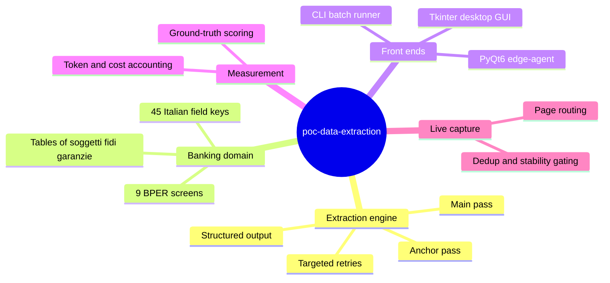

# poc-data-extraction

This project extracts structured fields from screenshots of the BPER credit-management application ("BStore Pratiche" / PEF pages) using Vision Language Models: LLMs that interpret images, not just text. It exists to answer a measurable question for the engineers at Tri-tech solutions: can VLM-based screen reading replace manual re-keying of these banking screens, at what per-field accuracy, and at what per-screen cost? One UI-free engine (**`extraction/`**) does the reading; three front-ends drive it: a CLI batch runner, a Tkinter desktop GUI, and a PyQt6 edge-agent that captures the operator's monitor live.

The mindmap below sketches the project's five concerns at a glance:

## What It Does

You hand it screenshots of the 9 known BPER screen types (`mnt/data/screen 1.png` … `screen 9.png`) and it returns one record per screen covering the 45 keys in `FIELD_KEYS` (**`extraction/fields.py`**): customer identifiers (`ndg`, `denominazione`), practice metadata (`tipo`, `stato`, `fase`, `creazione`, `evidenze`), credit-line data (`n_fido`, `importo_euro`, `scadenza`, …), five tooltip fields, flattened co-holder columns (`ndg_1..4` / `denominazione_1..4` / `ruolo_1..4`), and the 13 "scheda privati" fields (`professione_principale`, `retribuzione_annua_netta`, `score_cgs`, …). Every field carries a value, a confidence score, and evidence text.

The reading is a three-pass algorithm in `ExtractionPipeline` (**`extraction/pipeline.py`**):

1. **Anchor pass**: crops the header strip and extracts only `ndg` + `denominazione`, with an intended confidence gate at ≥ 0.95 (`ANCHOR_CONF_MIN`; the gate is currently ineffective in code: see [Workflows](05-workflows.md#multi-pass-extraction-pipeline)). The anchors lock the customer identity before anything else is read.
2. **Main pass**: sends the full content crop with anchor hints ("NDG atteso: …") and extracts all fields plus the `soggetti` / `fidi` / `garanzie` tables in one structured-output call.
3. **Conditional retry**: re-reads only the screen areas (HEADER / BODY / FOOTER) whose fields came back nullish or below 0.60 confidence, each with its own crop and Italian prompt, capped by `MAX_CALLS_PER_SCREEN`. `pick_best()` in **`extraction/normalization.py`** keeps the winner per field.

After a batch run, each extracted field is classified against a ground-truth CSV as OK / WRONG / MISSING / HALLUCINATED / OK_NULL (**`extraction/evaluation.py`**), and every VLM call's tokens and estimated USD cost are aggregated per screen (**`extraction/vlm_client.py`**, pricing in **`extraction/config.py`**). The edge-agent adds the live path: it watches a monitor, detects which BPER page is on screen, waits for it to hold still, and runs the same pipeline locally (**`edge-agent/workers/capture/bper_capture_worker.py`**). Full traces are in [Workflows](05-workflows.md); the component picture is in [Architecture](04-architecture.md).

## Who It's For

- **Primary: the developers and engineers maintaining and extending this codebase** (Tri-tech solutions). These documents are calibrated for you: the evaluation harness, cost accounting, and debug reports are the project's real deliverables, and the docs assume you will read the code alongside them.
- **Secondary: bank operators**, who use the Italian-language edge-agent UI (`edge-agent/ui/`) to capture screens live with page-by-page guidance. Their needs are served by the UI itself and by the Italian plain-language docs layer in `docs/`, not by this map.

## How It's Built

Python (3.8+ claimed; 3.12/3.13 in practice: **`run_edge_agent.bat`** targets 3.13 first). All LLM access goes through LangChain: `create_chat_model()` in **`extraction/llm_factory.py`** is the single factory that returns an OpenAI or Google Gemini chat model based on `LLM_PROVIDER`, and `.with_structured_output()` binds every call to a Pydantic schema (**`extraction/schemas.py`**). Pillow handles cropping and enhancement (**`extraction/imaging.py`**), pandas loads the ground truth and writes reports (**`extraction/evaluation.py`**). The front-ends use Tkinter (stdlib, `gui_app.py`) and PyQt6 + qt-material (`edge-agent/`); the edge-agent adds `mss` for screen grabs, `imagehash` for frame dedup, and an optional DINOv2 ViT-S/14 page classifier on torch (**`edge-agent/page_classifier.py`**). Dependency-by-dependency detail is in [Tech Stack](03-tech-stack.md).

## Project at a Glance

| Attribute | Value |
|---|---|
| Language | Python (3.8+ claimed, 3.12/3.13 in practice) |
| LLM framework | LangChain (`langchain-openai`, `langchain-google-genai`) |
| Providers | OpenAI (default, `gpt-4o`) or Google Gemini via `LLM_PROVIDER` |
| Project type | Proof of concept: CLI + two desktop GUIs over one library package |
| Entry points | `main.py` (CLI; `--gui` → edge-agent), `gui_app.py` (Tkinter), `edge-agent/edge_agent.py` (PyQt6) |
| Core engine | `extraction/` package, UI-free |
| Live capture | `edge-agent/`: mss, imagehash pHash, DINOv2 or OpenAI Vision page routing |
| Domain | 9 BPER credit-management screens, 45 Italian field keys, 4 canonical pages |
| Persistence | None: in-memory dicts written to JSON/CSV files |
| Configuration | Env vars for the engine (`extraction/config.py`); `edge-agent/config.ini` for the agent |
| Tests / CI / packaging / Docker | None |

## Why This Exists / Context

Manually re-keying data from the BPER credit-management application (practice headers, co-holders, credit lines, guarantees, employment and income data) is slow and error-prone. This POC reads those screens with vision LLMs and, crucially, **measures itself**: per-field accuracy against a ground-truth CSV and per-call cost against a pricing table (`PRICING_PER_1M` in `extraction/config.py`). The value proposition is one shared engine exposed three ways, so model and prompt changes can be compared against a baseline in batch, by hand, or live.

The git history shows how it got here:

- Started as a monolithic `main.py`, then decomposed into the `extraction/` package (commits `ce87bd3`, `699a8db`).
- Custom provider code migrated to LangChain's unified ChatModel abstraction (`37560b9`); configuration simplified to four unified env vars (`6ee9767`) with `.env` loading via python-dotenv (`368b7aa`).
- The edge-agent was originally built against a remote backend (API client, MinIO). The deprecated remote components were removed (`ea04ef7`) and the BPER path consolidated to local-only extraction through `LocalExtractionClient` (`e12af18`; the comment "Rimossa logica di upload remoto" at `edge-agent/workers/capture/bper_capture_worker.py:710`). Remnants of that era survive as unused `[api]` / `[minio]` sections in `edge-agent/config.ini`.
- Recent work added the canonical field/page mapping layer for client-facing export (`e9f22a1`, `5709f66`, `3521ba9`: see **`extraction/canonical_mapping.py`**), qt-material theming (`6e3634b`), LLM-router hallucination guards (`c80f809`), the docs layer and CLAUDE.md audits (`397f17a`, `f5b5a85`), and Windows launcher hardening (`40725a3`, `f74c21e`).
- Branch names record explored directions: `feature/ollama-version` (local models), `feature/image-optimization`, `dev/optimization`, `bug-fix/improove_accuracy`.

Two context questions remain open: who the external consumer of the "canonical" field contract is (`extraction/canonical_mapping.py` mentions "backend/UI/export integration" but no client is named in-repo), and whether the remote ingestion path will ever return. Both are tracked in [Open Questions](08-open-questions.md).

## Scope and Non-Goals

**In scope:**

- Extract ~45 structured fields from the 9 known BPER screen types via the multi-pass VLM pipeline (`extraction/pipeline.py`).
- Evaluate against a ground-truth CSV and report per-field accuracy in RAW and FILTERED variants (`extraction/evaluation.py`).
- Track tokens, latency, and estimated USD per call and per screen (`extraction/vlm_client.py`).
- Capture BPER screens live, route them to a page type, and extract locally (`edge-agent/`).

**Deliberately out of scope:**

- **No remote backend in the BPER path.** Remote upload was removed (`bper_capture_worker.py:710`); `LocalExtractionClient` is the only client the edge-agent uses. The generic-mode `DefaultCaptureWorker` still posts to a `localhost:8081` API that does not exist in this repo: legacy, not scope.
- **No classic OCR.** All reading is VLM-based; there is no Tesseract-style text recognition anywhere.
- **No generalization.** Crop coordinates (`CONTENT_CROP`, `HEADER_IN_CONTENT` in `extraction/config.py`), prompts, and field keys are hardcoded to BPER's screen layouts. This is not a general screenshot-to-data tool.
- **No production infrastructure.** No test suite, CI/CD, `pyproject.toml`, or containerization: validation is manual (run, compare accuracy and cost against a baseline).

> **A note on authority.** Where in-repo docs and code disagree, this map follows the code. Known drift: `CLAUDE.md` describes startup `if/raise` guards (`FIELD_RETRY_MAP` vs `FIELD_KEYS`, `_FIELD_COMPARATORS`) that do not exist in the current `extraction/` code; `README.md` says "18 campi" while `FIELD_KEYS` has 45; a comment at `bper_capture_worker.py:42` says "MobileNetV3" but the classifier is DINOv2 ViT-S/14. Details in [Open Questions](08-open-questions.md).
