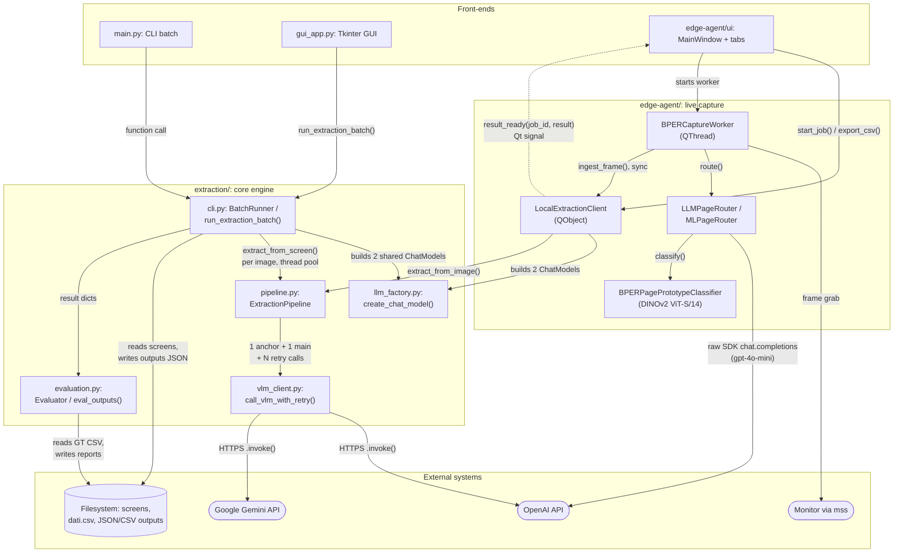

# Architecture

A UI-free extraction core with three interchangeable front-ends. The big idea: **all banking-screenshot intelligence lives in the `extraction/` package, and nothing in that package knows which UI called it.** The CLI batch runner, the Tkinter desktop app, and the PyQt6 edge-agent all reach the same `ExtractionPipeline`, which runs a fixed three-pass VLM sequence (anchor → main → retry) and returns one well-defined result dict. The LLM provider sits behind a one-function factory, so switching OpenAI for Gemini is an environment variable, not a code change.

## Component Diagram

The diagram below follows the two authoritative call chains recorded in the interconnect map's Call Graph (`.codebase-map/_internal/interconnect.md`): the batch chain `CLI/Tkinter → BatchRunner → ExtractionPipeline → call_vlm_with_retry → ChatModel → provider API`, and the live chain `BPERCaptureWorker → LocalExtractionClient.ingest_frame() → ExtractionPipeline → result_ready signal → UI tabs`. Solid arrows are direct calls; the dashed arrow is the Qt cross-thread signal.



Every edge above corresponds to a row in the interconnect map's Call Graph: for example `ExtractionPipeline` is called from `extraction/cli.py:192` and `edge-agent/local_extraction_client.py:49`; `create_chat_model` from `extraction/cli.py:182,187` and `edge-agent/local_extraction_client.py:47-48`; `ingest_frame` from `edge-agent/workers/capture/bper_capture_worker.py:696` only. The legacy generic mode (`DefaultCaptureWorker` POSTing frames to `http://localhost:8081`, a backend that does not exist in this repo) is deliberately omitted from the diagram; see [Layers](#edge-agent-capture--detection-layer).

## Directory Structure

```
poc-data-extraction/
  main.py                       # Entry: .env load + CLI batch; --gui dispatches to the edge-agent
  gui_app.py                    # Entry: standalone Tkinter GUI (no load_dotenv - see Configuration)
  run_edge_agent.bat            # Windows launcher: venv bootstrap + edge-agent start
  prompt_store.py               # Prompt catalog loader (stdlib-only), shared by extraction/ and edge-agent/
  prompts/                      # LLM prompt catalog: one JSON file per prompt, read once at startup
  requirements.txt              # Single flat dependency list for everything

  extraction/                   # ── Core engine (no UI, no Qt) ──
    __init__.py                 # Public API facade (__all__ re-exports)
    config.py                   # Env vars (read at import), crop coords, pricing, retry-area maps
    fields.py                   # FIELD_KEYS (45 keys), CSV_TO_SCHEMA ground-truth mapping
    field_definitions.py        # Canonical display_name + page_key per schema key
    page_definitions.py         # 4 canonical page keys, aliases, PAGE_SHEET_ORDER
    canonical_mapping.py        # build_canonical_field_entries() - client-facing rows
    schemas.py                  # Pydantic: FieldResult, Soggetto, Fido, Garanzia, responses
    prompts.py                  # VLM prompt constants, resolved from the prompts/ catalog at import
    normalization.py            # is_nullish, pick_best, classify_field, dataset_mismatch_guard
    imaging.py                  # normalize_image, crop_relative, PNG encoding, debug crops
    vlm_client.py               # call_vlm / call_vlm_with_retry, per-call cost estimation
    llm_factory.py              # create_chat_model() - the single LLM provider factory
    pipeline.py                 # ExtractionPipeline: anchor → main → retry orchestration
    evaluation.py               # GT loader, eval_outputs, debug report, cost summary
    cli.py                      # BatchRunner, run_extraction_batch() (shared), main()

  edge-agent/                   # ── PyQt6 live-capture app ──
    edge_agent.py               # Entry: .env, qt-material theme, AgentConfig, MainWindow
    config.py / config.ini      # AgentConfig: typed view over the committed INI
    local_extraction_client.py  # QObject bridge: ingest_frame() → ExtractionPipeline
    llm_router.py               # PageRouter base; LLMPageRouter (raw OpenAI SDK); MLPageRouter
    page_classifier.py          # DINOv2 ViT-S/14 prototype matching (degrades without torch)
    image_ops.py                # preprocess_for_ocr (scale, unsharp, autocontrast)
    ui/                         # MainWindow + tabs: capture, results, data table, debug, overlay
    workers/capture/            # BaseCaptureWorker (QThread loop), BPER + Default workers
    assets/templates/bper/      # prompts.json (10 page defs), DINOv2 prototype cache, samples

  mnt/data/                     # screen 1..9.png (tracked); dati.csv expected here but absent
  docs/                   # Italian narrative documentation layer
  .codebase-map/                # This guide
```

## Layers / Modules

### Front-end layer

Three UIs, none of which contain extraction logic.

- **CLI**: **`main.py`** is a thin shim (`load_dotenv()`, then `from extraction import *`; `main.py:7-8,23`) that runs `extraction.cli.main()`: batch over `INPUT_DIR`, print RAW + FILTERED accuracy and per-screen cost, write `poc_outputs_improved.json` + `poc_debug_improved.csv`. `python main.py --gui` instead inserts `edge-agent/` into `sys.path` and launches the Qt app (`main.py:15-20`).
- **Tkinter**: **`gui_app.py`**: image/CSV pickers, provider and model dropdowns fed by `PROVIDER_MODELS` (`extraction/config.py:22-33`), a background thread calling `run_extraction_batch()` (`gui_app.py:238`), then optional evaluation via `load_ground_truth` / `eval_outputs` / `build_debug_report`; the interconnect Call Graph lists `gui_app.py` as a direct caller of each.
- **PyQt6 edge-agent**: the only front-end with its own subsystem (capture, routing, a local bridge client); covered [below](#edge-agent-capture--detection-layer).

CLI and Tkinter share one batch entry point by design: `run_extraction_batch()` in **`extraction/cli.py:282`** owns the `ThreadPoolExecutor` and model construction, and `CLAUDE.md` (Architectural Constraints #8) forbids re-implementing that threading anywhere else.

### Configuration layer

Turns env vars and an INI file into importable constants, detailed in [Configuration](#configuration) below. Key files: **`extraction/config.py`** (env vars, crop coordinates, pricing table, retry-area maps) and **`edge-agent/config.py`** + **`edge-agent/config.ini`**. The critical property: `extraction/config.py` runs all `os.getenv()` calls at module import time (`config.py:8-56`), so configuration freezes the moment `extraction` is first imported, which is why every entry point must load `.env` *before* that import (interconnect Contracts → Implicit, "env must be populated before `extraction.config` import").

### Data-model layer

The single source of truth for what a "field" is.

- **Key files:** **`extraction/fields.py`** (`FIELD_KEYS`, `CSV_TO_SCHEMA`), **`extraction/schemas.py`**, `extraction/field_definitions.py`, `extraction/page_definitions.py`, `extraction/canonical_mapping.py`.
- **Pattern: single source of truth via a dynamically generated schema.** `FieldsModel` is built with `create_model()`: exactly one `Optional[FieldResult]` per key in `FIELD_KEYS` (`extraction/schemas.py:46-49`), so schema/field-list sync holds *by construction* (an invariant in the interconnect map). The formal contracts, per the map's Contracts anchor:
  - `FieldResult` = `{value: Optional[str], confidence: float, evidence_text, section}` (`schemas.py:9-13`): the atom of every extracted field.
  - `ExtractionResponse` = `{fields: FieldsModel, soggetti, fidi, garanzie}` (`schemas.py:54-58`): main-pass and retry-pass shape.
  - `AnchorResponse` = `fields.{ndg, denominazione}` only (`schemas.py:60-65`): anchor-pass shape.
- **Canonical mapping.** Each schema key is statically bound to a display name and one of four canonical page keys (`risultato_ricerca`, `elenco_soggetti`, `gestione_fidi_e_garanzie`, `note_da_richiesta`; `extraction/page_definitions.py:5-28`) via `CANONICAL_FIELD_DEFINITIONS` (`extraction/field_definitions.py:5-186`). `build_canonical_field_entries()` produces the client-facing rows consumed by evaluation, both GUIs, and the edge-agent data table (interconnect Change Impact Radius, `canonical_fields` entry). Full detail in [Data Model](06-data-model.md).

### Imaging layer

- **Key files:** **`extraction/imaging.py`** for the pipeline; **`edge-agent/image_ops.py`** for capture.
- The split is intentional and explains the pipeline's two entry methods. `extract_from_screen(path)` normalizes internally via `normalize_image()` (`extraction/pipeline.py:182-196`); `extract_from_image(img, screen_id)` does **not**, because the edge-agent already ran `preprocess_for_ocr()` upstream (`bper_capture_worker.py:576-583`). The interconnect map records this as a documented-but-unenforced state precondition (`edge-agent/local_extraction_client.py:84-85`): pass a raw image to `extract_from_image()` and normalization is silently skipped.

### LLM layer

The provider-abstraction seam.

- **Key files:** **`extraction/llm_factory.py`** (`create_chat_model()`), **`extraction/vlm_client.py`** (`call_vlm`, `call_vlm_with_retry`, `estimate_cost_usd`).
- **Communicates with:** `BatchRunner.__init__` and `LocalExtractionClient.__init__` each build two shared models (main + anchor) through the factory (interconnect Call Graph: callers at `extraction/cli.py:182,187` and `edge-agent/local_extraction_client.py:47-48`). The pipeline is `call_vlm_with_retry`'s only caller (`extraction/pipeline.py:76,130,274`).
- **Factory contract** (formal in the map): `create_chat_model(provider_name, *, model, api_key=None) -> BaseChatModel` raises `ValueError` for a missing key (`llm_factory.py:41-44`), a provider/model mismatch: a `gemini*` model under provider `openai` or `gpt-*` under `gemini` (`:49-53,59-63`), and an unknown provider (`:77`). Legacy `OPENAI_API_KEY` / `GEMINI_API_KEY` still work with a `DeprecationWarning` (`:10-13,30-40`).
- **Structured-output strategy** is the subtle part, and it is per provider *and* per model family (`extraction/vlm_client.py`): OpenAI uses `.with_structured_output(schema, include_raw=True)` (`:193`); Gemini 1.5 uses `method="json_mode"` with the response schema (`:147`); Gemini 2.0+/3.x get free-form JSON with the schema injected into the prompt plus manual Pydantic validation (`:47-119`), because complex response schemas trigger `INVALID_ARGUMENT` on newer Gemini models. The branch is a substring gate: `_GEMINI_JSON_SCHEMA_MODELS = ("gemini-1.5",)` (`:18`).
- **Error taxonomy** (implicit contract, review priority in the map): `ValueError` means "do not retry". All parse/validation failures are raised as `ValueError` (`vlm_client.py:39,44,95,153,200`); `call_vlm_with_retry()` re-raises them immediately and retries everything else with capped exponential backoff, max 3 attempts (`:252-258`). Any new exception type introduced in `call_vlm` silently becomes "transient, retry 3x".
- **Cost side-effect contract:** every call populates `_meta` with `model`, tokens, `latency_ms`, `estimated_cost_usd` (`vlm_client.py:107-116,167-176,214-223`); the pipeline aggregates into `_meta_agg`. One caveat from the map: `estimate_cost_usd()` returns `0.0` for any model missing from `PRICING_PER_1M` (`vlm_client.py:23-26`, table at `extraction/config.py:36-49`), so cost reports can under-count without any signal.
- The one exception to the single-factory rule: the edge-agent's `LLMPageRouter` uses the raw `openai` SDK with its own key and model from `config.ini` (`edge-agent/llm_router.py:200-209`): page routing only, never extraction.

### Orchestration layer

Where the multi-pass strategy lives.

- **Key files:** **`extraction/pipeline.py`** (`ExtractionPipeline`), **`extraction/cli.py`** (`BatchRunner`, `run_extraction_batch()`).
- **The pass sequence is an ordering contract** (interconnect Contracts → Implicit): anchor pass → main pass → anchor merge → `tipo` normalize → conditional retry → coherence check → soggetti flatten → canonical build → status (`extraction/pipeline.py:109-178`). Downstream steps assume prior mutations: retry selection reads fields with anchors already merged, and the coherence check runs after retries so tooltips reflect the best pass. The anchor pass gates on `ANCHOR_CONF_MIN` (0.95) with an optional early exit (`STOP_ON_ANCHOR_UNCERTAIN`); retries fire only for nullish or `<0.60`-confidence fields, grouped by crop area (HEADER/BODY/FOOTER, `extraction/config.py:72-95`), capped at `MAX_CALLS_PER_SCREEN - 2` applied in `AREA_TO_FIELDS` declaration order (the default is derived from `2 + len(AREA_TO_FIELDS)` so the cap covers one area each, see [ADR 0004](../docs/adr/0004-budget-retry-derivato-dalle-aree.md)), with per-field winners chosen by `pick_best()` (non-null beats null; ties go to higher confidence, `extraction/normalization.py:87-96`). See [Workflows](05-workflows.md) for the step-by-step trace.
- **Thread model:** `BatchRunner` builds one pipeline and two ChatModels once, then shares them across the `ThreadPoolExecutor` (`extraction/cli.py:159-163,181-192,233`); the pipeline's retry pass uses a nested executor (`pipeline.py:284`). Correctness rests on LangChain ChatModels being thread-safe for concurrent `.invoke()`: documented in comments, not verified in-repo (interconnect Assumptions). Batch callbacks `on_complete`/`on_error` run on the *calling* thread, inside the `as_completed` loop (`cli.py:235-266`); note the map's finding that error semantics differ by mode: sequential re-raises, parallel only prints, when no `on_error` is supplied.
- **Provenance:** `_field_sources` records which pass won each field (`ANCHOR_HEADER` / `CONTENT_MAIN` / `RETRY_{HEADER|BODY|FOOTER}`), surfaced in the debug report.
- **Known divergences worth carrying in your head** (all from the interconnect map, verified against code): the anchor confidence gate is currently *ineffective*: the `ndg`/`den` dicts that feed the hint prompt, early exit, and merge are copied *before* the gate runs, and `safe_set_field(..., None)` cannot overwrite an existing non-null value (`pipeline.py:87-96` vs `normalization.py:78-79`), so low-confidence anchors are not actually filtered downstream despite `CLAUDE.md`'s claim. The soggetti flatten runs after retry merge and overwrites `ndg_1..ruolo_4` unconditionally without updating `_field_sources` (`pipeline.py:161-166`). And a failed retry is non-fatal but its `_meta` is not appended, so `_meta_agg.calls` undercounts (`pipeline.py:288-294`). Also flagged: 6 fields (`creazione` and the 5 `tooltip_*`) belong to no retry area and can never be retried (`config.py:69-82`), and the startup `if/raise` guards described in `CLAUDE.md` do not exist in code.

### Evaluation layer

- **Key files:** **`extraction/evaluation.py`** (`Evaluator`, `load_ground_truth`, `eval_outputs`, `build_debug_report`, `print_cost_summary`), supported by **`extraction/normalization.py`**.
- Ground-truth loading auto-detects column names and raises `ValueError` when no candidate matches (formal contract, `evaluation.py:26-31,38-52`). `classify_field()` labels each field OK / WRONG / MISSING / HALLUCINATED / OK_NULL (`normalization.py:113-148`), with domain-specific comparison rules (numeric normalization for `importo_euro`/`ndg`/`n_fido` keys, fuzzy ratio ≥ 0.85 for long text; interconnect Domain Rules). `dataset_mismatch_guard()` (`normalization.py:174-189`) flags whole screens whose NDG/DENOMINAZIONE disagree with ground truth, which is why accuracy is reported twice: RAW and FILTERED.
- A structural quirk from the map: two functions named `build_debug_report` exist with different arities: module-level `(outputs, gt, out_csv_path)` used by `gui_app.py:274`, and `Evaluator.build_debug_report(outputs, out_csv_path)` used by `extraction/cli.py:346`.

### Edge-agent capture & detection layer

Live-screen capture, page detection, and a thread-crossing bridge into the core.

- **Key files:** **`edge-agent/workers/capture/bper_capture_worker.py`**, **`edge-agent/local_extraction_client.py`**, `edge-agent/llm_router.py`, `edge-agent/page_classifier.py`, `edge-agent/ui/`.
- **Two seams connect it to the core:**
  1. **`ingest_frame()`**: a duck-typed integration contract. `BPERCaptureWorker._upload_page()` requires only `hasattr(api_client, "ingest_frame")` (`bper_capture_worker.py:693`) and calls `ingest_frame(job_id, img, page_no, page_type, confidence, fields_json)` with exactly those keywords (`local_extraction_client.py:65-73`, caller at `bper_capture_worker.py:696-703`; `fields_json` is accepted but unused). The client then runs `ExtractionPipeline.extract_from_image()` synchronously.
  2. **`result_ready(str, dict)`**: the only channel back to the UI (`local_extraction_client.py:42`). Extraction runs inside the capture `QThread`; the signal carries a shallow-copied result dict across the thread boundary to three connected tabs (`capture_tab.py:212`, `extraction_results_tab.py:65`, `data_table_tab.py:98`). `_results` mutations are lock-guarded; reads return copies (interconnect Invariants).
- **Patterns:** Strategy for page routing: `PageRouter` base with `LLMPageRouter` (raw OpenAI SDK, page definitions from `assets/templates/bper/prompts.json`) and `MLPageRouter` (wraps the DINOv2 prototype classifier); `hybrid` tries LLM first, ML fallback. Observer via Qt signals (`tick`, `error`, `llm_debug`, `result_ready`). Graceful degradation: the classifier self-disables to `(None, 0.0)` without torch (`page_classifier.py:9-19`), and a hallucination guard rejects router page names not defined in `prompts.json` (`llm_router.py:225-230`).
- **Rough edges recorded in the map:** `ingest_frame()` blocks the capture FPS loop for the whole multi-call extraction (`local_extraction_client.py:77-79`); `force_capture()` executes on the UI thread while sharing the worker's unlocked `mss` context and state (`capture_tab.py:404`, `bper_capture_worker.py:739`); and re-ingesting the same page appends duplicate results: the batch-side dedup exists but is disabled pending validation (`extraction/cli.py:268-273`). The legacy `DefaultCaptureWorker` (generic mode) still POSTs frames to a nonexistent `localhost:8081` backend and is best treated as dead code.

## Data Flow

The system's spine is the **per-screen result dict** built in `extract_from_image()` (`extraction/pipeline.py:104-180`), a structural contract in the interconnect map. It carries: `screen_id`; `fields` (schema key → FieldResult-shaped dict); `soggetti` / `fidi` / `garanzie` lists; `canonical_fields` (sorted client-facing rows); `_attempts` (one `_meta` per VLM call); `_meta_agg` (calls, tokens, `estimated_cost_usd`, latency); `_field_sources`; and `_status` ∈ {`OK`, `ANCHOR_UNCERTAIN`}. `LocalExtractionClient` adds `_page_type` / `_page_no` / `_page_confidence`, and on failure substitutes a *reduced* dict `{screen_id, fields:{}, _status:"ERROR", _error}` with no `_meta_agg` or `canonical_fields` (`local_extraction_client.py:89-98`), which is why every consumer reads defensively with `or {}` and falls back from `canonical_fields` to `fields`.

**Batch path (CLI / Tkinter):**
1. Input: screenshot files in `INPUT_DIR` plus the ground-truth CSV (CLI hard-requires it; `extraction/cli.py:315-316`).
2. `BatchRunner` builds the two shared ChatModels once, then dispatches `extract_from_screen(path)` per image across the thread pool.
3. Inside the pipeline: `normalize_image()` → content crop → anchor pass (header strip, NDG + DENOMINAZIONE) → main pass (full crop, anchor hints in the prompt) → conditional area retries → coherence repairs → flatten/canonicalize.
4. Outputs land on disk (`poc_outputs_improved.json`), then `Evaluator` scores against ground truth (RAW + FILTERED) and writes the debug CSV and cost summary.

**Live path (edge-agent):**
1. Input: a real-time monitor grab via `mss` at the configured FPS.
2. `BPERCaptureWorker` preprocesses (`preprocess_for_ocr`), pHash-dedups, routes the page type (LLM/ML/hybrid), and requires 2 seconds of stable detection before acting.
3. On a stable, recognized page it calls `ingest_frame()`, which runs `extract_from_image()` (normalization intentionally skipped) and produces the same result dict.
4. `result_ready` carries the dict to the results tree, data-table spreadsheet, and capture counter. Note the map's finding that edge-agent screen IDs (`"{Friendly} - pag. {n}"`, `local_extraction_client.py:80-81`) never match ground-truth keys (file stems like `"screen 1"`), so the evaluation path is only meaningful for CLI/Tkinter outputs.

Because so much hangs off this one shape, the interconnect map's Change Impact Radius enumerates every consumer that breaks if it changes: `extraction/evaluation.py`, `extraction/cli.py`'s scoring helpers, `gui_app.py`, and the three edge-agent tabs. The same goes for `FIELD_KEYS`: adding a field ripples through the schema (automatic), the retry-area map (manual, or the field is never retried), `CSV_TO_SCHEMA`, the canonical definitions, and the Italian prompts.

## Configuration

Configuration is split by subsystem, with no shared config file.

- **Extraction core: environment variables, read once at import** (`extraction/config.py:8-56`). Provider and credentials: `LLM_PROVIDER` (`openai` default / `gemini`), `LLM_API_KEY` (required: the factory raises `ValueError` without it), `LLM_MODEL` (`gpt-4o`), `LLM_MODEL_ANCHOR`, `LLM_THINKING_LEVEL` (applied only to models whose name contains "thinking"). Behavior: `INPUT_DIR` (`mnt/data`), `PARALLEL_WORKERS` (4), `PARALLEL_ENABLED`, `MAX_CALLS_PER_SCREEN` (derived: `2 + len(AREA_TO_FIELDS)` = 5), `ANCHOR_CONF_MIN` (0.95), `STOP_ON_ANCHOR_UNCERTAIN`, `DEBUG_MODE`, `DEBUG_SAVE_CROPS`. `.env` is auto-loaded in `main.py:7`, `edge-agent/edge_agent.py:9-13`, and `edge-agent/local_extraction_client.py:22-25`, but **not** in `gui_app.py`, which imports `extraction` assuming the environment is already set (interconnect Assumptions; the import-time snapshot makes load order load-bearing). The full variable table lives in the [Configuration Guide](10-configuration-guide.md).
- **Edge-agent: an INI file**, **`edge-agent/config.ini`**, parsed into the typed `AgentConfig` (`edge-agent/config.py:8,134`). `[agent]` sets fps, `router=llm`, `monitor_index=1`, `window_title_contains` (used by `frame_normalize.find_window_rect()` to crop the grab down to the app window), the capture-border overlay, and `route_retry_seconds`; `[llm]` sets the router's provider/endpoint/model (the shipped file: `gemini`, Google's OpenAI-compatible endpoint, `gemini-3.6-flash`) and timeout; `[debug] show_llm_tab` gates the `llm_debug` signal (the Debug tab itself additionally needs the `--debug` CLI flag, `edge_agent.py:51`). The `[api]`, `[minio]`, and `[dataset]` sections are remnants of the removed remote backend and are consumed by no active BPER-path code. Router key precedence, provider-aware via `AgentConfig.resolve_llm_settings()`: `config.ini [llm] api_key` when non-blank, else for `gemini` `GEMINI_API_KEY` → `GOOGLE_API_KEY` → `LLM_API_KEY`, for `openai` `OPENAI_API_KEY` → `LLM_API_KEY`. **Security note:** an OpenAI API key was previously committed at `config.ini`; it has since been scrubbed from git history (2026-07-21) and the line now ships blank, with `AgentConfig` treating any `REDACTED*` value as empty; the original key must be treated as compromised and rotated. Be aware that `AgentConfig.save()` would re-persist whatever key is configured back to disk if it were ever called (`edge-agent/config.py:326-332`, currently uncalled).
- **Committed asset config:** `edge-agent/assets/templates/bper/prompts.json` defines the 10 recognizable pages (names, hints, fields) and is read independently by three consumers: the LLM router, the capture worker, and the force-capture combo (interconnect Integration Hot-Spots flags the triple-read as a drift risk). `bper_page_prototypes.json` caches the DINOv2 prototype embeddings.
- **Hard-coded constants that behave like configuration:** the crop rectangles `CONTENT_CROP` / `HEADER_IN_CONTENT` / `RETRY_AREAS` and the field-to-area map (`extraction/config.py:59-82`), the retry-confidence threshold 0.60 (`extraction/pipeline.py:255`), and the pricing table `PRICING_PER_1M` (`extraction/config.py:36-49`).

There are no feature flags in the formal sense and no dev/staging/prod profiles; behavior varies only through env vars, `config.ini`, GUI inputs, and the `--debug` flag.

---

See also: [Tech Stack](03-tech-stack.md) for the dependencies behind each layer, [Features](02-features.md) for what the system delivers, [Workflows](05-workflows.md) for end-to-end traces of both data paths, and [Data Model](06-data-model.md) for the field schema and result-dict detail.
