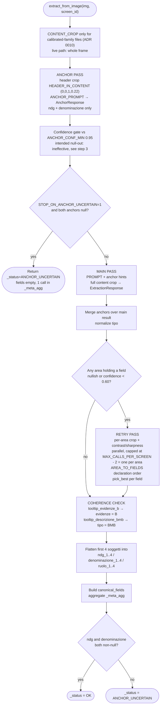
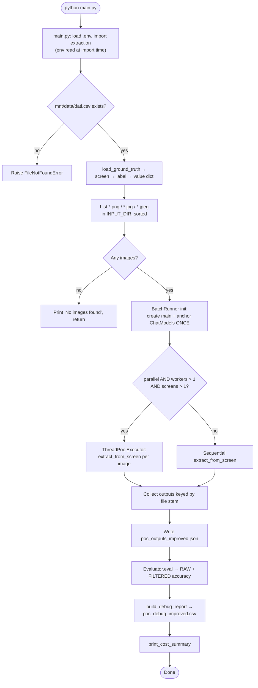
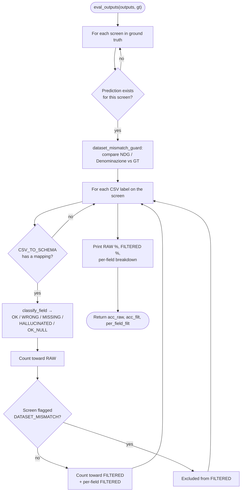
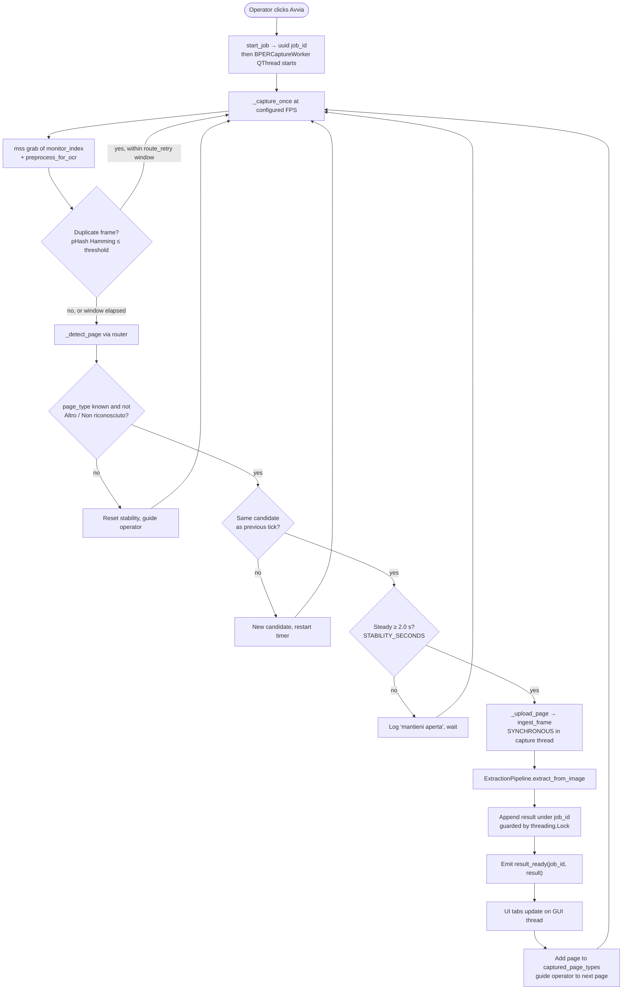
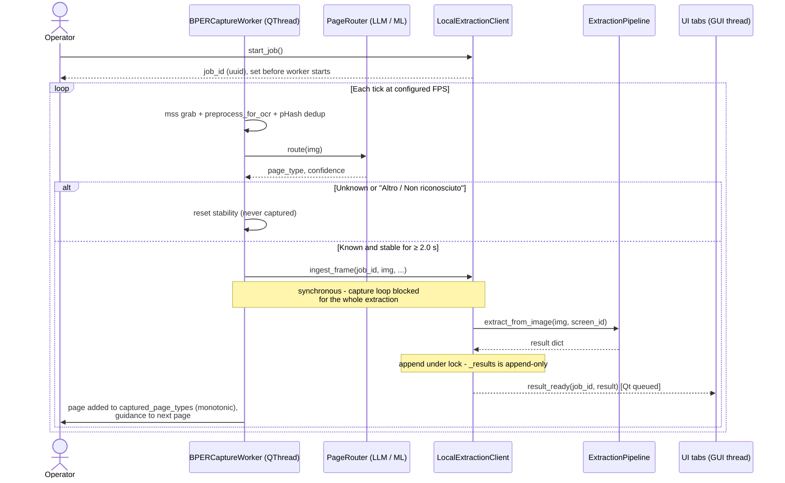
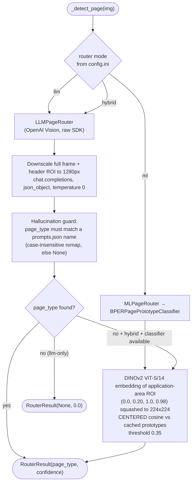

# Workflows

Everything this project does flows through one core engine: the multi-pass extraction pipeline in `extraction/pipeline.py`. Three front-ends wrap it. The CLI (`main.py`) batch-processes a folder of screenshots and scores the results against a ground-truth CSV. The Tkinter GUI (`gui_app.py`) does the same on demand for user-picked files. The PyQt6 edge-agent (`edge-agent/edge_agent.py`) watches a live monitor, detects which BPER page is on screen, and runs extraction frame-by-frame as the operator navigates the application.

The workflows below are ordered from the engine outward: the pipeline itself, the CLI batch run that exercises it, the accuracy evaluation that grades it, the edge-agent live-capture loop, and the page-routing decision that gates each captured frame. For how the pieces fit together structurally, see [Architecture](04-architecture.md); for the user-facing capabilities, see [Features](02-features.md).

## Multi-Pass Extraction Pipeline

Every screenshot (whether it arrives from the CLI, the Tkinter GUI, or the edge-agent) is processed by `ExtractionPipeline.extract_from_image()` in **`extraction/pipeline.py`**. The pipeline makes up to `MAX_CALLS_PER_SCREEN` (default `2 + len(AREA_TO_FIELDS)` = 5, derived in `extraction/config.py` right after `AREA_TO_FIELDS`) Vision-LLM calls per screen in three stages (anchor, main, conditional retry) and merges the outputs into a single result dict. The design exists because one LLM pass over a dense banking screen misses or misreads fields; the anchor pass targets the two identity fields first, and the retry pass re-attempts only the areas that came back weak.

**Trigger:** `extract_from_screen(path)` (`extraction/pipeline.py:182-187`, used by CLI and Tkinter GUI; opens the file, runs `normalize_image()`, derives `screen_id` from the file stem) or `extract_from_image(img, screen_id)` (`extraction/pipeline.py:104`, used by the edge-agent; the frame is already preprocessed upstream, so `normalize_image()` is intentionally bypassed, `edge-agent/local_extraction_client.py:84-86`).

**Outcome:** a result dict with per-field values, the `soggetti`/`fidi`/`garanzie` tables, `canonical_fields` (client-facing entries), cost/token metadata in `_meta_agg`, per-field provenance in `_field_sources`, and `_status` of `OK` or `ANCHOR_UNCERTAIN`. The dict's full shape is documented in [Data Model](06-data-model.md#result-dict).



### Step-by-step

**1. Content crop.** `extract_from_image` crops the image to `CONTENT_CROP = (0.18, 0.12, 0.98, 0.98)` (`extraction/config.py:59`), removing the BPER left navigation sidebar so the model only sees the data region (`extraction/pipeline.py:106`).

**2. Anchor pass.** `extract_anchors()` crops the header strip `HEADER_IN_CONTENT = (0.00, 0.00, 1.00, 0.22)` (`extraction/config.py:60`) and sends it with `ANCHOR_PROMPT` to extract only `ndg` and `denominazione` (`extraction/pipeline.py:70-102`). The prompt encodes two domain rules: NDG and Denominazione sit at the visual center of the practice header, and the operator name at top-right must be ignored (`prompts/extraction_anchor.json`). The prompt also instructs the model to return `null` when uncertain and to set `confidence >= 0.95` only when the value is clearly legible (`prompts/extraction_anchor.json`).

**3. Anchor confidence gate: intended vs. actual.** The code intends to null out anchors below `ANCHOR_CONF_MIN` (0.95, `extraction/config.py:56`), and CLAUDE.md documents it that way. In practice the gate is a no-op. The returned `ndg`/`den` dicts are fresh copies produced by `safe_field()` *before* the gate runs (`extraction/pipeline.py:87-88` vs `:91-96`), and the gate's `safe_set_field(..., value=None)` cannot null an existing non-null value anyway, because of the guard `if value is not None or f.get("value") is None` (`extraction/normalization.py:78-79`). It is the pre-gate copies that feed everything downstream: the `STOP_ON_ANCHOR_UNCERTAIN` early exit (`extraction/pipeline.py:112-113`), the hint prompt (`:205-208`), and `_merge_anchors` (`:212-216`). Net effect: **a low-confidence anchor still flows downstream at full strength**; the only null-on-uncertain behavior actually in force is the prompt instruction itself. The early exit therefore triggers only when the model itself returned null values. With `STOP_ON_ANCHOR_UNCERTAIN=1` and both anchors null, the pipeline returns `_status="ANCHOR_UNCERTAIN"` with empty `fields`, one `_attempts` entry, and no `canonical_fields` key (`extraction/pipeline.py:112-124`).

**4. Main pass.** `_build_anchor_hint_prompt()` appends the anchor values to the base `PROMPT` as hints (`"NDG atteso: {value}"`, `"Denominazione attesa: {value}"`) so the main call is primed with the identifiers (`extraction/pipeline.py:127`, `:202-209`). The full content crop is sent and parsed into an `ExtractionResponse`: all 45 scalar fields plus the `soggetti`, `fidi`, and `garanzie` arrays in one call (`extraction/pipeline.py:130-138`). Ordering is load-bearing here: the anchor pass must complete before the main prompt is built, because the main prompt embeds its output. The whole per-screen sequence (anchor → main → merge → tipo-normalize → retry → coherence → flatten → canonical → status) is enforced only by sequential code order (`extraction/pipeline.py:109-178`).

**5. Merge and tipo normalization.** `_merge_anchors()` overwrites the main pass's `ndg`/`denominazione` with any non-null anchor value and records the source as `ANCHOR_HEADER` (`extraction/pipeline.py:211-216`). `_postprocess_tipo()` then canonicalizes `tipo`: the synonyms `mutui spesa`, `mutuo spesa`, and `bpi mutui` (case-insensitive) all map to `BPI Mutui` (`extraction/normalization.py:10-23`, applied at `extraction/pipeline.py:146` and again per retry candidate at `:298-299`).

**6. Conditional retry.** `_retry_areas()` scans the three functional areas (`HEADER`, `BODY`, `FOOTER` (`extraction/config.py:63-82`)) and flags any area containing a field that is nullish or below 0.60 confidence (`extraction/pipeline.py:251-257`; the 0.60 is hardcoded). Each flagged area gets a dedicated crop (with extra contrast/sharpness enhancement for `HEADER` and `BODY`, `:267-272`) and an area-specific Italian prompt (`FIELD_RETRY_PROMPTS`, `extraction/prompts.py:23-27`, texts in `prompts/extraction_retry_*.json`), run in a nested `ThreadPoolExecutor` (`:284`). The cap is `max(0, MAX_CALLS_PER_SCREEN - 2)` retries: one call each reserved for anchor and main. The cap is applied to the area list in `AREA_TO_FIELDS` **declaration order** (`[a for a in AREA_TO_FIELDS if a in areas_to_retry][:allowed_retries]`), not alphabetically: `HEADER` owns the identity fields that drive `_status` and the dataset-mismatch guard, so it must be retried before the budget runs out. With the derived default (`2 + len(AREA_TO_FIELDS)` = 5) the cap is 3 and covers every area, so none is dropped. Lowering `MAX_CALLS_PER_SCREEN` restores the silent drop, and it falls on the *trailing* areas: that is how `FOOTER`, which owns `note_della_richiesta`, was never re-read on the Note da Richiesta page ([ADR 0004](../docs/adr/0004-budget-retry-derivato-dalle-aree.md)). Per field, `merge_field_sources()`/`pick_best()` choose the winner: non-nullish beats nullish; on a tie the current value wins at equal confidence (`extraction/normalization.py:87-108`); `_field_sources` flips to `RETRY_{AREA}` only when the retry candidate wins. Tables are merged from the `BODY` retry only, preferring more rows, then higher mean confidence (`extraction/pipeline.py:225-241`, a domain rule: a longer soggetti/fidi/garanzie table is assumed more complete).

**7. Coherence check.** Two domain rules repair fields from their tooltips, after retries so tooltips reflect the best pass (`extraction/pipeline.py:311-328`):
- If `tooltip_evidenze_b` has a value and `evidenze` is nullish or purely numeric, `evidenze` is forced to `"B"` (`:317-322`).
- If `tooltip_descrizione_bmb` has a value and `tipo` is null, `tipo` is set to `"BMB"` (`:324-328`).

**8. Soggetti flattening.** The first four `soggetti` rows are flattened into `ndg_1..4` / `denominazione_1..4` / `ruolo_1..4` for CSV-style evaluation (`extraction/pipeline.py:160-166`). The domain caps co-holders at 4 flat slots. This step runs *after* the retry pass and overwrites unconditionally: those twelve keys are retryable `BODY` fields (`extraction/config.py:73-76`), so a `BODY` retry winner for `ndg_2` is silently replaced by whatever `soggetti[1].ndg` holds (even `None`) and `_field_sources` is not updated for them.

**9. Canonical fields and status.** `build_canonical_field_entries()` converts every field into a client-facing entry with display name, page key, and page name (`extraction/canonical_mapping.py:20-42`). `_status` is `OK` if and only if both `ndg` and `denominazione` hold non-null values at the end (`extraction/pipeline.py:172-178`).

The same pipeline as a call sequence, showing where each VLM call happens:

```mermaid
sequenceDiagram
    participant Caller as Caller (CLI / GUI / edge-agent)
    participant Pipe as ExtractionPipeline
    participant VLM as call_vlm_with_retry
    participant API as OpenAI / Gemini API (HTTPS)

    Caller->>Pipe: extract_from_image(img, screen_id)
    Note over Pipe: crop CONTENT_CROP, then HEADER_IN_CONTENT
    Pipe->>VLM: ANCHOR_PROMPT + header crop (AnchorResponse)
    VLM->>API: invoke (structured output)
    API-->>VLM: ndg, denominazione + confidence
    VLM-->>Pipe: anchors + _meta
    Note over Pipe: 0.95 gate intended but ineffective;<br/>ungated copies feed hints and merge
    Pipe->>VLM: PROMPT + anchor hints + content crop (ExtractionResponse)
    VLM->>API: invoke (structured output)
    API-->>VLM: 45 fields + soggetti/fidi/garanzie
    VLM-->>Pipe: main result + _meta
    Note over Pipe: merge anchors, normalize tipo
    Pipe->>VLM: per-area retry prompts (parallel)
    Note over Pipe,API: invariant: total calls per screen ≤ MAX_CALLS_PER_SCREEN<br/>(1 anchor + 1 main + at most one retry per AREA_TO_FIELDS area)
    API-->>VLM: re-extracted fields
    VLM-->>Pipe: candidates → pick_best per field
    Note over Pipe: coherence check → flatten soggetti (overwrites retry winners)<br/>→ canonical_fields → _status
    Pipe-->>Caller: result dict (_meta_agg, _field_sources, _status)
```

### Error handling and edge cases

- **Transient vs. permanent failures.** `call_vlm_with_retry()` retries up to 3 times with capped backoff (`min(8.0, 2**i * 0.8) + 0.05*i` seconds) for anything *except* `ValueError`, which is re-raised immediately (`extraction/vlm_client.py:229-258`). All parse/validation failures are deliberately raised as `ValueError` (`extraction/vlm_client.py:39,44,95,153,200`), so the taxonomy is: `ValueError` = permanent, everything else = transient. Any new exception type introduced in `call_vlm` silently becomes "retry 3x".
- **A failed retry is non-fatal.** The pipeline prints `Warning: retry {area} for {screen} failed (keeping main-pass results)` and keeps main-pass values (`extraction/pipeline.py:288-292`). The failed call's `_meta` is never appended (`:294` is reached only on success), so `_meta_agg.calls` undercounts failed attempts even though earlier retry-wrapper attempts may have been billed.
- **Six fields are never retried.** `creazione` and the five `tooltip_*` fields belong to no retry area (`extraction/config.py:69-82` vs `extraction/fields.py:12-54`), so a miss in the main pass is final for them, except where the coherence check fills `evidenze`/`tipo` as a side effect. No startup guard checks this coverage.
- **Structured output varies by provider.** OpenAI uses `.with_structured_output(schema, include_raw=True)`; `gemini-1.5*` uses json_mode with the schema; Gemini 2.0+/3.x get the JSON schema injected into the prompt and are Pydantic-validated manually, because complex `response_schema` payloads trigger `INVALID_ARGUMENT` (`extraction/vlm_client.py:15-18`, `:47-119`, `:134-183`).

## CLI Batch Extraction

The canonical end-to-end run: process every screenshot in a directory, persist JSON, and print accuracy and cost. The Tkinter GUI reuses the same machinery: both call `run_extraction_batch()` / `BatchRunner` in **`extraction/cli.py`** (CLAUDE.md constraint: never duplicate this threading logic).

**Trigger:** `python main.py`. `main.py:7-8` loads `.env` *before* `from extraction import *`; this ordering matters because `extraction/config.py:8-56` reads all env vars at import time. Then `extraction.cli.main()` runs (`extraction/cli.py:314`).

**Outcome:** `mnt/data/poc_outputs_improved.json` (full result dicts), `mnt/data/poc_debug_improved.csv` (per-(screen, field) audit rows, `;`-separated, `utf-8-sig`), console RAW + FILTERED accuracy, and a per-screen cost summary.



### Step-by-step

**1. Ground truth is mandatory.** `main()` raises `FileNotFoundError` if `GROUND_TRUTH_CSV` (`INPUT_DIR/dati.csv`) is missing (`extraction/cli.py:315-316`). The repo tracks the nine screenshots but not `dati.csv` (`/mnt` is gitignored), so a fresh clone raises here until the CSV is supplied; see [Open Questions](08-open-questions.md).

**2. Load ground truth.** `load_ground_truth()` builds a `{screen_id: {csv_label: value}}` dict, auto-detecting screen/key/value columns among several accepted spellings (`extraction/evaluation.py:33-69`).

**3. Enumerate screenshots.** Every `.png`/`.jpg`/`.jpeg` in `INPUT_DIR`, sorted lexically (`extraction/cli.py:322-327`), not limited to screens named in the CSV. `screen_id` is the file stem (`:225`), so `a.png` and `a.jpg` would silently collide in the outputs dict.

**4. Build models once.** `BatchRunner.__init__` creates exactly two LangChain ChatModels via `create_chat_model()` (main and anchor) and one shared `ExtractionPipeline` (`extraction/cli.py:181-197`). LangChain ChatModels are assumed thread-safe and shared across all workers (comment at `:181`; docstring at `extraction/pipeline.py:50-51`); this is documented, not verified in-repo.

**5. Extract, in parallel when worthwhile.** A `ThreadPoolExecutor` is used only when `parallel` is on, `max_workers > 1`, and there is more than one existing image; otherwise the loop is serial (`extraction/cli.py:229-266`). The CLI passes `PARALLEL_ENABLED` / `PARALLEL_WORKERS` (defaults `1` / `4`, `extraction/config.py:11-12`). Missing files are warned and skipped (`:214-217`).

**6. Persist and score.** Outputs go to `poc_outputs_improved.json` (`extraction/cli.py:337-340`), then `Evaluator.eval()`, `Evaluator.build_debug_report()`, and `print_cost_summary()` run (`:343-347`).

The Tkinter path differs only at the edges: `gui_app.py:225-226` starts a worker thread that calls `run_extraction_batch()` with the GUI-entered API key, provider, and main model (`gui_app.py:238-247`, `max_workers=min(len(images), 12)`), writes `poc_outputs_gui.json` / `poc_results_gui.csv`, and (if a GT CSV was selected) runs `eval_outputs()` and `build_debug_report()` (`gui_app.py:250-275`). Two caveats: the GUI never passes `model_anchor`, so the anchor model falls back to the env-derived `LLM_MODEL_ANCHOR` (a provider mismatch raises in `extraction/llm_factory.py:59-63` when Gemini is selected in the dropdown), and `gui_app.py` performs no `load_dotenv`; it assumes env vars are already exported. See [Getting Started](07-getting-started.md) for running each interface.

### Error handling and edge cases

- **Error semantics differ by mode.** In parallel mode a worker exception without an `on_error` callback prints `ERROR extracting {screen}` and the batch continues (`extraction/cli.py:246-251`). In serial mode without a callback it re-raises and aborts the batch (`:261-266`).
- **Callbacks run on the calling thread.** `on_complete`/`on_error` fire inside the `as_completed` loop on the thread that called `BatchRunner.run()`, not on workers (`extraction/cli.py:235-266`).
- **Same-page dedup is implemented but disabled.** `_deduplicate_same_page_outputs()` (`extraction/cli.py:92-152`) would keep one result per canonical page, but the call site is commented out: `# TEMP TEST: keep all outputs until page_key mapping is validated` (`:268-273`). Its confidence check (`_is_confident_output`, `:77-89`) is, incidentally, the only code that actually enforces `ANCHOR_CONF_MIN` on final values.

## Accuracy Evaluation

After a batch run, the evaluator grades each extracted field against ground truth and reports two accuracy numbers plus a per-(screen, field) audit trail. Two numbers exist to separate genuine extraction errors from screens matched to the wrong ground-truth row.

**Trigger:** `Evaluator.eval()` / `Evaluator.build_debug_report()` from the CLI (`extraction/cli.py:343-346`); `eval_outputs()` / module-level `build_debug_report()` from the GUI (`gui_app.py:266-274`, note the two `build_debug_report` callables have different arities: the module function takes `(outputs, gt, path)`, the method takes `(outputs, path)`, `extraction/evaluation.py:125-129` vs `:275-277`).

**Outcome:** console RAW and FILTERED overall accuracy, a per-field FILTERED breakdown, and the debug CSV.



### Step-by-step

**1. Mismatch guard per screen.** `dataset_mismatch_guard()` compares predicted `ndg`/`denominazione` against the GT row: NDG numerically normalized, Denominazione text-normalized (`extraction/normalization.py:174-189`). This encodes the core domain rule: **NDG + DENOMINAZIONE are the identity anchors of a practice; if either disagrees with ground truth, the whole screen is flagged `DATASET_MISMATCH` and excluded from FILTERED metrics.** The anchor value may also be satisfied from the `soggetti` table when the header field is null (`_resolve_anchor_value`, `:162-172`).

**2. Field classification.** `classify_field()` returns one of five statuses (`extraction/normalization.py:113-148`): `OK_NULL` (both empty), `MISSING` (GT has a value, prediction null), `HALLUCINATED` (GT null, prediction has a value), and `OK`/`WRONG` for the both-present case. Comparison rules are domain-specific: any field whose key *contains* `importo_euro`, `ndg`, or `n_fido` is compared after currency/thousands normalization (`,`→`.`, strip `€` and spaces, `:127-133`, `norm_number_str` at `:40-55`; the substring semantics extend this to `ndg_1..4`); text longer than 20 characters passes with a `SequenceMatcher` ratio ≥ 0.85 (`:141-146`). The nullish vocabulary is `""`, `"n/d"`, `"nd"`, `"---"`, `"null"`, `"none"`, `"nan"` (`:28-32`).

**3. Two-variant accuracy.** Every classified field counts toward RAW; only fields on non-mismatched screens count toward FILTERED and the per-field breakdown (`extraction/evaluation.py:96-104`).

**4. Debug report.** One row per (screen, GT label) with predicted value, confidence, evidence text, status, the producing pass from `_field_sources` (`source_attempt` column), and per-screen cost metadata; on a flagged screen every status is overwritten with `DATASET_MISMATCH` (`extraction/evaluation.py:141-170`). Written with `sep=";"` and `utf-8-sig` (`:172-177`).

### Error handling and edge cases

- **Unrecognizable CSV columns fail loudly**: `_find_column()` raises `ValueError` (`extraction/evaluation.py:26-31`).
- **Unmapped GT labels are skipped silently** during scoring (`extraction/evaluation.py:88-90`); `CSV_TO_SCHEMA` even carries whitespace-variant keys like `"Evidenze "` to absorb dirty headers (`extraction/fields.py:65`).
- **Edge-agent results cannot be evaluated this way.** `ingest_frame` builds screen IDs like `"{Friendly} - pag. {n}"` (`edge-agent/local_extraction_client.py:80-81`) while GT keys are file stems like `"screen 1"`; the join never matches, so evaluation is meaningful only for CLI/Tkinter outputs.

## Edge-Agent Live Capture (BPER Mode)

The edge-agent watches a live monitor and extracts as the operator navigates BPER. It is the most stateful workflow: capture at a fixed FPS, skip duplicates, wait for the screen to hold still, detect the page, then run the full pipeline, synchronously, on the capture thread. There is no remote backend: `LocalExtractionClient` is the only client in the BPER path (remote upload logic was deliberately removed, comment at `edge-agent/workers/capture/bper_capture_worker.py:710`).

**Trigger:** `python edge-agent/edge_agent.py` (or `python main.py --gui`, or `run_edge_agent.bat`), then the operator clicks Avvia in the Cattura tab.

**Outcome:** one result dict per captured page, stored under the job in `LocalExtractionClient` and pushed to the UI tabs via the `result_ready` Qt signal; the operator is guided to the next page to open.



### Step-by-step

**1. One shared client, one job.** `MainWindow` constructs a single `LocalExtractionClient`, which immediately builds both ChatModels and the `ExtractionPipeline` from env-derived config; the app fails fast at boot without an API key (`edge-agent/local_extraction_client.py:44-57`; `edge-agent/ui/main_window.py:37`). Clicking Avvia calls `start_job()` for a fresh UUID and starts a `BPERCaptureWorker` QThread at the configured FPS (`edge-agent/ui/capture_tab.py:177-232`, `:272`). Ordering contract: **the job ID is set before the worker starts**; `_capture_once()` no-ops while `job_id_getter()` returns falsy (`edge-agent/workers/capture/bper_capture_worker.py:466-469`).

**2. Capture and preprocess.** Each tick (`BaseCaptureWorker.run()` loop, `edge-agent/workers/capture/base_capture_worker.py:39-61`), `_capture_screenshot()` grabs the configured monitor via a lazily created `mss` context and runs `preprocess_for_ocr()` (adaptive scale, unsharp mask, autocontrast) from `edge-agent/image_ops.py` (`bper_capture_worker.py:550-587`). `monitor_index` is clamped with a fallback to monitor 1 (`:569-571`).

**3. Deduplicate by pHash.** `_is_duplicate_frame()` compares a 256×256 pHash against the previous frame; Hamming distance ≤ `dedup_threshold` (config, default 3) means duplicate (`bper_capture_worker.py:601-624`). Temporal detail: **the stored hash is updated only when the distance exceeds the threshold** (`:617-623`), so slow drift keeps comparing against the last "new" frame. A duplicate is not discarded outright: routing is retried once per `route_retry_seconds` so a static screen the router failed to recognize gets another chance (`:476-489`).

**4. Detect the page.** `_detect_page()` runs the configured router (see the next workflow). A `None` page type or the catch-all resets stability and skips the frame; **"Altro / Non riconosciuto" is never captured** (`bper_capture_worker.py:31-32`, `:491-494`, the same frozenset check is duplicated in `edge-agent/ui/capture_tab.py:34`).

**5. Stability gate: a temporal invariant.** A recognized page is uploaded only after the *same* candidate has been detected continuously for ≥ `STABILITY_SECONDS` (2.0 s, `bper_capture_worker.py:49`, `:496-521`). A changed candidate restarts the timer. This prevents capturing mid-transition frames. The gate is bypassed by `force_capture()` (step 8).

**6. Synchronous extraction.** `_upload_page()` detects the local client by duck typing (`hasattr(api_client, "ingest_frame")`) and calls `ingest_frame(job_id, img, page_no, page_type, confidence, fields_json)` (`bper_capture_worker.py:693-703`; the `fields_json` kwarg is accepted but unused by the callee, `edge-agent/local_extraction_client.py:65-73`). **The call runs synchronously in the capture QThread** (`local_extraction_client.py:77-79`), so the pipeline's multiple blocking HTTPS calls stall the FPS loop until extraction completes.

**7. Store and emit.** `ingest_frame()` runs `extract_from_image()`, attaches `_page_type`/`_page_no`/`_page_confidence`, appends to `_results[job_id]` under a `threading.Lock`, and emits `result_ready(job_id, result)` with a shallow-copied dict (`local_extraction_client.py:86-106`). Invariants: **`_results` mutations are always lock-guarded and the list is append-only**: re-detecting a page after a hash change appends another row rather than replacing one (`:100-103`). The Qt signal is the only cross-thread channel; three tabs are connected (`edge-agent/ui/capture_tab.py:212`, `edge-agent/ui/extraction_results_tab.py:65`, `edge-agent/ui/data_table_tab.py:98`), and UI code reads only via the locked `get_results()`/`get_all_job_ids()` accessors (`local_extraction_client.py:147-153`). The copies are shallow, so nested dicts remain shared with the UI.

**8. Guide and force-capture.** After capture, the page joins `captured_page_types`, a set that **grows monotonically within a job** and drives operator guidance only; nothing consults it before re-uploading an already-captured page, and the docstring's "stop automatico quando tutte le pagine previste sono acquisite" (`bper_capture_worker.py:45`) has no implementing code (`:532-546`). The "Acquisisci ora" button calls `force_capture(page_name)` for a manually selected page, skipping both the router match and the stability gate (`:725-764`).

The same loop as a call sequence, showing the thread boundaries:



### Error handling and edge cases

- **Extraction failure becomes an `ERROR` result, not a crash.** On exception, `ingest_frame()` substitutes `{screen_id, fields: {}, _status: "ERROR", _error}`, a reduced dict without `_meta_agg`, `canonical_fields`, `_field_sources`, or the table lists (`edge-agent/local_extraction_client.py:87-94`). Consumers read those keys defensively.
- **Capture auto-stops after repeated failures.** Five consecutive screenshot errors raise `RuntimeError("Cattura fallita N volte consecutive...")` and stop the worker (`bper_capture_worker.py:97-98`, `:588-598`); a missing `mss` raises `"mss non disponibile"` and stops immediately (`:557-564`). Per-tick exceptions are otherwise non-fatal; the run loop catches and emits them (`base_capture_worker.py:53-56`).
- **Cross-thread hazards (unverified).** `force_capture()` executes on the UI thread (`capture_tab.py:404` invokes the slot directly on the QThread object) and shares `_mss_ctx`, `_last_frame_hash`, and `captured_page_types` with the capture loop without a lock (`bper_capture_worker.py:739`, `:557-574`). `stop()` closes `_mss_ctx` from the caller's thread while the loop may be mid-`_capture_once()`; `CaptureTab` calls `stop()` then `wait(5000)` (`bper_capture_worker.py:214-222`; `capture_tab.py:307-308`).
- **Unbounded growth.** `_results` accumulates one entry per captured frame per job and is never evicted (`local_extraction_client.py:56`, `:100-103`).

## Page Routing (Edge-Agent)

The per-frame decision inside step 4 of live capture: *which BPER page is this, and should extraction run?* Three interchangeable strategies, selected by `router=` in `edge-agent/config.ini` (committed value: `llm`).

**Trigger:** `BPERCaptureWorker._detect_page()` (`edge-agent/workers/capture/bper_capture_worker.py:628-675`).

**Outcome:** a `RouterResult(page_type, confidence, fields, reason, expected)` (`edge-agent/llm_router.py:27-34`), the contract every `PageRouter.route()` implementation must honor (`:37-39`).



### Step-by-step

**1. LLM mode (the default since 2026-08-18).** `LLMPageRouter.route()` downscales the full frame and a header ROI (the 12%-30% height band) to 1280 px, sends both to chat completions with `response_format={"type": "json_object"}` at temperature 0 and the config timeout, and parses `page_type`/`confidence`/`reason` (`edge-agent/llm_router.py:144-245`). The page list and per-page hints come from `edge-agent/assets/templates/bper/prompts.json` (10 definitions including the catch-all). This is the one LLM path that bypasses `create_chat_model()`; it uses the raw `openai` SDK against the configured provider's endpoint, with its own resolution of key, endpoint and model via `AgentConfig.resolve_llm_settings()`: explicit `config.ini [llm]` values are authoritative, provider defaults fill only blank entries, and the key is looked up as `config.ini [llm] api_key` → (for `gemini`) `GEMINI_API_KEY` → `GOOGLE_API_KEY` → `LLM_API_KEY`, or (for `openai`) `OPENAI_API_KEY` → `LLM_API_KEY`. The `[llm] api_key` line in the committed `config.ini` ships blank after a key leak; treat that file as secret-bearing. Why ML is preferred: [ADR 0005](../docs/adr/0005-router-ml-invece-di-router-llm.md).

**2. Hallucination guard.** A returned `page_type` is validated against the `prompts.json` names; a near-miss is remapped case-insensitively, anything else is nulled (`edge-agent/llm_router.py:225-230`). Invariant: **a non-null router page type is always a real `prompts.json` page name.**

**3. ML mode** (the fallback, no longer the default). `MLPageRouter` wraps `BPERPagePrototypeClassifier` (ROI `DEFAULT_CROP_ROI = (0.0, 0.20, 1.0, 0.98)` over the application area, threshold 0.35 on the centered score, CPU, `edge-agent/llm_router.py:42-58`), which embeds the crop with DINOv2 ViT-S/14 (384-dim, loaded via `torch.hub`), squashes it to 224x224 with no `CenterCrop`, and matches against cached prototypes in `edge-agent/assets/templates/bper/bper_page_prototypes.json` by **centered** cosine similarity: the prototype centroid is subtracted from both sides. That is necessary because pages of the same application share nearly every pixel: on the raw cosine all 9 sat between 0.91 and 1.00 with best-vs-runner-up margins of 0.003, and no threshold could separate them. Removing the shared component lifts the mean margin to 0.11. The prototype cache is keyed on `embedding_geometry()` as well as the dataset hash, so a change of ROI, resize, model or scoring rule invalidates it instead of silently serving mismatched vectors ([ADR 0002](../docs/adr/0002-riconoscimento-pagina-roi-e-coseno-centrato.md), [ADR 0003](../docs/adr/0003-chiave-cache-prototipi-con-geometria.md)). If torch fails to import, the classifier self-disables and `classify()` returns `(None, 0.0)` (`page_classifier.py:9-19`).

**4. Hybrid fallback.** LLM first; if it returns no page and an ML classifier exists, fall back to ML (`bper_capture_worker.py:663-668`).

### Error handling and edge cases

- **The router never throws into the loop.** No client (missing key, failed import) yields a null `RouterResult` with a debug-only error message (`llm_router.py:146-150`); API failures are retried twice with `0.5*(n+1)` s backoff and then also return null (`:191`, `:246-258`). A silently dead router therefore looks like "no page recognized", visible only in the Debug LLM tab (`config.ini [debug] show_llm_tab` plus the `--debug` CLI flag).
- **Router page types never reach the canonical taxonomy.** Detected names (e.g. `"Risultato ricerca - Colonne estese"`) are stored raw in `_page_type` and are never passed through `resolve_page_key()`, which only knows the four canonical keys: two disjoint naming systems with no bridge (`edge-agent/local_extraction_client.py:96`; `extraction/page_definitions.py:12-39`). See [Data Model](06-data-model.md#canonical-page).
- **DINOv2 weights download on first ML use** via `torch.hub` with no offline fallback.

## Background Processes

No servers, schedulers, cron jobs, or queue workers exist. The long-running activity is the edge-agent capture loop, which is an operator-facing feature rather than an autonomous task:

- **`BPERCaptureWorker` (QThread).** The capture loop above runs at the configured FPS until the operator stops it or the five-consecutive-failure auto-stop fires (`edge-agent/workers/capture/bper_capture_worker.py`).
- **Per-screen retry executor.** The pipeline's retry pass spins up a short-lived nested `ThreadPoolExecutor` per screen, sharing the same ChatModels as the outer batch pool (`extraction/pipeline.py:284-309`).
- **`DefaultCaptureWorker` ("Generico" mode).** A legacy path that grabs full-screen frames via `pyscreenshot` and POSTs them to `{api.base_url}/jobs/{job_id}/frames` (`edge-agent/workers/capture/default_capture_worker.py:62-66`; `config.ini` points at `http://localhost:8081`). No such backend exists in this repo; the endpoint is dead. It performs no page recognition and no local extraction.
- **Stubbed dataset upload.** `_maybe_upload_dataset()` is a no-op (`bper_capture_worker.py:713-715`); the `[minio]` and `[dataset]` sections in `config.ini` are remnants of the removed remote era.
