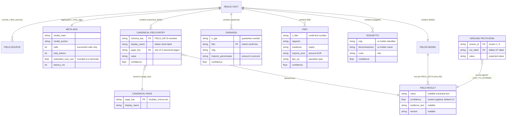

# Data Model

This project has no database. Its data landscape is built from in-memory Python dicts, Pydantic models that define the shape of LLM output, and flat files on disk: a ground-truth CSV the extraction is scored against, and the JSON/CSV reports written after a run. The center of the model is the **result dict**: the single structure that flows out of the pipeline and into every downstream consumer (evaluation, CSV export, the Tkinter results view, and the three edge-agent tabs).

Three concepts anchor everything. **`FIELD_KEYS`** (`extraction/fields.py:12-54`) is the canonical list of exactly 45 scalar fields and the single source of truth: the Pydantic field model is generated from it, and the CSV mapping, canonical definitions, and retry areas must stay aligned with it. The **Pydantic schemas** (`extraction/schemas.py`) define what a valid LLM response looks like. The **canonical field/page definitions** (`extraction/field_definitions.py`, `extraction/page_definitions.py`) map each field to an Italian display name and one of four BPER pages, which is how values are grouped for export and display. Field keys are Italian banking domain terms (`professione_principale`, `filiale_relazione`, ...) and are load-bearing: they must match the ground-truth labels via `CSV_TO_SCHEMA` and are never translated. Plain-language definitions of the domain terms are in the [Glossary](11-glossary.md).

The diagram below maps how these structures relate:



## Result Dict

The project's central structure: what `ExtractionPipeline.extract_from_image()` returns for one screen. Every reader downstream depends on its layout, which is a structural convention, not an enforced schema.

**Domain meaning:** everything the system knows about one banking screenshot: extracted scalar fields, the variable-length tables of co-holders/credit lines/guarantees, a client-facing flattened view, and the metadata needed to score and cost the extraction.

**Key entries** (assembled in **`extraction/pipeline.py:104-180`**):

| Key | Type | Purpose |
|---|---|---|
| `screen_id` | str | File stem (`screen 1`) or `"{Friendly} - pag. N"` in the edge-agent |
| `fields` | dict of FieldResult dicts | One entry per `FIELD_KEYS` member |
| `soggetti` / `fidi` / `garanzie` | lists | Variable-length table rows |
| `canonical_fields` | list | Client-facing entries with display name and page binding |
| `_attempts` | list of `_meta` dicts | One per *successful* VLM call |
| `_meta_agg` | dict | Aggregated calls/tokens/cost/latency (`extraction/pipeline.py:330-340`) |
| `_field_sources` | dict | `{key: ANCHOR_HEADER \| CONTENT_MAIN \| RETRY_{HEADER\|BODY\|FOOTER}}` |
| `_status` | str | `OK`, `ANCHOR_UNCERTAIN`, or (edge-agent error path) `ERROR` |
| `_meta`, `attempt` | dict, str | Leftovers from the main VLM call - never stripped (`extraction/vlm_client.py:214-225`) |

The edge-agent attaches three more keys: `_page_type`, `_page_no`, `_page_confidence` (`edge-agent/local_extraction_client.py:96-98`).

**Persistence:** in memory during a run; serialized verbatim (including `_meta` and `_attempts`) to `mnt/data/poc_outputs_improved.json` by the CLI (`extraction/cli.py:337-340`) and `poc_outputs_gui.json` by the GUI (`gui_app.py:253-254`). The edge-agent holds results in `LocalExtractionClient._results`, a `{job_id: [result, ...]}` dict that is lock-guarded, append-only, and never evicted (`edge-agent/local_extraction_client.py:56`, `:100-103`).

**Invariants worth knowing:**

- `_status == "OK"` if and only if both `fields["ndg"].value` and `fields["denominazione"].value` are non-null at the end (`extraction/pipeline.py:172-178`). Confidence plays no role in this check; see Validation below.
- `_meta_agg` totals are the sums over `_attempts`, cost rounded to 6 decimals (`extraction/pipeline.py:330-340`). Because a failed retry's `_meta` is never appended (`extraction/pipeline.py:288-294`), `calls` counts only successful calls; the retry wrapper's earlier billed attempts are invisible.
- `_field_sources` values are drawn from a closed set by construction (`extraction/pipeline.py:141`, `:216`, `:301-307`), but the soggetti flatten step overwrites `ndg_1..4`/`denominazione_1..4`/`ruolo_1..4` without updating their source (`extraction/pipeline.py:160-166`), so provenance for those twelve keys can be stale.
- The edge-agent `ERROR`-path result is a reduced dict: only `screen_id`, `fields: {}`, `_status`, `_error`; no `_meta_agg`, `canonical_fields`, `_field_sources`, or table lists (`edge-agent/local_extraction_client.py:87-94`). Every consumer reads those keys defensively with `.get(..., {})` or a `canonical_fields`→`fields` fallback (`extraction/evaluation.py:186-217`, `gui_app.py:333-368`, `edge-agent/ui/data_table_tab.py:161-208`).

## FieldResult and FieldsModel

**Domain meaning:** a single extracted scalar (e.g. the NDG number or the practice `stato`) with the model's confidence and the on-screen evidence it cited.

**Definition** (`extraction/schemas.py:9-13`):

```python
class FieldResult(BaseModel):
    value: Optional[str] = None
    confidence: float = 0.0
    evidence_text: Optional[str] = None
    section: Optional[str] = None
```

Every value is a string or null regardless of what it represents; numeric comparison happens later in evaluation via `norm_number_str()`. The `safe_field()` accessor coerces `confidence` to a float even when the model returns null (`extraction/normalization.py:60-69`).

**`FieldsModel`** is not hand-written: it is generated with `create_model()`, one `Optional[FieldResult]` per `FIELD_KEYS` entry (`extraction/schemas.py:46-49`). Schema/field-list sync is guaranteed by construction: the set of valid keys *is* `FIELD_KEYS`. Adding a key regenerates the model automatically, but it must also be added by hand to `CSV_TO_SCHEMA` (or it is never scored), `AREA_TO_FIELDS` (or it is never retried), `CANONICAL_FIELD_DEFINITIONS` (or it falls back to a raw-key display with `page_key=None`), and the Italian prompts. None of that is guard-checked; see Validation.

**The 45 fields** group as follows (`extraction/fields.py:12-54`):

| Group | Fields |
|---|---|
| Header identifiers | `ndg`, `denominazione` |
| Practice metadata | `tipo`, `stato`, `fase`, `creazione`, `evidenze`, `filiale_relazione` |
| Credit data | `n_fido`, `rapporto`, `descrizione`, `scadenza`, `importo_euro`, `tipo_op` |
| Notes & tooltips | `note_della_richiesta` + 5 `tooltip_*` fields |
| Flattened soggetti | `ndg_1..4`, `denominazione_1..4`, `ruolo_1..4` |
| Scheda Privati | `dal`, `datore_di_lavoro_anagrafica`, `di_cui_percepiscono_reddito`, `importo_totale_annuo_nucleo`, `note_scheda_privati`, `nr_altri_componenti_nucleo`, `numero_mensilita`, `professione_principale`, `rating_ufficiale`, `retribuzione_annua_netta`, `score_cgs`, `tipo_contratto`, `ultima_validazione_scheda` |

The `ndg_1..4` family is a flat projection of the first four `Soggetto` rows, written for CSV compatibility with the screen-2 ground truth (`extraction/pipeline.py:160-166`; the domain caps co-holders at 4 flat slots).

## Soggetto, Fido, Garanzia

The variable-length tables the LLM returns as JSON arrays in the main pass (and optionally the `BODY` retry).

- **Soggetto**: a co-holder row from Elenco Soggetti (`extraction/schemas.py:15-20`): `ndg`, `denominazione`, `ruolo`, plus `confidence`/`evidence_text`; all optional.
- **Fido**: a credit-line row from Gestione Fidi e Garanzie (`extraction/schemas.py:22-30`): `n_fido`, `rapporto`, `descrizione`, `scadenza`, `importo_euro`, `tipo_op`, plus confidence/evidence.
- **Garanzia**: a guarantee row (`extraction/schemas.py:32-41`): `n_gar`, `descrizione`, `fido` (the linked credit line), `ndg`, `denominazione`, `importo_percentuale`, `tipo_op`, plus confidence/evidence.

**Persistence:** lists in the result dict; exported as `category` rows like `soggetti[0].ndg` (`extraction/evaluation.py:219-232`). During retry, a table is replaced only from the `BODY` area and only when the new table has more rows or, at equal length, higher mean confidence (`extraction/pipeline.py:225-241`).

## ExtractionResponse and AnchorResponse

The two top-level schemas handed to LangChain so the LLM returns parseable, validated JSON.

- **`ExtractionResponse`** (main pass and retries, `extraction/schemas.py:54-58`): `fields: FieldsModel` plus the three table lists, the whole structure in one call.
- **`AnchorResponse`** (anchor pass, `extraction/schemas.py:60-65`): a narrow `AnchorFields` with only `ndg` and `denominazione`. The restriction is deliberate: it forces the model to focus on the two identity fields everything else depends on.

Backward-compatible aliases `RESPONSE_SCHEMA` / `ANCHOR_SCHEMA` exist (`extraction/schemas.py:70-71`).

**Enforcement varies by provider** (`extraction/vlm_client.py`): OpenAI uses `.with_structured_output(schema, include_raw=True)` (`:193`); `gemini-1.5*` uses json_mode with the schema (`:138-147`); Gemini 2.0+/3.x receive the JSON schema injected into the prompt and are validated manually with `schema.model_validate_json()` (`:47-119`), because a complex `response_schema` triggers `INVALID_ARGUMENT` on those models (`:15-18`).

## Canonical Field Entry

**Domain meaning:** the client-facing view of an extracted field. Where `FieldResult` is the raw extraction, a canonical entry pairs the value with its human-readable Italian label and the BPER page it belongs to, so results can be grouped per page in exports and in the Dati Estratti tab. The module docstring names its purpose: "backend/UI/export integration" (`extraction/canonical_mapping.py:1`); the external consumer of this contract is not identified in-repo (see [Open Questions](08-open-questions.md)).

**Shape**: built by `build_canonical_field_entries()` (`extraction/canonical_mapping.py:20-42`): `schema_key`, `display_name`, `page_key`, `page_name`, `value`, `confidence`, `evidence_text`, `section`. Entries are sorted by `PAGE_SHEET_ORDER` position, then display name, then schema key (`:8-18`); an unknown `page_key` sorts last rather than raising (`:12-14`). Display name and page binding resolve through `get_canonical_field_metadata()` (`extraction/fields.py:128-138`) against `CANONICAL_FIELD_DEFINITIONS` (`extraction/field_definitions.py:5-186`).

**Consumers:** `export_to_csv()` (`extraction/evaluation.py:186-200`), the currently disabled batch dedup (`extraction/cli.py:45-74`), the Tkinter results tree (`gui_app.py:333-354`), and the edge-agent data table (`edge-agent/ui/data_table_tab.py:161-208`). All of them fall back to raw `fields` when `canonical_fields` is absent.

## Canonical Page

**Domain meaning:** the four logical pages of the BPER credit-management UI that organize the 45 fields for export and display: a fixed sheet order, not a discovered property.

**Definition** (`extraction/page_definitions.py:5-28`):

| `page_key` | Display name | Holds |
|---|---|---|
| `risultato_ricerca` | Risultato ricerca | Header identifiers, practice metadata |
| `elenco_soggetti` | Elenco Soggetti | The 12 flattened soggetti fields |
| `gestione_fidi_e_garanzie` | Gestione Fidi e Garanzie | Credit-line fields |
| `note_da_richiesta` | Note da Richiesta | `note_della_richiesta` and the Scheda Privati fields |

Each field is statically bound to exactly one page in `CANONICAL_FIELD_DEFINITIONS`. The binding is metadata, not provenance: Scheda Privati fields like `professione_principale` are bound to `note_da_richiesta` even though they originate on a different BPER screen.

**A naming gap worth knowing:** the edge-agent router emits page types from `edge-agent/assets/templates/bper/prompts.json` (e.g. `"Risultato ricerca - Colonne estese"`, 10 definitions including a catch-all), stored raw in `_page_type`. They are never resolved through `resolve_page_key()` (`extraction/page_definitions.py:36-39`), whose aliases only cover the four canonical names: the detected-page taxonomy and the canonical-page taxonomy are disjoint, with no bridge (`edge-agent/local_extraction_client.py:96`). A field's `page_key` always comes from its static binding, never from the page the frame was actually captured on.

## Ground Truth (CSV)

**Domain meaning:** the human-verified expected values per screen: the answer key.

**Structure:** long format with three logical columns (screen, field label, expected value) loaded into `{screen_id: {csv_label: value}}` by `load_ground_truth()` (`extraction/evaluation.py:33-69`). The loader tolerates header variants: screen may be `Screenshot`/`Fotogramma`/`Screen`/`screen`; value `Valore rilevato` (including a trailing-space variant)/`Valore`/`Value`; key `Denominazione da attribuire`/`Denominazione`/`Campo`/`Field` (`:38-52`). Unmatchable columns raise `ValueError` (`:26-31`).

**Join to the field model:** GT labels map to schema keys via `CSV_TO_SCHEMA` (`extraction/fields.py:56-100`, which also carries whitespace-variant labels like `"Evidenze "`). A label with no mapping is silently skipped during scoring (`extraction/evaluation.py:88-90`); nothing validates that `CSV_TO_SCHEMA` values ⊆ `FIELD_KEYS`.

**Persistence:** read from `INPUT_DIR/dati.csv` (`extraction/config.py:8-9`). The CLI hard-requires it (`extraction/cli.py:315-316`), but the file is absent from both the working tree and git history; see [Open Questions](08-open-questions.md).

## Edge-Agent Data Structures

Three smaller structures support live capture (see [Architecture](04-architecture.md)):

- **`RouterResult`** (`edge-agent/llm_router.py:27-34`): `page_type: Optional[str]`, `confidence: float`, `fields: dict`, `reason`, `expected`. Every `PageRouter.route()` returns one. Invariant: a non-null `page_type` is always a real `prompts.json` page name; hallucinated values are remapped case-insensitively or nulled (`edge-agent/llm_router.py:225-230`).
- **`AgentConfig`** (`edge-agent/config.py:8`): a typed view over `edge-agent/config.ini` (fps, router mode, monitor index, preprocessing, `[llm]` credentials). Note that `AgentConfig.save()` would re-persist the `[llm] api_key` to disk if ever called (`edge-agent/config.py:326-332`, currently uncalled); the committed file previously leaked a real key, since scrubbed to a placeholder.
- **DINOv2 prototypes** (`edge-agent/page_classifier.py`): per-page L2-normalized 384-dim embeddings cached in `edge-agent/assets/templates/bper/bper_page_prototypes.json`, matched by cosine similarity at a 0.70 threshold.

## Data Flow Patterns

**Create.** All data originates from a Vision-LLM call. `call_vlm()` invokes the model with an image and a Pydantic schema and returns `parsed.model_dump()` plus a `_meta` block: `{model, screen_id, attempt, latency_ms, prompt_tokens, completion_tokens, total_tokens, estimated_cost_usd}` (`extraction/vlm_client.py:107-116`, `:167-176`, `:214-223`). Populating `_meta` on every call is a load-bearing side-effect contract (CLAUDE.md constraint #2); all three producer paths comply. There is no user-authored data entry; every value is model-produced, then optionally overridden by post-processing rules.

**Read.** Consumers read the result dict by documented key. Evaluation reads `fields[key].value` (`extraction/evaluation.py:92`); cost reporting reads `_meta_agg` (`:249-257`); the GUIs read `fields`, `canonical_fields`, the tables, and `_meta_agg` (`gui_app.py:308-396`; `edge-agent/ui/extraction_results_tab.py:159-211`; `edge-agent/ui/data_table_tab.py:161-305`). No schema enforces the dict, so every reader uses defensive `.get()` access.

**Update.** Within one screen, field values are revised in a fixed temporal order that `_field_sources` records (see [Workflows](05-workflows.md#multi-pass-extraction-pipeline)):

1. The main pass initializes every field's source to `CONTENT_MAIN` (`extraction/pipeline.py:141`).
2. `_merge_anchors()` overwrites `ndg`/`denominazione` with any non-null anchor value → `ANCHOR_HEADER` (`:211-216`). The intended 0.95 confidence filter on this step is ineffective (see Validation).
3. The retry pass replaces a field only when `pick_best()` favors the candidate → `RETRY_{AREA}` (`extraction/normalization.py:87-108`).
4. The coherence rules may force `evidenze="B"` or `tipo="BMB"` from tooltip evidence (`extraction/pipeline.py:311-328`).
5. The soggetti flatten writes `ndg_1..4`/`denominazione_1..4`/`ruolo_1..4` last and unconditionally, winning over any `BODY` retry for those keys and leaving `_field_sources` untouched (`:160-166`).

The ordering is load-bearing: retries assume anchors are already merged, the coherence check assumes retries are done, and `canonical_fields` is built only after the flatten so it reflects the final values (`extraction/pipeline.py:109-170`).

**Delete.** No delete path exists. The CLI discards results at process exit; the edge-agent's `_results` grows per job until the app closes (`edge-agent/local_extraction_client.py:56`). Batch-side same-page dedup is implemented but disabled (`extraction/cli.py:268-273`), and re-ingesting a page in the edge-agent appends a new row rather than replacing one.

**Export shapes diverge.** The same data leaves the system in three CSV dialects: `;`-separated `utf-8-sig` for the eval/debug/report CSVs (`extraction/evaluation.py:172-177`, `:234-239`) and the data-table export (`edge-agent/ui/data_table_tab.py:340-341`); plain `,` for `LocalExtractionClient.export_csv()`'s flat one-row-per-screen format (`edge-agent/local_extraction_client.py:112-143`, returns `None` when a job has no results).

## Validation

Validation happens at three layers; none is a database constraint, and several intended guards are weaker than documented.

**Schema validation (the LLM boundary).** Every VLM response must be valid JSON conforming to its Pydantic schema. `call_vlm()` raises `ValueError` on a missing JSON object, a decode error, a Pydantic failure, or a structured-output parsing error (`extraction/vlm_client.py:39`, `:44`, `:95`, `:153`, `:200`). These are permanent by convention: `call_vlm_with_retry()` re-raises `ValueError` immediately and retries only non-`ValueError` exceptions (`:252-258`).

**Confidence gating: mostly advisory.** Model-supplied `confidence` is trusted everywhere; nothing enforces the [0, 1] range beyond a prompt instruction (`prompts/extraction_anchor.json`). The retry trigger (`< 0.60`, `extraction/pipeline.py:255`) and `pick_best()` tie-breaks use it as-is. The anchor gate at `extraction/pipeline.py:91-96` *intends* to null anchors below `ANCHOR_CONF_MIN` (0.95), but the returned dicts are pre-gate copies (`:87-88`) and `safe_set_field(..., value=None)` cannot overwrite a non-null value (`extraction/normalization.py:78-79`), so low-confidence anchors flow downstream unfiltered. The only code that genuinely checks `ANCHOR_CONF_MIN` against final values is `_is_confident_output()` inside the disabled dedup helper (`extraction/cli.py:77-89`). CLAUDE.md's "zeroes out low-confidence anchors" describes the intent, not the behavior.

**Cross-structure consistency: by construction where it exists, absent where it doesn't.** `FieldsModel` ⟷ `FIELD_KEYS` sync is guaranteed by `create_model()` (`extraction/schemas.py:46-49`), and `FIELD_RETRY_MAP` is derived mechanically from `AREA_TO_FIELDS` (`extraction/config.py:85-88`). But no startup `if/raise` guard validates `AREA_TO_FIELDS` keys against `FIELD_KEYS`, `CSV_TO_SCHEMA` values, or `CANONICAL_FIELD_DEFINITIONS` coverage; the guards CLAUDE.md describes (and a `_FIELD_COMPARATORS` dict) do not exist in current code. The observable consequences: six fields (`creazione` and the five `tooltip_*`) belong to no retry area and can never be retried; a new field key without a canonical definition silently falls back to a raw-key display with `page_key=None` and sorts into the catch-all export bucket (`extraction/fields.py:118-138`, `extraction/canonical_mapping.py:12-14`). These silent fallbacks are the main failure mode when extending the field set.

**Value normalization (at evaluation).** Before comparison: `norm_number_str()` strips `€`/spaces and normalizes separators for numeric fields: any key containing `importo_euro`, `ndg`, or `n_fido` (`extraction/normalization.py:40-55`, `:127-133`); `norm_text()` lowercases and collapses whitespace (`:34-38`); text over 20 characters passes fuzzily at a `SequenceMatcher` ratio ≥ 0.85 (`:141-146`); the nullish vocabulary is `""`, `"n/d"`, `"nd"`, `"---"`, `"null"`, `"none"`, `"nan"` (`:28-32`). `tipo` is normalized earlier, in the pipeline, collapsing `mutui spesa`/`mutuo spesa`/`bpi mutui` to `BPI Mutui` (`:10-23`).

**Cost accounting caveat.** `estimate_cost_usd()` returns `0.0` for any model missing from `PRICING_PER_1M` (`extraction/vlm_client.py:21-26`; table at `extraction/config.py:36-49`), so runs with unlisted model names under-report cost with no warning.

For how these structures are produced and consumed end-to-end, see [Workflows](05-workflows.md); for the component layout, see [Architecture](04-architecture.md).
