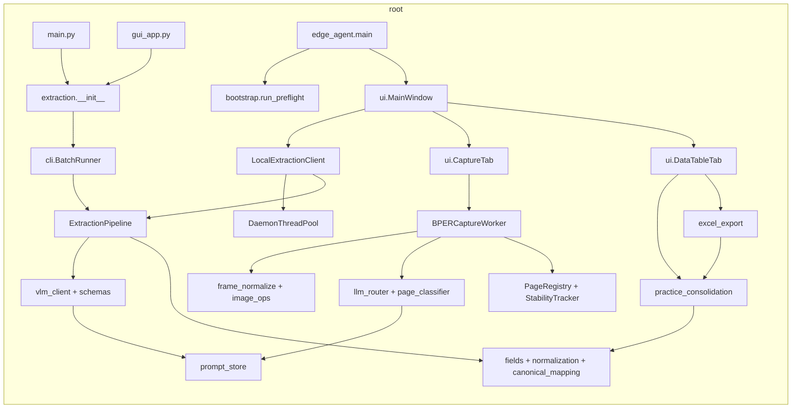
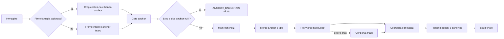
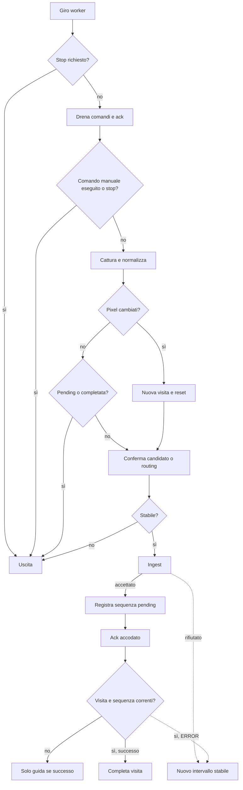
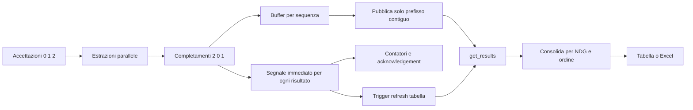
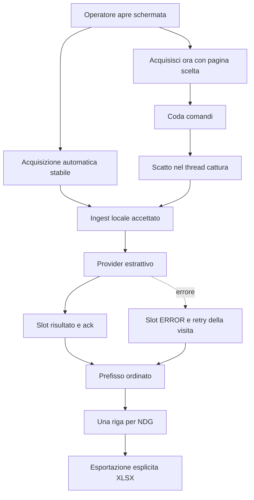

# Codebase X-Ray Analysis Report (Team Mode)

## Target

`D:/Projects/poc-data-extraction` — partizione unica `root`, profondità `full`. Analisi del working tree sul commit `f8f57e6124e008aa47ff6d8320aa508e9ef7976c` della branch `develop`: correzioni applicative già committate, modifiche documentali e istruzioni non committate incluse, eliminazioni preesistenti della mappa comprese.

## Executive Summary

Le tre criticità storiche XQ-R01, XQ-R02 e XQ-R03 sono risolte nel codice corrente: pubblicazione nell'ordine di cattura, acquisizione per visita con esito e scatto manuale nel thread della camera. Restano **14 finding aperti: 11 medi e 3 bassi**, senza criticità Critical o High; i rischi riguardano soprattutto arresto, routing, configurazione, concorrenza e attendibilità di costi/valutazione. Sette temi documentali originari sono risolti e tre sono parziali, con ulteriori discrepanze circoscritte: la documentazione non è interamente allineata.

La nuova esecuzione della suite ha prodotto **173 passed, 3 warnings in 38.20s**, exit code 0. Gli avvisi riguardano xFormers assente; non sono state eseguite chiamate estrattive ai provider né una sessione bancaria reale. [Evidenza e limiti della verifica](D:/Projects/poc-data-extraction/.codebase-xray/runs/poc-data-extraction-20260912-175144/validation/README.md).

## Project at a Glance

Il progetto estrae 45 campi strutturati da nove schermate del sistema creditizio BPER, con chiavi di dominio italiane. Serve a trasformare immagini in dati confrontabili ed esportabili: il batch CLI richiede un CSV di verità di riferimento, la GUI Tkinter consente elaborazione di file e valutazione facoltativa, l'edge-agent PyQt acquisisce il monitor e ricostruisce righe consolidate.

Il motore combina anchor degli identificatori, lettura principale e retry delle aree deboli. Il percorso file autorizza il crop soltanto per la famiglia calibrata; il percorso live preserva il frame già normalizzato. Nel live, routing e stabilità scelgono la pagina, il client accoda estrazioni concorrenti e pubblica solo il prefisso completato in ordine di acquisizione, da cui tabella ed Excel consolidano per NDG.

Il percorso BPER non usa un backend applicativo remoto: l'estrazione resta nel processo locale, ma immagini e prompt raggiungono i provider dei modelli. Il worker generico HTTP è un percorso distinto. Gli strumenti del corpus e i benchmark aiutano preparazione e misura del classificatore; le loro alternative DINOv3 non rappresentano una migrazione del runtime DINOv2.

## Partition Map

| Partition | Path | Language | Files | Status |
|-----------|------|----------|-------|--------|
| root | . | Python | 71 | done |

Inventario: 8.575 LOC, 12.812 righe fisiche, 554 funzioni/metodi e 58 classi. I 71 file includono applicazione, test e strumenti.

## Cross-Partition Topology

Non esistono archi tra partizioni; le directory sono sottosistemi della stessa root. La [mappa delle interconnessioni](08-interconnect-map.md) è un indice fallibile di ambito, non una dimostrazione dell'assenza di rischi interni.

## Architecture Overview

`extraction/` è un package piatto con facciata compatibile: factory dei modelli, pipeline, chiamate VLM, schemi, vocabolario, normalizzazione e batch. `prompt_store.py` rimane stdlib-only fuori dal package per consentire al router di usare il catalogo senza importare LangChain. Il catalogo prompt e quello delle pagine hanno politiche di errore diverse.

Nell'edge-agent la camera e lo stato di visita appartengono al worker; la UI accoda comandi e riceve segnali. `LocalExtractionClient` separa sequenza di accettazione, evento di completamento e lista pubblicabile. `practice_consolidation` usa `pick_best`; `excel_export` centralizza intestazione a due livelli e valori testuali inerti. Le firme complete, inclusi parametri e default, restano nel [catalogo delle interfacce](02-interfaces.md); non sono sostituite da questa panoramica.

## Technology Decisions

| Scelta | Funzione e compromesso documentato |
|---|---|
| Python, LangChain, Pydantic | Modelli estrattivi configurabili e output validato; metadati successivi restano dizionari liberi. |
| Pillow, Pandas, openpyxl | Immagini, valutazione tabellare ed export XLSX condiviso. |
| PyQt6 e Tkinter | Cattura live e batch interattivo come front-end dello stesso motore. |
| mss, DINOv2 e torch | Cattura e classificazione locale; geometria/pesi/cache devono essere coerenti. |
| Pool daemon e retry concorrenti | UI disaccoppiata; il budget esterno non limita tutta la concorrenza né garantisce da solo l'uscita del processo. |
| Ambiente, INI e JSON | Configurazione estrattiva import-time, router separato, prompt validati senza reload; precedenze non uniformi. |
| PyInstaller | Distribuzione portable, percorsi bundle e preflight; non un backend remoto. |

## Critical Paths (cross-partition)

Non esistono flussi tra partizioni. I percorsi critici interni, integralmente tracciati in [03-flows.md](03-flows.md), sono:

1. Avvio → ambiente/preflight → import UI e creazione modelli. `main.py --gui` importa il motore prima del preflight, a differenza dell'entry point diretto.
2. File → crop autorizzato → anchor → main → retry → coerenza → flatten → canonico → valutazione e costi.
3. Monitor → normalizzazione → identità della visita → routing/stabilità → ingest accettato → acknowledgement correlato a job/sequenza/visita.
4. Completamenti paralleli → buffer → prefisso ordinato → consolidamento NDG → tabella/export.
5. Scatto manuale → coda comandi → camera del worker → medesima acquisizione; stop cooperativo senza cancellazione della chiamata router in corso.
6. Corpus → annotazione/revisione → prototipi/benchmark, mantenendo distinta la provenienza dalle misure runtime.

## Key Process Diagrams

### Pipeline estrattiva

### Ciclo della visita e acknowledgement

### Pubblicazione e consolidamento

### Percorso dell'operatore

Il [rapporto dei flussi](03-flows.md) conserva fonti, percorsi d'errore, effetti e limiti per tutti i passaggi.

## Design Insights

Nessun ADR attraversa partizioni. Le decisioni interne di ADR 0013–0015 separano cronologia da concorrenza, visita da nome pagina e comando UI da uso della camera. Il prefisso ordinato può ritardare la tabella rispetto al contatore, ma preserva l'attribuzione dei frame senza NDG; una pagina immobile completata non viene reinviata, mentre un errore corrente riavvia l'intervallo di stabilità.

Il digest dei pixel distingue anche piccoli cambiamenti, con il compromesso che animazioni continue possono impedire la stabilizzazione. `ANCHOR_UNCERTAIN` completa la visita per evitare ricatture infinite. Il crop prudente e il fallback asimmetrico dei cataloghi privilegiano l'integrità del contenuto rispetto al risparmio e alla continuità apparente.

Restano contratti impliciti interni: leggere `get_results` per consolidare, preservare `_capture_sequence`, accodare gli ack senza mutare pending nello slot diretto e mantenere l'identità del vincitore restituito da `pick_best`. La [fase semantica](04-semantics.md) conserva l'intero registro, comprese assunzioni non garantite e intenzioni smentite dal wiring.

## Per-Partition Health Scorecard

| Partition | Anti-Patterns (C/H/M/L) | Red Flags (C/H/M/L) | Doc Gaps | Tech Debt | Overall |
|-----------|--------------------------|----------------------|----------|-----------|---------|
| root | 0/0/2/0 | 0/0/7/1 | 3 temi DQ parziali, più residui e carenze descritti in 06 | 4 (2 M, 2 L) | At Risk |

La valutazione riflette rischi operativi medi ancora aperti; la suite verde non sostituisce la verifica della qualità estrattiva reale.

## Risk Assessment (global)

| Categoria | Critical | High | Medium | Low | Totale aperti |
|---|---:|---:|---:|---:|---:|
| Anti-pattern | 0 | 0 | 2 | 0 | 2 |
| Red flags | 0 | 0 | 7 | 1 | 8 |
| Debito tecnico | 0 | 0 | 2 | 2 | 4 |
| Cross-Partition Risks | 0 | 0 | 0 | 0 | 0 |
| Totale | 0 | 0 | 11 | 3 | 14 |

### Cross-Partition Risks

Nessuno, data la partizione unica. Restano interne le catene client → retry (A02), stop UI → router (R04) e rinomina → export (R10); l'assenza di confini tra partizioni non ne riduce l'impatto.

### Registro sintetico dei finding aperti

| ID | Gravità | Ambito aperto |
|---|---|---|
| XQ-A01 | Medium | Vocabolari/mapping/aree indipendenti; creazione e cinque tooltip non attivano retry. |
| XQ-A02 | Medium | Pool annidati e coda illimitata: concorrenza, memoria e shutdown. |
| XQ-R04 | Medium | Dopo cinque secondi la UI rilascia il worker ancora vivo e permette un nuovo avvio. |
| XQ-R05 | Medium | local-first ripiega su ML anziché LLM; preflight non prepara quel modo. |
| XQ-R06 | Medium | Insiemi e precedenze delle chiavi divergono; import anticipato di extraction in main.py --gui prima del preflight. |
| XQ-R07 | Medium | Retry non limitato ai transitori; costi falliti/router esclusi, modelli ignoti a zero, budget logico e latenza sommata. |
| XQ-R08 | Medium | Valutazione di NDG/n_fido come quantità; consolidamento live già distinto e protetto. |
| XQ-R09 | Medium | Collisioni del basename e file falliti omessi; ramo sequenziale senza callback rilancia invece di restituire il parziale. |
| XQ-R11 | Medium | Valori personali/economici nei log e frammenti di parsing nelle diagnostiche. |
| XQ-R10 | Low | Etichette rinominate con = diventano formule; valori estratti XLSX già inerti. |
| XQ-D01 | Medium | Mancano regressioni di frontiera per gate anchor, merge scalare, coerenza e flatten. |
| XQ-D02 | Low | requeue_job è stub non usato dalla UI; dedup batch scollegata; _maybe_upload_dataset non esiste più. |
| XQ-D03 | Medium | Ripresa label_frames senza identità di contenuto/configurazione; relocalize conserva output senza versione geometrica e scrive checkpoint/finale senza sostituzione atomica. |
| XQ-D04 | Low | Provenienza incompleta dopo campi assenti, flatten e coerenza. |

I tre rilievi risolti R01–R03 sono esclusi dai totali aperti. [05-risks.md](05-risks.md) conserva **ogni sottocaso**, la delimitazione dell'impatto e tutte le evidenze delle chiusure, incluse le regressioni lette e coperte dalla suite corrente.

## Documentation vs Reality

I temi DQ-01, DQ-02, DQ-03, DQ-06, DQ-08, DQ-09 e DQ-10 sono risolti nel loro perimetro originario. Rimangono parziali DQ-04 (116 test ancora dichiarati nelle istruzioni), DQ-05 (conversione di confidenze non numeriche troppo generalizzata) e DQ-07 (README descrive quattro attributi per ogni campo, ma il flatten omette evidence_text).

Ulteriori residui: fallback Python sul PATH omesso in istruzioni/sintesi; retry descritto come solo transitorio; FIELD_RETRY_MAP dichiarato ma assente; _maybe_upload_dataset ancora descritto come stub vivo; ancoraggi numerici non aggiornati; riferimento inglese ai modi di routing meno completo. Le carenze di copertura documentale riguardano rinomina/export, differenze delle chiavi e ripresa degli strumenti. La provenienza incompleta e le lacune dei test centrali sono limiti applicativi già descritti: la loro documentazione non chiude il finding tecnico relativo.

Il controllo documentale consegnato registra zero link locali rotti e zero marker esaminati: non valida automaticamente simboli in backtick o riferimenti numerici. Gli ADR accettati e i piani storici conservano la loro natura storica; risultati di esecuzione e analisi rimangono nello X-ray.

## Top Priority Actions

Non risultano finding Critical o High da trasformare in azioni urgenti. Tra gli aperti medi, la sequenza proposta per un intervento successivo è:

1. Mantenere controllo e riferimento del worker fino alla terminazione effettiva (R04), verificando stop durante routing lento.
2. Allineare precedenze chiavi e ordine di bootstrap dei due entry point (R06); decidere ed eseguire il comportamento local-first dichiarato (R05).
3. Definire un limite complessivo a concorrenza e backlog (A02), senza rompere sequenze accettate e pubblicazione ordinata.
4. Rendere espliciti errori/identità batch e limiti di contabilizzazione (R07–R09); verificare le condizioni limite estrattive mancanti (D01).
5. Gestire la persistenza diagnostica dei dati (R11) e la ripresa/versione degli strumenti (D03); riconciliare i residui documentali di fase 06.

Sono priorità derivate dai finding consegnati, non nuove modifiche applicative o autorizzazioni a eseguire provider.

## Detailed Findings

- [01 — Inventario e dipendenze](01-structure.md): 71 file, simboli, import, ingressi e collocazione del nuovo codice.
- [02 — Interfacce e contratti](02-interfaces.md): firme integrali, schemi, segnali e protocollo visita/ingest/ack.
- [03 — Flussi](03-flows.md): percorsi critici, dati, errori ed effetti.
- [04 — Semantica](04-semantics.md): decisioni, ADR, assunzioni e contratti impliciti interni.
- [05 — Rischi](05-risks.md): 14 finding aperti e tre chiusure con evidenze complete.
- [06 — Documentazione](06-documentation.md): riconciliazione dei dieci temi, residui e limiti dei controlli.
- [08 — Interconnessioni](08-interconnect-map.md): ambito della partizione unica e rimandi verificabili.
- [Rapporti originali della partizione](D:/Projects/poc-data-extraction/.codebase-xray/runs/poc-data-extraction-20260912-175144/partitions/root/01-structure.md) e [validazione corrente](D:/Projects/poc-data-extraction/.codebase-xray/runs/poc-data-extraction-20260912-175144/validation/README.md): provenienza immutabile di questa consegna.

## Quick Reference: Which File to Consult

| Your Task | Start With | Also Check |
|-----------|-----------|------------|
| Onboarding / understanding the project | 07-final-report, 01-structure | 04-semantics |
| Writing new feature | 01-structure (Where to Add), 02-interfaces | 04-semantics |
| Fixing a bug | 03-flows, 05-risks | 01-structure |
| Refactoring | 01-structure, 04-semantics, 05-risks | 03-flows |
| Code review | 02-interfaces, 05-risks, 08-interconnect-map | 06-documentation |
| Updating documentation | 06-documentation, 04-semantics | 02-interfaces |
| Cross-partition design decisions | 04-semantics (Cross-Partition ADR), 01-structure | 02-interfaces (Cross-Partition Exports) |

## Analysis Metadata

- Mode: team
- Run: poc-data-extraction-20260912-175144
- Target: D:/Projects/poc-data-extraction
- Partitions: 1 (root), single-partition fallback
- Phases completed: 01–07 consolidate; 08 consegnata dal mapper. Pubblicazione e stato finale del run sono gestiti dal coordinatore.
- Date: 2026-09-12; avvio registrato 2026-09-12T17:52:45.199703+00:00
- Revisione: f8f57e6124e008aa47ff6d8320aa508e9ef7976c, develop; working tree documentale non committato incluso.
- Inventario: 71 file Python, 8.575 LOC; analisi full, critical=false, comments=false.
- Metodo della sintesi: trasformazione dei rapporti correnti della partizione; nessuna nuova analisi sorgente, modifica applicativa o esecuzione test da parte del sintetizzatore.
- Verifica corrente del coordinatore: 173 passed, 3 warnings, 38.20s, exit 0. [Comando e ambiente](D:/Projects/poc-data-extraction/.codebase-xray/runs/poc-data-extraction-20260912-175144/validation/test-command.json), [log](D:/Projects/poc-data-extraction/.codebase-xray/runs/poc-data-extraction-20260912-175144/validation/pytest.txt).
- Provider/live: nessuna chiamata estrattiva e nessuna sessione bancaria reale; risultati non equivalenti a una misura attuale di accuratezza VLM.
- Stato delle evidenze: verified = derivato/verificato nel perimetro dichiarato; documented = intenzione; unverified = assunzione; disputed = discrepanza.
- Run storico padre: poc-data-extraction-20260911-154206, conservato senza modifiche. Le verifiche storiche non sono presentate come esecuzioni nuove.
