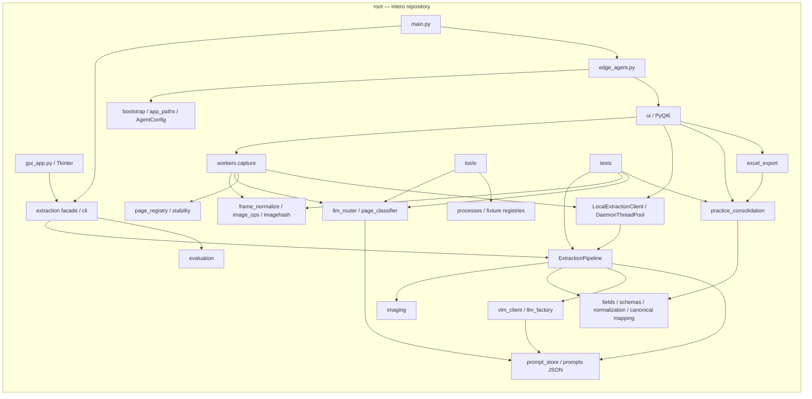
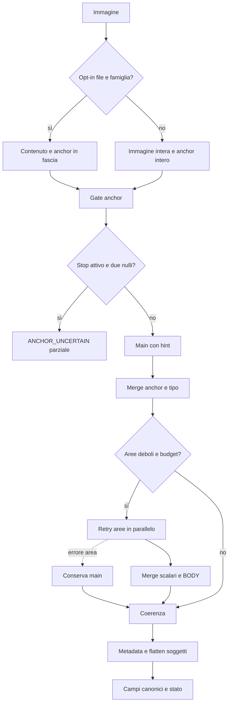
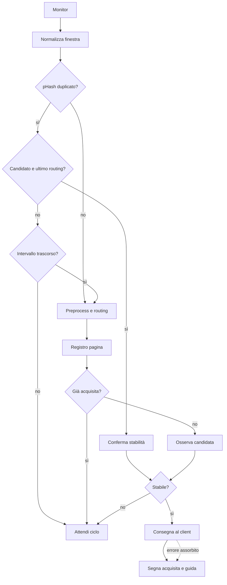
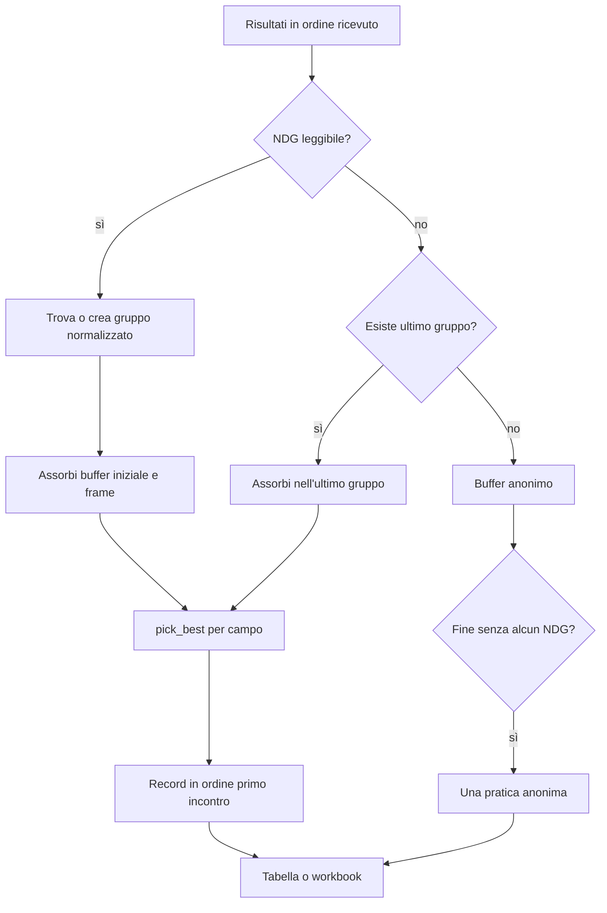
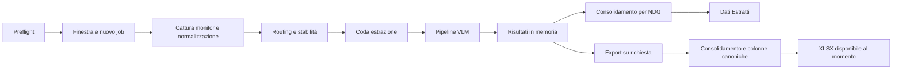

# Codebase X-Ray Analysis Report (Team Mode)

## Target

`D:/Projects/poc-data-extraction` — intero repository, unica partizione `root`, profondità `full`. Inventario: **70 file Python, 8.150 righe di codice e 12.294 righe fisiche**; le interfacce conservano **152 firme pubbliche**. I sottosistemi `extraction/`, `edge-agent/`, `tools/` e `tests/` appartengono tutti a `root`.

## Executive Summary

Il progetto ha un motore condiviso, confini di responsabilità riconoscibili e protezioni esplicite per geometria, prompt ed export; l'analisi statica lo classifica **At Risk** soprattutto per la composizione fra cattura, concorrenza e identità della pratica. I rapporti registrano **17 rilievi unici: 0 Critical, 3 High, 11 Medium e 3 Low**, oltre a **10 discrepanze documentali e 6 lacune di copertura**. I rischi prioritari riguardano l'assegnazione dei frame senza NDG, lo stato di pagina acquisita prima dell'esito e lo scatto manuale sullo stato del worker; l'impatto è condizionale e la frequenza sul campo non è misurata. Vedi [05-risks](D:/Projects/poc-data-extraction/.codebase-xray/runs/poc-data-extraction-20260911-154206/05-risks.md) e [06-documentation](D:/Projects/poc-data-extraction/.codebase-xray/runs/poc-data-extraction-20260911-154206/06-documentation.md).

## Project at a Glance

Il progetto supporta l'estrazione di dati da schermate bancarie BPER italiane per chi deve consultare e ricomporre informazioni di una pratica. Il vocabolario contiene 45 campi: identificatori, dati di credito, metadati, soggetti, note e dati privati. Le nove schermate riconosciute sono varianti delle quattro pagine canoniche dell'output. CLI e Tkinter lavorano su file; il desktop PyQt6 cattura il monitor e presenta una riga consolidata per NDG. Questa corrispondenza fra NDG e pratica è una regola applicativa la cui adeguatezza a ogni workflow resta **unverified**. Riferimenti: [02-interfaces](D:/Projects/poc-data-extraction/.codebase-xray/runs/poc-data-extraction-20260911-154206/02-interfaces.md), [04-semantics](D:/Projects/poc-data-extraction/.codebase-xray/runs/poc-data-extraction-20260911-154206/04-semantics.md).

La pipeline legge prima gli identificatori, poi il contenuto completo e infine le aree deboli entro un budget di passaggi. Merge, coerenza, flatten dei soggetti e campi canonici producono il risultato condiviso. Nel percorso live, normalizzazione della finestra, riconoscimento e stabilità precedono la coda locale; i risultati arrivano in memoria al completamento e alimentano tabella ed Excel. Il client BPER è locale, ma i modelli visivi possono usare servizi remoti: il termine non descrive un funzionamento offline. La CLI valuta rispetto a un CSV di ground truth; Tkinter può usarlo facoltativamente. Meccanismi **verified** nei rapporti [03-flows](D:/Projects/poc-data-extraction/.codebase-xray/runs/poc-data-extraction-20260911-154206/03-flows.md) e [04-semantics](D:/Projects/poc-data-extraction/.codebase-xray/runs/poc-data-extraction-20260911-154206/04-semantics.md).

## Partition Map

| Partition | Path | Language | Files | Status |
|-----------|------|----------|-------|--------|
| root | `D:/Projects/poc-data-extraction` | Python | 70 | done |

## Cross-Partition Topology

Non esistono archi fra partizioni. Il grafo rende visibili i collegamenti interni all'unica partizione, senza trasformare directory o librerie in partizioni sorelle.

La [08-interconnect-map](D:/Projects/poc-data-extraction/.codebase-xray/runs/poc-data-extraction-20260911-154206/08-interconnect-map.md) è stata consumata prima della sintesi: superficie, contratti e attribuzione di rischi cross-partition sono vuoti. Questo non esclude rischi di integrazione interni.

## Architecture Overview

Il package piatto `extraction` raccoglie vocabolario, schemi, immagini, factory provider, client VLM, pipeline e batch. CLI e Tkinter riusano `BatchRunner`; il desktop usa la stessa pipeline tramite `LocalExtractionClient` e un pool daemon. La facade mantiene gli import storici, ma carica configurazione e prompt all'importazione: il preflight deve precedere i consumer, e lo shim `main.py --gui` presenta il disallineamento censito XQ-R06. Riferimenti: [facade](D:/Projects/poc-data-extraction/extraction/__init__.py:47), [bootstrap diretto](D:/Projects/poc-data-extraction/edge-agent/edge_agent.py:63), [01-structure](D:/Projects/poc-data-extraction/.codebase-xray/runs/poc-data-extraction-20260911-154206/01-structure.md), [02-interfaces](D:/Projects/poc-data-extraction/.codebase-xray/runs/poc-data-extraction-20260911-154206/02-interfaces.md).

Nel desktop, percorsi e bootstrap gestiscono sorgente e bundle; `BPERCaptureWorker` compone framing, dedup, router, registro e stabilità. `practice_consolidation` applica il merge comune e `excel_export` mantiene 45 colonne, identificatori davanti e dati testuali. `prompt_store` rimane stdlib e separato dal core, così il router può accedere ai prompt senza importare LangChain. Il percorso HTTP del worker generico è distinto dal client BPER. Inventario, ingressi e contratti completi: [01-structure](D:/Projects/poc-data-extraction/.codebase-xray/runs/poc-data-extraction-20260911-154206/01-structure.md), [02-interfaces](D:/Projects/poc-data-extraction/.codebase-xray/runs/poc-data-extraction-20260911-154206/02-interfaces.md).

## Technology Decisions

| Scelta | Funzione e compromesso osservato |
|---|---|
| Python e moduli per responsabilità | Core condiviso da tre ingressi; compatibilità tramite facade e wrapper. Le dipendenze non sono bloccate da un lockfile o da metadata di packaging. |
| LangChain e Pydantic | Adattamento OpenAI/Gemini e risposta strutturata comune; il percorso JSON libero richiede validazione manuale. Il router e il labeller usano anche un client SDK diretto. |
| Pillow, crop e normalizzazione della finestra | Coordinate comuni ai consumer live; crop contenuto riservato al percorso file e alla famiglia calibrata. La geometria euristica non dimostra identità applicativa. |
| PyQt6 e pool daemon; Tkinter per batch | Cattura ed estrazione separate, con più livelli di concorrenza. L'assenza di attesa nel pool non garantisce da sola la cessazione di ogni lavoro attivo. |
| DINOv2, prototipi e router VLM | Riconoscimento locale per similarità oppure remoto; score e confidence non equivalgono a probabilità calibrate di correttezza. |
| JSON per prompt e cataloghi | Validazione anticipata dei prompt e caricamento unico; catalogo pagine separato con degrado differente. |
| pandas e openpyxl | Valutazione/CSV e workbook diretto con due righe di intestazione. L'XLSX mostra scalari consolidati, senza espandere tutte le tabelle annidate. |
| PyInstaller | Distribuzione portabile focalizzata sull'edge-agent; successo della build corrente non verificato dal run. |

Scelte e limiti derivano dalle interfacce e dalle decisioni già raccolte, senza nuove valutazioni dei fornitori: [02-interfaces](D:/Projects/poc-data-extraction/.codebase-xray/runs/poc-data-extraction-20260911-154206/02-interfaces.md), [04-semantics](D:/Projects/poc-data-extraction/.codebase-xray/runs/poc-data-extraction-20260911-154206/04-semantics.md).

## Critical Paths (cross-partition)

Nessun percorso attraversa partizioni. I percorsi critici interni conservati in [03-flows](D:/Projects/poc-data-extraction/.codebase-xray/runs/poc-data-extraction-20260911-154206/03-flows.md) sono:

1. **Avvio → ambiente → prompt → modelli:** lo snapshot di configurazione rende l'ordine degli import parte del contratto.
2. **Screenshot → anchor → main → retry → output:** gate e priorità di merge trasformano più letture in una risposta comune.
3. **Monitor → normalizzazione → routing → stabilità → coda:** il set delle pagine acquisite precede il risultato estrattivo.
4. **Coda → completamento → consolidamento → XLSX:** l'ordine ricevuto influisce sull'assegnazione dei frame senza NDG.
5. **Scatto manuale / Stop / chiusura:** chiamate UI dirette e lavoro sincrono possono sovrapporsi al lifecycle del worker.
6. **Video → frame → etichette → registro → prototipi:** i tool preparano corpus e misure separati dall'esecuzione applicativa.

Le tracce complete, le eccezioni e gli effetti su disco/rete restano nel rapporto dei flussi; nessuno di questi percorsi è presentato come una sessione live eseguita.

## Key Process Diagrams

Quattro diagrammi del rapporto [03-flows](D:/Projects/poc-data-extraction/.codebase-xray/runs/poc-data-extraction-20260911-154206/03-flows.md), che ne conserva nove. Sono sintesi dei percorsi statici citati nei commenti Mermaid, non tracce di esecuzione.

### Estrazione e merge

### Selezione della pagina live

### Composizione della pratica

### Operatore → Excel

## Design Insights

Il registro Cross-Partition ADR è vuoto. Le decisioni interne restano essenziali per leggere il sistema e sono conservate integralmente, insieme agli undici Hidden Contracts, in [04-semantics](D:/Projects/poc-data-extraction/.codebase-xray/runs/poc-data-extraction-20260911-154206/04-semantics.md):

- **Normalizzazione prima dei consumer (ADR 0001/0002/0003):** un solo framing alimenta dedup, routing ed estrazione; ROI, trasformazione e scoring partecipano alla geometria della cache. Il significato della chiave non garantisce automaticamente che rappresenti ogni parametro applicato.
- **Budget derivato dalle aree (ADR 0004):** evita che un default letterale escluda i retry finali, ma conta passaggi logici; l'assenza legittima di campi può continuare a richiedere riletture.
- **Router distribuito e conferma sul duplicato (ADR 0006/0007):** la decisione documentata privilegia il router LLM nella distribuzione e riduce chiamate ripetute riusando il routing. Il default della classe resta ML; pHash misura somiglianza e la stabilità non certifica l'etichetta.
- **Scarti, margine e popolazioni dei prototipi (ADR 0008/0011/0012):** i resoconti distinguono esperimenti, asset e cablaggio rinviato. Il fallback LLM di local-first è una divergenza già censita XQ-R05, non una decisione runtime da presumere realizzata.
- **Crop autorizzato dal percorso e dalla famiglia (ADR 0010):** live senza crop contenuto; file con controllo di aspetto e dimensione; anchor intero e tabelle a solo riempimento fuori calibrazione. Il merge scalare può comunque sostituire un valore in base alla confidence.
- **Prompt e pratica come contratti interni:** i prompt validati prima dell'uso restano coerenti mediante caricamento unico; il consolidamento comune evita merge differenti nelle due tab, ma rende identità e ordine parte del dato.

Le motivazioni e le misure storiche degli ADR sono **documented**; l'applicazione verificata e le contraddizioni sono indicate separatamente nel rapporto semantico. Nessun nuovo ADR è stato creato.

## Per-Partition Health Scorecard

| Partition | Anti-Patterns (C/H/M/L) | Red Flags (C/H/M/L) | Doc Gaps | Tech Debt | Overall |
|-----------|--------------------------|----------------------|----------|-----------|---------|
| root | 0/0/2/0 | 0/3/7/1 | 6 | 4 | At Risk |

La valutazione deriva dai percorsi a impatto High censiti; non misura frequenza degli incidenti. Doc Gaps conta soltanto DQ-G01–DQ-G06. Le quattro voci di debito sono 0/0/2/2 per gravità.

## Risk Assessment (global)

| Categoria | Critical | High | Medium | Low | Totale univoco |
|---|---:|---:|---:|---:|---:|
| Anti-pattern XQ-A | 0 | 0 | 2 | 0 | 2 |
| Red flag XQ-R | 0 | 3 | 7 | 1 | 11 |
| Debito XQ-D | 0 | 0 | 2 | 2 | 4 |
| **Totale** | **0** | **3** | **11** | **3** | **17** |

I richiami degli stessi ID nella Failure Mode Analysis e nella documentazione non aggiungono rilievi. La severità esprime impatto condizionale; percorsi statici **verified**, divergenze **disputed** e conseguenze/frequenze **unverified** restano distinti in [05-risks](D:/Projects/poc-data-extraction/.codebase-xray/runs/poc-data-extraction-20260911-154206/05-risks.md).

| Priorità | Scenario | Portata della prova |
|---|---|---|
| XQ-R01 — High | Una nota senza NDG della pratica A completa dopo un risultato identificato di B e viene consolidata nella riga B. | Percorso statico verificato e sensibilità all'ordine riprodotta con dati sintetici dalla funzione reale; frequenza live e sessione GUI completa non verificate. |
| XQ-R02 — High | La pagina entra nel set delle acquisite prima del risultato; un errore o la seconda pratica nello stesso job impediscono la successiva acquisizione automatica dello stesso nome. | Rami del codice verificati; recupero manuale e nuovo job esistono. Il report non misura quante sessioni reali richiedano più pratiche o rivisite. |
| XQ-R03 — High | Il pulsante manuale richiama cattura e stato del worker dal thread UI mentre il loop può eseguire lo stesso lavoro. | Due ingressi e assenza di serializzazione verificati; errori concreti di contesto, duplicazioni e impatto su Windows non riprodotti in GUI. |

I Medium coprono inoltre concorrenza annidata, cataloghi coordinati per convenzione, stop incompleto, local-first, bootstrap/provider, contabilità parziale, identificatori valutati come quantità, perdita/omissione di output batch, dati nei log e identità di ripresa dei tool. I Low riguardano intestazioni Excel personalizzate, percorsi sospesi e provenienza incompleta. Tutti gli scenari dettagliati, i limiti e le barriere esistenti sono conservati in [05-risks](D:/Projects/poc-data-extraction/.codebase-xray/runs/poc-data-extraction-20260911-154206/05-risks.md).

Le barriere da mantenere includono gate anchor, geometria distinta file/live, protezione delle tabelle fuori calibrazione, conservazione del main su errore d'area, validazione dei prompt e celle dati XLSX testuali. Non equivalgono a correttezza semantica garantita del modello.

## Cross-Partition Risks

**0 attribuzioni cross-partition.** Tutte le 17 voci appartengono a `root`; in particolare UI, cattura, client, pipeline e configurazione sono integrazioni interne. Il perimetro vuoto della [08-interconnect-map](D:/Projects/poc-data-extraction/.codebase-xray/runs/poc-data-extraction-20260911-154206/08-interconnect-map.md) non riduce il rischio di tali composizioni.

## Documentation vs Reality

Il rapporto [06-documentation](D:/Projects/poc-data-extraction/.codebase-xray/runs/poc-data-extraction-20260911-154206/06-documentation.md) conserva **10 discrepanze DQ-01–DQ-10**, **6 lacune DQ-G01–DQ-G06** e **3 voci di riferimenti DQ-B01–DQ-B03**. DQ-B02 richiama DQ-03 e non è un'ulteriore discrepanza. Le verifiche dei link Markdown locali non hanno trovato link rotti negli scope dichiarati; quel controllo non valida riferimenti inline, ancore, URL remoti o la verità delle frasi.

| Gruppo | Realtà da rappresentare |
|---|---|
| DQ-01 / DQ-02 / DQ-03 | Il gate anchor modifica i valori usati; il client estrae in coda mentre il router può bloccare la cattura; il desktop presenta Dati Estratti ed export XLSX per pratica. |
| DQ-04 / DQ-05 | La suite esiste e il coordinatore registra 153 test passati; i modelli estrattivi normalizzano le confidence numeriche. Ciò non dimostra precisione VLM né convalida ogni score router. |
| DQ-06 / DQ-07 | La soglia retry è configurabile; passaggi, richieste, costi stimati e latenza aggregata hanno perimetri diversi e non coprono ogni chiamata fallita o il routing. |
| DQ-08 / DQ-09 / DQ-10 | local-first non costruisce il fallback dichiarato; coerenza e confronto date hanno limiti specifici; alcune liste di vecchi difetti sono a loro volta obsolete. |
| DQ-G01–DQ-G06 | Mancano contratti operativi completi su ordine/pratica, lifecycle, provider/import, contabilità, identità e sequenza dei tool. |
| DQ-B01–DQ-B03 | La vecchia mappa è assente per cancellazioni preesistenti; export_csv, get_screenshot_paths e FIELD_RETRY_MAP sono riferimenti a superfici assenti, da correggere nella documentazione senza ricrearle automaticamente. |

Gli ADR accettati rimangono documenti storici immutabili secondo la convenzione del repository. Eventuali riconciliazioni del comportamento richiedono una decisione coerente con quella convenzione; le misure storiche non diventano risultati di questo run.

## Top Priority Actions

Le seguenti proposte derivano dai tre High di [05-risks](D:/Projects/poc-data-extraction/.codebase-xray/runs/poc-data-extraction-20260911-154206/05-risks.md); sono indicazioni per una successiva modifica, non interventi eseguiti nel run.

1. **Rendere esplicita l'associazione dei frame alla pratica (XQ-R01; DQ-G01; XQ-D01).** Conservare il contesto di acquisizione attraverso la coda e definire l'assegnazione dei frame senza NDG. Verificare con completamenti fuori ordine che una nota di A rimanga nella riga A quando il frame identificato di B termina prima.
2. **Distinguere tentativo, consegna ed esito della pagina (XQ-R02; DQ-G02).** Definire quando una pagina può essere acquisita nuovamente dopo errore o cambio pratica e collegare lo stato visualizzato a un esito verificabile. Verificare errore estrattivo e due pratiche nello stesso job, mantenendo il recupero manuale previsto.
3. **Serializzare lo scatto manuale nel contesto del worker (XQ-R03; DQ-G02).** Evitare ingressi simultanei su cattura, dedup e tracker; verificare un comando manuale mentre la cattura è attiva, insieme al comportamento della UI.

L'assenza di copertura delle composizioni è già XQ-D01. I test dei singoli componenti non sostituiscono questi casi, e l'implementazione dovrà preservare le barriere descritte nei flussi e nelle decisioni interne.

## Detailed Findings

- [01-structure](D:/Projects/poc-data-extraction/.codebase-xray/runs/poc-data-extraction-20260911-154206/01-structure.md): inventario completo, grafo, ingressi, osservazioni e collocazione del nuovo codice.
- [02-interfaces](D:/Projects/poc-data-extraction/.codebase-xray/runs/poc-data-extraction-20260911-154206/02-interfaces.md): 152 firme pubbliche, forme dei dati, contratti, dipendenze e integrazione dei moduli.
- [03-flows](D:/Projects/poc-data-extraction/.codebase-xray/runs/poc-data-extraction-20260911-154206/03-flows.md): percorsi critici, errori, effetti e nove diagrammi.
- [04-semantics](D:/Projects/poc-data-extraction/.codebase-xray/runs/poc-data-extraction-20260911-154206/04-semantics.md): finalità, decisioni, ADR, assunzioni e undici contratti nascosti interni.
- [05-risks](D:/Projects/poc-data-extraction/.codebase-xray/runs/poc-data-extraction-20260911-154206/05-risks.md): 17 rilievi, ordinamento per gravità e scenari dettagliati senza doppio conteggio.
- [06-documentation](D:/Projects/poc-data-extraction/.codebase-xray/runs/poc-data-extraction-20260911-154206/06-documentation.md): discrepanze, lacune e riferimenti documentali.
- [08-interconnect-map](D:/Projects/poc-data-extraction/.codebase-xray/runs/poc-data-extraction-20260911-154206/08-interconnect-map.md): mappa supplementare consumata dalla sintesi, con superficie cross-partition vuota e rimandi ai contratti interni.

## Quick Reference: Which File to Consult

| Your Task | Start With | Also Check |
|-----------|-----------|------------|
| Onboarding / understanding the project | [07-final-report](D:/Projects/poc-data-extraction/.codebase-xray/runs/poc-data-extraction-20260911-154206/07-final-report.md), [01-structure](D:/Projects/poc-data-extraction/.codebase-xray/runs/poc-data-extraction-20260911-154206/01-structure.md) | [04-semantics](D:/Projects/poc-data-extraction/.codebase-xray/runs/poc-data-extraction-20260911-154206/04-semantics.md) |
| Writing new feature | [01-structure](D:/Projects/poc-data-extraction/.codebase-xray/runs/poc-data-extraction-20260911-154206/01-structure.md) (Where to Add), [02-interfaces](D:/Projects/poc-data-extraction/.codebase-xray/runs/poc-data-extraction-20260911-154206/02-interfaces.md) | [04-semantics](D:/Projects/poc-data-extraction/.codebase-xray/runs/poc-data-extraction-20260911-154206/04-semantics.md) |
| Fixing a bug | [03-flows](D:/Projects/poc-data-extraction/.codebase-xray/runs/poc-data-extraction-20260911-154206/03-flows.md), [05-risks](D:/Projects/poc-data-extraction/.codebase-xray/runs/poc-data-extraction-20260911-154206/05-risks.md) | [01-structure](D:/Projects/poc-data-extraction/.codebase-xray/runs/poc-data-extraction-20260911-154206/01-structure.md) |
| Refactoring | [01-structure](D:/Projects/poc-data-extraction/.codebase-xray/runs/poc-data-extraction-20260911-154206/01-structure.md), [04-semantics](D:/Projects/poc-data-extraction/.codebase-xray/runs/poc-data-extraction-20260911-154206/04-semantics.md), [05-risks](D:/Projects/poc-data-extraction/.codebase-xray/runs/poc-data-extraction-20260911-154206/05-risks.md) | [03-flows](D:/Projects/poc-data-extraction/.codebase-xray/runs/poc-data-extraction-20260911-154206/03-flows.md) |
| Code review | [02-interfaces](D:/Projects/poc-data-extraction/.codebase-xray/runs/poc-data-extraction-20260911-154206/02-interfaces.md), [05-risks](D:/Projects/poc-data-extraction/.codebase-xray/runs/poc-data-extraction-20260911-154206/05-risks.md), [08-interconnect-map](D:/Projects/poc-data-extraction/.codebase-xray/runs/poc-data-extraction-20260911-154206/08-interconnect-map.md) | [06-documentation](D:/Projects/poc-data-extraction/.codebase-xray/runs/poc-data-extraction-20260911-154206/06-documentation.md) |
| Updating documentation | [06-documentation](D:/Projects/poc-data-extraction/.codebase-xray/runs/poc-data-extraction-20260911-154206/06-documentation.md), [04-semantics](D:/Projects/poc-data-extraction/.codebase-xray/runs/poc-data-extraction-20260911-154206/04-semantics.md) | [02-interfaces](D:/Projects/poc-data-extraction/.codebase-xray/runs/poc-data-extraction-20260911-154206/02-interfaces.md) |
| Cross-partition design decisions | [04-semantics](D:/Projects/poc-data-extraction/.codebase-xray/runs/poc-data-extraction-20260911-154206/04-semantics.md) (Cross-Partition ADR e contratti interni), [01-structure](D:/Projects/poc-data-extraction/.codebase-xray/runs/poc-data-extraction-20260911-154206/01-structure.md) | [02-interfaces](D:/Projects/poc-data-extraction/.codebase-xray/runs/poc-data-extraction-20260911-154206/02-interfaces.md) (Cross-Partition Exports) |

I collegamenti usano percorsi assoluti al run per restare validi anche nella copia pubblicata alla root `.codebase-xray/`. Le sezioni cross-partition sono presenti per compatibilità, ma in questo run la guida alle decisioni effettive è nelle sezioni interne di `root`.

## Analysis Metadata

- **Mode:** team.
- **Run:** `poc-data-extraction-20260911-154206`.
- **Target:** `D:/Projects/poc-data-extraction`.
- **Partitions:** 1 (`root`, stato `done`); nessuna partizione mancante e nessun parent run.
- **Phases completed:** 01 Structure, 02 Interfaces, 03 Flows, 04 Semantics, 05 Risks, 06 Documentation, 07 Final Report; mappa supplementare 08 consegnata prima della sintesi secondo l'ordine del workflow.
- **Date:** 2026-09-11; avvio `2026-09-11T15:42:06.080941+02:00` (Europe/Rome).
- **Scope flags:** `depth=full`, `critical=false`, `comments=false`; analisi completa non incrementale. L'audit dei commenti è omesso.
- **Source revision:** branch `develop`, commit `d28dac359cec0296d47bdf21d570750a7b2494d8`; working tree inizialmente modificato. Cancellazioni preesistenti di `.codebase-map/` e `AGENTS.md` non tracciato conservati.
- **Inventory:** 70 file Python, 12.294 righe fisiche, 8.150 righe di codice, 516 funzioni/metodi e 54 classi estratti; 152 firme pubbliche presentate nel rapporto interfacce.
- **Tooling provenance:** workflow/snapshot originari 4.0.1; cache del plugin sostituita esternamente con 4.0.2 durante il run. I corpi dei ruoli behavior, quality, mapper e synthesizer sono stati confrontati e risultano identici; lo stato del run registra la distinzione.
- **Consolidation sources:** rapporti consegnati della partizione, stato e mappa supplementare. La sintesi conserva le evidenze senza nuova analisi dei sorgenti, modifiche applicative, test aggiunti o chiamate a provider.

### Evidence and validation boundaries

| Evidenza | Risultato osservato | Che cosa dimostra e che cosa resta escluso |
|---|---|---|
| Lettura statica dei worker | Inventario, firme, percorsi, contratti e rilievi con stato esplicito. | Dimostra struttura e rami letti; non frequenza degli incidenti, accuratezza live o compatibilità futura dei provider. |
| Suite esistente eseguita dal coordinatore | **153 passed, 3 warnings in 43.27s; exit code 0; nessun fallimento o skip.** Python 3.13.14, pytest 9.1.1, Windows. | I tre warning indicano xFormers non disponibile per SwiGLU, Attention e Block nei test DINOv2 su CPU. La suite usa il classificatore reale nei casi dedicati e risposte simulate al confine VLM. Non valida le composizioni rischiose prive di casi dedicati. |
| Riproduzione sintetica del coordinatore | La funzione reale `consolidate` assegna la stessa nota anonima alla 111 o alla 222 in base all'ordine dei tre risultati forniti. | Dimostra sensibilità all'ordine, a supporto di XQ-R01. Non riproduce il completamento concorrente di una sessione GUI completa e non ne misura la frequenza. |
| Verifiche non eseguite | CSV `mnt/data/dati.csv` assente; nessuna valutazione con ground truth, misura live VLM/costi, sessione desktop end-to-end o build. | Il verde della suite non misura accuratezza estrattiva, costo fatturato, reattività/chiusura GUI o comportamento del servizio remoto. |

Verbale ed esiti del coordinatore: [validation/README.md](D:/Projects/poc-data-extraction/.codebase-xray/runs/poc-data-extraction-20260911-154206/validation/README.md), [output pytest](D:/Projects/poc-data-extraction/.codebase-xray/runs/poc-data-extraction-20260911-154206/validation/pytest.txt), [riproduzione dell'ordine](D:/Projects/poc-data-extraction/.codebase-xray/runs/poc-data-extraction-20260911-154206/validation/consolidation-order.json). L'esecuzione della suite ha usato `PYTHONDONTWRITEBYTECODE=1`, `PYTHON_DOTENV_DISABLED=1` e `QT_QPA_PLATFORM=offscreen`, con cache pytest confinata al run.

Fonti della consolidazione: [struttura root](D:/Projects/poc-data-extraction/.codebase-xray/runs/poc-data-extraction-20260911-154206/partitions/root/01-structure.md), [interfacce root](D:/Projects/poc-data-extraction/.codebase-xray/runs/poc-data-extraction-20260911-154206/partitions/root/02-interfaces.md), [flussi root](D:/Projects/poc-data-extraction/.codebase-xray/runs/poc-data-extraction-20260911-154206/partitions/root/03-flows.md), [semantica root](D:/Projects/poc-data-extraction/.codebase-xray/runs/poc-data-extraction-20260911-154206/partitions/root/04-semantics.md), [rischi root](D:/Projects/poc-data-extraction/.codebase-xray/runs/poc-data-extraction-20260911-154206/partitions/root/05-risks.md), [documentazione root](D:/Projects/poc-data-extraction/.codebase-xray/runs/poc-data-extraction-20260911-154206/partitions/root/06-documentation.md), [08-interconnect-map](D:/Projects/poc-data-extraction/.codebase-xray/runs/poc-data-extraction-20260911-154206/08-interconnect-map.md) e campi `target`, `flags`, `partitions`, `git`, `validation`, `tooling` di [state.json](D:/Projects/poc-data-extraction/.codebase-xray/runs/poc-data-extraction-20260911-154206/state.json). Gli stati dell'orchestrazione possono avanzare dopo questa consegna; non sono citati mediante numeri di riga instabili.
