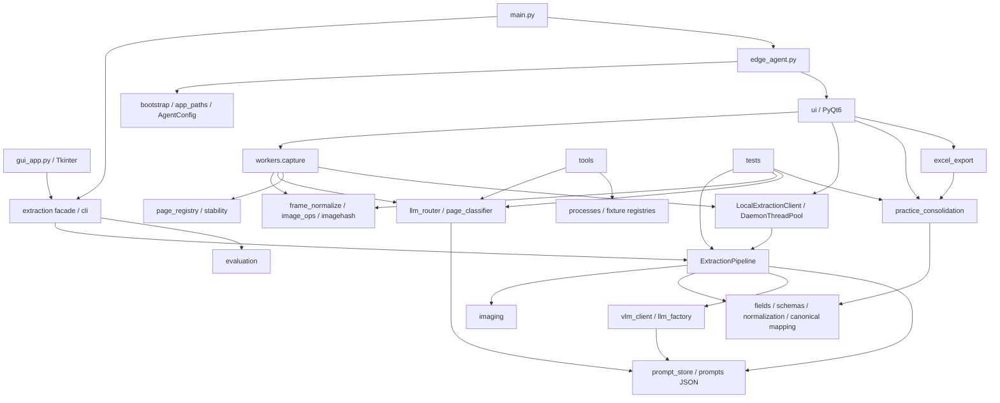

# Partition: root — Structure Extraction

## File Inventory

**[verified]** L'inventario contiene 70 sorgenti Python dell'unica partizione `root`. `extraction/`, `edge-agent/`, `tools/` e `tests/` sono sottosistemi interni. Ogni riga seguente è un'affermazione **verified** ancorata al relativo file: le grandezze derivano da `ast_parser.parse_file()` e `classifier.classify_file()` del plugin e dalla lettura integrale del sorgente. `Lines` indica righe fisiche / righe di codice del classificatore; `Functions` somma funzioni di modulo e metodi estratti, inclusi helper privati; `Imports` conta dichiarazioni estratte, non pacchetti unici né chiamate. Le librerie standard sono comprese in `external`. I nomi assoluti risolvibili nei percorsi della repository e gli import relativi sono `internal`; gli import dinamici sono descritti separatamente nel grafo. Le dichiarazioni distribuite nell'inventario sono l'evidenza del conteggio complessivo.

Sono esclusi dall'inventario sorgente ambiente virtuale, `.git`, build, dist, cache, vendor e report generati. Non sono stati letti file di ambiente o credenziali. Il conteggio non misura complessità ciclomatica né comportamento eseguito. La precedente analisi meccanica usava il plugin 4.0.1; dopo la sostituzione della cache durante il lavoro, la tabella è stata materializzata con le medesime API del plugin 4.0.2.

| File | Language | Lines | Functions | Classes | Imports (internal / cross / external) |
|------|----------|-------|-----------|---------|---------------------------------------|
| `edge-agent/__init__.py:1` | Python | 1 / 0 | 0 | 0 | 0 / 0 / 0 |
| `edge-agent/app_paths.py:1` | Python | 76 / 35 | 11 | 0 | 1 / 0 / 2 |
| `edge-agent/bootstrap.py:1` | Python | 517 / 369 | 18 | 1 | 8 / 0 / 6 |
| `edge-agent/config.py:1` | Python | 412 / 267 | 6 | 1 | 0 / 0 / 4 |
| `edge-agent/edge_agent.py:1` | Python | 99 / 57 | 1 | 0 | 8 / 0 / 3 |
| `edge-agent/excel_export.py:1` | Python | 229 / 148 | 8 | 1 | 9 / 0 / 3 |
| `edge-agent/extraction_pool.py:1` | Python | 64 / 42 | 5 | 1 | 1 / 0 / 4 |
| `edge-agent/frame_normalize.py:1` | Python | 235 / 129 | 6 | 0 | 2 / 0 / 5 |
| `edge-agent/image_ops.py:1` | Python | 71 / 44 | 4 | 0 | 2 / 0 / 3 |
| `edge-agent/llm_router.py:1` | Python | 290 / 208 | 12 | 4 | 6 / 0 / 9 |
| `edge-agent/local_extraction_client.py:1` | Python | 201 / 122 | 10 | 1 | 10 / 0 / 5 |
| `edge-agent/page_classifier.py:1` | Python | 727 / 381 | 18 | 3 | 4 / 0 / 6 |
| `edge-agent/page_registry.py:1` | Python | 99 / 73 | 8 | 2 | 1 / 0 / 5 |
| `edge-agent/practice_consolidation.py:1` | Python | 146 / 78 | 6 | 2 | 4 / 0 / 4 |
| `edge-agent/stability.py:1` | Python | 115 / 72 | 6 | 2 | 1 / 0 / 2 |
| `edge-agent/ui/__init__.py:1` | Python | 7 / 6 | 0 | 0 | 2 / 0 / 0 |
| `edge-agent/ui/capture_tab.py:1` | Python | 422 / 311 | 17 | 1 | 10 / 0 / 2 |
| `edge-agent/ui/data_table_tab.py:1` | Python | 291 / 211 | 14 | 1 | 7 / 0 / 2 |
| `edge-agent/ui/debug_tab.py:1` | Python | 40 / 25 | 3 | 1 | 2 / 0 / 1 |
| `edge-agent/ui/main_window.py:1` | Python | 95 / 54 | 4 | 1 | 7 / 0 / 1 |
| `edge-agent/ui/overlay.py:1` | Python | 39 / 26 | 3 | 1 | 2 / 0 / 0 |
| `edge-agent/workers/__init__.py:1` | Python | 9 / 6 | 0 | 0 | 1 / 0 / 0 |
| `edge-agent/workers/capture/__init__.py:1` | Python | 11 / 8 | 0 | 0 | 3 / 0 / 0 |
| `edge-agent/workers/capture/base_capture_worker.py:1` | Python | 104 / 51 | 7 | 1 | 2 / 0 / 2 |
| `edge-agent/workers/capture/bper_capture_worker.py:1` | Python | 677 / 459 | 17 | 1 | 14 / 0 / 4 |
| `edge-agent/workers/capture/default_capture_worker.py:1` | Python | 88 / 41 | 3 | 1 | 5 / 0 / 4 |
| `extraction/__init__.py:1` | Python | 122 / 82 | 0 | 0 | 11 / 0 / 1 |
| `extraction/canonical_mapping.py:1` | Python | 42 / 31 | 2 | 0 | 2 / 0 / 1 |
| `extraction/cli.py:1` | Python | 358 / 268 | 10 | 1 | 6 / 0 / 4 |
| `extraction/config.py:1` | Python | 130 / 71 | 0 | 0 | 0 / 0 / 1 |
| `extraction/evaluation.py:1` | Python | 286 / 212 | 12 | 1 | 2 / 0 / 2 |
| `extraction/field_definitions.py:1` | Python | 262 / 246 | 4 | 0 | 0 / 0 / 1 |
| `extraction/fields.py:1` | Python | 122 / 101 | 3 | 0 | 2 / 0 / 1 |
| `extraction/imaging.py:1` | Python | 98 / 57 | 7 | 0 | 2 / 0 / 3 |
| `extraction/llm_factory.py:1` | Python | 81 / 59 | 1 | 0 | 4 / 0 / 3 |
| `extraction/normalization.py:1` | Python | 210 / 147 | 13 | 0 | 1 / 0 / 3 |
| `extraction/page_definitions.py:1` | Python | 51 / 35 | 4 | 0 | 0 / 0 / 1 |
| `extraction/pipeline.py:1` | Python | 418 / 296 | 13 | 1 | 11 / 0 / 3 |
| `extraction/prompts.py:1` | Python | 27 / 12 | 0 | 0 | 1 / 0 / 1 |
| `extraction/schemas.py:1` | Python | 93 / 61 | 1 | 8 | 1 / 0 / 3 |
| `extraction/vlm_client.py:1` | Python | 262 / 199 | 5 | 0 | 4 / 0 / 6 |
| `gui_app.py:1` | Python | 403 / 327 | 11 | 1 | 1 / 0 / 5 |
| `main.py:1` | Python | 20 / 13 | 0 | 0 | 3 / 0 / 2 |
| `prompt_store.py:1` | Python | 319 / 193 | 11 | 3 | 1 / 0 / 8 |
| `tests/conftest.py:1` | Python | 47 / 20 | 1 | 0 | 1 / 0 / 2 |
| `tests/test_base_capture_worker.py:1` | Python | 42 / 25 | 5 | 2 | 2 / 0 / 1 |
| `tests/test_bper_capture_framing.py:1` | Python | 260 / 143 | 27 | 8 | 3 / 0 / 1 |
| `tests/test_content_crop.py:1` | Python | 208 / 98 | 19 | 0 | 5 / 0 / 3 |
| `tests/test_excel_export.py:1` | Python | 133 / 98 | 15 | 0 | 3 / 0 / 2 |
| `tests/test_extraction_pool.py:1` | Python | 72 / 55 | 5 | 0 | 1 / 0 / 2 |
| `tests/test_frame_normalize.py:1` | Python | 182 / 95 | 17 | 0 | 2 / 0 / 0 |
| `tests/test_local_extraction_client.py:1` | Python | 82 / 60 | 7 | 2 | 3 / 0 / 2 |
| `tests/test_localize_rect.py:1` | Python | 60 / 32 | 2 | 0 | 0 / 0 / 3 |
| `tests/test_page_classifier.py:1` | Python | 268 / 147 | 18 | 0 | 7 / 0 / 3 |
| `tests/test_page_registry.py:1` | Python | 96 / 71 | 10 | 0 | 1 / 0 / 3 |
| `tests/test_pipeline_retry.py:1` | Python | 78 / 44 | 5 | 0 | 6 / 0 / 2 |
| `tests/test_practice_consolidation.py:1` | Python | 139 / 100 | 17 | 0 | 1 / 0 / 1 |
| `tests/test_prompt_store.py:1` | Python | 359 / 236 | 35 | 0 | 4 / 0 / 6 |
| `tests/test_stability.py:1` | Python | 120 / 76 | 13 | 0 | 1 / 0 / 0 |
| `tools/benchmark_backbones.py:1` | Python | 203 / 144 | 7 | 1 | 6 / 0 / 6 |
| `tools/build_frame_registry.py:1` | Python | 198 / 144 | 2 | 0 | 1 / 0 / 5 |
| `tools/build_prototypes.py:1` | Python | 167 / 98 | 2 | 0 | 2 / 0 / 7 |
| `tools/extract_frames.py:1` | Python | 141 / 62 | 3 | 0 | 3 / 0 / 5 |
| `tools/label_frames.py:1` | Python | 285 / 207 | 6 | 0 | 9 / 0 / 12 |
| `tools/make_contact_sheets.py:1` | Python | 102 / 72 | 2 | 0 | 2 / 0 / 6 |
| `tools/make_framing_corpus.py:1` | Python | 165 / 116 | 4 | 0 | 2 / 0 / 5 |
| `tools/measure_classifier.py:1` | Python | 159 / 117 | 3 | 0 | 6 / 0 / 6 |
| `tools/measure_reject_prototypes.py:1` | Python | 113 / 86 | 5 | 0 | 5 / 0 / 4 |
| `tools/measure_tooltip_prototypes.py:1` | Python | 144 / 97 | 0 | 0 | 2 / 0 / 4 |
| `tools/relocalize.py:1` | Python | 102 / 74 | 2 | 0 | 4 / 0 / 8 |

**[verified] Totali dell’inventario:** 70 file, 12,294 righe fisiche, 8,150 righe di codice, 516 funzioni/metodi e 54 classi estratti. Distribuzione: root 3, extraction 15, edge-agent 26, tests 15, tools 11.

### Companion Files

| Evidenza e simbolo/oggetto | Ruolo e stato |
|---|---|
| `requirements.txt:1`; `requirements-dev.txt:1` | **[verified]** Un manifesto principale di dipendenze runtime/build e un'aggiunta pytest per sviluppo; diversi pacchetti sono senza versione e altri hanno solo un limite inferiore. |
| `run_edge_agent.bat:13`; `run_edge_agent.bat:39` | **[verified]** Launcher Windows: individua la root, prepara/ripara `.venv`, avvia direttamente `edge-agent/edge_agent.py` e inoltra gli argomenti. |
| `build_exe.bat:67`; `edge_agent.spec:27`, `Analysis` | **[verified]** Build Windows con controllo della riga `api_key` del config, PyInstaller e layout onedir; il punto di ingresso congelato è l'edge-agent. |
| `edge_agent.spec:12`, `datas`; `edge_agent.spec:37`, `excludes` | **[verified]** Il bundle include configurazione predefinita, asset e catalogo prompt; esclude esplicitamente Tkinter e librerie di sviluppo elencate. I file di ambiente inclusi nella specifica sono rilevati solo come nomi, senza leggerne il contenuto. |
| `prompts/extraction_main.json:1`; `prompt_store.py:62`, `CATALOG` | **[verified]** Dieci documenti JSON compongono il catalogo dei prompt applicativi; `prompt_store` li carica e valida all'importazione. |
| `edge-agent/assets/templates/bper/prompts.json:2`, `pages`; `edge-agent/page_registry.py:40`, `PageRegistry.load` | **[verified]** Catalogo runtime distinto dai prompt LLM: nove pagine ordinate con template `screen 1`…`screen 9` e una voce catchall. |
| `processes/bper-p1.json:48`, `pages`; `processes/bper-p1.json:282`, `navigation`; `tools/label_frames.py:61`, `build_prompt` | **[verified]** Il processo di etichettatura contiene nove pagine, firme/esclusioni e descrizione della navigazione; il tool costruisce da qui un prompt. La navigazione descritta nel JSON è **[documented]**, non un motore di workflow runtime. |
| `claude_.bat:1` | **[verified]** Launcher di assistenza allo sviluppo, separato dagli ingressi applicativi. |

## Dependency Graph

**[verified]** Il grafo seguente raggruppa moduli per leggibilità; tutte le frecce rimangono dentro `root`. È un grafo di dipendenze e chiamate osservate, non una misura temporale o una promessa di successo operativo. Le evidenze delle frecce sono riportate nella tabella immediatamente successiva.

| Archi / dettaglio | Evidenza verificata |
|---|---|
| Shim → facade/CLI oppure edge; Tk → batch | `main.py:4`, import e ramo `__main__`; `main.py:12`, ramo `--gui`; `gui_app.py:238`, `App.run_process`; `extraction/__init__.py:47`, re-export. |
| Edge → bootstrap → UI; UI → client e capture | `edge-agent/edge_agent.py:63`, `main`; `edge-agent/edge_agent.py:74`, import ritardato; `edge-agent/ui/main_window.py:36`, `MainWindow.__init__`; `edge-agent/ui/capture_tab.py:224`, `CaptureTab._on_start_capture`. |
| Capture → normalizzazione → routing/stabilità/registro → client | `edge-agent/workers/capture/bper_capture_worker.py:392`, `BPERCaptureWorker._grab_raw`; `edge-agent/workers/capture/bper_capture_worker.py:299`, `BPERCaptureWorker._capture_once`; `edge-agent/workers/capture/bper_capture_worker.py:318`, osservazione tracker; `edge-agent/workers/capture/bper_capture_worker.py:625`, `BPERCaptureWorker._upload_page`. |
| Client → coda/pipeline; batch → pipeline | `edge-agent/local_extraction_client.py:114`, `LocalExtractionClient.__init__`; `edge-agent/local_extraction_client.py:159`, `LocalExtractionClient._process_frame`; `extraction/cli.py:195`, `BatchRunner.__init__`. |
| Pipeline → modelli, immagini, dominio, prompt, VLM | `extraction/pipeline.py:78`, `ExtractionPipeline.extract_anchors`; `extraction/pipeline.py:122`, `ExtractionPipeline.extract_from_image`; `extraction/pipeline.py:169`, chiamata principale; `extraction/pipeline.py:209`, canonicalizzazione. |
| Store → JSON senza dipendenze del core; router → store lazy | `prompt_store.py:30`, import stdlib; `prompt_store.py:284`, caricamento globale; `extraction/prompts.py:6`, costanti; `edge-agent/llm_router.py:130`, `LLMPageRouter._load_prompt_templates`. |
| UI → consolidamento/export → vocabolario/merge | `edge-agent/ui/data_table_tab.py:194`, `DataTableTab._load_table`; `edge-agent/practice_consolidation.py:90`, `_Group.absorb`; `edge-agent/excel_export.py:227`, `export_results`. |
| Tools → classificatore/processo; import dinamico di un altro tool | `tools/label_frames.py:174`, `main`; `tools/measure_classifier.py:46`, `load_model`; `tools/relocalize.py:31`, `load_localizer` carica `tools/label_frames.py` tramite importlib. |
| Test → componenti applicativi | `tests/conftest.py:19`, `install_fake_vlm`; `tests/test_page_classifier.py:50`, fixture del classificatore; `tests/test_content_crop.py:79`, percorso live; `tests/test_excel_export.py:14`, ordine colonne. Le asserzioni sono evidenza statica di copertura intenzionale, non di esito. |

**[verified]** `edge-agent` è una directory con trattino e moduli caricati usando il suo percorso su `sys.path`: gli import `config`, `app_paths`, `llm_router`, `ui` e `workers` risolvono internamente a tale directory; non sono servizi o package esterni. `main.py:14` inserisce il percorso, `edge-agent/local_extraction_client.py:20` inserisce la root per accedere a `extraction`, `tests/conftest.py:9` prepara i percorsi dei test. I nomi generici come `config` dipendono quindi dal contesto di avvio e dalla precedenza dei percorsi.

## Cross-Partition Outgoing References

Nessuna. La partizione assegnata è l'intera repository `root`, senza partizioni sorelle; non esistono riferimenti nel formato `<other-partition>::<symbol>` per questo run. Le connessioni fra sottodirectory nel grafo sono interne. Gli import esterni dei file inventariati sono dipendenze di libreria, descritte in `02-interfaces.md`.

## Entry Points (within this partition)

| Ingresso | Superficie e stato |
|---|---|
| `main.py:7`, ramo `__main__`; `extraction/cli.py:318`, `main()` | **[verified]** Batch CLI: richiede il CSV di ground truth, enumera PNG/JPG/JPEG direttamente in `INPUT_DIR`, estrae e produce JSON/CSV/debug/metriche. Il ramo `--gui` richiama l'edge-agent. |
| `gui_app.py:16`, `App`; `gui_app.py:228`, `App.run_process` | **[verified]** GUI Tkinter per selezione file/provider/modello, batch condiviso, valutazione facoltativa e scrittura output; usa un thread applicativo per elaborare. |
| `edge-agent/edge_agent.py:38`, `main()` | **[verified]** GUI PyQt6, preflight e `MainWindow`; `--debug` abilita la tab di debug. `EDGE_AGENT_SMOKE_TEST` programma l'uscita dopo cinque secondi (`edge-agent/edge_agent.py:91`), ma nessuna GUI è stata lanciata da questo worker. |
| `extraction/__init__.py:11`, `__all__`; `extraction/pipeline.py:55`, `ExtractionPipeline` | **[verified]** Facade Python compatibile con gli import storici e API di estrazione da immagine/file; la facade importa eager i suoi moduli. |
| `prompt_store.py:239`, `load_prompts`; `prompt_store.py:287`, `catalog_source`; `prompt_store.py:302`, `get_text`; `prompt_store.py:310`, `get_part` | **[verified]** API condivisa di configurazione testuale, indipendente dal package di estrazione. |
| `edge-agent/workers/capture/base_capture_worker.py:9`, `BaseCaptureWorker`; `edge-agent/local_extraction_client.py:76`, `LocalExtractionClient` | **[verified]** Estensione per modalità di cattura e interfaccia asincrona Qt di consegna frame/risultati. |
| `tools/extract_frames.py:108`, `main`; `tools/label_frames.py:156`, `main`; `tools/build_frame_registry.py:74`, `main`; `tools/build_prototypes.py:85`, `main` | **[verified]** Pipeline offline: video → immagini → etichette/rettangoli → registro → prototipi. Richiede file/input espliciti; alcune operazioni scrivono asset o invocano provider esterni. |
| `tools/make_contact_sheets.py:32`, `main`; `tools/make_framing_corpus.py:121`, `main`; `tools/relocalize.py:38`, `main`; `tools/measure_classifier.py:60`, `main`; `tools/benchmark_backbones.py:139`, `main` | **[verified]** Tool di visualizzazione dati, corpus sintetici, localizzazione e misurazione dei backbone. |
| `tools/measure_reject_prototypes.py:29`, corpo di modulo; `tools/measure_tooltip_prototypes.py:82`, corpo di modulo | **[verified]** Script sperimentali con lavoro eseguito all'importazione, senza guardia `main`; importarli può caricare modelli e creare dati temporanei. Non sono API di libreria passive. |

## Key Observations

1. **[verified] Confini applicativi chiari, distribuzione unica.** Il core è un package piatto per responsabilità, l'edge-agent aggiunge lifecycle/cattura/UI, e i tool riusano componenti ML. La facade eager rende però un import di `extraction` più ampio del singolo simbolo richiesto (`extraction/__init__.py:47`, blocco import). La dichiarazione di una factory unica va limitata all'estrazione: il router e il tool di etichettatura creano anche client SDK diretti (`extraction/llm_factory.py:18`, `create_chat_model`; `edge-agent/llm_router.py:98`, `LLMPageRouter.__init__`; `tools/label_frames.py:196`, `main`).
2. **[verified] L'ordine di bootstrap varia con l'ingresso.** L'avvio diretto edge ritarda la UI dopo il preflight (`edge-agent/edge_agent.py:63`, `main`; `edge-agent/edge_agent.py:74`); `main.py --gui` ha già importato la facade prima di scegliere quel ramo (`main.py:5`; `main.py:12`). Le costanti del core sono lette all'import (`extraction/config.py:16`, `LLM_PROVIDER`): aggiornamenti successivi dell'ambiente non aggiornano lo snapshot già importato.
3. **[verified] La pipeline ha più livelli di parallelismo.** Il batch/client condivide una pipeline fra thread; ogni schermata può aprire anche l'executor dei retry d'area (`extraction/cli.py:232`, `BatchRunner.run`; `edge-agent/local_extraction_client.py:114`, `LocalExtractionClient.__init__`; `extraction/pipeline.py:337`, `ExtractionPipeline._retry_areas`). La sicurezza concorrente effettiva dei provider e la scalabilità restano **[unverified]** da sola lettura statica, anche se il codice assume condivisione sicura (`extraction/llm_factory.py:27`, docstring).
4. **[verified] Due famiglie geometriche differenti.** Il file path normalizza l'immagine e ammette il crop di calibrazione; il client live passa immagini già preprocessate senza quel crop (`extraction/pipeline.py:223`, `ExtractionPipeline.extract_from_screen`; `edge-agent/local_extraction_client.py:159`, `LocalExtractionClient._process_frame`). La normalizzazione del monitor precede dedup e routing nel worker (`edge-agent/workers/capture/bper_capture_worker.py:392`, `BPERCaptureWorker._grab_raw`). La qualità reale dei rettangoli e della classificazione resta **[unverified]** senza esecuzione e dati rappresentativi.
5. **[verified] Dominio distribuito su cataloghi collegati per convenzione.** I 45 campi, alias CSV, metadati canonici, schema dinamico e aree retry sono definiti in file diversi (`extraction/fields.py:12`, `FIELD_KEYS`; `extraction/fields.py:56`, `CSV_TO_SCHEMA`; `extraction/field_definitions.py:5`, `CANONICAL_FIELD_DEFINITIONS`; `extraction/schemas.py:68`, `FieldsModel`; `extraction/config.py:101`, `AREA_TO_FIELDS`). Il prompt contiene un ulteriore elenco (`prompts/extraction_main.json:10`). L'interfaccia non applica una validazione globale di coerenza fra questi elenchi; la selezione retry considera solo i campi presenti nelle aree (`extraction/pipeline.py:295`, `ExtractionPipeline._retry_areas`).
6. **[disputed] `local-first` non attiva il fallback LLM descritto dal config.** La documentazione inline annuncia ML seguito dal router LLM (`edge-agent/config.py:26`); l'inizializzazione per ogni modalità diversa da `llm`/`hybrid`, inclusa `local-first`, costruisce invece `MLPageRouter` (`edge-agent/workers/capture/bper_capture_worker.py:173`, `BPERCaptureWorker._init_router`). Se il margine locale è insufficiente, `_detect_page` richiama quel router ML (`edge-agent/workers/capture/bper_capture_worker.py:541`). I test di local-first iniettano router fittizi (`tests/test_bper_capture_framing.py:212`) e non dimostrano il cablaggio produttivo.
7. **[disputed] Il processo descritto e il runtime non coincidono interamente.** Il processo dichiara rivisite libere e segnala il divario (`processes/bper-p1.json:368`, `capture_policy`); il worker salta pagine già acquisite automaticamente (`edge-agent/workers/capture/bper_capture_worker.py:308`, `BPERCaptureWorker._capture_once`) e permette l'acquisizione manuale (`edge-agent/workers/capture/bper_capture_worker.py:643`, `BPERCaptureWorker.force_capture`). Per pagina 9, il processo esclude checklist/documenti (`processes/bper-p1.json:259`) mentre il catalogo runtime li include ancora (`edge-agent/assets/templates/bper/prompts.json:104`, `pages[8].hints`).
8. **[verified] Due percorsi di consegna frame.** BPER usa `LocalExtractionClient.ingest_frame` (`edge-agent/workers/capture/bper_capture_worker.py:625`), mentre la modalità generica resta un upload HTTP (`edge-agent/workers/capture/default_capture_worker.py:34`, `DefaultCaptureWorker._capture_once`). La UI istanzia il client locale per i job (`edge-agent/ui/main_window.py:36`, `MainWindow.__init__`); un servizio compatibile per il percorso generico non è definito da questa superficie, e la sua disponibilità è **[unverified]**.
9. **[verified] L'ordine di risultato ha rilevanza semantica.** Il client memorizza in ordine di completamento (`edge-agent/local_extraction_client.py:175`, `LocalExtractionClient._process_frame`), il consolidatore associa i frame senza NDG alla pratica precedente nella sequenza ricevuta (`edge-agent/practice_consolidation.py:125`, `consolidate`). La corrispondenza con l'ordine visivo di cattura non è garantita dal codice concorrente.
10. **[verified] La distribuzione privilegia l'edge-agent.** Lo spec seleziona l'entry point PyQt6, esclude Tkinter e raccoglie asset/prompt (`edge_agent.spec:27`, `Analysis`; `edge_agent.spec:37`, `excludes`). Il successo della build portabile, i download del bootstrap e il supporto effettivo di ambienti esterni sono **[unverified]**; questo worker ha svolto solo analisi statica (`edge-agent/bootstrap.py:304`, `_WeightsDownloadWorker.run`; `build_exe.bat:75`).

## Where to Add New Code

Le indicazioni seguenti sono proposte di collocazione **[unverified]** fino a una modifica concreta; i precedenti citati sono **[verified]**.

- New feature module: `extraction/<responsabilita>.py` per elaborazione riusabile; integrare nella pipeline o nella facade solo quando occorre un contratto pubblico. Precedenti: `extraction/canonical_mapping.py:20`, `build_canonical_field_entries`; `extraction/__init__.py:11`, `__all__`.
- New API endpoint: nessun server è definito dagli ingressi osservati; un'integrazione desktop passa da `LocalExtractionClient`, una nuova modalità da `BaseCaptureWorker`. L'aggiunta di un endpoint di rete richiederebbe un nuovo confine architetturale. Precedenti: `edge-agent/local_extraction_client.py:125`, `LocalExtractionClient.ingest_frame`; `edge-agent/workers/capture/base_capture_worker.py:81`, `BaseCaptureWorker._capture_once`.
- New utility: `extraction/imaging.py` o `normalization.py` per utility del core; `edge-agent/frame_normalize.py`/`app_paths.py` per integrazione desktop, mantenendo il contesto d'uso esplicito. Precedenti: `extraction/imaging.py:78`, `crop_relative`; `edge-agent/frame_normalize.py:209`, `normalize_frame`; `edge-agent/app_paths.py:14`, `app_dir`.
- New tests: `tests/test_<componente>.py`, con fixture comuni in `tests/conftest.py`. Precedenti: `tests/test_content_crop.py:79`, percorso live; `tests/conftest.py:19`, sostituzione del solo confine VLM.
- New page/prompt: aggiornare il catalogo pagine e i relativi template per il riconoscimento, oppure JSON + `CATALOG` per un testo LLM; sono due contratti distinti. Precedenti: `edge-agent/page_registry.py:40`, `PageRegistry.load`; `prompt_store.py:62`, `CATALOG`.

## Naming Conventions Observed

- **[verified] Files:** prevalentemente `snake_case.py`, package core piatto e file `test_*.py`; la directory `edge-agent` richiede il caricamento a percorso illustrato sopra (`extraction/canonical_mapping.py:1`; `tests/test_page_registry.py:1`; `main.py:14`).
- **[verified] Functions:** `snake_case`, helper con `_`, nomi italiani conservati nei campi bancari; metodi Qt come `closeEvent`/`paintEvent` seguono invece il framework (`extraction/normalization.py:104`, `pick_best`; `edge-agent/ui/main_window.py:85`, `MainWindow.closeEvent`; `edge-agent/ui/overlay.py:30`, `CaptureBorderOverlay.paintEvent`).
- **[verified] Classes:** `PascalCase` per modelli e componenti; costanti `UPPER_SNAKE_CASE`, con alias legacy dello schema (`extraction/schemas.py:31`, `FieldResult`; `extraction/schemas.py:92`, `RESPONSE_SCHEMA`; `extraction/config.py:92`, `RETRY_AREAS`).
- **[disputed] Annotazioni universali:** non tutte le API hanno annotazioni complete; esempi pubblici sono `gui_app.py:17`, `App.__init__`, e `edge-agent/workers/capture/base_capture_worker.py:69`, `BaseCaptureWorker.start_capture`. Le firme nel report interfacce distinguono annotazioni presenti da contratti ricavati dal corpo.
