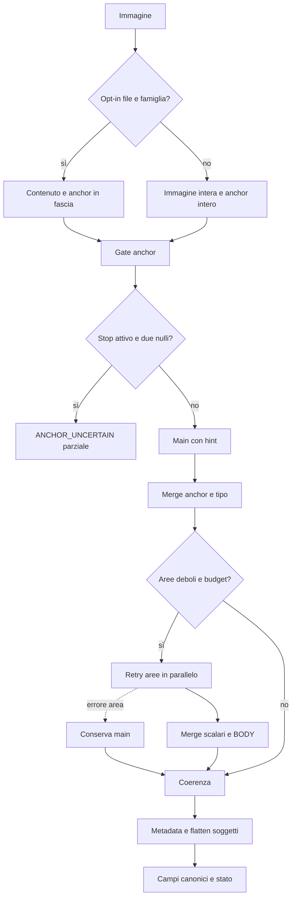
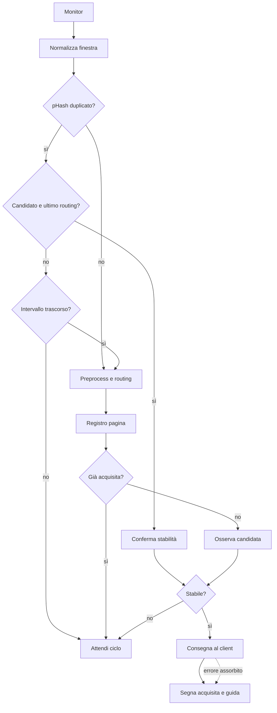
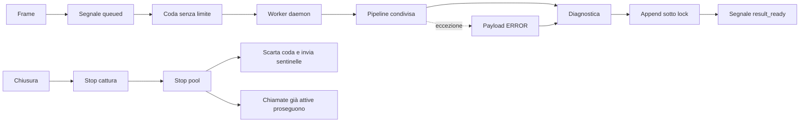
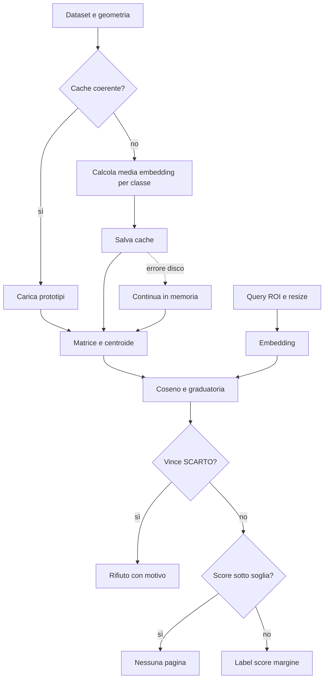
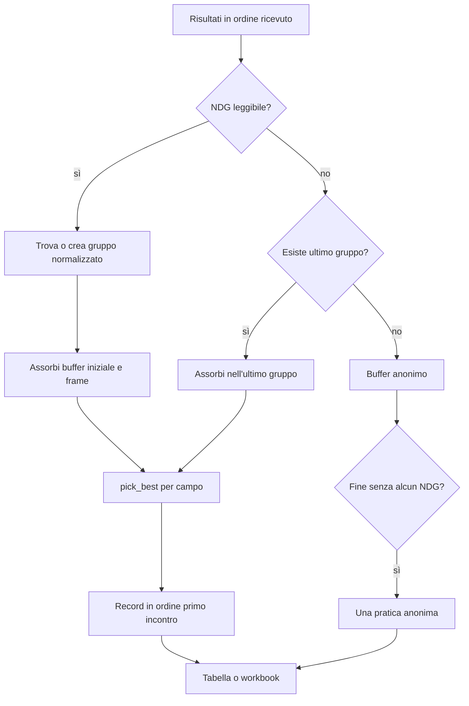
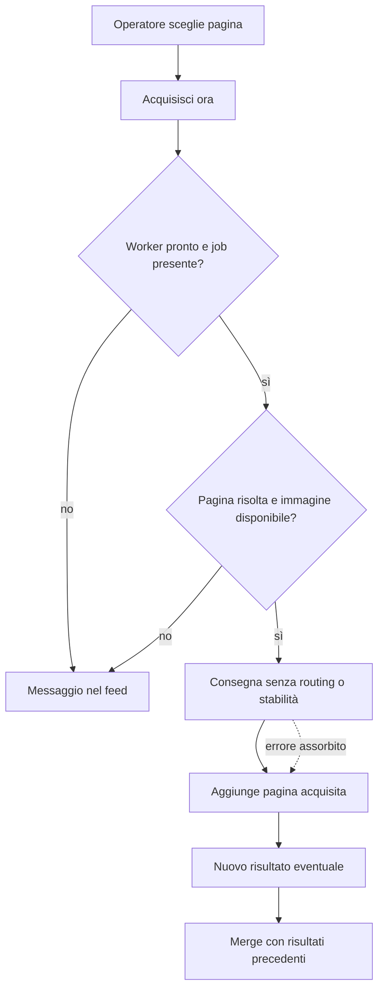
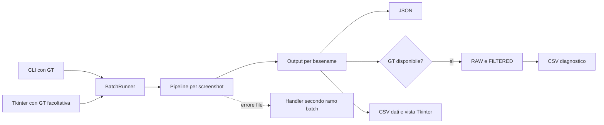
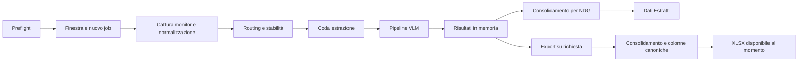
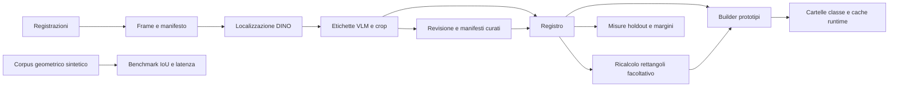

# Partition: root — Flow Tracing

Lettura statica dell'unica partizione `root`; `extraction/`, `edge-agent/`, `tools/` e `tests/` sono sottosistemi interni. Non ci sono flussi cross-partition. **verified** significa verificato nel sorgente, **documented** dichiarato da una fonte, **unverified** assunto senza garanzia e **disputed** contraddetto da un'altra evidenza. Le citazioni indicano file:riga e simbolo qualificato nel file. Non sono state eseguite chiamate LLM, GUI, build o utility mutanti.

## Critical Paths

### Avvio e configurazione prima dell'estrazione

1. **[verified]** Lo shim carica l'ambiente e importa immediatamente la facade `extraction`; solo dopo sceglie CLI oppure `--gui`. L'avvio diretto edge carica l'ambiente locale, crea Qt, esegue il preflight e importa `MainWindow` dopo il suo successo. I due ingressi non sono equivalenti al primo avvio: `main.py --gui` può avere già fotografato la configurazione del core prima che il preflight la completi (`main.py:4`; `main.py:12`; `edge-agent/edge_agent.py:31`; `edge-agent/edge_agent.py:38`, `main`; `extraction/config.py:16`).
2. **[verified]** `run_preflight` prepara la cache portabile, verifica scrivibilità/config/asset, istanzia `AgentConfig`, carica o richiede la chiave e prepara DINOv2 soltanto per `ml`/`hybrid`. Il ramo `EDGE_AGENT_SMOKE=1` salta richiesta chiave e preparazione ML, ma non `_ensure_files`; la finestra programma poi `app.quit` dopo cinque secondi (`edge-agent/bootstrap.py:489`, `run_preflight`; `edge-agent/bootstrap.py:143`, `_ensure_files`; `edge-agent/edge_agent.py:91`, `main`).
3. **[verified]** Il download dei pesi scrive un `.part`, controlla SHA-256 e sostituisce la destinazione solo dopo verifica; errore/annullamento eliminano il parziale e producono un segnale. La presenza di pesi già salvati viene invece verificata per esistenza, non ricalcolando l'hash (`edge-agent/bootstrap.py:299`, `_WeightsDownloadWorker.run`; `edge-agent/bootstrap.py:110`, `_weights_present`). **[unverified]** La presenza di una chiave soddisfa il preflight, senza dimostrarne autenticità o compatibilità col provider (`edge-agent/bootstrap.py:99`, `_has_api_key`).
4. **[verified]** Il catalogo dei prompt viene caricato integralmente all'import. L'override `PROMPTS_DIR` ammette un solo candidato; nel bundle si prova prima la copia modificabile, poi quella inclusa. Errori di sintassi, parti mancanti o placeholder sconosciuti impediscono l'uso del catalogo. Il bootstrap ripopola i prompt soltanto quando mancano JSON; non ripara una cartella parzialmente popolata (`prompt_store.py:220`, `catalog_candidates`; `prompt_store.py:239`, `load_prompts`; `prompt_store.py:262`, `_load_first_usable`; `prompt_store.py:284`; `edge-agent/bootstrap.py:213`, `_ensure_files`).

### Screenshot → risultato multipassata

1. **[verified]** Il percorso file apre RGB, riduce fino a 1800 px e applica contrasto/nitidezza. `extract_from_image` limita ulteriormente il lato lungo secondo configurazione; il crop contenuto richiede opt-in del percorso file e appartenenza alla famiglia geometrica: lato lungo 800–900 px e aspetto entro il 5% di 848/679. Il percorso live usa il default `allow_content_crop=False` (`extraction/pipeline.py:223`, `ExtractionPipeline.extract_from_screen`; `extraction/imaging.py:19`, `normalize_image`; `extraction/pipeline.py:139`, `ExtractionPipeline.extract_from_image`; `extraction/imaging.py:52`, `select_content_crop`; `extraction/config.py:65`).
2. **[verified]** L'anchor legge la fascia alta del contenuto solo se calibrato; altrimenti legge l'intera immagine. Annulla separatamente il valore NDG/denominazione sotto `ANCHOR_CONF_MIN`. Se configurato, l'early exit richiede entrambi i valori nullish e restituisce `ANCHOR_UNCERTAIN`, campi/tabelle vuoti e metadata dell'unico passaggio, senza `canonical_fields` (`extraction/pipeline.py:78`, `ExtractionPipeline.extract_anchors`; `extraction/pipeline.py:150`, `ExtractionPipeline.extract_from_image`).
3. **[verified]** Il main riceve immagine e hint dei soli anchor sopravvissuti. Il risultato principale viene modificato in-place: anchor non nulli sovrascrivono i due identificatori, `tipo` viene normalizzato, poi partono i retry (`extraction/pipeline.py:165`, `ExtractionPipeline.extract_from_image`; `extraction/pipeline.py:235`, `ExtractionPipeline._build_anchor_hint_prompt`; `extraction/pipeline.py:244`, `ExtractionPipeline._merge_anchors`; `extraction/pipeline.py:251`, `ExtractionPipeline._postprocess_tipo`).
4. **[verified]** Basta un campo nullo o con confidence inferiore a `RETRY_CONF_MIN` per rendere debole un'area. Si selezionano le prime aree deboli nell'ordine HEADER→BODY→FOOTER, limitate a `max(0, MAX_CALLS_PER_SCREEN-2)`, e si eseguono in parallelo. L'ordine è di selezione, non di completamento. Ogni area restituisce solo i propri scalari al merge; BODY può anche aggiornare le tre tabelle (`extraction/config.py:59`; `extraction/config.py:101`; `extraction/pipeline.py:284`, `ExtractionPipeline._retry_areas`).
5. **[verified]** Negli scalari vince un valore non nullo su uno nullo, poi la confidence maggiore; a parità resta il corrente. L'anchor può quindi essere sostituito da HEADER se il candidato ha confidence maggiore. Per tabelle calibrate vince prima il maggior numero di righe e, a pari lunghezza, la confidence media; fuori calibrazione il retry può soltanto riempire una tabella vuota (`extraction/normalization.py:104`, `pick_best`; `extraction/normalization.py:115`, `merge_field_sources`; `extraction/pipeline.py:258`, `ExtractionPipeline._merge_tables`).
6. **[verified]** La coerenza può derivare `evidenze=B` dal tooltip B quando il valore precedente è nullo/numerico, oppure `tipo=BMB` dal tooltip BMB quando tipo è nullo. Dopo l'aggregazione metadata, fino a quattro righe soggetti sovrascrivono i rispettivi campi piatti, anche con valori nulli. Né coerenza né flatten aggiornano la provenienza. Canonicalizzazione precede `_status`, che vale `OK` quando entrambi gli identificatori finali sono non nullish: non certifica gli altri campi né una confidence minima finale (`extraction/pipeline.py:365`, `ExtractionPipeline._coherence_check`; `extraction/pipeline.py:194`, `ExtractionPipeline.extract_from_image`; `extraction/canonical_mapping.py:20`, `build_canonical_field_entries`).

### Confine VLM e contabilità

**[verified]** La factory seleziona OpenAI/Gemini e controlla solo alcuni mismatch di nome modello. `call_vlm` decide il formato dalla stringa del modello: OpenAI usa structured output; Gemini 1.5 usa `json_mode`; gli altri Gemini ricevono lo schema nel prompt e vengono validati manualmente tramite Pydantic. I campi/tabelle hanno valori testuali opzionali e confidence normalizzata nel confine dello schema. Ogni risposta riuscita riceve `_meta`, `screen_id` e `attempt` (`extraction/llm_factory.py:18`, `create_chat_model`; `extraction/vlm_client.py:123`, `call_vlm`; `extraction/vlm_client.py:52`, `_call_vlm_gemini_freeform`; `extraction/schemas.py:11`, `_ConfidenceModel`; `extraction/schemas.py:76`, `ExtractionResponse`).

**[verified]** Il wrapper esegue fino a tre tentativi: `ValueError`, `KeyError`, `IndexError` propagano subito; ogni altra eccezione viene ritentata con backoff, anche se non è realmente transitoria. Il budget per schermata limita passaggi logici, non richieste di rete: i tentativi falliti non hanno `_meta` e non entrano negli aggregati; i retry SDK sono un ulteriore comportamento esterno **[unverified]**. Modelli assenti dal tariffario valgono zero; la latenza aggregata somma durate di chiamata riuscite, incluse quelle parallele, e non è tempo muro della schermata. Il routing usa un altro client e non entra in `_meta_agg` (`extraction/vlm_client.py:230`, `call_vlm_with_retry`; `extraction/vlm_client.py:26`, `estimate_cost_usd`; `extraction/pipeline.py:383`, `ExtractionPipeline._aggregate_meta`; `edge-agent/llm_router.py:228`, `LLMPageRouter.route`).

### Batch CLI e GUI Tkinter

1. **[verified]** La CLI richiede il CSV, legge la ground truth, enumera solo immagini immediate di `INPUT_DIR`, ordina i nomi e costruisce due modelli/una pipeline condivisa. Il batch scarta i percorsi inesistenti e usa come chiave il basename senza estensione: file omonimi di cartelle/formati diversi possono sostituire lo stesso risultato (`extraction/cli.py:318`, `main`; `extraction/cli.py:164`, `BatchRunner.__init__`; `extraction/cli.py:210`, `BatchRunner.run`; `extraction/imaging.py:29`, `screen_id_from_path`).
2. **[verified]** I future eseguono l'estrazione, mentre raccolta risultati e callback avvengono nel thread che chiama `run`. In parallelo, un'eccezione per file viene comunicata/stampata e si continua; nel ramo sequenziale, senza `on_error`, si rilancia. Un errore di `on_complete` entra nello stesso handler dopo che l'output è già stato salvato; un errore di `on_error` non ha un'ulteriore protezione. La dedup per pagina esiste ma non viene chiamata (`extraction/cli.py:232`, `BatchRunner.run`; `extraction/cli.py:255`; `extraction/cli.py:271`).
3. **[verified]** La CLI scrive JSON prima di valutare, poi CSV diagnostico e riepilogo costi. `eval_outputs` considera solo schermate presenti sia in GT sia negli output, e solo alias riconosciuti: immagini senza output vengono saltate, non conteggiate come campi mancanti. RAW include i mismatch di identificatori; FILTERED li esclude. La classificazione usa nullità, normalizzazione numerica per importo/NDG/fido e confronto testuale, con fuzzy matching per testi lunghi (`extraction/cli.py:342`, `main`; `extraction/evaluation.py:88`, `eval_outputs`; `extraction/normalization.py:134`, `classify_field`; `extraction/normalization.py:195`, `dataset_mismatch_guard`).
4. **[verified]** Tkinter valida selezione/chiave, avvia un thread normale, richiama il batch condiviso con fino a 12 worker, scrive JSON/CSV nella directory corrente e valuta solo se è stato selezionato un CSV. Solo il rendering finale viene pianificato con `after`; log, letture dei controlli, messagebox e riabilitazione pulsante restano nel thread di elaborazione. L'affinità sicura di tutte queste operazioni GUI è **[unverified]** dal solo codice (`gui_app.py:213`, `App.start_extraction`; `gui_app.py:228`, `App.run_process`; `gui_app.py:287`, `App.display_results`).

### Sessione live, routing e stabilità

1. **[verified]** `CaptureTab` crea un nuovo job, aggiorna FPS/filtro e costruisce il worker selezionato. BPER inizializza router/registro dentro `run`, poi usa il loop QThread; il periodo FPS viene rispettato solo se il lavoro termina prima dell'intervallo. L'LLM router è sincrono in quel loop (`edge-agent/ui/capture_tab.py:192`, `CaptureTab._on_start_capture`; `edge-agent/workers/capture/bper_capture_worker.py:201`, `BPERCaptureWorker.run`; `edge-agent/workers/capture/base_capture_worker.py:41`, `BaseCaptureWorker.run`; `edge-agent/workers/capture/bper_capture_worker.py:552`, `BPERCaptureWorker._detect_page`).
2. **[verified]** `_grab_raw` legge il monitor configurato con fallback a 1 e normalizza prima di qualunque consumatore: rettangolo OS selezionato per titolo, esclusione del PID proprio e area maggiore; poi bounding box su sfondo uniforme; infine frame invariato. pHash lavora su quell'immagine, ridotta a 256×256. La somiglianza entro soglia è una decisione euristica, non uguaglianza dei pixel o identità di pratica **[unverified]** (`edge-agent/workers/capture/bper_capture_worker.py:359`, `BPERCaptureWorker._grab_raw`; `edge-agent/frame_normalize.py:113`, `select_window_rect`; `edge-agent/frame_normalize.py:209`, `normalize_frame`; `edge-agent/workers/capture/bper_capture_worker.py:464`, `BPERCaptureWorker._is_duplicate_frame`).
3. **[verified]** Con frame duplicato, candidato e ultimo routing presenti, il tracker conferma senza altra chiamata e può acquisire. Altrimenti il duplicato è soggetto a throttling; i frame non duplicati vengono preprocessati e instradati. Il registro risolve nome/template e rifiuta catchall; una pagina già acquisita viene saltata, le altre alimentano il tracker. La guida alla pagina successiva non impone che le acquisizioni seguano quell'ordine (`edge-agent/workers/capture/bper_capture_worker.py:255`, `BPERCaptureWorker._capture_once`; `edge-agent/page_registry.py:69`, `PageRegistry.resolve`; `edge-agent/workers/capture/bper_capture_worker.py:246`, `BPERCaptureWorker._next_pending_page`).
4. **[verified]** La stabilità richiede due concordanze e almeno due secondi; tollera una discordanza. Una seconda nuova candidata concorde cambia candidata ma non restituisce subito una pagina pronta. `confirm` osserva nuovamente il candidato precedente. La corrispondenza fra candidato e `_last_routed_page` è mantenuta dal chiamante, non controllata dal tracker (`edge-agent/stability.py:10`, `StabilityConfig`; `edge-agent/stability.py:46`, `StabilityTracker.observe`; `edge-agent/stability.py:76`, `StabilityTracker.confirm`; `edge-agent/workers/capture/bper_capture_worker.py:282`, `BPERCaptureWorker._capture_once`).
5. **[verified]** `llm` crea solo LLM; `hybrid` crea LLM con eventuale fallback ML; ogni altro valore crea ML. Il ramo `local-first` può accettare un risultato locale a margine sufficiente o uno scarto riconosciuto; quando rinuncia richiama il router costruito prima, che per tale modalità è ML. Il fallback LLM dichiarato nei commenti è quindi **[disputed]** (`edge-agent/workers/capture/bper_capture_worker.py:108`, `BPERCaptureWorker._init_router`; `edge-agent/workers/capture/bper_capture_worker.py:491`, `BPERCaptureWorker._try_local_first`; `edge-agent/workers/capture/bper_capture_worker.py:541`, `BPERCaptureWorker._detect_page`; `edge-agent/config.py:30`).
6. **[verified]** Il router LLM invia frame ridotto e fascia header, prova fino a due volte, valida l'etichetta contro il catalogo e restituisce `fields={}`. Il worker non applica un gate alla confidence del routing. Il classificatore ML calcola ROI/resize/embedding, sottrae il centroide dei prototipi, ordina score e margine, respinge prima i vincitori `SCARTO*`, poi i punteggi sotto soglia. Con un solo prototipo usa il coseno grezzo (`edge-agent/llm_router.py:172`, `LLMPageRouter.route`; `edge-agent/page_classifier.py:629`, `BPERPagePrototypeClassifier._compute_embedding`; `edge-agent/page_classifier.py:499`, `BPERPagePrototypeClassifier._refresh_proto_matrix`; `edge-agent/page_classifier.py:660`, `BPERPagePrototypeClassifier.classify_detailed`).

### Acquisizione, coda, risultati e chiusura

1. **[verified]** `_acquire` chiama `_upload_page`, inserisce il nome nell'insieme acquisito, azzera la stabilità e aggiorna la guida. `_upload_page` cattura gli errori del client e non restituisce un esito: l'insieme può avanzare anche se la consegna non è riuscita. `ingest_frame` emette `frame_queued` prima di `submit` e ne ignora il booleano. «Acquisita» indica dunque il tentativo di consegna, non estrazione riuscita (`edge-agent/workers/capture/bper_capture_worker.py:331`, `BPERCaptureWorker._acquire`; `edge-agent/workers/capture/bper_capture_worker.py:609`, `BPERCaptureWorker._upload_page`; `edge-agent/local_extraction_client.py:125`, `LocalExtractionClient.ingest_frame`).
2. **[verified]** La coda senza limite contiene immagine e argomenti del frame. Worker daemon condividono una pipeline; ogni estrazione può aprire a sua volta un executor di retry. Il client ignora `fields_json` nella pipeline, aggiunge metadata pagina, scrive diagnostica, conserva sotto lock e notifica Qt. Gli errori pipeline diventano risultati `ERROR` con campi vuoti. La lista cresce in ordine di completamento, non di acquisizione (`edge-agent/extraction_pool.py:23`, `DaemonThreadPool.__init__`; `edge-agent/local_extraction_client.py:144`, `LocalExtractionClient._process_frame`; `extraction/pipeline.py:337`, `ExtractionPipeline._retry_areas`).
3. **[verified]** «Acquisisci ora» chiama direttamente `force_capture` dalla UI. Verifica inizializzazione/job/pagina, cattura una nuova immagine e la consegna senza routing, stabilità o blocco per pagina già acquisita. Non rimuove il risultato precedente. L'accesso a MSS e stato del worker può sovrapporsi al loop; nessun lock serializza questa chiamata (`edge-agent/ui/capture_tab.py:405`, `CaptureTab._on_force_capture`; `edge-agent/workers/capture/bper_capture_worker.py:643`, `BPERCaptureWorker.force_capture`).
4. **[verified]** Stop imposta un latch persistente, chiude MSS e attende fino a cinque secondi il worker; la UI azzera comunque il riferimento e lascia le estrazioni in background. La chiusura finestra ferma anche il pool: scarta task in coda, invia sentinelle e non attende né cancella le chiamate attive. `pending_extractions` misura soltanto la coda; `requeue_job` restituisce `True` senza rifare lavoro (`edge-agent/workers/capture/base_capture_worker.py:73`, `BaseCaptureWorker.stop`; `edge-agent/workers/capture/bper_capture_worker.py:210`, `BPERCaptureWorker.stop`; `edge-agent/ui/capture_tab.py:292`, `CaptureTab._on_stop_capture`; `edge-agent/ui/main_window.py:85`, `MainWindow.closeEvent`; `edge-agent/extraction_pool.py:44`, `DaemonThreadPool.stop`; `edge-agent/local_extraction_client.py:180`, `LocalExtractionClient.requeue_job`). **[unverified]** La cessazione immediata dell'intero processo non è dimostrata dai soli daemon, perché il percorso attivo può contenere executor e chiamate sincrone (`extraction/pipeline.py:337`; `edge-agent/llm_router.py:228`).

### Risultati → pratica → workbook

**[verified]** `consolidate` deriva l'identità dall'NDG scalare normalizzato: conserva alfanumerici maiuscoli e rimuove zeri iniziali solo per identificatori interamente numerici. Tiene l'ordine del primo incontro, associa frame privi di NDG all'ultimo identificatore e bufferizza quelli precedenti al primo; se tutti sono anonimi restituisce un unico record anonimo. I 45 campi vengono scelti con `pick_best` su copie; `_status=ERROR` non esclude il frame. L'NDG del record è la chiave normalizzata, mentre il valore mostrato resta quello vincente nei campi (`edge-agent/practice_consolidation.py:46`, `normalize_ndg`; `edge-agent/practice_consolidation.py:85`, `_Group.absorb`; `edge-agent/practice_consolidation.py:105`, `consolidate`).

**[verified]** La tabella ricalcola il consolidamento ad ogni risultato del job mostrato. Colonne fissate da metadati canonici, NDG/denominazione davanti; la rinomina cambia solo etichette in memoria. Entrambi i pulsanti export chiamano `export_results`, ma soltanto Dati Estratti passa le rinomine. L'export prende i risultati disponibili in quel momento, senza attesa di fine job, e scrive un foglio con bande pagina, etichette, righe pratica e freeze `C3`. Gli scalari sono testo esplicito; le tabelle annidate non diventano ulteriori righe (`edge-agent/ui/data_table_tab.py:128`, `DataTableTab._on_result_ready`; `edge-agent/ui/data_table_tab.py:161`, `DataTableTab._on_rename_column`; `edge-agent/excel_export.py:92`, `build_columns`; `edge-agent/excel_export.py:124`, `_set_text`; `edge-agent/excel_export.py:177`, `write_workbook`; `edge-agent/ui/capture_tab.py:332`, `CaptureTab._on_export_excel`; `edge-agent/ui/data_table_tab.py:255`, `DataTableTab._on_export_excel`).

### Utility di supporto e distribuzione

| Flusso | Comportamento ed evidenza |
|---|---|
| Video → frame | **[verified]** FFmpeg campiona l'inizio della registrazione a FPS fisso oppure scene change; pHash confronta ogni candidato con tutti i frame mantenuti e scrive facoltativamente il manifesto. Le immagini scartate dalla lista restano sul disco (`tools/extract_frames.py:69`, `extract`; `tools/extract_frames.py:86`, `deduplicate`; `tools/extract_frames.py:108`, `main`). |
| Frame → etichette | **[verified]** Il prompt deriva dal processo; DINO localizza una finestra su griglia di patch con area minima, salva crop, poi un pool invia i crop al provider. Resume usa `source`/basename, scarta record senza cluster per riprovarli, checkpoint sostituisce un file temporaneo dopo ogni batch; `--limit` con residui termina con codice 10 (`tools/label_frames.py:61`, `build_prompt`; `tools/label_frames.py:121`, `localize`; `tools/label_frames.py:156`, `main`; `tools/label_frames.py:93`, `save_atomic`). |
| Etichette → registro/prototipi | **[verified]** Una revisione disponibile precede la proposta, i manifesti curati vengono aggiunti; `relocalize` ricalcola rettangoli con resume e salvataggi periodici. Il builder campiona per classe, costruisce scarti di default e pagine solo con `--pages`, allarga i rettangoli verso l'alto per la ROI e sostituisce le cartelle di classe selezionate (`tools/build_frame_registry.py:74`, `main`; `tools/relocalize.py:38`, `main`; `tools/build_prototypes.py:67`, `widen_for_roi`; `tools/build_prototypes.py:85`, `main`). |
| Dati → ispezione/misure | **[verified]** Contact sheet e indice per `label` o sorgente; corpus sintetico con rettangoli noti; benchmark confronta IoU/tempo; misure classificatore separano registrazioni train/holdout e riportano margini. Gli esperimenti scarti/tooltip eseguono lavoro al caricamento del modulo; tooltip usa una directory temporanea, non aggiorna gli asset runtime (`tools/make_contact_sheets.py:32`, `main`; `tools/make_framing_corpus.py:91`, `compose`; `tools/benchmark_backbones.py:139`, `main`; `tools/measure_classifier.py:60`, `main`; `tools/measure_reject_prototypes.py:29`; `tools/measure_tooltip_prototypes.py:82`). |
| Launcher/build | **[verified]** Il launcher ripara una venv non avviabile, prova 3.13, 3.12 e infine `python` senza controllo versione; installa dipendenze alla creazione e avvia l'edge-agent. La build può installare Python, ricrea `dist/EdgeAgent`, controlla la riga API key INI con un pattern, esegue PyInstaller, copia asset/prompt/template e produce ZIP. Non è stata eseguita (`run_edge_agent.bat:23`; `run_edge_agent.bat:43`; `build_exe.bat:10`; `build_exe.bat:57`; `build_exe.bat:67`; `edge_agent.spec:27`; `build_exe.bat:81`). |

## Data Flow

| Dato | Trasformazione/contratto osservato |
|---|---|
| Pixel | **[verified]** Monitor→window framing→pHash→preprocessing→routing/coda; file→RGB/enhancement→crop ammesso dalla famiglia. Retry e ROI ricevono coordinate relative all'immagine corrente, non al monitor originario (`edge-agent/workers/capture/bper_capture_worker.py:270`, `BPERCaptureWorker._capture_once`; `extraction/pipeline.py:223`, `ExtractionPipeline.extract_from_screen`; `extraction/pipeline.py:318`, `ExtractionPipeline._retry_areas`). |
| Identità schermata | **[verified]** Batch: basename; live: nome pagina o `pagina N`; job UUID separa sessioni. Il nome di pagina non entra come vincolo di campi nel prompt di estrazione e `fields_json` non viene utilizzato (`extraction/imaging.py:29`, `screen_id_from_path`; `edge-agent/local_extraction_client.py:121`, `LocalExtractionClient.start_job`; `edge-agent/local_extraction_client.py:154`, `LocalExtractionClient._process_frame`; `extraction/vlm_client.py:123`, `call_vlm`). |
| Confidenza/provenienza | **[verified]** Confidence influenza gate, retry e vincitore; `_field_sources` registra main/anchor/retry ma resta invariato nelle derivazioni successive. Confidence del routing rimane metadata separato e non modifica la confidence dei campi (`extraction/pipeline.py:180`, `ExtractionPipeline.extract_from_image`; `extraction/pipeline.py:365`, `ExtractionPipeline._coherence_check`; `edge-agent/local_extraction_client.py:168`, `LocalExtractionClient._process_frame`). |
| Ground truth | **[verified]** CSV con separatore inferito e tentativi encoding→alias colonne→dict per screen/campo, con ultima riga duplicata vincente→confronto. NDG di valutazione usa `norm_number_str`, mentre NDG di consolidamento usa `normalize_ndg`: i due significati non coincidono (`extraction/evaluation.py:32`, `_read_gt_csv`; `extraction/evaluation.py:47`, `load_ground_truth`; `extraction/normalization.py:195`, `dataset_mismatch_guard`; `edge-agent/practice_consolidation.py:46`, `normalize_ndg`). |
| Output | **[verified]** JSON conserva payload/diagnostica; CSV può serializzare scalari canonici e voci delle tabelle; XLSX/UI edge mostrano soltanto scalari consolidati. CSV prefissa formule apparenti, XLSX forza il tipo testuale dei dati (`extraction/evaluation.py:191`, `export_to_csv`; `extraction/evaluation.py:15`, `_write_csv`; `edge-agent/excel_export.py:124`, `_set_text`; `edge-agent/ui/data_table_tab.py:194`, `DataTableTab._load_table`). |

## Error Handling Paths

| Origine | Propagazione e stato |
|---|---|
| Catalogo prompt | **[verified]** Errori strutturali→`PromptStoreError`→prossimo candidato oppure fallimento import. Nell'avvio diretto edge l'import UI ha dialog critico; l'istanziazione successiva di `MainWindow` è fuori da quel catch. Il catalogo pagine del router degrada invece a spec vuota (`prompt_store.py:262`, `_load_first_usable`; `edge-agent/edge_agent.py:73`, `main`; `edge-agent/llm_router.py:102`, `LLMPageRouter._load_spec`). |
| Anchor/main VLM | **[verified]** Dopo il wrapper retry, l'errore esce dalla pipeline: il batch può proseguire o rilanciare secondo ramo/callback; il client live lo converte in payload ERROR. I risultati parziali e i costi precedenti non vengono recuperati in tale payload (`extraction/pipeline.py:148`, `ExtractionPipeline.extract_from_image`; `extraction/cli.py:249`, `BatchRunner.run`; `edge-agent/local_extraction_client.py:156`, `LocalExtractionClient._process_frame`). |
| Retry d'area | **[verified]** L'eccezione del future produce warning e conserva il main. L'elaborazione del payload dopo `future.result`, incluso `_meta` e merge, sta fuori dal catch: un payload malformato può ancora far fallire l'intera estrazione (`extraction/pipeline.py:337`, `ExtractionPipeline._retry_areas`). |
| Riconoscimento | **[verified]** Import Torch fallito→classificatore disabled; errori d'inizializzazione router→router disabilitato; eccezioni delle chiamate LLM→risultato nullo con reason dopo due tentativi. Con client LLM assente viene restituito un nullo senza reason, pur essendo disponibile l'errore nel debug (`edge-agent/page_classifier.py:313`, `BPERPagePrototypeClassifier._lazy_init_torch`; `edge-agent/workers/capture/bper_capture_worker.py:191`, `BPERCaptureWorker._init_router`; `edge-agent/llm_router.py:172`, `LLMPageRouter.route`). |
| Cattura/preprocess | **[verified]** MSS indisponibile ferma il loop; cinque errori screenshot consecutivi lo fermano, mentre un successo azzera il contatore. Preprocess fallito restituisce l'immagine originale; pHash fallito tratta il frame come nuovo. Altre eccezioni per iterazione vengono emesse e il loop continua (`edge-agent/workers/capture/bper_capture_worker.py:359`, `BPERCaptureWorker._grab_raw`; `edge-agent/workers/capture/bper_capture_worker.py:445`, `BPERCaptureWorker._preprocess`; `edge-agent/workers/capture/base_capture_worker.py:52`, `BaseCaptureWorker.run`). |
| Consegna/pubblicazione | **[verified]** Errori ingest vengono emessi ma la pagina può risultare acquisita. Errori dopo il catch della pipeline, per esempio in diagnostica, sono stampati dal pool e possono impedire append/segnale: nessun payload ERROR aggiuntivo è costruito dal pool (`edge-agent/workers/capture/bper_capture_worker.py:635`, `BPERCaptureWorker._upload_page`; `edge-agent/local_extraction_client.py:172`, `LocalExtractionClient._process_frame`; `edge-agent/extraction_pool.py:55`, `DaemonThreadPool._run`). |
| Export/servizio generico | **[verified]** Errori XLSX arrivano ai dialog delle tab; nessuna transazione collega export e job. La modalità generica invia PNG a `POST /jobs/{job_id}/frames`, timeout 30 s, cattura errori HTTP e continua; questo ramo non consegna risultati al client locale (`edge-agent/excel_export.py:214`, `write_workbook`; `edge-agent/ui/data_table_tab.py:269`, `DataTableTab._on_export_excel`; `edge-agent/workers/capture/default_capture_worker.py:34`, `DefaultCaptureWorker._capture_once`). |

## Side Effects

- **[verified] Processo/rete:** import configura ambiente e prompt; factory/client invocano provider; preflight/classificatore possono scaricare pesi/codice; modalità generica effettua upload. «Locale» descrive la pipeline/client BPER, non assenza di rete (`main.py:4`; `prompt_store.py:284`; `extraction/vlm_client.py:197`, `call_vlm`; `edge-agent/bootstrap.py:304`, `_WeightsDownloadWorker.run`; `edge-agent/page_classifier.py:363`, `BPERPagePrototypeClassifier._init_feature_extractor_and_transform`; `edge-agent/workers/capture/default_capture_worker.py:65`, `DefaultCaptureWorker._capture_once`).
- **[verified] Disco applicativo:** bootstrap semina file ed eventualmente salva la chiave; classifier riscrive la cache; debug crop, JSON/CSV e XLSX sono scritture dirette. `AgentConfig.save` esiste e serializza anche la chiave nel file INI, ma i flussi UI letti usano solo `update_from_ui` (`edge-agent/bootstrap.py:58`, `_save_env_key`; `edge-agent/bootstrap.py:143`, `_ensure_files`; `edge-agent/page_classifier.py:546`, `BPERPagePrototypeClassifier._save_prototypes_to_cache`; `extraction/imaging.py:93`, `save_debug_crop`; `extraction/cli.py:343`, `main`; `edge-agent/config.py:339`, `AgentConfig.save`; `edge-agent/ui/capture_tab.py:214`, `CaptureTab._on_start_capture`). Nessun file contenente credenziali è stato letto dall'analisi.
- **[verified] Memoria/UI:** set acquisiti e tracker appartengono al worker; coda e risultati al client; ordinamento/consolidamento e rinomine alle tab. Non esiste persistenza dei job nei metodi del client: chiusura perde la memoria non esportata. `get_results` copia solo la lista, non i dizionari interni (`edge-agent/workers/capture/bper_capture_worker.py:44`, `BPERCaptureWorker.__init__`; `edge-agent/local_extraction_client.py:116`, `LocalExtractionClient.__init__`; `edge-agent/local_extraction_client.py:195`, `LocalExtractionClient.get_results`; `edge-agent/ui/data_table_tab.py:179`, `DataTableTab._on_rename_column`).
- **[verified] Diagnostica:** i valori non vuoti e le loro confidence/provenienze vengono stampati; solo quando stdout/stderr mancano si redirige a `edge-agent.log`, con azzeramento oltre 1 MB all'apertura. Il feed Cattura mostra anche lo stato dell'estrazione; i valori della tabella restano business (`edge-agent/local_extraction_client.py:41`, `_log_extraction`; `edge-agent/edge_agent.py:15`; `edge-agent/ui/capture_tab.py:388`, `CaptureTab._on_result_ready_count`; `edge-agent/ui/data_table_tab.py:210`, `DataTableTab._load_table`).

## Process Diagrams

I diagrammi sono **[verified]** come sintesi dei rami citati nelle sezioni precedenti; non sono tracce d'esecuzione. Le frecce tratteggiate rappresentano fallimenti/degradi.

### Technical Processes

#### Estrazione e merge

#### Selezione della pagina live

#### Pool e terminazione

#### Cache del classificatore

### Functional Processes

#### Composizione della pratica

#### Ripresa manuale

### End-to-End Processes

#### Screenshot selezionati → valutazione

#### Operatore → Excel

#### Raccolta → valutazione dei prototipi

