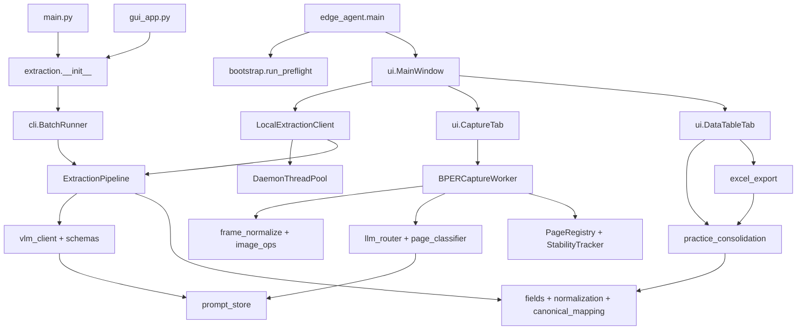

# Partizione root — Estrazione della struttura

> Stato: `verified` per inventario, firme e dipendenze estratti dal working tree con `ast_parser.py` e `classifier.py` (parser Python `stdlib-ast`), integrati dalla lettura delle sorgenti. Revisione: `f8f57e6124e008aa47ff6d8320aa508e9ef7976c`. Sono presenti modifiche non committate alla documentazione, rimozioni di `.codebase-map/` e nuovi file documentali; nessuna modifica applicativa risultava da `git status --short` durante questa fase. Non sono stati letti output X-ray precedenti. Nessun test o provider è stato eseguito da questo worker.

## File Inventory

Le righe totali comprendono commenti e righe vuote; LOC viene dal classificatore del plugin. Le funzioni comprendono i metodi, ma non i callable annidati. Gli import sono dichiarazioni AST (anche import locali/condizionali), non dipendenze effettivamente caricate. Interno significa risolvibile nel repository; non esistono partizioni sorelle. Esterno comprende la libreria standard. La classificazione automatica è un segnale di complessità, non una constatazione di difetto.

| File | Linguaggio | Righe / LOC | Funzioni | Classi | Import interni / tra partizioni / esterni | Classificazione |
|---|---|---:|---:|---:|---|---|
| `edge-agent/__init__.py` | Python | 1 / 0 | 0 | 0 | 0 / 0 / 0 | `utility` |
| `edge-agent/app_paths.py` | Python | 76 / 35 | 11 | 0 | 0 / 0 / 3 | `utility` |
| `edge-agent/bootstrap.py` | Python | 517 / 369 | 18 | 1 | 5 / 0 / 9 | `high-complexity` |
| `edge-agent/config.py` | Python | 412 / 267 | 6 | 1 | 0 / 0 / 4 | `high-complexity` |
| `edge-agent/edge_agent.py` | Python | 99 / 57 | 1 | 0 | 3 / 0 / 8 | `standard` |
| `edge-agent/excel_export.py` | Python | 229 / 148 | 8 | 1 | 4 / 0 / 8 | `standard` |
| `edge-agent/extraction_pool.py` | Python | 64 / 42 | 5 | 1 | 0 / 0 / 5 | `high-complexity` |
| `edge-agent/frame_normalize.py` | Python | 235 / 129 | 6 | 0 | 0 / 0 / 7 | `standard` |
| `edge-agent/image_ops.py` | Python | 71 / 44 | 4 | 0 | 0 / 0 / 5 | `utility` |
| `edge-agent/llm_router.py` | Python | 290 / 208 | 12 | 4 | 3 / 0 / 12 | `high-complexity` |
| `edge-agent/local_extraction_client.py` | Python | 229 / 141 | 10 | 1 | 6 / 0 / 9 | `high-complexity` |
| `edge-agent/page_classifier.py` | Python | 727 / 381 | 18 | 3 | 0 / 0 / 10 | `high-complexity` |
| `edge-agent/page_registry.py` | Python | 99 / 73 | 8 | 2 | 0 / 0 / 6 | `standard` |
| `edge-agent/practice_consolidation.py` | Python | 146 / 78 | 6 | 2 | 3 / 0 / 5 | `high-complexity` |
| `edge-agent/stability.py` | Python | 115 / 72 | 6 | 2 | 0 / 0 / 3 | `standard` |
| `edge-agent/ui/__init__.py` | Python | 7 / 6 | 0 | 0 | 2 / 0 / 0 | `utility` |
| `edge-agent/ui/capture_tab.py` | Python | 422 / 311 | 17 | 1 | 6 / 0 / 6 | `high-complexity` |
| `edge-agent/ui/data_table_tab.py` | Python | 291 / 211 | 14 | 1 | 3 / 0 / 6 | `standard` |
| `edge-agent/ui/debug_tab.py` | Python | 40 / 25 | 3 | 1 | 0 / 0 / 3 | `utility` |
| `edge-agent/ui/main_window.py` | Python | 95 / 54 | 4 | 1 | 5 / 0 / 3 | `standard` |
| `edge-agent/ui/overlay.py` | Python | 39 / 26 | 3 | 1 | 0 / 0 / 2 | `utility` |
| `edge-agent/workers/__init__.py` | Python | 9 / 6 | 0 | 0 | 1 / 0 / 0 | `standard` |
| `edge-agent/workers/capture/__init__.py` | Python | 11 / 8 | 0 | 0 | 3 / 0 / 0 | `utility` |
| `edge-agent/workers/capture/base_capture_worker.py` | Python | 104 / 51 | 7 | 1 | 0 / 0 / 4 | `standard` |
| `edge-agent/workers/capture/bper_capture_worker.py` | Python | 761 / 535 | 21 | 1 | 9 / 0 / 11 | `high-complexity` |
| `edge-agent/workers/capture/default_capture_worker.py` | Python | 88 / 41 | 3 | 1 | 1 / 0 / 8 | `standard` |
| `extraction/__init__.py` | Python | 122 / 82 | 0 | 0 | 11 / 0 / 1 | `standard` |
| `extraction/canonical_mapping.py` | Python | 42 / 31 | 2 | 0 | 2 / 0 / 1 | `utility` |
| `extraction/cli.py` | Python | 358 / 268 | 10 | 1 | 6 / 0 / 4 | `high-complexity` |
| `extraction/config.py` | Python | 130 / 71 | 0 | 0 | 0 / 0 / 1 | `high-complexity` |
| `extraction/evaluation.py` | Python | 286 / 212 | 12 | 1 | 2 / 0 / 2 | `high-complexity` |
| `extraction/field_definitions.py` | Python | 262 / 246 | 4 | 0 | 0 / 0 / 1 | `standard` |
| `extraction/fields.py` | Python | 122 / 101 | 3 | 0 | 2 / 0 / 1 | `standard` |
| `extraction/imaging.py` | Python | 98 / 57 | 7 | 0 | 1 / 0 / 4 | `standard` |
| `extraction/llm_factory.py` | Python | 81 / 59 | 1 | 0 | 1 / 0 / 6 | `high-complexity` |
| `extraction/normalization.py` | Python | 210 / 147 | 13 | 0 | 1 / 0 / 3 | `standard` |
| `extraction/page_definitions.py` | Python | 51 / 35 | 4 | 0 | 0 / 0 / 1 | `utility` |
| `extraction/pipeline.py` | Python | 418 / 296 | 13 | 1 | 9 / 0 / 5 | `high-complexity` |
| `extraction/prompts.py` | Python | 27 / 12 | 0 | 0 | 1 / 0 / 1 | `standard` |
| `extraction/schemas.py` | Python | 93 / 61 | 1 | 8 | 1 / 0 / 3 | `standard` |
| `extraction/vlm_client.py` | Python | 262 / 199 | 5 | 0 | 2 / 0 / 8 | `high-complexity` |
| `gui_app.py` | Python | 403 / 327 | 11 | 1 | 1 / 0 / 5 | `high-complexity` |
| `main.py` | Python | 20 / 13 | 0 | 0 | 2 / 0 / 3 | `utility` |
| `prompt_store.py` | Python | 319 / 193 | 11 | 3 | 0 / 0 / 9 | `standard` |
| `tests/conftest.py` | Python | 47 / 20 | 1 | 0 | 1 / 0 / 2 | `utility` |
| `tests/test_base_capture_worker.py` | Python | 42 / 25 | 5 | 2 | 1 / 0 / 2 | `utility` |
| `tests/test_bper_capture_framing.py` | Python | 260 / 143 | 27 | 8 | 1 / 0 / 3 | `standard` |
| `tests/test_bper_capture_lifecycle.py` | Python | 248 / 196 | 25 | 3 | 3 / 0 / 7 | `high-complexity` |
| `tests/test_content_crop.py` | Python | 208 / 98 | 19 | 0 | 4 / 0 / 4 | `standard` |
| `tests/test_excel_export.py` | Python | 133 / 98 | 15 | 0 | 2 / 0 / 3 | `standard` |
| `tests/test_extraction_pool.py` | Python | 72 / 55 | 5 | 0 | 1 / 0 / 2 | `standard` |
| `tests/test_frame_normalize.py` | Python | 182 / 95 | 17 | 0 | 1 / 0 / 1 | `high-complexity` |
| `tests/test_local_extraction_client.py` | Python | 240 / 194 | 16 | 3 | 2 / 0 / 7 | `standard` |
| `tests/test_localize_rect.py` | Python | 60 / 32 | 2 | 0 | 0 / 0 / 3 | `utility` |
| `tests/test_page_classifier.py` | Python | 268 / 147 | 18 | 0 | 6 / 0 / 4 | `standard` |
| `tests/test_page_registry.py` | Python | 96 / 71 | 10 | 0 | 1 / 0 / 3 | `standard` |
| `tests/test_pipeline_retry.py` | Python | 78 / 44 | 5 | 0 | 5 / 0 / 3 | `standard` |
| `tests/test_practice_consolidation.py` | Python | 139 / 100 | 17 | 0 | 1 / 0 / 1 | `standard` |
| `tests/test_prompt_store.py` | Python | 359 / 236 | 35 | 0 | 4 / 0 / 6 | `high-complexity` |
| `tests/test_stability.py` | Python | 120 / 76 | 13 | 0 | 1 / 0 / 0 | `standard` |
| `tools/benchmark_backbones.py` | Python | 203 / 144 | 7 | 1 | 0 / 0 / 12 | `high-complexity` |
| `tools/build_frame_registry.py` | Python | 198 / 144 | 2 | 0 | 0 / 0 / 6 | `standard` |
| `tools/build_prototypes.py` | Python | 167 / 98 | 2 | 0 | 0 / 0 / 9 | `standard` |
| `tools/extract_frames.py` | Python | 141 / 62 | 3 | 0 | 0 / 0 / 8 | `high-complexity` |
| `tools/label_frames.py` | Python | 285 / 207 | 6 | 0 | 2 / 0 / 19 | `high-complexity` |
| `tools/make_contact_sheets.py` | Python | 102 / 72 | 2 | 0 | 0 / 0 / 8 | `standard` |
| `tools/make_framing_corpus.py` | Python | 165 / 116 | 4 | 0 | 0 / 0 / 7 | `high-complexity` |
| `tools/measure_classifier.py` | Python | 159 / 117 | 3 | 0 | 1 / 0 / 11 | `high-complexity` |
| `tools/measure_reject_prototypes.py` | Python | 113 / 86 | 5 | 0 | 1 / 0 / 8 | `standard` |
| `tools/measure_tooltip_prototypes.py` | Python | 144 / 97 | 0 | 0 | 1 / 0 / 5 | `standard` |
| `tools/relocalize.py` | Python | 102 / 74 | 2 | 0 | 0 / 0 / 12 | `standard` |

Totale: **71 file Python**, **554 funzioni/metodi** e **58 classi**.

### Import e simboli per modulo

### edge-agent/__init__.py

- Import interni: nessuno.
- Import esterni: nessuno.
- Simboli esportati e costanti rilevati: nessuno.

### edge-agent/app_paths.py

- Import interni: nessuno.
- Import esterni: `__future__`, `pathlib`, `sys`.
- Simboli esportati e costanti rilevati: `is_frozen`, `app_dir`, `project_root`, `config_ini`, `env_file`, `templates_dir`, `torch_cache_dir`, `bundled_defaults_dir`, `prompts_dir`, `bundled_prompts_dir`, `bundled_assets_dir`.

### edge-agent/bootstrap.py

- Import interni: `edge-agent/app_paths.py`, `edge-agent/config.py`, `edge-agent/page_classifier.py`.
- Import esterni: `PyQt6`, `__future__`, `dotenv`, `hashlib`, `os`, `pathlib`, `shutil`, `typing`, `urllib.request`.
- Simboli esportati e costanti rilevati: `ENV_TEMPLATE`, `run_preflight`, `_KEY_ENV_VARS`.

### edge-agent/config.py

- Import interni: nessuno.
- Import esterni: `configparser`, `os`, `pathlib`, `typing`.
- Simboli esportati e costanti rilevati: `AgentConfig`.

### edge-agent/edge_agent.py

- Import interni: `edge-agent/app_paths.py`, `edge-agent/bootstrap.py`, `edge-agent/ui/main_window.py`.
- Import esterni: `PyQt6`, `PyQt6.QtCore`, `__future__`, `dotenv`, `os`, `qt_material`, `sys`, `traceback`.
- Simboli esportati e costanti rilevati: `main`.

### edge-agent/excel_export.py

- Import interni: `edge-agent/app_paths.py`, `edge-agent/practice_consolidation.py`, `extraction/field_definitions.py`, `extraction/page_definitions.py`.
- Import esterni: `__future__`, `dataclasses`, `openpyxl`, `openpyxl.styles`, `openpyxl.utils`, `openpyxl.worksheet.worksheet`, `sys`, `typing`.
- Simboli esportati e costanti rilevati: `SHEET_TITLE`, `PINNED_KEYS`, `LABEL_FILL`, `ZEBRA_FILL`, `WRAP_KEYS`, `MIN_WIDTH`, `MAX_WIDTH`, `HEADER_ROWS`, `ColumnSpec`, `build_columns`, `write_workbook`, `export_results`, `_PROJECT_ROOT`, `PAGE_BAND_COLORS`, `_THIN`, `_BORDER`.

### edge-agent/extraction_pool.py

- Import interni: nessuno.
- Import esterni: `__future__`, `queue`, `threading`, `traceback`, `typing`.
- Simboli esportati e costanti rilevati: `DaemonThreadPool`, `_SENTINEL`.

### edge-agent/frame_normalize.py

- Import interni: nessuno.
- Import esterni: `PIL`, `__future__`, `ctypes`, `os`, `sys`, `typing`.
- Simboli esportati e costanti rilevati: `Rect`, `WINDOW_RECT`, `CONTENT_RECT`, `UNCHANGED`, `crop_to_rect`, `detect_app_rect`, `select_window_rect`, `find_window_rect`, `normalize_frame`, `_COLOR_TOLERANCE`, `_MIN_CROP_SIDE`, `_MIN_DESKTOP_MARGIN`.

### edge-agent/image_ops.py

- Import interni: nessuno.
- Import esterni: `PIL`, `__future__`, `io`, `typing`.
- Simboli esportati e costanti rilevati: `preprocess_for_ocr`, `to_png8`, `to_webp_lossless`.

### edge-agent/llm_router.py

- Import interni: `edge-agent/app_paths.py`, `edge-agent/page_classifier.py`, `prompt_store.py`.
- Import esterni: `PIL`, `__future__`, `base64`, `dataclasses`, `io`, `json`, `openai`, `pathlib`, `re`, `sys`, `time`, `typing`.
- Simboli esportati e costanti rilevati: `RouterResult`, `PageRouter`, `MLPageRouter`, `LLMPageRouter`.

### edge-agent/local_extraction_client.py

- Import interni: `edge-agent/app_paths.py`, `edge-agent/extraction_pool.py`, `extraction/config.py`, `extraction/llm_factory.py`, `extraction/pipeline.py`, `prompt_store.py`.
- Import esterni: `PIL`, `PyQt6`, `__future__`, `dotenv`, `os`, `sys`, `threading`, `typing`, `uuid`.
- Simboli esportati e costanti rilevati: `LocalExtractionClient`, `_PROJECT_ROOT`.

### edge-agent/page_classifier.py

- Import interni: nessuno.
- Import esterni: `PIL`, `__future__`, `dataclasses`, `hashlib`, `json`, `pathlib`, `time`, `torch`, `torchvision`, `typing`.
- Simboli esportati e costanti rilevati: `DINOV2_HUB_REPO`, `DINOV2_MODEL_NAME`, `DINOV2_WEIGHTS_URL`, `DINOV2_WEIGHTS_FILENAME`, `DINOV2_WEIGHTS_SHA256`, `DEFAULT_CROP_ROI`, `DEFAULT_SIMILARITY_THRESHOLD`, `EMBED_SIDE`, `REJECT_PREFIX`, `Classification`, `embedding_geometry`, `cache_is_valid`, `Prototype`, `BPERPagePrototypeClassifier`, `_EXCLUDED_SUBDIRS`.

### edge-agent/page_registry.py

- Import interni: nessuno.
- Import esterni: `__future__`, `dataclasses`, `json`, `pathlib`, `re`, `typing`.
- Simboli esportati e costanti rilevati: `slugify`, `PageDef`, `PageRegistry`.

### edge-agent/practice_consolidation.py

- Import interni: `edge-agent/app_paths.py`, `extraction/fields.py`, `extraction/normalization.py`.
- Import esterni: `__future__`, `dataclasses`, `re`, `sys`, `typing`.
- Simboli esportati e costanti rilevati: `PracticeRecord`, `normalize_ndg`, `consolidate`, `_PROJECT_ROOT`.

### edge-agent/stability.py

- Import interni: nessuno.
- Import esterni: `__future__`, `dataclasses`, `typing`.
- Simboli esportati e costanti rilevati: `StabilityConfig`, `StabilityTracker`.

### edge-agent/ui/__init__.py

- Import interni: `edge-agent/ui/capture_tab.py`, `edge-agent/ui/main_window.py`.
- Import esterni: nessuno.
- Simboli esportati e costanti rilevati: nessuno.

### edge-agent/ui/capture_tab.py

- Import interni: `edge-agent/app_paths.py`, `edge-agent/config.py`, `edge-agent/excel_export.py`, `edge-agent/page_registry.py`, `edge-agent/ui/overlay.py`, `edge-agent/workers/capture/__init__.py`.
- Import esterni: `PyQt6`, `PyQt6.QtWidgets`, `__future__`, `datetime`, `typing`.
- Simboli esportati e costanti rilevati: `CaptureTab`.

### edge-agent/ui/data_table_tab.py

- Import interni: `edge-agent/app_paths.py`, `edge-agent/excel_export.py`, `edge-agent/practice_consolidation.py`.
- Import esterni: `PyQt6`, `PyQt6.QtGui`, `PyQt6.QtWidgets`, `__future__`, `sys`, `typing`.
- Simboli esportati e costanti rilevati: `DataTableTab`, `_EXTRACTION_ROOT`, `_BAND_ROW`, `_FIRST_DATA_ROW`.

### edge-agent/ui/debug_tab.py

- Import interni: nessuno.
- Import esterni: `PyQt6`, `__future__`, `typing`.
- Simboli esportati e costanti rilevati: `DebugTab`.

### edge-agent/ui/main_window.py

- Import interni: `edge-agent/config.py`, `edge-agent/local_extraction_client.py`, `edge-agent/ui/capture_tab.py`, `edge-agent/ui/data_table_tab.py`, `edge-agent/ui/debug_tab.py`.
- Import esterni: `PyQt6`, `__future__`, `typing`.
- Simboli esportati e costanti rilevati: `MainWindow`.

### edge-agent/ui/overlay.py

- Import interni: nessuno.
- Import esterni: `PyQt6`, `__future__`.
- Simboli esportati e costanti rilevati: `CaptureBorderOverlay`.

### edge-agent/workers/__init__.py

- Import interni: `edge-agent/workers/capture/__init__.py`.
- Import esterni: nessuno.
- Simboli esportati e costanti rilevati: nessuno.

### edge-agent/workers/capture/__init__.py

- Import interni: `edge-agent/workers/capture/base_capture_worker.py`, `edge-agent/workers/capture/bper_capture_worker.py`, `edge-agent/workers/capture/default_capture_worker.py`.
- Import esterni: nessuno.
- Simboli esportati e costanti rilevati: nessuno.

### edge-agent/workers/capture/base_capture_worker.py

- Import interni: nessuno.
- Import esterni: `PyQt6`, `__future__`, `time`, `typing`.
- Simboli esportati e costanti rilevati: `BaseCaptureWorker`.

### edge-agent/workers/capture/bper_capture_worker.py

- Import interni: `edge-agent/app_paths.py`, `edge-agent/frame_normalize.py`, `edge-agent/image_ops.py`, `edge-agent/llm_router.py`, `edge-agent/page_classifier.py`, `edge-agent/page_registry.py`, `edge-agent/stability.py`, `edge-agent/workers/capture/base_capture_worker.py`.
- Import esterni: `PIL`, `PyQt6`, `__future__`, `hashlib`, `imagehash`, `json`, `mss`, `queue`, `time`, `typing`, `uuid`.
- Simboli esportati e costanti rilevati: `BPERCaptureWorker`.

### edge-agent/workers/capture/default_capture_worker.py

- Import interni: `edge-agent/workers/capture/base_capture_worker.py`.
- Import esterni: `PIL`, `PyQt6`, `__future__`, `io`, `pyscreenshot`, `requests`, `typing`, `uuid`.
- Simboli esportati e costanti rilevati: `DefaultCaptureWorker`.

### extraction/__init__.py

- Import interni: `extraction/cli.py`, `extraction/config.py`, `extraction/evaluation.py`, `extraction/fields.py`, `extraction/imaging.py`, `extraction/llm_factory.py`, `extraction/normalization.py`, `extraction/pipeline.py`, `extraction/prompts.py`, `extraction/schemas.py`, `extraction/vlm_client.py`.
- Import esterni: `warnings`.
- Simboli esportati e costanti rilevati: nessuno.

### extraction/canonical_mapping.py

- Import interni: `extraction/fields.py`, `extraction/page_definitions.py`.
- Import esterni: `typing`.
- Simboli esportati e costanti rilevati: `build_canonical_field_entries`.

### extraction/cli.py

- Import interni: `extraction/config.py`, `extraction/evaluation.py`, `extraction/imaging.py`, `extraction/llm_factory.py`, `extraction/pipeline.py`, `prompt_store.py`.
- Import esterni: `concurrent.futures`, `json`, `os`, `typing`.
- Simboli esportati e costanti rilevati: `BatchRunner`, `run_extraction_batch`, `main`.

### extraction/config.py

- Import interni: nessuno.
- Import esterni: `os`.
- Simboli esportati e costanti rilevati: `INPUT_DIR`, `GROUND_TRUTH_CSV`, `PARALLEL_WORKERS`, `PARALLEL_ENABLED`, `LLM_PROVIDER`, `LLM_MODEL`, `LLM_MODEL_ANCHOR`, `LLM_THINKING_LEVEL`, `PROVIDER_MODELS`, `PRICING_PER_1M`, `STOP_ON_ANCHOR_UNCERTAIN`, `ANCHOR_CONF_MIN`, `RETRY_CONF_MIN`, `MAX_IMAGE_LONG_SIDE`, `CONTENT_CROP`, `CONTENT_CROP_CALIBRATED_ASPECT`, `CONTENT_CROP_ASPECT_TOLERANCE`, `CONTENT_CROP_LONG_SIDE_RANGE`, `HEADER_IN_CONTENT`, `RETRY_AREAS`, `AREA_TO_FIELDS`, `MAX_CALLS_PER_SCREEN`, `DEBUG_MODE`, `DEBUG_SAVE_CROPS`, `DEBUG_CROP_DIR`.

### extraction/evaluation.py

- Import interni: `extraction/fields.py`, `extraction/normalization.py`.
- Import esterni: `pandas`, `typing`.
- Simboli esportati e costanti rilevati: `load_ground_truth`, `eval_outputs`, `build_debug_report`, `export_to_csv`, `print_cost_summary`, `Evaluator`.

### extraction/field_definitions.py

- Import interni: nessuno.
- Import esterni: `typing`.
- Simboli esportati e costanti rilevati: `normalize_field_label`, `resolve_schema_key`, `resolve_display_name`, `resolve_field_page_key`, `CANONICAL_FIELD_DEFINITIONS`, `FIELD_LABEL_ALIASES`.

### extraction/fields.py

- Import interni: `extraction/field_definitions.py`, `extraction/page_definitions.py`.
- Import esterni: `typing`.
- Simboli esportati e costanti rilevati: `get_canonical_field_display_name`, `get_canonical_field_page_key`, `get_canonical_field_metadata`, `FIELD_KEYS`, `CSV_TO_SCHEMA`.

### extraction/imaging.py

- Import interni: `extraction/config.py`.
- Import esterni: `PIL`, `io`, `os`, `typing`.
- Simboli esportati e costanti rilevati: `normalize_image`, `screen_id_from_path`, `clamp_long_side`, `select_content_crop`, `crop_relative`, `img_to_png_bytes`, `save_debug_crop`.

### extraction/llm_factory.py

- Import interni: `extraction/config.py`.
- Import esterni: `langchain_core.language_models`, `langchain_google_genai`, `langchain_openai`, `os`, `typing`, `warnings`.
- Simboli esportati e costanti rilevati: `create_chat_model`, `_LEGACY_KEY_VARS`.

### extraction/normalization.py

- Import interni: `extraction/fields.py`.
- Import esterni: `difflib`, `re`, `typing`.
- Simboli esportati e costanti rilevati: `normalize_tipo`, `is_nullish`, `norm_text`, `norm_number_str`, `escape_csv_formula`, `safe_field`, `safe_set_field`, `pick_best`, `merge_field_sources`, `classify_field`, `get_pred_value_for_gt_key`, `dataset_mismatch_guard`, `TIPO_MAPPING`.

### extraction/page_definitions.py

- Import interni: nessuno.
- Import esterni: `typing`.
- Simboli esportati e costanti rilevati: `PAGE_SHEET_ORDER`, `normalize_page_label`, `resolve_page_key`, `resolve_page_name`, `get_canonical_page_name`, `CANONICAL_PAGE_NAMES`, `PAGE_NAME_ALIASES`.

### extraction/pipeline.py

- Import interni: `extraction/canonical_mapping.py`, `extraction/config.py`, `extraction/fields.py`, `extraction/imaging.py`, `extraction/normalization.py`, `extraction/prompts.py`, `extraction/schemas.py`, `extraction/vlm_client.py`, `prompt_store.py`.
- Import esterni: `PIL`, `concurrent.futures`, `langchain_core.language_models`, `re`, `typing`.
- Simboli esportati e costanti rilevati: `ANCHOR_HINT_NDG`, `ANCHOR_HINT_DENOMINAZIONE`, `ExtractionPipeline`, `extract_anchors`, `extract_from_screen`.

### extraction/prompts.py

- Import interni: `prompt_store.py`.
- Import esterni: `typing`.
- Simboli esportati e costanti rilevati: `PROMPT`, `ANCHOR_PROMPT`, `RETRY_PROMPT_HEADER`, `RETRY_PROMPT_BODY`, `RETRY_PROMPT_FOOTER`, `FIELD_RETRY_PROMPTS`.

### extraction/schemas.py

- Import interni: `extraction/fields.py`.
- Import esterni: `math`, `pydantic`, `typing`.
- Simboli esportati e costanti rilevati: `FieldResult`, `Soggetto`, `Fido`, `Garanzia`, `FieldsModel`, `ExtractionResponse`, `AnchorFields`, `AnchorResponse`, `RESPONSE_SCHEMA`, `ANCHOR_SCHEMA`.

### extraction/vlm_client.py

- Import interni: `extraction/config.py`, `prompt_store.py`.
- Import esterni: `base64`, `json`, `langchain_core.language_models`, `langchain_core.messages`, `pydantic`, `re`, `time`, `typing`.
- Simboli esportati e costanti rilevati: `estimate_cost_usd`, `call_vlm`, `call_vlm_with_retry`, `_GEMINI_JSON_SCHEMA_MODELS`, `_USER_INSTRUCTION`, `_JSON_SCHEMA_INSTRUCTION`.

### gui_app.py

- Import interni: `extraction/__init__.py`.
- Import esterni: `json`, `os`, `threading`, `tkinter`.
- Simboli esportati e costanti rilevati: `App`.

### main.py

- Import interni: `edge-agent/edge_agent.py`, `extraction/__init__.py`.
- Import esterni: `dotenv`, `pathlib`, `sys`.
- Simboli esportati e costanti rilevati: nessuno.

### prompt_store.py

- Import interni: nessuno.
- Import esterni: `__future__`, `dataclasses`, `json`, `os`, `pathlib`, `string`, `sys`, `types`, `typing`.
- Simboli esportati e costanti rilevati: `PromptSpec`, `PromptStoreError`, `Prompt`, `catalog_candidates`, `load_prompts`, `catalog_source`, `get_prompt`, `get_text`, `get_part`, `CATALOG`.

### tests/conftest.py

- Import interni: `extraction/pipeline.py`.
- Import esterni: `pathlib`, `sys`.
- Simboli esportati e costanti rilevati: `REPO_ROOT`, `EDGE_AGENT_DIR`, `EMPTY_VLM_RESPONSE`, `install_fake_vlm`.

### tests/test_base_capture_worker.py

- Import interni: `edge-agent/workers/capture/base_capture_worker.py`.
- Import esterni: `PyQt6.QtCore`, `typing`.
- Simboli esportati e costanti rilevati: `test_stop_before_run_skips_the_loop`, `test_run_without_prior_stop_executes_loop`.

### tests/test_bper_capture_framing.py

- Import interni: `edge-agent/workers/capture/bper_capture_worker.py`.
- Import esterni: `PIL`, `PyQt6.QtCore`, `typing`.
- Simboli esportati e costanti rilevati: `DESKTOP`, `WINDOW_SIZE`, `WINDOW_AT`, `test_grab_raw_crops_the_monitor_down_to_the_app_window`, `test_grab_raw_keeps_the_full_frame_when_no_window_can_be_located`, `test_grab_raw_announces_which_framing_strategy_ran`, `test_the_framing_announcement_is_not_repeated_every_frame`, `test_grab_raw_warns_when_the_frame_is_passed_through_uncropped`, `test_an_unchanged_screen_is_acquired_without_a_second_route`, `test_a_confident_local_answer_does_not_call_the_router`, `test_a_low_margin_answer_defers_to_the_router`, `test_a_frame_rejected_locally_does_not_call_the_router`, `MONITOR`.

### tests/test_bper_capture_lifecycle.py

- Import interni: `edge-agent/llm_router.py`, `edge-agent/page_registry.py`, `edge-agent/workers/capture/bper_capture_worker.py`.
- Import esterni: `PIL`, `PyQt6`, `__future__`, `pytest`, `threading`, `types`, `typing`.
- Simboli esportati e costanti rilevati: `CaptureClient`, `Camera`, `Router`, `app`, `capture`, `acquire`, `test_queued_page_is_not_reported_as_completed`, `test_stationary_page_is_not_rerouted_after_completion`, `test_failed_extraction_rearms_the_stationary_page`, `test_rejected_enqueue_does_not_consume_the_page`, `test_small_identity_change_on_the_same_page_can_be_acquired`, `test_returning_to_a_page_is_a_new_visit`, `test_old_failure_does_not_release_the_current_pending_visit`, `test_uncertain_anchor_does_not_trigger_endless_recapture`, `test_manual_request_waits_for_the_capture_thread`, `test_stop_discards_queued_manual_requests`, `test_manual_request_during_pending_extraction_is_coalesced`, `test_manual_request_after_success_can_capture_again`, `test_first_manual_capture_retries_the_operator_page_after_error`, `test_manual_retry_does_not_reuse_automatic_route_metadata`.

### tests/test_content_crop.py

- Import interni: `extraction/config.py`, `extraction/imaging.py`, `extraction/pipeline.py`, `tests/conftest.py`.
- Import esterni: `PIL`, `io`, `pytest`, `typing`.
- Simboli esportati e costanti rilevati: `CALIBRATED`, `MEASURED_AMPUTATION`, `LEGACY_5_4`, `test_the_calibrated_family_keeps_the_calibrated_crop`, `test_a_divergent_aspect_is_not_cropped`, `test_a_matching_aspect_at_a_foreign_size_is_not_cropped`, `call_sizes`, `test_a_live_frame_is_never_cropped_even_at_the_calibrated_aspect`, `test_the_anchor_pass_reads_the_whole_image_when_the_crop_was_skipped`, `test_the_live_result_states_that_no_crop_was_applied`, `test_a_reference_shaped_file_still_gets_the_calibrated_crop`, `test_the_anchor_band_still_applies_on_the_calibrated_file_path`, `test_an_out_of_family_file_is_not_amputated`, `test_a_longer_retry_table_does_not_replace_rows_off_calibration`, `test_a_longer_retry_table_still_fills_an_empty_one_off_calibration`, `test_a_longer_retry_table_still_replaces_on_the_calibrated_path`.

### tests/test_excel_export.py

- Import interni: `edge-agent/excel_export.py`, `edge-agent/practice_consolidation.py`.
- Import esterni: `openpyxl`, `pathlib`, `typing`.
- Simboli esportati e costanti rilevati: `test_ndg_and_denominazione_are_pinned_first`, `test_all_45_canonical_fields_are_columns`, `test_columns_are_grouped_by_page_without_gaps`, `test_user_label_overrides_the_display_name`, `test_header_row_one_holds_merged_page_bands`, `test_header_row_two_holds_field_labels`, `test_data_starts_at_row_three_one_row_per_practice`, `test_panes_are_frozen_below_the_two_header_rows`, `test_autofilter_covers_the_label_row_and_the_data`, `test_a_value_starting_with_equals_is_inert_text`, `test_a_negative_amount_keeps_its_minus_sign`, `test_unextracted_field_leaves_the_cell_empty`, `test_export_results_consolidates_and_returns_the_practice_count`, `test_export_results_applies_renamed_labels`.

### tests/test_extraction_pool.py

- Import interni: `edge-agent/extraction_pool.py`.
- Import esterni: `threading`, `time`.
- Simboli esportati e costanti rilevati: `test_submitted_tasks_execute_with_args`, `test_threads_are_daemon`, `test_exception_does_not_kill_worker`, `test_concurrency_is_bounded_by_max_workers`, `test_stop_discards_queued_tasks_and_rejects_new_ones`.

### tests/test_frame_normalize.py

- Import interni: `edge-agent/frame_normalize.py`.
- Import esterni: `PIL`.
- Simboli esportati e costanti rilevati: `MONITOR`, `MONITOR_SECOND`, `DESKTOP`, `test_crop_to_rect_maps_virtual_screen_coordinates_to_monitor_local_ones`, `test_crop_to_rect_keeps_the_frame_when_the_window_is_on_another_monitor`, `test_crop_to_rect_clamps_a_window_hanging_off_the_monitor_edge`, `test_detect_app_rect_finds_a_window_on_a_uniform_desktop`, `test_detect_app_rect_gives_up_when_the_app_fills_the_frame`, `test_normalize_frame_prefers_the_window_rect_over_content_detection`, `test_normalize_frame_falls_back_to_content_detection_without_a_window_rect`, `test_normalize_frame_keeps_the_frame_when_nothing_can_be_located`, `test_normalize_frame_survives_a_window_rect_provider_that_raises`, `OWN_PID`, `test_window_selection_never_returns_our_own_window`, `test_window_selection_gives_up_when_only_our_own_window_matches`, `test_window_selection_arbitrates_by_area_instead_of_enumeration_order`, `test_window_selection_returns_none_when_nothing_matches`, `test_window_selection_ignores_degenerate_rectangles`.

### tests/test_local_extraction_client.py

- Import interni: `edge-agent/local_extraction_client.py`, `edge-agent/practice_consolidation.py`.
- Import esterni: `PIL`, `PyQt6.QtCore`, `os`, `pytest`, `threading`, `time`, `typing`.
- Simboli esportati e costanti rilevati: `FakePipeline`, `BrokenPipeline`, `test_ingest_frame_returns_immediately_and_result_arrives_async`, `test_pipeline_error_produces_error_result`, `test_shutdown_stops_accepting_work`, `ControlledPipeline`, `test_out_of_order_completions_preserve_practice_assignment`, `test_slow_job_does_not_delay_another_jobs_results`, `test_error_completion_releases_the_following_ordered_results`, `test_rejected_ingest_does_not_emit_frame_queued`, `test_log_write_error_does_not_block_ordered_results`.

### tests/test_localize_rect.py

- Import interni: nessuno.
- Import esterni: `json`, `pathlib`, `pytest`.
- Simboli esportati e costanti rilevati: `FRAMES`, `REGISTRY`, `RELOCALIZED`, `MIN_AREA_FRACTION`, `test_localization_does_not_return_fragments`.

### tests/test_page_classifier.py

- Import interni: `edge-agent/frame_normalize.py`, `edge-agent/image_ops.py`, `edge-agent/page_classifier.py`.
- Import esterni: `PIL`, `json`, `pathlib`, `pytest`.
- Simboli esportati e costanti rilevati: `TEMPLATES`, `SCREENS`, `MONITOR`, `DESKTOP`, `classifier`, `test_recognizes_each_page_from_a_full_monitor_frame`, `test_recognition_survives_a_differently_sized_window`, `test_rejects_a_frame_that_is_not_a_bper_page`, `test_cache_is_stale_when_the_embedding_geometry_changed`, `REJECT_PREFIX`, `rejecting_classifier`, `test_a_reject_prototype_wins_instead_of_a_page`, `test_a_page_still_wins_when_reject_prototypes_exist`, `test_classify_reports_the_margin_over_the_runner_up`, `test_a_rejected_frame_is_reported_as_rejected_not_as_unknown`, `test_cache_is_stale_when_reject_classes_appear`, `test_reject_classes_do_not_cost_page_recognition`, `test_a_blank_desktop_is_rejected_by_a_named_class`.

### tests/test_page_registry.py

- Import interni: `edge-agent/page_registry.py`.
- Import esterni: `json`, `pathlib`, `pytest`.
- Simboli esportati e costanti rilevati: `REAL_PROMPTS`, `test_slugify_flattens_punctuation`, `test_load_real_prompts_json`, `test_resolve_template_and_name_case_insensitive`, `test_resolve_catchall_unknown_and_empty_return_none`, `test_acquirable_ml_mode_counts_only_templated_pages`, `test_real_prompts_ml_total_is_nine`, `test_duplicate_template_raises`, `test_missing_order_raises`, `test_empty_registry_is_permissive`.

### tests/test_pipeline_retry.py

- Import interni: `extraction/config.py`, `extraction/fields.py`, `extraction/pipeline.py`, `tests/conftest.py`.
- Import esterni: `PIL`, `pytest`, `typing`.
- Simboli esportati e costanti rilevati: `recorded_attempts`, `test_footer_is_retried_when_header_and_body_are_also_weak`, `test_every_declared_retry_area_gets_a_read_when_all_are_weak`.

### tests/test_practice_consolidation.py

- Import interni: `edge-agent/practice_consolidation.py`.
- Import esterni: `typing`.
- Simboli esportati e costanti rilevati: `test_normalize_ndg_ignores_separators_and_leading_zeros`, `test_normalize_ndg_keeps_a_non_numeric_suffix`, `test_normalize_ndg_returns_none_when_unreadable`, `test_same_ndg_frames_collapse_into_one_record`, `test_distinct_ndg_produce_records_in_first_appearance_order`, `test_frame_without_ndg_attaches_to_last_seen_practice`, `test_leading_frames_without_ndg_join_the_first_identified_practice`, `test_session_without_any_readable_ndg_yields_one_anonymous_record`, `test_higher_confidence_wins_on_conflict`, `test_non_null_beats_null_even_at_high_confidence`, `test_ndg_written_in_different_formats_group_together`, `test_denominazione_is_exposed_on_the_record`, `test_source_pages_records_every_contributing_frame`, `test_every_canonical_field_is_present_even_when_never_extracted`, `test_empty_input_yields_no_records`, `test_record_is_frozen`.

### tests/test_prompt_store.py

- Import interni: `edge-agent/llm_router.py`, `extraction/__init__.py`, `prompt_store.py`.
- Import esterni: `json`, `pathlib`, `pytest`, `shutil`, `sys`, `typing`.
- Simboli esportati e costanti rilevati: `REAL_CATALOG`, `test_real_catalog_satisfies_the_contract`, `test_every_prompt_documents_itself`, `test_catalog_source_is_the_repo_catalog`, `test_env_override_is_the_only_candidate`, `test_source_layout_looks_next_to_the_repo_root`, `test_frozen_prefers_the_editable_copy_next_to_the_exe`, `test_a_broken_first_candidate_falls_back_to_the_next`, `test_all_candidate_failures_are_reported`, `test_line_list_is_joined_with_newlines`, `test_plain_string_body_is_kept_verbatim`, `test_parts_accept_lines_too`, `test_loaded_parts_are_read_only`, `test_utf8_bom_is_accepted`, `test_non_utf8_file_is_reported_as_a_catalog_error`, `test_literal_brace_in_a_formatted_template_is_rejected`, `test_escaped_braces_are_allowed`, `test_braces_are_not_checked_in_verbatim_prompts`, `test_positional_placeholder_is_rejected`, `test_missing_required_part_is_rejected`, `test_declared_placeholders_must_match_what_the_code_substitutes`, `test_placeholders_declared_on_a_verbatim_prompt_are_rejected`, `test_missing_directory_is_reported`, `test_missing_required_prompt_is_reported`, `test_id_must_match_file_name`, `test_empty_body_is_rejected`, `test_wrong_body_type_is_rejected`, `test_invalid_json_is_reported`, `test_unknown_prompt_id_is_reported`, `test_unknown_part_is_reported`, `test_get_text_rejects_a_parts_only_prompt`, `test_extraction_constants_come_from_the_catalog`, `test_page_router_builds_its_prompts_from_the_catalog`.

### tests/test_stability.py

- Import interni: `edge-agent/stability.py`.
- Import esterni: nessuno.
- Simboli esportati e costanti rilevati: `CFG`, `test_capture_requires_matches_and_min_seconds`, `test_two_quick_matches_do_not_capture_mid_scroll`, `test_single_miss_is_tolerated`, `test_two_consecutive_misses_reset`, `test_single_different_page_blip_keeps_candidate`, `test_two_consecutive_new_page_observations_switch_candidate`, `test_miss_overflow_adopts_pending_page`, `test_observe_none_without_candidate_is_noop`, `test_reset_clears_state`, `test_unchanged_frame_confirms_the_candidate_without_a_second_route`, `test_confirming_without_a_candidate_does_nothing`, `test_confirmation_still_honours_min_seconds`, `test_confirmation_does_not_resurrect_a_reset_candidate`.

### tools/benchmark_backbones.py

- Import interni: nessuno.
- Import esterni: `PIL`, `__future__`, `argparse`, `json`, `os`, `pathlib`, `time`, `torch`, `torch.nn.functional`, `torchvision`, `transformers`, `typing`.
- Simboli esportati e costanti rilevati: `Rect`, `NORM`, `HFBackbone`, `load_backbone`, `patch_grid`, `localize`, `iou`, `main`, `BACKBONES`.

### tools/build_frame_registry.py

- Import interni: nessuno.
- Import esterni: `__future__`, `argparse`, `collections`, `json`, `pathlib`, `typing`.
- Simboli esportati e costanti rilevati: `FRAMES`, `VIDEO_DIRS`, `NAME_TO_CLUSTER`, `PAGE_NAMES`, `main`.

### tools/build_prototypes.py

- Import interni: nessuno.
- Import esterni: `PIL`, `__future__`, `argparse`, `collections`, `json`, `pathlib`, `random`, `shutil`, `typing`.
- Simboli esportati e costanti rilevati: `FRAMES`, `REFERENCES`, `REJECT_PREFIX`, `ROI_TOP_DROP`, `REJECT_GROUPS`, `PAGE_SLUGS`, `widen_for_roi`, `main`.

### tools/extract_frames.py

- Import interni: nessuno.
- Import esterni: `PIL`, `__future__`, `argparse`, `imagehash`, `json`, `pathlib`, `subprocess`, `typing`.
- Simboli esportati e costanti rilevati: `DEDUP_HAMMING`, `extract`, `deduplicate`, `main`.

### tools/label_frames.py

- Import interni: `edge-agent/config.py`, `edge-agent/page_classifier.py`.
- Import esterni: `PIL`, `__future__`, `argparse`, `base64`, `collections`, `concurrent.futures`, `dotenv`, `io`, `json`, `openai`, `pathlib`, `re`, `sys`, `threading`, `time`, `torch`, `torch.nn.functional`, `torchvision`, `typing`.
- Simboli esportati e costanti rilevati: `NORM`, `MARGIN`, `MIN_AREA_FRACTION`, `build_prompt`, `save_atomic`, `load_model`, `patch_grid`, `localize`, `main`.

### tools/make_contact_sheets.py

- Import interni: nessuno.
- Import esterni: `PIL`, `__future__`, `argparse`, `collections`, `json`, `pathlib`, `re`, `typing`.
- Simboli esportati e costanti rilevati: `TILE_W`, `COLS`, `MAX_TILES`, `main`.

### tools/make_framing_corpus.py

- Import interni: nessuno.
- Import esterni: `PIL`, `__future__`, `argparse`, `json`, `pathlib`, `random`, `typing`.
- Simboli esportati e costanti rilevati: `Rect`, `compose`, `main`, `SCREENS`, `SCALES`, `BACKGROUNDS`, `NESTINGS`.

### tools/measure_classifier.py

- Import interni: `edge-agent/page_classifier.py`.
- Import esterni: `PIL`, `__future__`, `argparse`, `collections`, `json`, `pathlib`, `sys`, `torch`, `torch.nn.functional`, `torchvision`, `typing`.
- Simboli esportati e costanti rilevati: `NORM`, `SIDE`, `MIN_PROTOTYPE_EXAMPLES`, `load_model`, `embed`, `main`.

### tools/measure_reject_prototypes.py

- Import interni: `edge-agent/page_classifier.py`.
- Import esterni: `PIL`, `json`, `pathlib`, `random`, `sys`, `torch`, `torch.nn.functional`, `torchvision`.
- Simboli esportati e costanti rilevati: `NORM`, `FD`, `TPL`, `reg`, `new`, `model`, `embed`, `rect_of`, `HOLD`, `cache`, `emb_of`, `pages`, `page_protos`, `rejects`, `run`.

### tools/measure_tooltip_prototypes.py

- Import interni: `edge-agent/page_classifier.py`.
- Import esterni: `PIL`, `pathlib`, `shutil`, `sys`, `tempfile`.
- Simboli esportati e costanti rilevati: `REPO`, `TPL`, `TOOLTIPS`, `BASE`, `MARGIN_GATE`, `PROTO`, `TEST`, `FUORI_PROCESSO`, `work`, `clf`, `info`, `tot`, `good_n`, `ok_neg`, `ok`.

### tools/relocalize.py

- Import interni: nessuno.
- Import esterni: `PIL`, `__future__`, `argparse`, `importlib.util`, `json`, `pathlib`, `statistics`, `sys`, `time`, `torch`, `torch.nn.functional`, `typing`.
- Simboli esportati e costanti rilevati: `FRAMES_DIR`, `load_localizer`, `main`.

### File non Python e risorse

Inventario dei file testuali di supporto. I file di configurazione potenzialmente sensibili sono indicati senza leggerne il contenuto. Asset binari e corpus di immagini sono aggregati per directory per mantenere leggibile il rapporto; non sono moduli eseguibili. Esclusi `.venv`, `dist`, `build`, `.git`, `.codebase-xray`, cache e output storici di analisi/revisione. `.env` e le sue varianti non sono state aperte.

| File | Ruolo/formato |
|---|---|
| `.gitignore` | file di supporto |
| `AGENTS.md` | documentazione |
| `build_exe.bat` | script Windows |
| `CLAUDE.md` | documentazione |
| `claude_.bat` | script Windows |
| `docs/00-executive-summary.md` | documentazione |
| `docs/01-overview.md` | documentazione |
| `docs/02-features.md` | documentazione |
| `docs/03-tech-stack.md` | documentazione |
| `docs/04-architecture.md` | documentazione |
| `docs/05-workflows.md` | documentazione |
| `docs/06-data-model.md` | documentazione |
| `docs/07-getting-started.md` | documentazione |
| `docs/08-open-questions.md` | documentazione |
| `docs/09-project-anatomy.md` | documentazione |
| `docs/10-configuration-guide.md` | documentazione |
| `docs/11-glossary.md` | documentazione |
| `docs/12-python-api.md` | documentazione |
| `docs/adr/0001-normalizzazione-inquadratura-frame.md` | documentazione |
| `docs/adr/0002-riconoscimento-pagina-roi-e-coseno-centrato.md` | documentazione |
| `docs/adr/0003-chiave-cache-prototipi-con-geometria.md` | documentazione |
| `docs/adr/0004-budget-retry-derivato-dalle-aree.md` | documentazione |
| `docs/adr/0005-router-ml-invece-di-router-llm.md` | documentazione |
| `docs/adr/0006-router-llm-come-predefinito.md` | documentazione |
| `docs/adr/0007-conferma-stabilita-su-frame-invariato.md` | documentazione |
| `docs/adr/0008-classificatore-locale-prototipi-reali-e-classi-di-scarto.md` | documentazione |
| `docs/adr/0009-ritaglio-contenuto-solo-su-inquadratura-calibrata.md` | documentazione |
| `docs/adr/0010-ritaglio-autorizzato-dal-percorso-e-dalla-famiglia.md` | documentazione |
| `docs/adr/0011-prototipi-tooltip-rimandati-purezza-di-popolazione.md` | documentazione |
| `docs/adr/0012-prototipi-interamente-nella-popolazione-live.md` | documentazione |
| `docs/adr/0013-risultati-nell-ordine-di-acquisizione.md` | documentazione |
| `docs/adr/0014-acquisizione-per-visita-con-esito.md` | documentazione |
| `docs/adr/0015-scatto-manuale-nel-thread-di-cattura.md` | documentazione |
| `docs/adr/README.md` | documentazione |
| `docs/how-it-works.md` | documentazione |
| `docs/INDEX.md` | documentazione |
| `docs/mappa-codice.md` | documentazione |
| `docs/superpowers/plans/2026-08-17-edge-agent-async-capture.md` | documentazione |
| `docs/superpowers/plans/2026-08-17-edge-agent-excel-export.md` | documentazione |
| `docs/superpowers/specs/2026-08-17-edge-agent-async-capture-design.md` | documentazione |
| `docs/superpowers/specs/2026-08-17-edge-agent-excel-export-design.md` | documentazione |
| `edge-agent/assets/templates/bper/prompts.json` | catalogo / dati JSON |
| `edge-agent/config.ini` | configurazione INI, contenuto non letto |
| `edge-agent/defaults/env.template` | template configurazione, contenuto non letto |
| `edge_agent.spec` | configurazione build PyInstaller (Python) |
| `OPEN_POINTS.md` | documentazione |
| `processes/bper-p1.json` | catalogo / dati JSON |
| `processes/README.md` | documentazione |
| `prompts/extraction_anchor.json` | catalogo / dati JSON |
| `prompts/extraction_anchor_hints.json` | catalogo / dati JSON |
| `prompts/extraction_json_schema_instruction.json` | catalogo / dati JSON |
| `prompts/extraction_main.json` | catalogo / dati JSON |
| `prompts/extraction_retry_body.json` | catalogo / dati JSON |
| `prompts/extraction_retry_footer.json` | catalogo / dati JSON |
| `prompts/extraction_retry_header.json` | catalogo / dati JSON |
| `prompts/extraction_user_instruction.json` | catalogo / dati JSON |
| `prompts/page_router_system.json` | catalogo / dati JSON |
| `prompts/page_router_user.json` | catalogo / dati JSON |
| `README.md` | documentazione |
| `requirements-dev.txt` | dipendenze / testo |
| `requirements.txt` | dipendenze / testo |
| `run_edge_agent.bat` | script Windows |
| `tests/fixtures/frames/_relocalize_subset.json` | catalogo / dati JSON |
| `tests/fixtures/frames/manifest.json` | catalogo / dati JSON |
| `tests/fixtures/frames/no-tooltip-rita/manifest.json` | catalogo / dati JSON |
| `tests/fixtures/frames/README.md` | documentazione |
| `tests/fixtures/frames/reference-screens.json` | catalogo / dati JSON |
| `tests/fixtures/frames/registry.json` | catalogo / dati JSON |
| `tests/fixtures/frames/relocalized.json` | catalogo / dati JSON |
| `tests/fixtures/frames/tooltips-rita/manifest.json` | catalogo / dati JSON |
| `tools/label_frames_driver.sh` | script shell |

| Directory asset | File binari |
|---|---:|
| `edge-agent/assets/templates/bper/` | 9 |
| `edge-agent/assets/templates/bper/SCARTO-altro-applicativo/` | 25 |
| `edge-agent/assets/templates/bper/SCARTO-fuori-processo/` | 25 |
| `edge-agent/assets/templates/bper/SCARTO-vuoto/` | 25 |
| `edge-agent/assets/templates/bper/transitions/` | 27 |
| `mnt/data/` | 9 |
| `tests/fixtures/frames/20250919-parte02/` | 211 |
| `tests/fixtures/frames/20250925-controllo-schermo/` | 82 |
| `tests/fixtures/frames/bpimutui-surroga/` | 212 |
| `tests/fixtures/frames/fixed-1fps/20250909-consap80/` | 120 |
| `tests/fixtures/frames/fixed-1fps/20250910-bpi-standard/` | 122 |
| `tests/fixtures/frames/fixed-1fps/20250919-parte02/` | 43 |
| `tests/fixtures/frames/fixed-1fps/20250922-parte01/` | 147 |
| `tests/fixtures/frames/fixed-1fps/20250925-controllo-schermo/` | 65 |
| `tests/fixtures/frames/fixed-1fps/bpimutui-surroga/` | 112 |
| `tests/fixtures/frames/no-tooltip-rita/` | 21 |
| `tests/fixtures/frames/tooltips-rita/` | 17 |

## Dependency Graph

Il grafo comprime i gruppi omogenei; il catalogo precedente elenca gli archi per singolo modulo. Gli archi indicano dipendenze, non ordine temporale.

## Cross-Partition Outgoing References

Nessuno: l’intero repository applicativo appartiene alla partizione `root`. Le directory `extraction/`, `edge-agent/`, `tools/` e `tests/` sono sottosistemi, non partizioni distinte.

## Entry Points (within this partition)

- `main.py:3`: carica dotenv e importa la facciata `extraction`; il ramo `--gui` importa l’entry point edge-agent dopo aver aggiunto la directory al percorso moduli.
- `gui_app.py::App`: front-end Tkinter, avviato dal blocco principale del modulo; selezione di immagini, modelli e dataset, invocazione di `run_extraction_batch()`.
- `edge-agent/edge_agent.py::main`: preflight, tema Qt e costruzione differita di `MainWindow`.
- `extraction/cli.py::main`: dataset obbligatorio, scoperta screenshot, batch ed esportazione/valutazione.
- `run_edge_agent.bat`: bootstrap dell’ambiente Windows; `build_exe.bat` e `edge_agent.spec`: packaging portable.
- `tools/*.py`: strumenti indipendenti per corpus, prototipi, annotazione e misure; alcuni importano modelli e possiedono chiamate di rete proprie, quindi non vanno usati come semplici controlli statici.

## Key Observations

- `verified`: il nucleo è un package piatto con facciata compatibile in `extraction/__init__.py`. `edge-agent/` usa import top-level e aggiustamenti di `sys.path`, mentre `ui` e `workers.capture` sono sottopackage; il nome della directory con trattino non è un normale nome importabile Python.
- `verified`: la factory dell’estrattore è `create_chat_model()`, mentre il router LLM usa separatamente il client SDK OpenAI configurabile (`llm_router.py::LLMPageRouter`). Il ramo generico `DefaultCaptureWorker` contiene HTTP remoto ed è distinto dal percorso BPER locale.
- `verified`: il worker BPER mantiene stato di visita, identità pixel, richieste manuali e acknowledgement nel thread di cattura. `captured_page_types` guida la sequenza ma non impedisce visite successive (`edge-agent/workers/capture/bper_capture_worker.py:64`; `edge-agent/workers/capture/bper_capture_worker.py:299`; `edge-agent/workers/capture/bper_capture_worker.py:329`).
- `verified`: `LocalExtractionClient` assegna sequenze per job, conserva completamenti fuori ordine e rende disponibile soltanto il prefisso contiguo in `get_results()`; questo protegge il consolidamento dei frame senza NDG (`edge-agent/local_extraction_client.py:127`; `edge-agent/local_extraction_client.py:157`; `edge-agent/local_extraction_client.py:222`).
- `verified`: le API GUI conservano diverse firme senza annotazioni, in particolare `gui_app.py::App` e metodi base Qt; l’inventario delle interfacce le riproduce senza inventare tipi.
- `verified`: prompt testuali nel catalogo root e catalogo pagine sotto template BPER sono due contratti distinti (`prompt_store.py`, `page_registry.py`).
- `verified`: `extraction/config.py` nel codice attuale non definisce `get_screenshot_paths()` né `FIELD_RETRY_MAP`; questi nomi presenti in istruzioni storiche non devono diventare interfacce inventate.

## Where to Add New Code

- Nuova logica di estrazione: modulo dedicato in `extraction/`, richiamato dalla pipeline/factory esistente; estendere la facciata solo se serve compatibilità pubblica.
- Nuova logica di cattura: `edge-agent/workers/capture/`, mantenendo il framing in `_grab_raw()` e lo stato nel thread di cattura.
- Nuovo comando UI/manuale: `edge-agent/ui/capture_tab.py` e coda comandi del worker; non accedere alla camera dal thread GUI.
- Nuova utilità dominio/consolidamento: `extraction/normalization.py` o `edge-agent/practice_consolidation.py` secondo il contratto; non duplicare `pick_best()`.
- Nuovo endpoint HTTP: non esiste un backend applicativo da estendere; richiederebbe una scelta architetturale distinta.
- Nuovi test: `tests/test_<comportamento_o_modulo>.py`, fixture condivise in `tests/conftest.py` e corpus in `tests/fixtures/frames/`.

## Naming Conventions Observed

- File e funzioni: `snake_case`; helper privati con `_`; classi `PascalCase`; costanti `UPPER_SNAKE_CASE`.
- Chiavi bancarie, stringhe UI e prompt sono italiani; codice e commenti sono prevalentemente inglesi, con commenti legacy italiani.
- Separatori di sezione con commenti ripetuti; annotazioni `typing.Optional/List/Dict` convivono con generici builtin.
- `verified` significa rilevato nel working tree; la descrizione delle intenzioni non sostituisce la verifica del comportamento da parte delle altre fasi.
