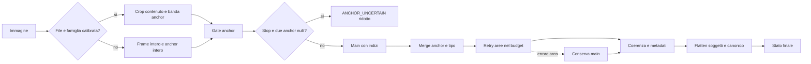
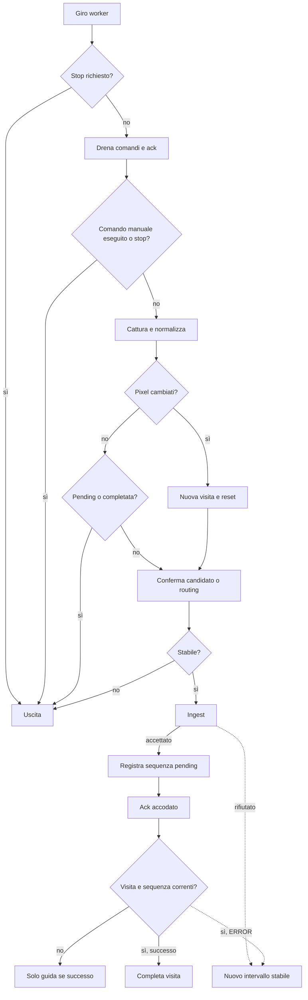
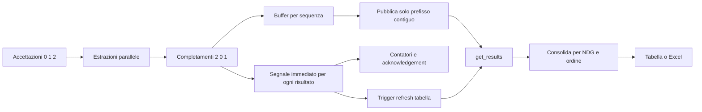
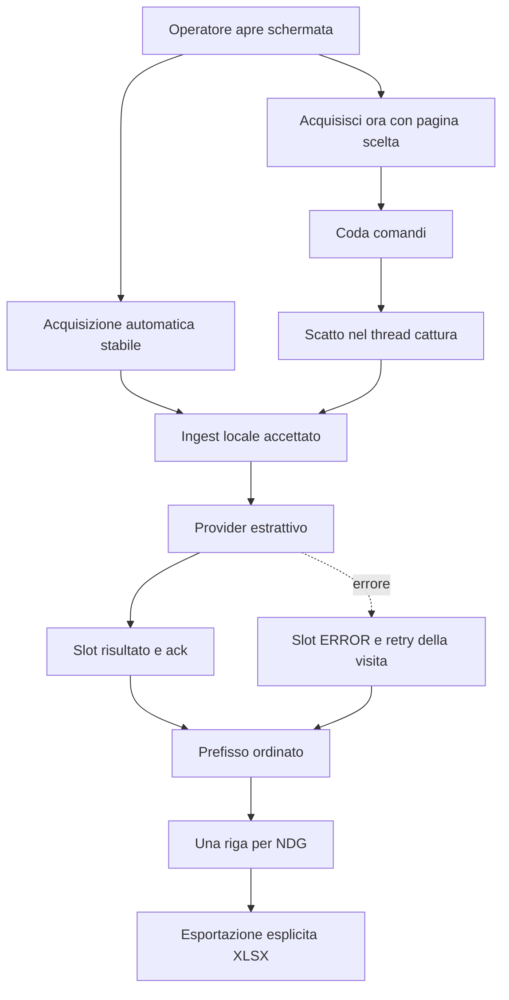

# Partition: root — Flow Tracing

Analisi statica del working tree alla revisione `f8f57e6124e008aa47ff6d8320aa508e9ef7976c`, con modifiche documentali non committate. Sono stati letti gli output strutturali di questa esecuzione, i sorgenti e gli ADR pertinenti; nessun rapporto X-ray precedente. `verified` indica un comportamento derivato dal codice, non una prova end-to-end eseguita. Nessuna chiamata ai provider, sessione GUI o suite eseguita da questo worker. Non esistono partizioni sorelle.

## Critical Paths

### Avvio e configurazione

1. **verified** — `main.py:4` carica dotenv e importa subito la facciata `extraction`; solo dopo distingue CLI e `--gui` (`main.py:12`). L'avvio diretto `edge-agent/edge_agent.py::main` crea Qt, chiama il preflight e importa `MainWindow` dopo il successo (`edge-agent/edge_agent.py:48`, `edge-agent/edge_agent.py:63`, `edge-agent/edge_agent.py:74`). Il percorso `main.py --gui` ha quindi già congelato la configurazione estrattiva prima del preflight.
2. **verified** — `edge-agent/bootstrap.py::run_preflight` verifica directory scrivibile, INI, asset e prompt recuperabili dal bundle, costruisce `AgentConfig`, carica/richiede la chiave e prepara pesi/cache solo nei modi `ml` e `hybrid` (`edge-agent/bootstrap.py:143`, `edge-agent/bootstrap.py:489`). Lo smoke salta i passaggi interattivi a partire da `edge-agent/bootstrap.py:503`, ma non la verifica dei file.
3. **verified** — Le opzioni estrattive sono valori import-time (`extraction/config.py:7`); le credenziali sono risolte alla costruzione del modello da `extraction/llm_factory.py::create_chat_model` (`extraction/llm_factory.py:32`). Il router usa un'altra precedenza provider-aware in `edge-agent/config.py::AgentConfig.resolve_llm_settings` (`edge-agent/config.py:301`): INI, variabili legacy specifiche, infine `LLM_API_KEY`. Cambiare l'ambiente dopo l'import non aggiorna modello/provider/budget già acquisiti.
4. **verified** — Il catalogo seleziona il primo candidato interamente valido; l'override esplicito produce un candidato solo. Un errore in tutte le copie impedisce l'import del catalogo; i consumatori leggono da memoria senza reload (`prompt_store.py::catalog_candidates`, `prompt_store.py:220`; `prompt_store.py::_load_first_usable`, `prompt_store.py:262`; registro a `prompt_store.py:284`).

### File → campi → valutazione

1. **verified** — `extraction/cli.py::main` richiede il CSV, elenca direttamente PNG/JPG/JPEG, ordina i percorsi e crea un `BatchRunner` (`extraction/cli.py:318`). `BatchRunner.__init__` crea due modelli e una pipeline condivisa; `run` usa un pool solo se parallelismo, numero worker e numero immagini lo consentono (`extraction/cli.py:164`, `extraction/cli.py:232`). Le callback sono eseguite dal chiamante del runner mentre consuma i futures.
2. **verified** — `extraction/pipeline.py::ExtractionPipeline.extract_from_screen` apre RGB e normalizza, poi abilita il crop condizionale (`extraction/pipeline.py:223`). `extract_from_image` limita il lato lungo, autorizza `CONTENT_CROP` soltanto con opt-in e famiglia compatibile, altrimenti conserva il frame; `select_content_crop` verifica dimensione e rapporto (`extraction/pipeline.py:139`; `extraction/imaging.py::select_content_crop`, `extraction/imaging.py:52`). Nel live l'opt-in rimane falso.
3. **verified** — Anchor: banda superiore soltanto nella famiglia calibrata, immagine intera altrimenti; sotto `ANCHOR_CONF_MIN` il valore è annullato. Con `STOP_ON_ANCHOR_UNCERTAIN`, due valori nulli terminano dopo il primo passaggio con `_status=ANCHOR_UNCERTAIN` e forma ridotta (`extraction/pipeline.py::ExtractionPipeline.extract_anchors`, `extraction/pipeline.py:91`; `ExtractionPipeline.extract_from_image`, `extraction/pipeline.py:150`).
4. **verified** — Main: prompt con indizi anchor non nulli → output strutturato → sovrascrittura dei due identificatori con gli anchor ammessi → normalizzazione `tipo` (`extraction/pipeline.py:165`, `extraction/pipeline.py:244`). Retry: selezione delle aree con almeno un campo nullo/debole, priorità di dichiarazione `HEADER/BODY/FOOTER`, massimo `max(0, MAX_CALLS_PER_SCREEN-2)`, esecuzione concorrente (`extraction/pipeline.py::ExtractionPipeline._retry_areas`, `extraction/pipeline.py:294`). Il limite conta passaggi logici: anchor e main non sono eliminati da un valore inferiore a due, e ogni passaggio può fare tre tentativi di invocazione (`extraction/vlm_client.py::call_vlm_with_retry`, `extraction/vlm_client.py:238`).
5. **verified** — I retry fondono solo i campi dell'area con `pick_best`: valore presente prima del nullo, poi confidenza, parità al corrente (`extraction/normalization.py::pick_best`, `extraction/normalization.py:104`). Solo BODY aggiorna gli array: off-calibration può riempire un array vuoto; calibrato preferisce più righe, poi maggiore confidenza media (`extraction/pipeline.py::ExtractionPipeline._merge_tables`, `extraction/pipeline.py:258`).
6. **verified** — Coerenza tooltip → `evidenze`/`tipo`, aggregazione metadati, flatten dei primi quattro soggetti, mapping canonico, stato basato sulla presenza dei due identificatori (`extraction/pipeline.py:191`, `extraction/pipeline.py:200`, `extraction/pipeline.py:213`; `ExtractionPipeline._coherence_check`, `extraction/pipeline.py:365`). Il flatten può sovrascrivere campi flat anche con null e non aggiorna `_field_sources`; nemmeno le correzioni di coerenza aggiornano la provenienza.
7. **verified** — CLI scrive JSON e CSV diagnostico, valuta RAW/FILTERED ed espone costi (`extraction/cli.py:342`). `extraction/evaluation.py::eval_outputs` salta schermate senza risultato e chiavi GT non mappate, conta OK/OK_NULL e rimuove dal FILTERED i mismatch di identità (`extraction/evaluation.py:88`). Non misura l'accuratezza delle schermate completamente fallite.
8. **verified** — Tkinter avvia un thread proprio, richiama `run_extraction_batch`, salva JSON/CSV e valuta solo se scelto un CSV; solo `display_results` passa esplicitamente da `after`, mentre log, dialoghi e riabilitazione pulsante sono chiamati dal worker (`gui_app.py::App.run_process`, `gui_app.py:228`).

### Cattura BPER → visita → accettazione → acknowledgement

1. **verified** — `CaptureTab._on_start_capture` crea un UUID locale, aggiorna FPS/filtro, costruisce il worker e lo avvia; inizializzazione router e registro avvengono in `BPERCaptureWorker.run` (`edge-agent/ui/capture_tab.py:192`; `edge-agent/workers/capture/bper_capture_worker.py:216`). `BaseCaptureWorker.run` conserva uno stop ricevuto durante l'inizializzazione e ripete `_capture_once` al ritmo configurato (`edge-agent/workers/capture/base_capture_worker.py:41`).
2. **verified** — Ogni giro drena la coda comandi prima della cattura automatica. `mss` cattura il monitor, poi `normalize_frame` prova rettangolo OS, sfondo uniforme e infine frame invariato; il selettore esclude il PID dell'agent e sceglie la finestra compatibile più grande (`edge-agent/workers/capture/bper_capture_worker.py::BPERCaptureWorker._capture_once`, `edge-agent/workers/capture/bper_capture_worker.py:357`; `BPERCaptureWorker._grab_raw`, `edge-agent/workers/capture/bper_capture_worker.py:442`; `edge-agent/frame_normalize.py::normalize_frame`, `edge-agent/frame_normalize.py:209`; `select_window_rect`, `edge-agent/frame_normalize.py:113`).
3. **verified** — Identità di visita = dimensioni, modo colore, BLAKE2b a 128 bit dei pixel normalizzati. Una variazione apre una visita e resetta stabilità e selezione; visita immobile pending/completata non viene nuovamente instradata (`edge-agent/workers/capture/bper_capture_worker.py::BPERCaptureWorker._observe_frame`, `edge-agent/workers/capture/bper_capture_worker.py:329`, `edge-agent/workers/capture/bper_capture_worker.py:369`). Il pHash è un criterio separato per risparmiare routing, non per identificare la pratica.
4. **verified** — Se il pHash è simile e c'è un candidato coerente, `StabilityTracker.confirm` sostituisce una seconda risposta router, conservando minimo due osservazioni e due secondi. Altrimenti viene preprocessato e instradato il frame; il nome è risolto nel registro e alimenta la stabilità (`edge-agent/workers/capture/bper_capture_worker.py:373`, `edge-agent/workers/capture/bper_capture_worker.py:398`; `edge-agent/stability.py::StabilityTracker.confirm`, `edge-agent/stability.py:76`; `edge-agent/page_registry.py::PageRegistry.resolve`, `edge-agent/page_registry.py:69`).
5. **verified** — `_acquire` conserva pagina/confidenza/campi e chiama `_upload_page` → `LocalExtractionClient.ingest_frame`. Sotto lock il client assegna la sequenza solo se `DaemonThreadPool.submit` accetta; un rifiuto solleva `RuntimeError` senza buco o segnale di accodamento (`edge-agent/workers/capture/bper_capture_worker.py:422`, `edge-agent/workers/capture/bper_capture_worker.py:687`; `edge-agent/local_extraction_client.py:127`). Il worker associa `(job, sequenza)` a `(visita, pagina)` e passa a pending.
6. **verified** — `result_ready` è collegato con `DirectConnection` a uno slot che accoda soltanto job/sequenza/stato; il loop consuma l'ack dopo aver registrato l'accettazione, anche se il completamento è rapidissimo (`edge-agent/workers/capture/bper_capture_worker.py:64`; `BPERCaptureWorker._queue_extraction_result`, `edge-agent/workers/capture/bper_capture_worker.py:278`).
7. **verified** — `_complete_capture` tratta `ERROR` come recuperabile: se visita e sequenza sono correnti, libera pending e riavvia l'intervallo stabile. Ogni altro esito, incluso `ANCHOR_UNCERTAIN`, aggiorna la guida; completa la visita solo se ancora corrente. Un ack vecchio non libera il pending nuovo (`edge-agent/workers/capture/bper_capture_worker.py:299`). `captured_page_types` guida la sequenza di pagine, non blocca nuove pratiche per tutta la sessione.
8. **verified** — `force_capture` accoda; `_execute_manual_capture` legge lo schermo quando il loop raggiunge il comando, salta routing/stabilità e usa `_acquire` con confidenza zero e campi vuoti. La stessa pagina già pending è coalescente; una richiesta dopo successo può riacquisire. Un giro con comando manuale non aggiunge lo scatto automatico (`edge-agent/workers/capture/bper_capture_worker.py:284`, `edge-agent/workers/capture/bper_capture_worker.py:722`).

### Routing e classificazione

- **verified** — `ml` possiede una sola istanza DINOv2 tramite `MLPageRouter`; `llm` usa il router OpenAI-compatible; `hybrid` tenta LLM e usa il classificatore dopo una risposta senza pagina. `local-first` entra invece nello stesso ramo di costruzione ML: il margine alto/scarto viene gestito localmente, ma il ripiego incerto richiama ML, senza costruire un LLM (`edge-agent/workers/capture/bper_capture_worker.py::BPERCaptureWorker._init_router`, `edge-agent/workers/capture/bper_capture_worker.py:130`; `_try_local_first`, `edge-agent/workers/capture/bper_capture_worker.py:590`; `_detect_page`, `edge-agent/workers/capture/bper_capture_worker.py:624`). L'intenzione del commento in `edge-agent/config.py:30` è quindi **disputed** rispetto al wiring.
- **verified** — Il runtime usa DINOv2 ViT-S/14 pinnato, ROI `(0,.20,1,.98)`, squash quadrato, embedding CLS L2, media dei prototipi e coseno centrato. Il vincitore `SCARTO*` produce `label=None`; altrimenti si applica la soglia assoluta e si espone il margine (`edge-agent/page_classifier.py:33`, `edge-agent/page_classifier.py:44`; `BPERPagePrototypeClassifier._init_feature_extractor_and_transform`, `edge-agent/page_classifier.py:350`; `_compute_embedding`, `edge-agent/page_classifier.py:629`; `classify_detailed`, `edge-agent/page_classifier.py:660`).
- **verified** — Cache = digest dei contenuti/nome/classe + geometria esplicita. Cache assente, illeggibile o incompatibile viene ricostruita e riscritta (`edge-agent/page_classifier.py::BPERPagePrototypeClassifier._compute_dataset_hash`, `edge-agent/page_classifier.py:398`; `_load_or_build_prototypes`, `edge-agent/page_classifier.py:415`). Il codice hub/pesi possono richiedere rete al primo uso.

## Data Flow

- **verified** — Screenshot → PNG/base64 → messaggi LangChain → Pydantic → dict. La scelta Gemini dipende dal nome del modello; 1.5 usa structured JSON, le altre versioni il JSON libero validato manualmente; OpenAI usa structured output con raw usage (`extraction/vlm_client.py::call_vlm`, `extraction/vlm_client.py:123`; `_call_vlm_gemini_freeform`, `extraction/vlm_client.py:52`). Non è un flusso interamente offline.
- **verified** — I thread locali possono completare 2,0,1: `_completed[job]` conserva i risultati pronti, `_results[job]` avanza solo sul prefisso contiguo 0,1,2. `result_ready` notifica ogni completamento immediatamente; `get_results` restituisce una nuova lista del prefisso, con dict condivisi. Un job lento non blocca la pubblicazione di altri job (`edge-agent/local_extraction_client.py::LocalExtractionClient._process_frame`, `edge-agent/local_extraction_client.py:193`; `get_results`, `edge-agent/local_extraction_client.py:222`).
- **verified** — Il segnale aggiorna contatori e trigger di refresh; `DataTableTab` ignora il payload come ordine e rilegge `get_results` prima di consolidare (`edge-agent/ui/capture_tab.py::CaptureTab._on_result_ready_count`, `edge-agent/ui/capture_tab.py:388`; `edge-agent/ui/data_table_tab.py::DataTableTab._on_result_ready`, `edge-agent/ui/data_table_tab.py:128`; `_load_table`, `edge-agent/ui/data_table_tab.py:194`). Un contatore avanzato non implica che quel risultato sia già esportabile.
- **verified** — `consolidate` associa NDG normalizzati, frame anonimi alla pratica precedente, anonimi iniziali alla prima identificata; una sessione tutta anonima produce una riga. `pick_best` fonde 45 campi, l'ordine delle pratiche segue la prima apparizione (`edge-agent/practice_consolidation.py::normalize_ndg`, `edge-agent/practice_consolidation.py:46`; `consolidate`, `edge-agent/practice_consolidation.py:105`). Non distingue due pratiche dello stesso NDG.
- **verified** — I due export PyQt passano da `export_results`, che consolida e usa colonne canoniche con NDG/denominazione iniziali, bande pagina, filtri e blocco `C3`. I valori estratti sono testo XLSX inerte; le etichette rinominate sono passate dal tab dati e scritte separatamente da `_write_labels` (`edge-agent/excel_export.py::export_results`, `edge-agent/excel_export.py:217`; `build_columns`, `edge-agent/excel_export.py:92`; `_set_text`, `edge-agent/excel_export.py:124`; `_write_labels`, `edge-agent/excel_export.py:160`).

## Error Handling Paths

| Stato | Origine → conseguenza verificata |
|---|---|
| verified | `extraction/vlm_client.py::call_vlm_with_retry` a `extraction/vlm_client.py:253`: `ValueError/KeyError/IndexError` immediati; tutte le altre eccezioni entrano nel backoff, non soltanto errori riconosciuti come transitori. Dopo tre tentativi solleva l'ultimo errore. |
| verified | Anchor/main falliti propagano; retry-area fallito stampa warning e mantiene il main (`extraction/pipeline.py::ExtractionPipeline._retry_areas`, `extraction/pipeline.py:339`). Tentativi falliti e backoff non sono aggiunti a `_attempts`; le somme misurano metadati disponibili, non costo/tempo end-to-end garantiti (`extraction/pipeline.py:347`, `extraction/pipeline.py:383`). |
| verified | Batch parallelo senza callback stampa e continua, sequenziale senza callback risolleva (`extraction/cli.py::BatchRunner.run`, `extraction/cli.py:249`, `extraction/cli.py:264`). Il live converte l'eccezione in slot `_status=ERROR`; il fallimento del log produce `_diagnostic_error` e non interrompe la pubblicazione (`edge-agent/local_extraction_client.py::LocalExtractionClient._process_frame`, `edge-agent/local_extraction_client.py:174`, `edge-agent/local_extraction_client.py:187`). |
| verified | Router init fallito disabilita riconoscimento; registro fallito abilita risoluzione permissiva; preprocessing fallito conserva immagine; pHash fallito rinuncia alla dedup (`edge-agent/workers/capture/bper_capture_worker.py::BPERCaptureWorker._init_router`, `edge-agent/workers/capture/bper_capture_worker.py:206`; `_load_registry`, `edge-agent/workers/capture/bper_capture_worker.py:244`; `_preprocess`, `edge-agent/workers/capture/bper_capture_worker.py:528`; `_is_duplicate_frame`, `edge-agent/workers/capture/bper_capture_worker.py:542`). |
| verified | Cinque errori consecutivi di screenshot fermano il loop; mancanza mss lo ferma subito (`edge-agent/workers/capture/bper_capture_worker.py::BPERCaptureWorker._grab_raw`, `edge-agent/workers/capture/bper_capture_worker.py:450`, `edge-agent/workers/capture/bper_capture_worker.py:483`). |
| verified | Stop imposta un latch cooperativo, non interrompe una chiamata router in corso. La UI aspetta 5 s, segnala il timeout e rilascia comunque il proprio riferimento `worker`; non chiama `terminate` (`edge-agent/workers/capture/base_capture_worker.py::BaseCaptureWorker.stop`, `edge-agent/workers/capture/base_capture_worker.py:73`; `edge-agent/ui/capture_tab.py::CaptureTab._on_stop_capture`, `edge-agent/ui/capture_tab.py:292`). |
| verified / unverified | Chiusura finestra ferma cattura e pool; il pool scarta i task in coda senza slot terminali e lascia quelli attivi (`edge-agent/ui/main_window.py::MainWindow.closeEvent`, `edge-agent/ui/main_window.py:85`; `edge-agent/extraction_pool.py::DaemonThreadPool.stop`, `edge-agent/extraction_pool.py:44`). **unverified**: uscita immediata garantita dell'intero processo; la pipeline contiene anche un `ThreadPoolExecutor` annidato e nessuna cancellazione delle invocazioni (`extraction/pipeline.py:337`). Non è stata eseguita una prova di shutdown. |

## Side Effects

| Stato | Confine / raggio d'azione |
|---|---|
| verified | Provider estrattivi: immagini e prompt inviati da `extraction/vlm_client.py::call_vlm` (`extraction/vlm_client.py:194`); router pagina usa separatamente SDK OpenAI, timeout/retry e debug, fuori da `_meta_agg` (`edge-agent/llm_router.py::LLMPageRouter.route`, `edge-agent/llm_router.py:172`). |
| verified | Stato live volatile: code, sequenze, risultati e pratiche restano in memoria; export esplicito persiste il workbook (`edge-agent/local_extraction_client.py:116`; `edge-agent/excel_export.py::write_workbook`, `edge-agent/excel_export.py:214`). |
| verified | Log includono valori estratti/provenienza; nel bundle windowed stdout/stderr vanno al file locale o devnull. I crop diagnostici possono scrivere immagini sul disco (`edge-agent/local_extraction_client.py::_log_extraction`, `edge-agent/local_extraction_client.py:41`; `edge-agent/edge_agent.py:15`; `extraction/imaging.py::save_debug_crop`, `extraction/imaging.py:93`). |
| verified | Preflight scrive file di setup, può richiedere/salvare una chiave locale e scaricare pesi con checksum; classificatore scrive cache (`edge-agent/bootstrap.py::_ensure_files`, `edge-agent/bootstrap.py:143`; `_ensure_api_key`, `edge-agent/bootstrap.py:236`; `_DownloadWorker.run`, `edge-agent/bootstrap.py:299`; `edge-agent/page_classifier.py::BPERPagePrototypeClassifier._save_prototypes_to_cache`, `edge-agent/page_classifier.py:546`). Nessun file segreto è stato letto. |
| verified | Modalità generica separata: screenshot PNG → `POST /jobs/{id}/frames`, con timeout 30 s; non usa il client estrattivo BPER (`edge-agent/workers/capture/default_capture_worker.py::DefaultCaptureWorker._capture_once`, `edge-agent/workers/capture/default_capture_worker.py:34`). |

### Strumenti e corpus

- **verified** — `tools/extract_frames.py::extract` invoca ffmpeg e salva fotogrammi; `deduplicate` confronta pHash sull'intero frame (`tools/extract_frames.py:69`, `tools/extract_frames.py:86`). `tools/label_frames.py::main` localizza con patch DINOv2, invia crop al provider, salva etichette/checkpoint e usa exit 10 quando il limite lascia lavoro residuo (`tools/label_frames.py:156`, `tools/label_frames.py:222`, `tools/label_frames.py:276`).
- **verified** — Contact sheet → revisione proposta → registro con provenienza, revisioni e manifest curati; `relocalize` riutilizza il localizzatore per aggiornare rettangoli in file separato (`tools/make_contact_sheets.py::main`, `tools/make_contact_sheets.py:32`; `tools/build_frame_registry.py::main`, `tools/build_frame_registry.py:74`; `tools/relocalize.py::main`, `tools/relocalize.py:38`). Queste etichette non sono automaticamente GT umano: il registro conserva la distinzione a `tools/build_frame_registry.py:167`.
- **verified** — `tools/build_prototypes.py::main` campiona classi di scarto e, solo con `--pages`, pagine reali; salvo dry-run rimuove e ricrea le cartelle di classe pianificate (`tools/build_prototypes.py:85`, `tools/build_prototypes.py:146`). Il crop viene allargato prima della ROI runtime per evitare un doppio taglio.
- **verified** — `tools/make_framing_corpus.py::compose` genera frame con rettangolo noto; `tools/benchmark_backbones.py::main` misura IoU/tempo del localizzatore su questo corpus. Supporta DINOv2 e DINOv3, checkpoint hub o adapter `hf:`, mentre il runtime resta DINOv2 CLS (`tools/make_framing_corpus.py:91`; `tools/benchmark_backbones.py:44`, `tools/benchmark_backbones.py:53`, `tools/benchmark_backbones.py:139`; `edge-agent/page_classifier.py:650`). Il benchmark usa patch token e conosce l'aspect della pagina sorgente: non è una misura dell'accuratezza runtime né una migrazione a DINOv3.
- **verified** — `tools/measure_classifier.py::main` divide train/test per registrazione e confronta pooling/griglia patch con margini (`tools/measure_classifier.py:60`). Gli script `measure_reject_prototypes` e `measure_tooltip_prototypes` sono esperimenti eseguibili al livello modulo, non parti del loop UI (`tools/measure_reject_prototypes.py:31`; `tools/measure_tooltip_prototypes.py:95`). Nessuna di queste misure è stata rieseguita qui.

## Process Diagrams

### Technical Processes

### Functional Processes

### End-to-End Processes

