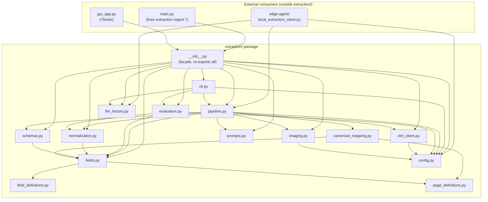

# Phase 1: Structure Extraction

Target: the `extraction/` Python package in `D:\Projects\poc-data-extraction`.
Domain: multi-pass Vision-LLM extraction of structured fields from Italian BPER
banking screenshots (LangChain → OpenAI GPT-4o / Google Gemini, Pillow, Pandas).
Method: AST/classifier scripts from the deep-dive skill, cross-checked by reading
each source file. Every line count and symbol below is verified against the code.

## File Inventory

Line counts are raw `wc -l`. "Functions" counts module-level `def`s (methods are
listed under Classes). Imports are split intra-package / third-party / stdlib.

| File | Language | Lines | Functions (module-level) | Classes | Imports (intra / 3rd-party / stdlib) |
|---|---|---:|---|---|---|
| `pipeline.py` | Python | 365 | 2 (`extract_anchors`, `extract_from_screen`) | 1 (`ExtractionPipeline`, 12 methods) | 6 / 2 (PIL, langchain_core) / 4 (os, re, typing, concurrent.futures) |
| `cli.py` | Python | 352 | 8 (incl. `run_extraction_batch`, `main`, 6 `_`-helpers) | 1 (`BatchRunner`, 2 methods) | 4 / 0 / 4 (json, os, concurrent.futures, typing) |
| `evaluation.py` | Python | 282 | 7 (`load_ground_truth`, `eval_outputs`, `build_debug_report`, `export_to_csv`, `print_cost_summary`, `infer_screenshots_from_gt`, `_find_column`) | 1 (`Evaluator`, 4 methods) | 3 / 1 (pandas) / 3 (os, json, typing) |
| `field_definitions.py` | Python | 262 | 4 (`normalize_field_label`, `resolve_schema_key`, `resolve_display_name`, `resolve_field_page_key`) | 0 | 0 / 0 / 1 (typing) |
| `vlm_client.py` | Python | 258 | 5 (`estimate_cost_usd`, `call_vlm`, `call_vlm_with_retry`, `_extract_json_str`, `_call_vlm_gemini_freeform`) | 0 | 1 (config) / 2 (langchain_core, pydantic) / 4 (base64, json, re, time, typing) |
| `normalization.py` | Python | 189 | 12 (`normalize_tipo`, `is_nullish`, `norm_text`, `norm_number_str`, `safe_field`, `safe_set_field`, `pick_best`, `merge_field_sources`, `classify_field`, `get_pred_value_for_gt_key`, `dataset_mismatch_guard`, `_resolve_anchor_value`) | 0 | 1 (fields) / 0 / 2 (re, difflib, typing) |
| `fields.py` | Python | 138 | 3 (`get_canonical_field_display_name`, `get_canonical_field_page_key`, `get_canonical_field_metadata`) | 0 | 2 (field_definitions, page_definitions) / 0 / 1 (typing) |
| `__init__.py` | Python | 126 | 0 (pure re-export facade) | 0 | 11 (all sibling modules) / 0 / 1 (warnings) |
| `config.py` | Python | 109 | 1 (`get_screenshot_paths`) | 0 | 0 / 0 / 3 (os, typing, re) |
| `prompts.py` | Python | 78 | 0 (string constants only) | 0 | 0 / 0 / 0 |
| `llm_factory.py` | Python | 77 | 1 (`create_chat_model`) | 0 | 0 / 1 (langchain_core; langchain_openai / langchain_google_genai lazy-imported) / 2 (os, warnings, typing) |
| `schemas.py` | Python | 71 | 0 | 7 Pydantic models + `FieldsModel` (dynamic) | 1 (fields) / 1 (pydantic) / 1 (typing) |
| `page_definitions.py` | Python | 51 | 4 (`normalize_page_label`, `resolve_page_key`, `resolve_page_name`, `get_canonical_page_name`) | 0 | 0 / 0 / 1 (typing) |
| `canonical_mapping.py` | Python | 42 | 2 (`build_canonical_field_entries`, `_canonical_entry_sort_key`) | 0 | 2 (fields, page_definitions) / 0 / 1 (typing) |
| `imaging.py` | Python | 42 | 4 (`normalize_image`, `crop_relative`, `img_to_png_bytes`, `save_debug_crop`) | 0 | 1 (config) / 1 (PIL) / 2 (io, os, typing) |

Totals: 15 files, 2,342 lines; 4 classes; 7 Pydantic models (+1 dynamically built);
53 module-level functions.

Classifier verdicts (`classifier.py`): `pipeline.py`, `cli.py`, `evaluation.py`,
`vlm_client.py`, `llm_factory.py`, `__init__.py` are flagged **high-complexity /
verification-required** (many dependencies or critical patterns). The rest are
`standard` or `utility`.

## Dependency Graph

Intra-package import edges (verified from each module's `from extraction.X import`)
plus the three external consumers of the package.

Layering (topological):
- **Layer 0 — leaves, no intra-package imports:** `config.py`, `field_definitions.py`,
  `page_definitions.py`, `prompts.py`, `llm_factory.py`.
- **Layer 1 — primitives:** `fields.py` (→ field_definitions, page_definitions),
  `schemas.py` (→ fields), `normalization.py` (→ fields), `imaging.py` (→ config),
  `vlm_client.py` (→ config), `canonical_mapping.py` (→ fields, page_definitions).
- **Layer 2 — engines:** `pipeline.py` (→ 8 modules), `evaluation.py` (→ config, fields, normalization).
- **Layer 3 — orchestration:** `cli.py` (→ llm_factory, config, pipeline, evaluation).
- **Layer 4 — facade:** `__init__.py` re-exports the whole public surface.

`config.py` is the most-depended-upon module (imported by cli, pipeline, evaluation,
vlm_client, imaging + directly by the edge-agent). `fields.py` is the field-schema
single source of truth (imported by schemas, normalization, evaluation, canonical_mapping).

## Entry Points

**Package public API — `extraction/__init__.py`** (`__init__.py:11-45`): a flat
`__all__` re-export facade. `from extraction import *` yields config constants
(`INPUT_DIR`, `FIELD_KEYS`, `PRICING_PER_1M`, `PROVIDER_MODELS`, crop tuples, …),
`create_chat_model`, prompts, all schemas, all normalization helpers, imaging
helpers, VLM helpers, `ExtractionPipeline`, `Evaluator`, and the CLI symbols
(`BatchRunner`, `main`, `run_extraction_batch`).

**CLI batch — `main()`** (`cli.py:314-352`): the `python main.py` path. Hard-requires
`mnt/data/dati.csv` (`FileNotFoundError` at `cli.py:315-316`); scans `INPUT_DIR` for
`.png/.jpg/.jpeg` (`cli.py:322-327`), builds a `BatchRunner`, writes
`poc_outputs_improved.json`, evaluates, writes `poc_debug_improved.csv`, prints cost.

**Shared batch runner — `run_extraction_batch()`** (`cli.py:282-307`): thin wrapper
over `BatchRunner`, used by both `main()` and the Tkinter `gui_app.py`. Creates
LangChain ChatModels once and shares one `ExtractionPipeline` across a
`ThreadPoolExecutor` (`cli.py:229-234`). `on_complete`/`on_error` callbacks fire on
the **calling** thread.

**Pipeline entry methods — `ExtractionPipeline`** (`pipeline.py:47`):
- `extract_from_screen(path)` (`pipeline.py:182-187`) — opens + `normalize_image()`s
  the file, then delegates. Used by CLI and Tkinter GUI.
- `extract_from_image(img, screen_id)` (`pipeline.py:104-180`) — the real multi-pass
  engine; assumes the image is already normalized. Used by the edge-agent
  (`local_extraction_client.py:86`) to skip redundant normalization.
- `extract_anchors(content_img, screen_id)` (`pipeline.py:70-102`) — pass-1 header crop.
- Module-level `extract_anchors(...)` / `extract_from_screen(...)` (`pipeline.py:347-365`)
  are backward-compatible wrappers that instantiate a throwaway pipeline.

**External consumers (verified imports):**
- `main.py` → `from extraction import *` (calls `main()`; `--gui` re-routes to the
  edge-agent).
- `gui_app.py:6-14` → `run_extraction_batch`, `load_ground_truth`, `eval_outputs`,
  `build_debug_report`, `export_to_csv`, `FIELD_KEYS`, `PROVIDER_MODELS`.
- `edge-agent/local_extraction_client.py:27-29` → `create_chat_model` (llm_factory),
  `ExtractionPipeline` (pipeline), `LLM_PROVIDER`/`LLM_MODEL`/`LLM_MODEL_ANCHOR` (config).
  It calls `ExtractionPipeline.extract_from_image()` directly.

## Key Observations

1. **`config.py` executes at import time.** All env-var reads and the derived
   `FIELD_RETRY_MAP` loop (`config.py:85-88`) run when the module is first imported,
   so `.env` / env vars must be set **before** `import extraction`. This is why
   `main.py`, `edge_agent.py`, and `local_extraction_client.py` call `load_dotenv()`
   first, and why `gui_app.py` (which does **not**) requires pre-exported env vars.

2. **Two seams by design: normalized vs pre-normalized image.** `extract_from_screen`
   normalizes; `extract_from_image` does not. Any new caller must pick the right one
   or it double-processes / skips processing the image.

3. **The result dict is dynamically shaped, not a model.** The pipeline returns a
   plain `dict` (a `model_dump()` of `ExtractionResponse` mutated in place with
   `_meta`, `_attempts`, `_meta_agg`, `_field_sources`, `canonical_fields`, `_status`).
   There is no typed contract for the output — consumers key into it by string.

4. **Field-config consistency is convention-only.** `AREA_TO_FIELDS` (`config.py:69-82`)
   omits `creazione` and the five `tooltip_*` fields, so those 6 of 45 `FIELD_KEYS`
   can never be retried. Nothing validates `AREA_TO_FIELDS`/`FIELD_RETRY_MAP` against
   `FIELD_KEYS` — a missing key silently means "never retried".

5. **The anchor confidence gate is dead code.** `extract_anchors` copies `ndg`/`den`
   via `safe_field()` (`pipeline.py:87-88`) *before* the gate, and `safe_set_field`
   cannot null an already-non-null value (`normalization.py:78-79`), so the
   `< ANCHOR_CONF_MIN` gate at `pipeline.py:91-96` never takes effect.

6. **Dedup is parked.** `_deduplicate_same_page_outputs` (`cli.py:92-152`) is fully
   implemented but its call site is commented out (`cli.py:268-273`, "TEMP TEST").

7. **`get_screenshot_paths` is orphaned in practice.** Exported and aliased by
   `infer_screenshots_from_gt` (`evaluation.py:19-21`) but `main()` scans `INPUT_DIR`
   directly instead (`cli.py:322-327`).

8. **Cost tracking can silently under-count.** `estimate_cost_usd` returns `0.0` for
   any model absent from `PRICING_PER_1M` (`vlm_client.py:23-25`), so unknown models
   report `$0.00`.

## Where to Add New Code

| Change | Files that MUST be touched | Notes |
|---|---|---|
| **New extracted field** | `fields.py` (`FIELD_KEYS` + `CSV_TO_SCHEMA`), `config.py` (`AREA_TO_FIELDS` so it can be retried), `field_definitions.py` (`CANONICAL_FIELD_DEFINITIONS` + `FIELD_LABEL_ALIASES` for display/page mapping), the relevant prompt in `prompts.py` | `schemas.FieldsModel` auto-derives from `FIELD_KEYS` (`schemas.py:46-49`), so no schema edit needed. Skipping `AREA_TO_FIELDS` = field is never retried (silent). |
| **New prompt / tune a pass** | `prompts.py` (`PROMPT`, `ANCHOR_PROMPT`, or the `RETRY_PROMPT_*` + `FIELD_RETRY_PROMPTS` map) | Retry prompts are keyed by area name (`HEADER`/`BODY`/`FOOTER`); `pipeline._retry_areas` looks them up via `FIELD_RETRY_PROMPTS.get(area, PROMPT)` (`pipeline.py:277`). |
| **New LLM provider** | `llm_factory.py` (`create_chat_model` branch + lazy import), `config.py` (`PROVIDER_MODELS`, `PRICING_PER_1M`), possibly `vlm_client.py` if the provider needs a bespoke structured-output path (see the Gemini free-form branch, `vlm_client.py:47-119` / `134-183`) | `_LEGACY_KEY_VARS` (`llm_factory.py:10-13`) maps provider → legacy env var. |
| **New retry area / crop** | `config.py` (`RETRY_AREAS` crop tuple + `AREA_TO_FIELDS` entry), `prompts.py` (`FIELD_RETRY_PROMPTS` entry) | `_retry_areas` iterates `AREA_TO_FIELDS`; `_merge_tables` special-cases `"BODY"` only (`pipeline.py:227`). |
| **New output / export format** | `evaluation.py` (add an `export_*` function next to `export_to_csv` / `build_debug_report`), re-export in `__init__.py` `__all__` + import block | Prefer reading `canonical_fields` (already page-ordered) over raw `fields`. |
| **New evaluation metric / classification rule** | `normalization.py` (`classify_field`), `evaluation.py` (`eval_outputs`) | Numeric vs text handling is keyed off substrings in `classify_field` (`normalization.py:127-128`). |
| **New client of the engine** | reuse `run_extraction_batch` (batch) or `ExtractionPipeline` (single frame); do **not** re-implement the ThreadPool | Choose `extract_from_screen` (raw file) vs `extract_from_image` (pre-normalized). |

## Naming Conventions

Prescriptive rules, derived from the observed code:

- **Modules:** `snake_case`, single responsibility, named by role (`normalization`,
  `imaging`, `vlm_client`, `llm_factory`). Config-like data modules end in
  `_definitions` (`field_definitions`, `page_definitions`).
- **Constants:** `UPPER_SNAKE_CASE` at module scope (`FIELD_KEYS`, `CSV_TO_SCHEMA`,
  `AREA_TO_FIELDS`, `CONTENT_CROP`, `PRICING_PER_1M`, `PROMPT`, `TIPO_MAPPING`).
  Private data constants take a leading underscore (`_SOGGETTI_KEY_MAP`,
  `_GARANZIE_KEY_MAP`, `_GEMINI_JSON_SCHEMA_MODELS`, `_LEGACY_KEY_VARS`).
- **Functions:** `snake_case`, fully type-annotated params **and** return
  (e.g. `def normalize_image(img: Image.Image, long_side: int = 1800) -> Image.Image`).
  Private helpers take a leading underscore (`_find_column`, `_extract_json_str`,
  `_resolve_anchor_value`, `_do_retry`).
- **Classes:** `PascalCase` (`ExtractionPipeline`, `BatchRunner`, `Evaluator`).
  Pydantic models are `PascalCase` (`FieldResult`, `Soggetto`, `ExtractionResponse`)
  and keep legacy `UPPER_SNAKE_CASE` aliases where callers expect them
  (`RESPONSE_SCHEMA = ExtractionResponse`, `ANCHOR_SCHEMA = AnchorResponse`,
  `schemas.py:70-71`).
- **Result-dict private keys:** prefix with a single underscore (`_meta`, `_meta_agg`,
  `_attempts`, `_field_sources`, `_status`) to distinguish pipeline bookkeeping from
  extracted field payloads.
- **Section markers:** separate logical blocks with a full-width comment rule
  `# ============================================================`.
- **Language policy:** English for identifiers, comments, docstrings; **Italian** for
  VLM prompt bodies, banking field keys (`professione_principale`, `note_della_richiesta`),
  and CSV headers. Do not translate the Italian field keys — they must match the
  banking-domain schema and the ground-truth CSV.
- **Keep the facade in sync:** any new public symbol must be added to **both** the
  `__all__` list and the corresponding `from extraction.X import` block in
  `__init__.py`.
