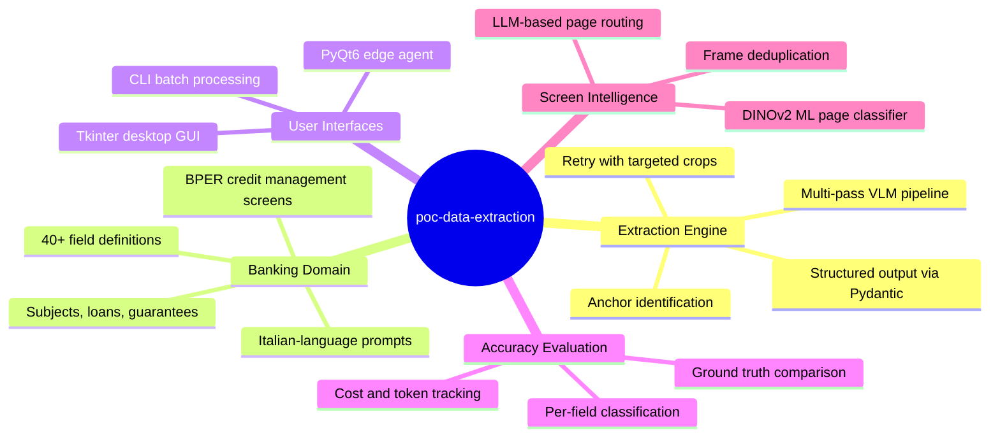

# poc-data-extraction

This project uses Vision Language Models (VLMs) -- large language models that can interpret images -- to extract structured data from screenshots of the BPER Italian banking application. It targets a specific credit management workflow where operators navigate nine distinct screens, each containing fields like customer IDs, loan details, guarantees, and subject tables. The extracted data is validated against ground truth, scored for accuracy, and reported with per-field metrics and cost breakdowns.

The project is a proof of concept. It demonstrates that LLM-based screen reading can replace manual data entry for BPER banking operations, providing three separate interfaces to the same underlying extraction engine.

## What It Does

You point it at screenshots of the BPER banking application, and it gives you back structured JSON containing every field it can read -- customer NDG numbers, names, loan amounts, guarantee details, employment data, free-text notes, and more. It does this through a multi-pass pipeline: first it reads the header to lock down the customer identity (the "anchor pass"), then it reads the full screen content (the "main pass"), and finally it re-reads any areas where confidence was low or values were missing (the "retry pass"). Each pass uses a different image crop and a specialized Italian-language prompt.

The project also includes an edge agent -- a desktop application that watches the operator's screen in real time, automatically detects which BPER page is currently displayed, waits for stability, and triggers extraction without the operator needing to save screenshots manually.

## Who It's For

**Banking operations personnel** who work with the BPER credit management application and need to extract structured data from its screens. The CLI and GUI tools let you process batches of saved screenshots. The edge agent sits alongside the banking application and captures data as you work.

**Developers building document-to-data pipelines** who want to understand how to combine Vision LLMs with image preprocessing, multi-pass extraction, structured output, and accuracy evaluation. The codebase demonstrates patterns for LangChain structured output with both OpenAI and Google Gemini providers, targeted image cropping strategies, and confidence-gated field merging.

## How It's Built

Python throughout. The extraction engine (`extraction/` package) uses LangChain to talk to OpenAI GPT-4o or Google Gemini models, Pydantic for structured output schemas, and Pillow for image normalization and cropping. The CLI runs parallel extraction with `ThreadPoolExecutor`. The Tkinter GUI (`gui_app.py`) wraps the same batch runner in a desktop window. The PyQt6 edge agent (`edge-agent/`) adds live screen capture via `mss`, frame deduplication via perceptual hashing (`imagehash`), and ML-based page classification using Facebook's DINOv2 model loaded through PyTorch. There is no database -- everything runs in memory with CSV files for ground truth and JSON files for output. For a complete breakdown, see [Tech Stack](03-tech-stack.md).

## Project at a Glance

| Attribute | Value |
|---|---|
| Language | Python 3.8+ (3.13 observed in compiled bytecode) |
| LLM Providers | OpenAI (GPT-4o, GPT-4o-mini, o1) and Google Gemini (1.5/2.0/3.x Flash and Pro) |
| LLM Framework | LangChain (langchain-core, langchain-openai, langchain-google-genai) |
| UI Frameworks | Tkinter (gui_app.py), PyQt6 + qt-material (edge-agent/) |
| ML Framework | PyTorch + torchvision (DINOv2 ViT-S/14 for page classification) |
| Project Type | Proof of concept -- multi-interface application (CLI, desktop GUI, live capture agent) |
| Database | None. In-memory dicts; CSV ground truth; JSON output files |
| Test Suite | None |
| CI/CD | None |
| Entry Points | `main.py` (CLI/edge-agent), `gui_app.py` (Tkinter), `edge-agent/edge_agent.py` (direct) |
| Key Directories | `extraction/` (core engine), `edge-agent/` (live capture agent), `mnt/data/` (test data, gitignored) |

## Where to Go Next

The rest of this codebase map drills down from this overview. Start with [Features](02-features.md) for a tour of what the project actually does, then [Architecture](04-architecture.md) for how the pieces fit together. If you want to run it immediately, jump to [Getting Started](07-getting-started.md). For the entity shapes referenced above (FieldResult, Soggetto, ExtractionResponse), see [Data Model](06-data-model.md). The honest list of things this project does not yet have answers for lives in [Open Questions](08-open-questions.md).
