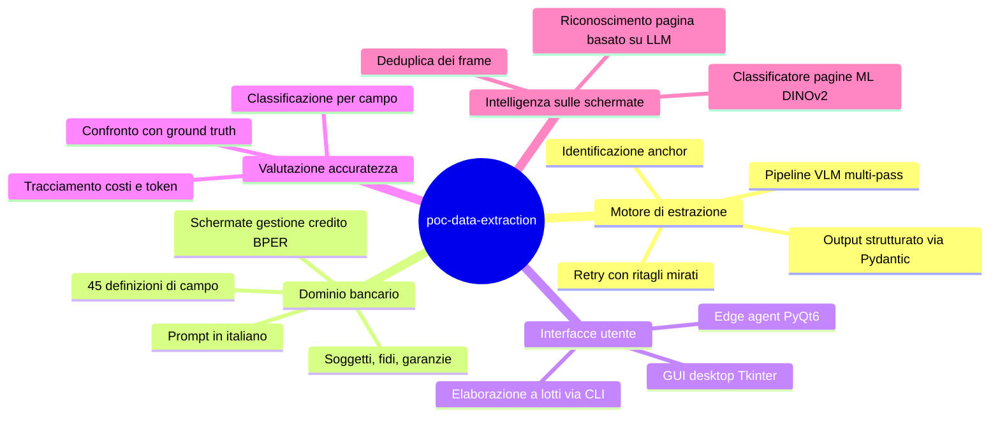

# poc-data-extraction

Questo progetto usa i Vision Language Model (VLM) -- modelli linguistici di grandi dimensioni in grado di interpretare le immagini -- per estrarre dati strutturati dagli screenshot dell'applicativo bancario italiano BPER. Si rivolge a uno specifico flusso di gestione del credito, in cui gli operatori navigano nove schermate distinte, ciascuna contenente campi come codici cliente, dettagli dei fidi, garanzie e tabelle di soggetti. I dati estratti vengono validati rispetto alla ground truth, valutati per accuratezza e riportati con metriche per campo e dettaglio dei costi.

Il progetto è un proof of concept (prototipo). Dimostra che la lettura delle schermate basata su LLM può sostituire l'inserimento manuale dei dati nelle operazioni bancarie di BPER, offrendo tre interfacce distinte sullo stesso motore di estrazione sottostante.

## Cosa fa

Lo indirizzi verso gli screenshot dell'applicativo bancario BPER e ti restituisce un JSON strutturato che contiene ogni campo che riesce a leggere -- numeri NDG dei clienti, nomi, importi dei fidi, dettagli delle garanzie, dati lavorativi, note in testo libero e altro ancora. Lo fa attraverso una pipeline multi-pass: prima legge l'intestazione per fissare l'identità del cliente (il "passaggio anchor"), poi legge l'intero contenuto della schermata (il "passaggio principale") e infine rilegge le aree dove la confidenza era bassa o i valori mancavano (il "passaggio di retry"). Ogni passaggio usa un ritaglio diverso dell'immagine e un prompt specializzato in italiano.

Il progetto include anche un edge agent -- un'applicazione desktop che osserva lo schermo dell'operatore in tempo reale, rileva automaticamente quale pagina BPER è attualmente visualizzata, attende la stabilità e avvia l'estrazione senza che l'operatore debba salvare gli screenshot manualmente.

## A chi è rivolto

**Personale operativo della banca** che lavora con l'applicativo di gestione del credito di BPER e ha bisogno di estrarre dati strutturati dalle sue schermate. Gli strumenti CLI e GUI permettono di elaborare lotti di screenshot salvati. L'edge agent si affianca all'applicativo bancario e cattura i dati mentre lavori.

**Sviluppatori che costruiscono pipeline da documento a dati** che vogliono capire come combinare i Vision LLM con il pre-trattamento delle immagini, l'estrazione multi-pass, l'output strutturato e la valutazione dell'accuratezza. Il codice mostra pattern per l'output strutturato di LangChain sia con il provider OpenAI sia con Google Gemini, strategie di ritaglio mirato delle immagini e fusione dei campi vincolata dalla confidenza.

## Com'è costruito

Python ovunque. Il motore di estrazione (package `extraction/`) usa LangChain per dialogare con i modelli OpenAI GPT-4o o Google Gemini, Pydantic per gli schemi di output strutturato e Pillow per la normalizzazione e il ritaglio delle immagini. La CLI esegue l'estrazione in parallelo con `ThreadPoolExecutor`. La GUI Tkinter (`gui_app.py`) incapsula lo stesso runner a lotti in una finestra desktop. L'edge agent PyQt6 (`edge-agent/`) aggiunge la cattura dal vivo dello schermo via `mss`, la deduplica dei frame tramite perceptual hashing (`imagehash`) e la classificazione delle pagine basata su ML usando il modello DINOv2 di Facebook caricato tramite PyTorch. Non c'è alcun database -- tutto gira in memoria, con file CSV per la ground truth e file JSON per l'output. Per un'analisi completa, vedi [Tech Stack](03-tech-stack.md).

## Il progetto in sintesi

| Attributo | Valore |
|---|---|
| Linguaggio | Python 3.8+ (3.13 osservato nel bytecode compilato) |
| Provider LLM | OpenAI (GPT-4o, GPT-4o-mini, o1) e Google Gemini (1.5/2.0/3.x Flash e Pro) |
| Framework LLM | LangChain (langchain-core, langchain-openai, langchain-google-genai) |
| Framework UI | Tkinter (gui_app.py), PyQt6 + qt-material (edge-agent/) |
| Framework ML | PyTorch + torchvision (DINOv2 ViT-S/14 per la classificazione delle pagine) |
| Tipo di progetto | Proof of concept (prototipo) -- applicazione multi-interfaccia (CLI, GUI desktop, agente di cattura dal vivo) |
| Database | Nessuno. Dizionari in memoria; ground truth CSV; file JSON di output |
| Suite di test | Nessuna |
| CI/CD | Nessuna |
| Entry point | `main.py` (CLI/edge-agent), `gui_app.py` (Tkinter), `edge-agent/edge_agent.py` (diretto) |
| Directory principali | `extraction/` (motore core), `edge-agent/` (agente di cattura dal vivo), `mnt/data/` (dati di test, esclusi da git) |

## Dove andare adesso

Il resto di questa mappa del codice approfondisce questa panoramica. Inizia da [Funzionalità](02-features.md) per una panoramica di ciò che il progetto fa davvero, poi [Architettura](04-architecture.md) per come si incastrano i pezzi. Se vuoi eseguirlo subito, salta a [Getting Started](07-getting-started.md). Per le strutture delle entità citate sopra (FieldResult, Soggetto, ExtractionResponse), vedi [Data Model](06-data-model.md). L'elenco onesto delle questioni a cui questo progetto non ha ancora una risposta vive in [Domande Aperte](08-open-questions.md).
