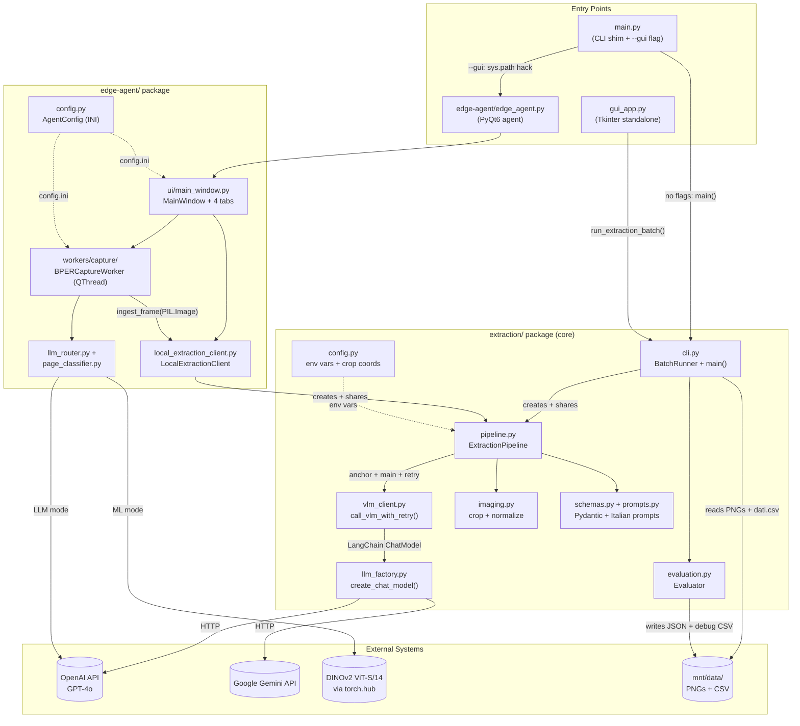

# Architecture

This is a hub-and-spokes Python project: a core `extraction/` package that knows how to turn a single banking screenshot into structured data, and three different "front doors" -- a CLI, a Tkinter GUI, and a PyQt6 live-capture agent -- that all feed images into the same pipeline. The big idea is that no UI or batch runner ever talks to an LLM directly. They all go through `extraction.pipeline.ExtractionPipeline`, which owns the multi-pass anchor-main-retry logic and the LangChain model handles. Every other module orbits around that class.

The project is not packaged (no `setup.py`, no `pyproject.toml`). The `edge-agent/` folder is a sibling package that imports `extraction` via a runtime `sys.path` injection (`edge-agent/local_extraction_client.py` lines 17-19). This is unusual but deliberate: it keeps the edge-agent deployable as a standalone `.exe` bundle while still reusing the batch-mode pipeline code.

## Component Diagram



Dotted arrows carry configuration, solid arrows carry data (PIL images, Pydantic models, Qt signals, or HTTP payloads).

## Directory Structure

```
poc-data-extraction/
├── main.py                       # Thin shim: .env -> extraction.* -> main() or edge-agent
├── gui_app.py                    # Standalone Tkinter GUI (imports extraction package)
├── requirements.txt              # All deps for CLI + edge-agent combined
├── .env.example                  # Env var template
├── CLAUDE.md                     # Detailed project documentation
├── README.md                     # Italian-language usage guide
│
├── extraction/                   # Core business logic — the "engine"
│   ├── __init__.py               # Public API re-exports (46 symbols)
│   ├── config.py                 # Env vars, crop coordinates, pricing tables
│   ├── fields.py                 # FIELD_KEYS list (40+ fields)
│   ├── field_definitions.py      # Display names and page_key mapping
│   ├── page_definitions.py       # 4 canonical pages and sheet ordering
│   ├── canonical_mapping.py      # Maps raw fields to canonical page entries
│   ├── schemas.py                # Pydantic: FieldResult, Soggetto, ExtractionResponse
│   ├── prompts.py                # Italian VLM prompts (PROMPT, ANCHOR_PROMPT, retry)
│   ├── normalization.py          # Text normalization, classify_field, pick_best
│   ├── imaging.py                # normalize_image, crop_relative, PNG encoding
│   ├── llm_factory.py            # create_chat_model() — ChatModel factory
│   ├── vlm_client.py             # call_vlm_with_retry — API call + backoff
│   ├── pipeline.py               # ExtractionPipeline — the anchor/main/retry passes
│   ├── evaluation.py             # Evaluator, cost_summary, debug_report
│   └── cli.py                    # BatchRunner + main() + run_extraction_batch wrapper
│
├── edge-agent/                   # PyQt6 live-capture agent (standalone sub-app)
│   ├── edge_agent.py             # QApplication boot, qt-material theme, MainWindow
│   ├── config.py                 # AgentConfig — INI loader
│   ├── config.ini                # 6 sections: agent, api, minio, llm, dataset, debug
│   ├── local_extraction_client.py  # Bridges QThread frames to ExtractionPipeline
│   ├── llm_router.py             # PageRouter strategies (ML / LLM / hybrid)
│   ├── page_classifier.py        # DINOv2 ViT-S/14 + cosine similarity
│   ├── image_ops.py              # preprocess_for_ocr, WebP/PNG encoders
│   ├── ui/
│   │   ├── main_window.py        # MainWindow with 4 tabs
│   │   ├── capture_tab.py        # Start/stop, FPS slider, live log
│   │   ├── extraction_results_tab.py  # Pages tree, fields table, JSON view
│   │   ├── data_table_tab.py     # Spreadsheet export (CSV/Excel)
│   │   ├── debug_tab.py          # Raw LLM router debug
│   │   └── overlay.py            # Red capture-border overlay window
│   ├── workers/capture/
│   │   ├── base_capture_worker.py     # QThread base with FPS loop + signals
│   │   ├── bper_capture_worker.py     # Dedup, routing, stability, page upload
│   │   └── default_capture_worker.py  # Generic remote-upload variant
│   └── assets/templates/bper/
│       ├── prompts.json          # LLM router: 5 BPER page definitions
│       ├── bper_page_prototypes.json  # Cached DINOv2 embeddings
│       └── screen 1-9.png        # Prototype reference images
│
├── mnt/data/                     # Test PNGs and ground truth (gitignored)
└── .codebase-map/                # This documentation set
```

The layout deliberately separates concerns. `extraction/` has zero UI imports and zero Qt imports -- you can run it from any Python script. `edge-agent/` contains everything Qt-specific. `gui_app.py` and `main.py` are deliberately thin so that logic stays in the package, not in the entry points.

## Layers / Modules

### Entry layer

Three ways to start the app, all three eventually call into `extraction.pipeline.ExtractionPipeline`:

- **`main.py`** is a seven-line shim. It loads `.env` via `python-dotenv`, wildcard-imports from `extraction`, and then branches on `--gui`. Without the flag it calls `main()` for a CLI batch run (`main.py` line 23). With the flag it injects `edge-agent/` onto `sys.path` and hands off to `edge_agent.main()` (`main.py` lines 15-20).
- **`gui_app.py`** is a Tkinter desktop app that imports `run_extraction_batch` and `FIELD_KEYS` from `extraction` (`gui_app.py` lines 6-14) and runs batches on a background `threading.Thread`. No Qt involved.
- **`edge-agent/edge_agent.py`** boots a `QApplication`, applies the `qt-material` dark-cyan theme, loads `AgentConfig` from `config.ini`, and creates a `MainWindow` (`edge_agent.py` lines 33-52).

None of these entry points knows about LLM APIs, prompts, or crop coordinates. They only know how to get an image to the pipeline.

### Core extraction package (`extraction/`)

This is the only module that matters if you need to change what gets extracted or how. It has a clear internal stack:

1. **Config (`extraction/config.py`)** -- Reads environment variables once at import time. Exposes crop coordinates (`CONTENT_CROP = (0.18, 0.12, 0.98, 0.98)` at line 55), parallel worker counts, pricing tables, and field-to-area mappings (`AREA_TO_FIELDS` lines 65-78). Import side effects matter here: env vars have to be loaded before `extraction/config.py` runs, which is why `main.py` line 7 calls `load_dotenv()` before importing `extraction`.
2. **Schemas and fields (`extraction/schemas.py`, `fields.py`, `field_definitions.py`, `page_definitions.py`)** -- The `FieldsModel` Pydantic class is constructed dynamically from the `FIELD_KEYS` list, so adding a new field is a one-line change in `fields.py`. See [Data Model](06-data-model.md) for the full schema.
3. **Imaging (`extraction/imaging.py`)** -- Pure-function image helpers. `normalize_image()` resizes to 1800px long side, applies contrast and unsharp filters. `crop_relative()` takes a `(left, top, right, bottom)` tuple in 0.0-1.0 coordinates. No PIL leaks past this module.
4. **LLM factory (`extraction/llm_factory.py`)** -- A single function `create_chat_model(provider, model, api_key)` that lazy-imports either `ChatOpenAI` or `ChatGoogleGenerativeAI` depending on `LLM_PROVIDER`. Validates provider/model match (`llm_factory.py` lines 46-54 reject Gemini models under OpenAI provider). Returned instances are thread-safe and shared across all workers.
5. **VLM client (`extraction/vlm_client.py`)** -- `call_vlm_with_retry()` wraps the LangChain `ChatModel.with_structured_output(PydanticSchema).invoke()` call with exponential backoff on transient errors (`min(8.0, 2^i * 0.8) + 0.05*i` seconds, max 3 retries) and returns both the parsed Pydantic model and a `_meta` dict with token counts and cost. This is the only module that calls the LLM SDK directly.
6. **Pipeline (`extraction/pipeline.py`)** -- The orchestrator. `ExtractionPipeline` holds two `BaseChatModel` instances (one for the main pass, one for the anchor pass) and exposes `extract_from_image(PIL.Image, screen_id)` (line 104) and `extract_from_screen(path)` (line 182). The class is explicitly documented as thread-safe (line 48-52) so that `BatchRunner` can share a single instance across a `ThreadPoolExecutor`.
7. **Evaluation (`extraction/evaluation.py`)** -- Only used by CLI and Tkinter flows. Loads ground truth from `mnt/data/dati.csv`, classifies each field as OK/WRONG/MISSING/HALLUCINATED/OK_NULL, writes a debug CSV, prints per-field accuracy and cost.
8. **CLI (`extraction/cli.py`)** -- `BatchRunner` at line 158 owns the `ExtractionPipeline` and a `ThreadPoolExecutor`. `main()` at line 314 wires ground truth loading, batch execution, and evaluation into a single CLI command. `run_extraction_batch()` at line 282 is the module-level shim that `gui_app.py` imports.

The package pattern is closest to a layered monolith. There's no dependency injection framework, no events, no interfaces (in the Java sense). The pipeline is explicitly wired through `extraction/__init__.py`, which re-exports 46 public symbols (`__init__.py` lines 11-45) to keep the `gui_app.py` import line short.

### Edge-agent package (`edge-agent/`)

The live-capture agent. It depends on `extraction/` but not vice versa.

- **`edge_agent.py`** -- Entry point. Inserts `.env` loading before Qt boots (`edge_agent.py` lines 9-13).
- **`config.py` / `config.ini`** -- `AgentConfig` reads a six-section INI file via `configparser`. The sections are `[agent]` (FPS, router mode, monitor index, preprocessing), `[api]`, `[minio]`, `[llm]`, `[dataset]`, `[debug]`. Note that `config.ini` is committed to git *and* contains an LLM API key on line 23 -- this is flagged in the [Configuration Guide](10-configuration-guide.md) as a credential leak.
- **`local_extraction_client.py`** -- `LocalExtractionClient` is a `QObject` that creates its own `ExtractionPipeline` via the same `create_chat_model()` factory, then exposes `ingest_frame(job_id, PIL.Image, ...)` for the capture worker. When extraction completes, it emits the Qt signal `result_ready = pyqtSignal(str, dict)` (line 42), which the UI tabs listen to. A `threading.Lock` at line 57 guards the in-memory results dict.
- **`workers/capture/bper_capture_worker.py`** -- A `QThread` subclass that runs an FPS loop. Each tick: capture monitor via `mss`, preprocess via `image_ops.preprocess_for_ocr`, check pHash dedup (`DEDUP_HASH_THRESHOLD = 3` at line 52), run the page router, wait for 2 seconds of stability (`STABILITY_SECONDS = 2.0` at line 49), and only then call `api_client.ingest_frame()`. The `_detect_page()` method at line 628 dispatches to the configured router.
- **`llm_router.py` + `page_classifier.py`** -- The page detection layer. `PageRouter` is the strategy base class (`llm_router.py` line 37); `MLPageRouter` wraps `BPERPagePrototypeClassifier` (DINOv2 embeddings + cosine similarity), `LLMPageRouter` uses OpenAI Vision directly, and the `bper_capture_worker` can run them in `ml`, `llm`, or `hybrid` mode based on `config.ini [agent] router=`.
- **`ui/main_window.py`** -- `MainWindow` owns the shared `LocalExtractionClient` and wires it into four tabs: Cattura (capture), Risultati (results tree), Dati Estratti (spreadsheet), and an optional Debug tab enabled with `--debug` (`main_window.py` lines 37-77).

The key pattern here is the Qt signal/slot observer model. The capture worker runs in its own `QThread`, does the extraction inline in that thread (via `LocalExtractionClient.ingest_frame`), and fires `result_ready` to update the UI from the main thread. No explicit thread synchronization except the single `threading.Lock` in `LocalExtractionClient`.

### Why two capture workers?

`edge-agent/workers/capture/` contains `BaseCaptureWorker` (the FPS-loop + signals scaffolding), `BPERCaptureWorker` (the full BPER flow with dedup + stability + routing), and `DefaultCaptureWorker` (a simpler variant that just uploads frames to a remote API via `requests`). Only the BPER worker is currently active; the default worker exists as a legacy path for the HTTP-upload deployment mode that `config.ini [api] base_url` still references but that is not exercised in the local-only mode.

## Data Flow

### CLI path

`main.py` -> `extraction.cli.main()` -> `load_ground_truth()` reads `mnt/data/dati.csv` -> `get_screenshot_paths()` discovers PNGs in `INPUT_DIR` -> `BatchRunner(...)` constructs two LangChain ChatModels and one shared `ExtractionPipeline` -> `BatchRunner.run()` submits each path to a `ThreadPoolExecutor` (up to `PARALLEL_WORKERS`) -> each worker calls `pipeline.extract_from_screen(path)`.

Inside `extract_from_screen()` (`extraction/pipeline.py` line 182): `Image.open` -> `normalize_image` -> `extract_from_image`:

1. **Content crop** via `CONTENT_CROP` coordinates removes the sidebar
2. **Anchor pass** -- header strip sent to anchor model with `ANCHOR_PROMPT`, returns NDG + denominazione
3. **Main pass** -- full content with `PROMPT` plus anchor hints, returns all 40+ fields as a Pydantic `ExtractionResponse`
4. **Merge and normalize** -- `_merge_anchors`, `_postprocess_tipo`, tipo normalization
5. **Retry pass** -- for nullish or low-confidence fields, crop each `RETRY_AREAS` region, re-prompt in parallel via `ThreadPoolExecutor`, use `pick_best()` to keep the strongest result
6. **Coherence check** -- tooltip-based corrections
7. **Canonical mapping** -- `build_canonical_field_entries` maps raw field names to BPER canonical pages

Results come back as a `Dict[str, Any]` with keys `fields`, `soggetti`, `fidi`, `garanzie`, `canonical_fields`, `_meta_agg`, `_field_sources`, `_status`. `cli.main()` then writes `mnt/data/poc_outputs_improved.json`, runs `Evaluator.eval()`, writes `poc_debug_improved.csv`, and prints the cost summary.

See [Workflow 1 and Workflow 3](05-workflows.md) for the step-by-step sequence.

### Edge-agent path

`edge-agent/edge_agent.py::main()` -> `QApplication` -> `AgentConfig(config.ini)` -> `MainWindow(config)` -> `LocalExtractionClient()` constructs its own `ExtractionPipeline` via `create_chat_model(LLM_PROVIDER, LLM_MODEL)` (`local_extraction_client.py` lines 47-54).

User clicks Avvia on `CaptureTab` -> `BPERCaptureWorker(QThread)` starts -> on each tick:

1. `mss.grab()` captures the configured monitor
2. `preprocess_for_ocr()` applies unsharp mask and scaling
3. pHash dedup via `imagehash` (Hamming distance ≤ 3, skip if same frame)
4. `_detect_page(img)` -> `PageRouter.route()` -> either DINOv2 cosine match or OpenAI Vision prompt
5. Stability check: must see the same page_type for 2+ seconds
6. Once stable: `self.api_client.ingest_frame(job_id, img, page_no, page_type, confidence, fields_json)`
7. `LocalExtractionClient.ingest_frame()` calls `self._pipeline.extract_from_image(img, screen_id)` -- the same core pipeline used by the CLI
8. Emits `result_ready.emit(job_id, result)` on completion
9. The signal is bound to slots in `ExtractionResultsTab` and `DataTableTab`, which update the UI on the main thread

The critical design decision is that extraction runs **inside the capture QThread**, not in yet another worker. This simplifies shared state (the `LocalExtractionClient._results` dict is the only cross-thread surface, guarded by its `threading.Lock`) but means that a slow LLM call blocks the next capture tick.

### Tkinter path

`gui_app.py` is the simplest. The main window launches a background `threading.Thread` that calls `run_extraction_batch(paths, api_key, provider, model_main)` -- this is a thin wrapper around `BatchRunner` from `extraction/cli.py`. Results are written back to the Tk widgets via `self.after()` scheduling. No Qt, no capture, no routing -- just batch extraction with a file picker.

## Configuration

The project has two entirely separate configuration systems and they do not share code:

**`extraction/config.py` -- environment variables**

Read once at module import via `os.getenv()`. Everything the core package needs. The list: `LLM_PROVIDER` (openai/gemini), `LLM_API_KEY`, `LLM_MODEL` (default `gpt-4o`), `LLM_MODEL_ANCHOR`, `LLM_THINKING_LEVEL`, `INPUT_DIR` (default `mnt/data`), `PARALLEL_WORKERS` (default **12** in code at line 11, though docs say 4), `PARALLEL_ENABLED`, `MAX_CALLS_PER_SCREEN`, `ANCHOR_CONF_MIN` (default 0.95), `STOP_ON_ANCHOR_UNCERTAIN`, `DEBUG_SAVE_CROPS`, `DEBUG_MODE`. Legacy `OPENAI_API_KEY` and `GEMINI_API_KEY` are still honored in `llm_factory.py` lines 10-13 but trigger a `DeprecationWarning`.

Constants that are *not* env-configurable but live in the same file: `CONTENT_CROP`, `HEADER_IN_CONTENT`, `RETRY_AREAS`, `AREA_TO_FIELDS`, `FIELD_RETRY_MAP`, `PROVIDER_MODELS`, `PRICING_PER_1M`. These are tuning knobs that require a code change.

**`edge-agent/config.py` -- INI file**

`AgentConfig` reads `edge-agent/config.ini` through `configparser`. Six sections (`agent`, `api`, `minio`, `llm`, `dataset`, `debug`) cover FPS, router mode, monitor index, capture preprocessing, MinIO/S3 credentials (unused but still parsed), LLM provider/model/API key, dataset collection, and debug-tab toggles. Defaults are hardcoded as class attributes at `edge-agent/config.py` lines 17-49 and applied if a section or key is missing.

**Load order**

The .env file is loaded first by `main.py` (line 7) or `edge_agent.py` (lines 9-13), so `LLM_API_KEY` is already in `os.environ` by the time `extraction/config.py` runs. `edge-agent/config.ini` is loaded afterward inside `MainWindow.__init__`. There are no profiles, no dev/staging/prod split, no feature flags beyond the `DEBUG_*` env vars and the `[debug] show_llm_tab` INI toggle. The `--debug` CLI flag on the edge-agent toggles the debug tab independently (`edge_agent.py` line 51).

**Known discrepancies** (flagged in the [Configuration Guide](10-configuration-guide.md))

- `PARALLEL_WORKERS` defaults to 12 in `extraction/config.py` line 11, but `.env.example` and CLAUDE.md document the default as 4
- `LLM_THINKING_LEVEL` has a `medium` default in `extraction/config.py` line 20, but that constant is never consumed. The gate that matters is `extraction/llm_factory.py` line 72, which re-reads the env var with an empty default -- so leaving it unset (as `.env.example` suggests) keeps thinking mode off regardless
- `edge-agent/config.ini` is committed to the repository **with a real API key** on line 23 -- this is a credential leak, not an architectural choice

See [Features](02-features.md) for what each configuration option enables, and [Getting Started](07-getting-started.md) for the recommended first-time setup.
