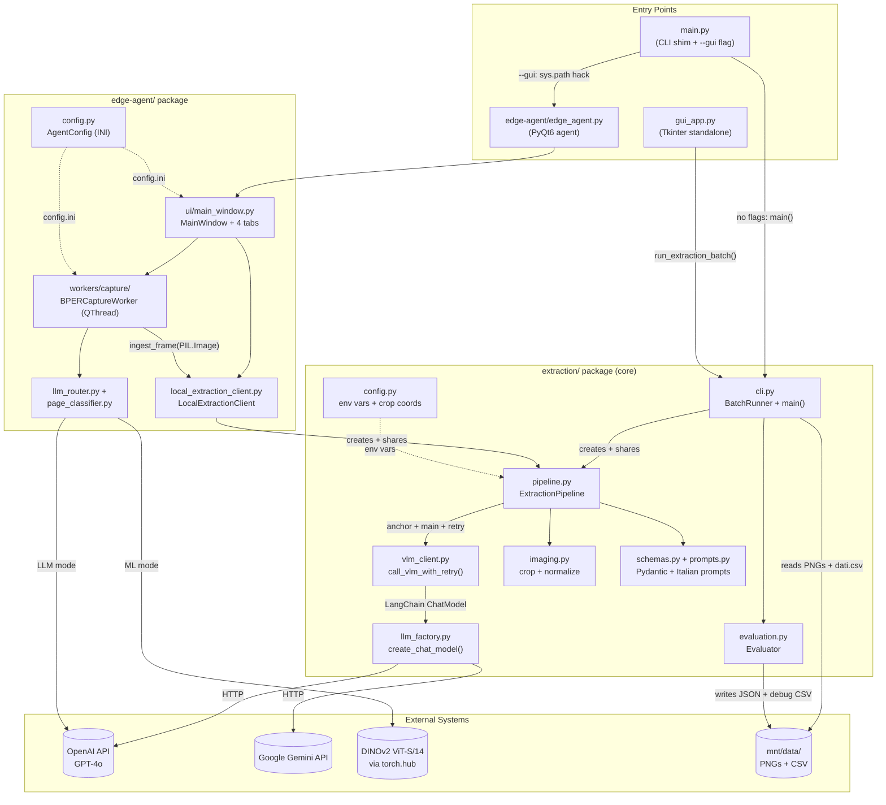

# Architettura

Questo è un progetto Python a stella (hub-and-spokes): un pacchetto centrale `extraction/` che sa come trasformare un singolo screenshot bancario in dati strutturati, e tre diverse "porte d'ingresso" -- una CLI, una GUI Tkinter e un agente di cattura dal vivo in PyQt6 -- che inviano tutte le immagini alla stessa pipeline. L'idea di fondo è che nessuna UI o runner batch parli mai direttamente con un LLM. Passano tutte attraverso `extraction.pipeline.ExtractionPipeline`, che possiede la logica multi-passaggio anchor-main-retry e gli handle dei modelli LangChain. Ogni altro modulo orbita attorno a quella classe.

Il progetto non è pacchettizzato (niente `setup.py`, niente `pyproject.toml`). La cartella `edge-agent/` è un pacchetto fratello che importa `extraction` tramite un'iniezione a runtime di `sys.path` (`edge-agent/local_extraction_client.py` righe 17-19). È una soluzione insolita ma deliberata: mantiene l'edge-agent distribuibile come bundle `.exe` autonomo pur riutilizzando il codice della pipeline in modalità batch.

## Diagramma dei componenti



Le frecce tratteggiate trasportano configurazione, le frecce piene trasportano dati (immagini PIL, modelli Pydantic, segnali Qt o payload HTTP).

## Struttura delle directory

```
poc-data-extraction/
├── main.py                       # Thin shim: .env -> extraction.* -> main() or edge-agent
├── gui_app.py                    # Standalone Tkinter GUI (imports extraction package)
├── requirements.txt              # All deps for CLI + edge-agent combined
├── .env.example                  # Env var template
├── CLAUDE.md                     # Detailed project documentation
├── README.md                     # Italian-language usage guide
│
├── extraction/                   # Core business logic — the "engine"
│   ├── __init__.py               # Public API re-exports (46 symbols)
│   ├── config.py                 # Env vars, crop coordinates, pricing tables
│   ├── fields.py                 # FIELD_KEYS list (40+ fields)
│   ├── field_definitions.py      # Display names and page_key mapping
│   ├── page_definitions.py       # 4 canonical pages and sheet ordering
│   ├── canonical_mapping.py      # Maps raw fields to canonical page entries
│   ├── schemas.py                # Pydantic: FieldResult, Soggetto, ExtractionResponse
│   ├── prompts.py                # Italian VLM prompts (PROMPT, ANCHOR_PROMPT, retry)
│   ├── normalization.py          # Text normalization, classify_field, pick_best
│   ├── imaging.py                # normalize_image, crop_relative, PNG encoding
│   ├── llm_factory.py            # create_chat_model() — ChatModel factory
│   ├── vlm_client.py             # call_vlm_with_retry — API call + backoff
│   ├── pipeline.py               # ExtractionPipeline — the anchor/main/retry passes
│   ├── evaluation.py             # Evaluator, cost_summary, debug_report
│   └── cli.py                    # BatchRunner + main() + run_extraction_batch wrapper
│
├── edge-agent/                   # PyQt6 live-capture agent (standalone sub-app)
│   ├── edge_agent.py             # QApplication boot, qt-material theme, MainWindow
│   ├── config.py                 # AgentConfig — INI loader
│   ├── config.ini                # 6 sections: agent, api, minio, llm, dataset, debug
│   ├── local_extraction_client.py  # Bridges QThread frames to ExtractionPipeline
│   ├── llm_router.py             # PageRouter strategies (ML / LLM / hybrid)
│   ├── page_classifier.py        # DINOv2 ViT-S/14 + cosine similarity
│   ├── image_ops.py              # preprocess_for_ocr, WebP/PNG encoders
│   ├── ui/
│   │   ├── main_window.py        # MainWindow with 4 tabs
│   │   ├── capture_tab.py        # Start/stop, FPS slider, live log
│   │   ├── extraction_results_tab.py  # Pages tree, fields table, JSON view
│   │   ├── data_table_tab.py     # Spreadsheet export (CSV/Excel)
│   │   ├── debug_tab.py          # Raw LLM router debug
│   │   └── overlay.py            # Red capture-border overlay window
│   ├── workers/capture/
│   │   ├── base_capture_worker.py     # QThread base with FPS loop + signals
│   │   ├── bper_capture_worker.py     # Dedup, routing, stability, page upload
│   │   └── default_capture_worker.py  # Generic remote-upload variant
│   └── assets/templates/bper/
│       ├── prompts.json          # LLM router: 5 BPER page definitions
│       ├── bper_page_prototypes.json  # Cached DINOv2 embeddings
│       └── screen 1-9.png        # Prototype reference images
│
├── mnt/data/                     # Test PNGs and ground truth (gitignored)
└── .codebase-map/                # This documentation set
```

Il layout separa volutamente le responsabilità. `extraction/` non ha alcun import di UI né alcun import di Qt -- puoi eseguirlo da qualsiasi script Python. `edge-agent/` contiene tutto ciò che è specifico di Qt. `gui_app.py` e `main.py` sono volutamente leggeri, in modo che la logica resti nel pacchetto, non negli entry point.

## Layer / moduli

### Layer di ingresso

Tre modi per avviare l'applicazione, tutti e tre finiscono per chiamare `extraction.pipeline.ExtractionPipeline`:

- **`main.py`** è uno shim di sette righe. Carica `.env` tramite `python-dotenv`, fa un import con wildcard da `extraction` e poi si dirama su `--gui`. Senza il flag chiama `main()` per un'esecuzione batch da CLI (`main.py` riga 23). Con il flag inietta `edge-agent/` in `sys.path` e passa il controllo a `edge_agent.main()` (`main.py` righe 15-20).
- **`gui_app.py`** è un'applicazione desktop Tkinter che importa `run_extraction_batch` e `FIELD_KEYS` da `extraction` (`gui_app.py` righe 6-14) ed esegue i batch su un `threading.Thread` in background. Nessun coinvolgimento di Qt.
- **`edge-agent/edge_agent.py`** avvia una `QApplication`, applica il tema `qt-material` dark-cyan, carica `AgentConfig` da `config.ini` e crea una `MainWindow` (`edge_agent.py` righe 33-52).

Nessuno di questi entry point conosce le API degli LLM, i prompt o le coordinate di ritaglio. Sanno solo come far arrivare un'immagine alla pipeline.

### Pacchetto di estrazione centrale (`extraction/`)

Questo è l'unico modulo che conta se devi cambiare cosa viene estratto o come. Ha uno stack interno ben definito:

1. **Config (`extraction/config.py`)** -- Legge le variabili d'ambiente una sola volta al momento dell'import. Espone le coordinate di ritaglio (`CONTENT_CROP = (0.18, 0.12, 0.98, 0.98)` alla riga 55), il numero di worker paralleli, le tabelle dei prezzi e le mappature campo-area (`AREA_TO_FIELDS` righe 65-78). Qui contano gli effetti collaterali dell'import: le variabili d'ambiente devono essere caricate prima che venga eseguito `extraction/config.py`, ed è per questo che `main.py` riga 7 chiama `load_dotenv()` prima di importare `extraction`.
2. **Schemi e campi (`extraction/schemas.py`, `fields.py`, `field_definitions.py`, `page_definitions.py`)** -- La classe Pydantic `FieldsModel` viene costruita dinamicamente a partire dalla lista `FIELD_KEYS`, quindi aggiungere un nuovo campo è una modifica di una sola riga in `fields.py`. Vedi [Modello dati](06-data-model.md) per lo schema completo.
3. **Imaging (`extraction/imaging.py`)** -- Helper di immagini puramente funzionali. `normalize_image()` ridimensiona il lato lungo a 1800px, applica filtri di contrasto e unsharp. `crop_relative()` accetta una tupla `(left, top, right, bottom)` in coordinate 0.0-1.0. Nessun riferimento a PIL trapela oltre questo modulo.
4. **Factory LLM (`extraction/llm_factory.py`)** -- Una singola funzione `create_chat_model(provider, model, api_key)` che importa in modo lazy `ChatOpenAI` oppure `ChatGoogleGenerativeAI` a seconda di `LLM_PROVIDER`. Convalida la corrispondenza provider/modello (`llm_factory.py` righe 46-54 rifiutano i modelli Gemini sotto il provider OpenAI). Le istanze restituite sono thread-safe e condivise tra tutti i worker.
5. **Client VLM (`extraction/vlm_client.py`)** -- `call_vlm_with_retry()` avvolge la chiamata LangChain `ChatModel.with_structured_output(PydanticSchema).invoke()` con backoff esponenziale sugli errori transitori (`min(8.0, 2^i * 0.8) + 0.05*i` secondi, massimo 3 retry) e restituisce sia il modello Pydantic parsato sia un dict `_meta` con conteggi di token e costo. È l'unico modulo che chiama direttamente l'SDK dell'LLM.
6. **Pipeline (`extraction/pipeline.py`)** -- L'orchestratore. `ExtractionPipeline` contiene due istanze `BaseChatModel` (una per il passaggio principale, una per il passaggio anchor) ed espone `extract_from_image(PIL.Image, screen_id)` (riga 104) ed `extract_from_screen(path)` (riga 182). La classe è esplicitamente documentata come thread-safe (righe 48-52) così che `BatchRunner` possa condividere una singola istanza tra un `ThreadPoolExecutor`.
7. **Valutazione (`extraction/evaluation.py`)** -- Usata solo dai flussi CLI e Tkinter. Carica la ground truth da `mnt/data/dati.csv`, classifica ogni campo come OK/WRONG/MISSING/HALLUCINATED/OK_NULL, scrive un CSV di debug, stampa accuratezza e costo per campo.
8. **CLI (`extraction/cli.py`)** -- `BatchRunner` alla riga 158 possiede l'`ExtractionPipeline` e un `ThreadPoolExecutor`. `main()` alla riga 314 collega il caricamento della ground truth, l'esecuzione batch e la valutazione in un unico comando CLI. `run_extraction_batch()` alla riga 282 è lo shim a livello di modulo che `gui_app.py` importa.

Il pattern del pacchetto è più vicino a un monolite a layer. Non c'è un framework di dependency injection, non ci sono eventi, non ci sono interfacce (nel senso Java del termine). La pipeline è collegata esplicitamente tramite `extraction/__init__.py`, che ri-esporta 46 simboli pubblici (`__init__.py` righe 11-45) per mantenere breve la riga di import di `gui_app.py`.

### Pacchetto edge-agent (`edge-agent/`)

L'agente di cattura dal vivo. Dipende da `extraction/` ma non viceversa.

- **`edge_agent.py`** -- Entry point. Inserisce il caricamento di `.env` prima dell'avvio di Qt (`edge_agent.py` righe 9-13).
- **`config.py` / `config.ini`** -- `AgentConfig` legge un file INI a sei sezioni tramite `configparser`. Le sezioni sono `[agent]` (FPS, modalità router, indice del monitor, preprocessing), `[api]`, `[minio]`, `[llm]`, `[dataset]`, `[debug]`. Nota che `config.ini` è committato su git *e* contiene una chiave API dell'LLM alla riga 23 -- questo è segnalato nella [Guida alla configurazione](10-configuration-guide.md) come fuga di credenziali.
- **`local_extraction_client.py`** -- `LocalExtractionClient` è un `QObject` che crea la propria `ExtractionPipeline` tramite la stessa factory `create_chat_model()`, poi espone `ingest_frame(job_id, PIL.Image, ...)` per il worker di cattura. Quando l'estrazione termina, emette il segnale Qt `result_ready = pyqtSignal(str, dict)` (riga 42), che i tab della UI ascoltano. Un `threading.Lock` alla riga 57 protegge il dict dei risultati in memoria.
- **`workers/capture/bper_capture_worker.py`** -- Una sottoclasse di `QThread` che esegue un loop a FPS. Ad ogni tick: cattura il monitor tramite `mss`, esegue il preprocessing tramite `image_ops.preprocess_for_ocr`, controlla la deduplica pHash (`DEDUP_HASH_THRESHOLD = 3` alla riga 52), esegue il router pagina, attende 2 secondi di stabilità (`STABILITY_SECONDS = 2.0` alla riga 49), e solo allora chiama `api_client.ingest_frame()`. Il metodo `_detect_page()` alla riga 628 smista verso il router configurato.
- **`llm_router.py` + `page_classifier.py`** -- Il layer di riconoscimento pagina. `PageRouter` è la classe base strategy (`llm_router.py` riga 37); `MLPageRouter` avvolge `BPERPagePrototypeClassifier` (embedding DINOv2 + similarità del coseno), `LLMPageRouter` usa direttamente OpenAI Vision, e il `bper_capture_worker` può eseguirli in modalità `ml`, `llm` o `hybrid` in base a `config.ini [agent] router=`.
- **`ui/main_window.py`** -- `MainWindow` possiede il `LocalExtractionClient` condiviso e lo collega a quattro tab: Cattura, Risultati (albero dei risultati), Dati Estratti (foglio di calcolo) e un tab Debug opzionale abilitato con `--debug` (`main_window.py` righe 37-77).

Il pattern chiave qui è il modello observer segnale/slot di Qt. Il worker di cattura gira nel proprio `QThread`, esegue l'estrazione in linea in quel thread (tramite `LocalExtractionClient.ingest_frame`) e lancia `result_ready` per aggiornare la UI dal thread principale. Nessuna sincronizzazione esplicita dei thread se non l'unico `threading.Lock` in `LocalExtractionClient`.

### Perché due worker di cattura?

`edge-agent/workers/capture/` contiene `BaseCaptureWorker` (l'impalcatura loop a FPS + segnali), `BPERCaptureWorker` (il flusso BPER completo con deduplica + stabilità + routing) e `DefaultCaptureWorker` (una variante più semplice che si limita a caricare i frame su un'API remota tramite `requests`). Solo il worker BPER è attualmente attivo; il worker default esiste come percorso legacy per la modalità di deployment con upload HTTP a cui `config.ini [api] base_url` fa ancora riferimento ma che non è esercitata nella modalità solo-locale.

## Flusso dei dati

### Percorso CLI

`main.py` -> `extraction.cli.main()` -> `load_ground_truth()` legge `mnt/data/dati.csv` -> `get_screenshot_paths()` scopre i PNG in `INPUT_DIR` -> `BatchRunner(...)` costruisce due ChatModel LangChain e una `ExtractionPipeline` condivisa -> `BatchRunner.run()` invia ogni percorso a un `ThreadPoolExecutor` (fino a `PARALLEL_WORKERS`) -> ogni worker chiama `pipeline.extract_from_screen(path)`.

All'interno di `extract_from_screen()` (`extraction/pipeline.py` riga 182): `Image.open` -> `normalize_image` -> `extract_from_image`:

1. **Ritaglio del contenuto** tramite le coordinate `CONTENT_CROP` rimuove la barra laterale
2. **Passaggio anchor** -- la striscia dell'header viene inviata al modello anchor con `ANCHOR_PROMPT`, restituisce NDG + denominazione
3. **Passaggio principale** -- l'intero contenuto con `PROMPT` più gli hint dell'anchor, restituisce tutti i 40+ campi come `ExtractionResponse` Pydantic
4. **Merge e normalizzazione** -- `_merge_anchors`, `_postprocess_tipo`, normalizzazione del tipo
5. **Passaggio di retry** -- per i campi nulli o a bassa confidenza, ritaglia ogni regione `RETRY_AREAS`, ri-effettua il prompt in parallelo tramite `ThreadPoolExecutor`, usa `pick_best()` per tenere il risultato più solido
6. **Controllo di coerenza** -- correzioni basate sui tooltip
7. **Mappatura canonica** -- `build_canonical_field_entries` mappa i nomi grezzi dei campi sulle pagine canoniche BPER

I risultati tornano come `Dict[str, Any]` con le chiavi `fields`, `soggetti`, `fidi`, `garanzie`, `canonical_fields`, `_meta_agg`, `_field_sources`, `_status`. `cli.main()` scrive poi `mnt/data/poc_outputs_improved.json`, esegue `Evaluator.eval()`, scrive `poc_debug_improved.csv` e stampa il riepilogo dei costi.

Vedi [Workflow 1 e Workflow 3](05-workflows.md) per la sequenza passo passo.

### Percorso edge-agent

`edge-agent/edge_agent.py::main()` -> `QApplication` -> `AgentConfig(config.ini)` -> `MainWindow(config)` -> `LocalExtractionClient()` costruisce la propria `ExtractionPipeline` tramite `create_chat_model(LLM_PROVIDER, LLM_MODEL)` (`local_extraction_client.py` righe 47-54).

L'utente clicca Avvia su `CaptureTab` -> `BPERCaptureWorker(QThread)` parte -> ad ogni tick:

1. `mss.grab()` cattura il monitor configurato
2. `preprocess_for_ocr()` applica maschera unsharp e scalatura
3. deduplica pHash tramite `imagehash` (distanza di Hamming ≤ 3, salta se è lo stesso frame)
4. `_detect_page(img)` -> `PageRouter.route()` -> match coseno DINOv2 oppure prompt OpenAI Vision
5. Controllo di stabilità: deve vedere lo stesso page_type per 2+ secondi
6. Una volta stabile: `self.api_client.ingest_frame(job_id, img, page_no, page_type, confidence, fields_json)`
7. `LocalExtractionClient.ingest_frame()` chiama `self._pipeline.extract_from_image(img, screen_id)` -- la stessa pipeline centrale usata dalla CLI
8. Emette `result_ready.emit(job_id, result)` al completamento
9. Il segnale è collegato agli slot in `ExtractionResultsTab` e `DataTableTab`, che aggiornano la UI sul thread principale

La decisione di progettazione cruciale è che l'estrazione gira **all'interno del QThread di cattura**, non in un ulteriore worker. Questo semplifica lo stato condiviso (il dict `LocalExtractionClient._results` è l'unica superficie cross-thread, protetta dal suo `threading.Lock`) ma significa che una chiamata LLM lenta blocca il tick di cattura successivo.

### Percorso Tkinter

`gui_app.py` è il più semplice. La finestra principale avvia un `threading.Thread` in background che chiama `run_extraction_batch(paths, api_key, provider, model_main)` -- un sottile wrapper attorno a `BatchRunner` di `extraction/cli.py`. I risultati vengono riscritti nei widget Tk tramite la schedulazione `self.after()`. Niente Qt, niente cattura, niente routing -- solo estrazione batch con un selettore di file.

## Configurazione

Il progetto ha due sistemi di configurazione completamente separati che non condividono codice:

**`extraction/config.py` -- variabili d'ambiente**

Lette una sola volta all'import del modulo tramite `os.getenv()`. Tutto ciò di cui ha bisogno il pacchetto centrale. L'elenco: `LLM_PROVIDER` (openai/gemini), `LLM_API_KEY`, `LLM_MODEL` (default `gpt-4o`), `LLM_MODEL_ANCHOR`, `LLM_THINKING_LEVEL`, `INPUT_DIR` (default `mnt/data`), `PARALLEL_WORKERS` (default **12** nel codice alla riga 11, anche se la documentazione dice 4), `PARALLEL_ENABLED`, `MAX_CALLS_PER_SCREEN`, `ANCHOR_CONF_MIN` (default 0.95), `STOP_ON_ANCHOR_UNCERTAIN`, `DEBUG_SAVE_CROPS`, `DEBUG_MODE`. Le vecchie `OPENAI_API_KEY` e `GEMINI_API_KEY` sono ancora onorate in `llm_factory.py` righe 10-13 ma generano un `DeprecationWarning`.

Costanti che *non* sono configurabili da variabile d'ambiente ma vivono nello stesso file: `CONTENT_CROP`, `HEADER_IN_CONTENT`, `RETRY_AREAS`, `AREA_TO_FIELDS`, `FIELD_RETRY_MAP`, `PROVIDER_MODELS`, `PRICING_PER_1M`. Sono manopole di tuning che richiedono una modifica al codice.

**`edge-agent/config.py` -- file INI**

`AgentConfig` legge `edge-agent/config.ini` tramite `configparser`. Sei sezioni (`agent`, `api`, `minio`, `llm`, `dataset`, `debug`) coprono FPS, modalità router, indice del monitor, preprocessing di cattura, credenziali MinIO/S3 (inutilizzate ma comunque parsate), provider/modello/chiave API dell'LLM, raccolta del dataset e toggle del tab di debug. I default sono hardcoded come attributi di classe in `edge-agent/config.py` righe 17-49 e applicati se una sezione o una chiave manca.

**Ordine di caricamento**

Il file .env viene caricato per primo da `main.py` (riga 7) o `edge_agent.py` (righe 9-13), quindi `LLM_API_KEY` è già in `os.environ` nel momento in cui viene eseguito `extraction/config.py`. `edge-agent/config.ini` viene caricato successivamente all'interno di `MainWindow.__init__`. Non ci sono profili, nessuna separazione dev/staging/prod, nessun feature flag oltre alle variabili d'ambiente `DEBUG_*` e al toggle INI `[debug] show_llm_tab`. Il flag CLI `--debug` dell'edge-agent attiva il tab di debug in modo indipendente (`edge_agent.py` riga 51).

**Discrepanze note** (segnalate nella [Guida alla configurazione](10-configuration-guide.md))

- `PARALLEL_WORKERS` ha default 12 in `extraction/config.py` riga 11, ma `.env.example` e CLAUDE.md documentano il default come 4
- `LLM_THINKING_LEVEL` ha un default `medium` in `extraction/config.py` riga 20, ma quella costante non viene mai consumata. Il gate che conta è `extraction/llm_factory.py` riga 72, che rilegge la variabile d'ambiente con default vuoto -- quindi lasciarla non impostata (come suggerisce `.env.example`) mantiene comunque la modalità thinking disattivata
- `edge-agent/config.ini` è committato nel repository **con una chiave API reale** alla riga 23 -- questa è una fuga di credenziali, non una scelta architetturale

Vedi [Funzionalità](02-features.md) per cosa abilita ogni opzione di configurazione, e [Per iniziare](07-getting-started.md) per la configurazione iniziale consigliata.
