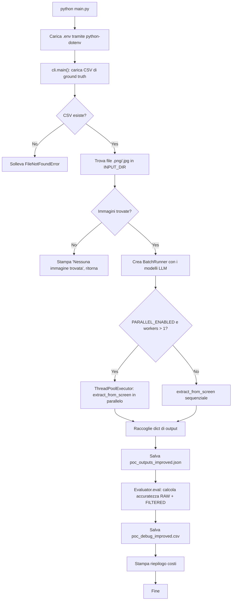
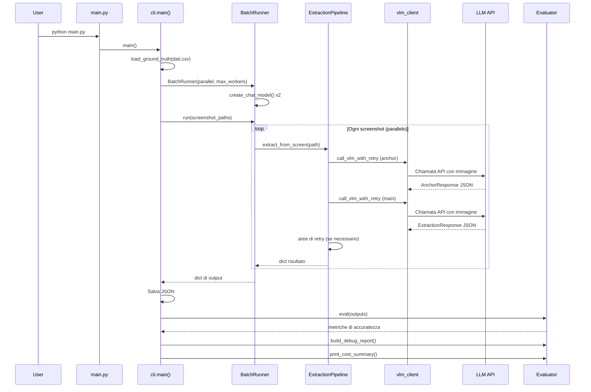
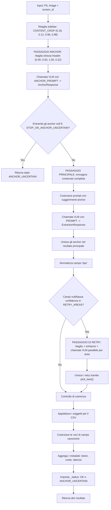
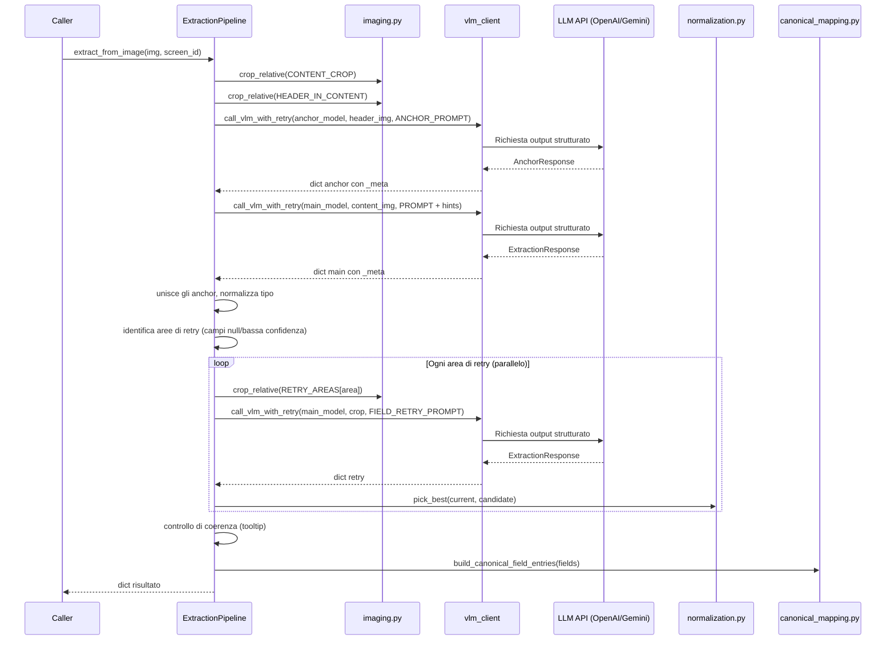
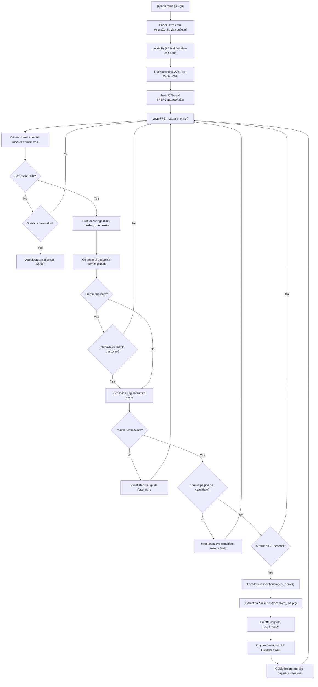
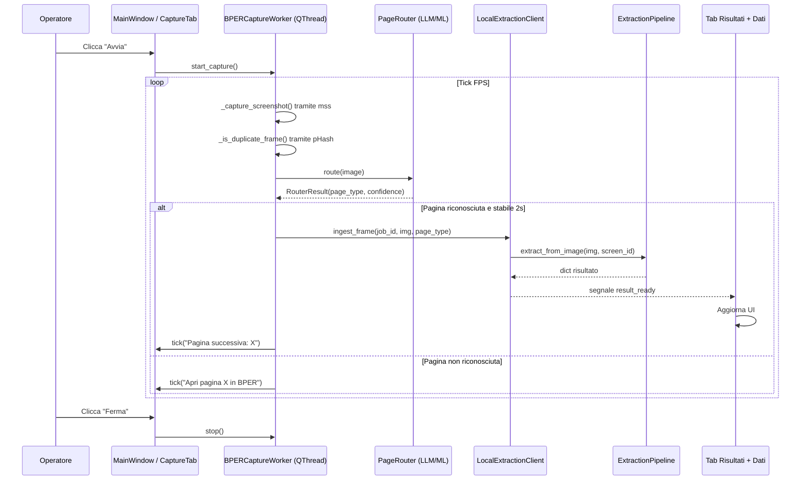
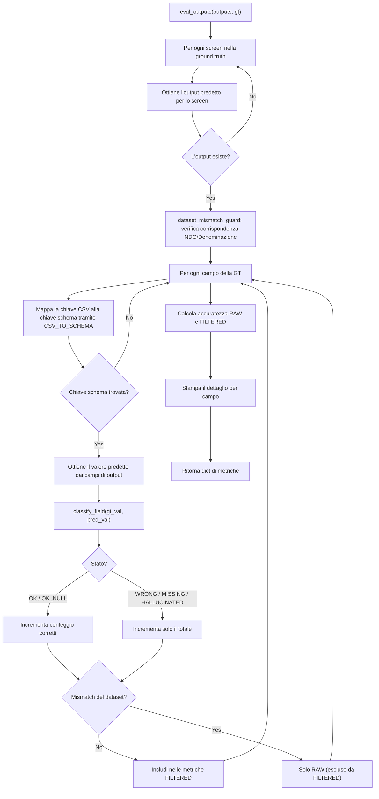

# Workflow

Questo progetto ha tre distinti workflow rivolti all'utente e un workflow di sistema centrale che li accomuna tutti. La **estrazione batch da CLI** fa passare tutti gli screenshot attraverso la pipeline multi-pass e valuta l'accuratezza rispetto alla ground truth. La **cattura dal vivo dell'edge-agent** monitora uno schermo in tempo reale, riconosce le pagine bancarie BPER ed estrae i dati man mano che gli operatori navigano. La **GUI desktop Tkinter** fornisce un'interfaccia grafica per esecuzioni di estrazione estemporanee. Al cuore di ognuno c'è la **pipeline di estrazione multi-pass**, il motore condiviso che trasforma un singolo screenshot in dati bancari strutturati.

## Estrazione batch da CLI

È il workflow di sviluppo più comune. Un operatore esegue `python main.py` per elaborare ogni screenshot nella directory di input, valutare l'accuratezza rispetto a un CSV di ground truth e produrre i report di costo.

### Flowchart

### Spiegazione passo per passo

1. **Entry point.** `main.py` carica le variabili d'ambiente tramite `python-dotenv`, poi importa tutto dal package `extraction`. Quando viene eseguito senza flag, invoca `main()` da `extraction/cli.py` (riga 314).

2. **Caricamento della ground truth.** `cli.main()` verifica la presenza di `mnt/data/dati.csv` (il percorso è costruito a partire da `INPUT_DIR` in `extraction/config.py`, riga 9). La funzione `load_ground_truth()` in `extraction/evaluation.py` (riga 33) legge il CSV con pandas, mappando ogni nome di screen a un dict di coppie nome-campo/valore. Tollera diverse varianti dei nomi delle colonne per le colonne screen, key e value.

3. **Individuazione delle immagini.** Tutti i file `.png`, `.jpg` e `.jpeg` in `INPUT_DIR` vengono raccolti e ordinati alfabeticamente (`extraction/cli.py`, righe 322-327).

4. **Inizializzazione del BatchRunner.** `BatchRunner.__init__()` (`extraction/cli.py`, riga 158) chiama `create_chat_model()` da `extraction/llm_factory.py` due volte -- una per il modello di estrazione principale, una per il modello anchor. Entrambe le istanze `ChatModel` di LangChain sono thread-safe e condivise tra tutti i worker. Confluiscono in un'unica istanza di `ExtractionPipeline`.

5. **Esecuzione parallela o sequenziale.** `BatchRunner.run()` (riga 207) controlla `PARALLEL_ENABLED` e il numero di worker. Se in parallelo, usa `ThreadPoolExecutor` con un massimo di `PARALLEL_WORKERS` thread (default 12 nel codice, `extraction/config.py` riga 11). Ogni thread chiama `ExtractionPipeline.extract_from_screen()` per un'immagine. Le callback `on_complete` e `on_error` scattano sul thread chiamante.

6. **Persistenza dell'output.** I risultati vengono salvati come JSON in `mnt/data/poc_outputs_improved.json` (`extraction/cli.py`, righe 337-340).

7. **Valutazione.** `Evaluator.eval()` delega a `eval_outputs()` in `extraction/evaluation.py` (riga 74), che confronta ogni valore di campo predetto rispetto alla ground truth usando `classify_field()` da `extraction/normalization.py` (riga 113). I campi vengono classificati come OK, WRONG, MISSING, HALLUCINATED o OK_NULL. Un controllo `dataset_mismatch_guard()` filtra gli screen in cui NDG o Denominazione non corrispondono (segnalando una riga di ground truth errata).

8. **Reportistica.** `build_debug_report()` scrive un CSV delimitato da punto e virgola con una riga per ogni coppia (screen, campo). `print_cost_summary()` stampa il conteggio dei token per screen e i costi stimati in USD.

### Sequence Diagram

### Gestione degli errori

- **CSV mancante**: `FileNotFoundError` sollevata immediatamente in `extraction/cli.py` riga 316.
- **Immagini mancanti**: viene stampato un avviso ma l'esecuzione continua con i file rimanenti (riga 218).
- **Errori transitori delle API LLM**: `call_vlm_with_retry()` in `extraction/vlm_client.py` (riga 229) riprova fino a 3 volte con backoff esponenziale (`min(8.0, 2^i * 0.8) + 0.05*i` secondi). Un `ValueError` dovuto a fallimenti di parsing viene risollevato immediatamente -- nessun retry.
- **Fallimento di un singolo screen**: in modalità parallela, le eccezioni di uno screen vengono catturate e segnalate tramite la callback `on_error`; gli altri screen proseguono (riga 246).

---

## Pipeline di estrazione multi-pass

Il workflow di sistema centrale condiviso da ogni interfaccia. Dato un singolo screenshot, produce dati strutturati attraverso tre passaggi: anchor, principale e retry condizionale.

### Flowchart

### Spiegazione passo per passo

1. **Normalizzazione dell'immagine.** `extract_from_screen()` in `extraction/pipeline.py` (riga 182) apre l'immagine, la converte in RGB e chiama `normalize_image()` da `extraction/imaging.py` (riga 12). Questo ridimensiona il lato lungo a 1800px, applica un leggero potenziamento del contrasto (1.05x) ed esegue una unsharp mask.

2. **Ritaglio del contenuto.** La sidebar BPER viene rimossa ritagliando a `CONTENT_CROP = (0.18, 0.12, 0.98, 0.98)` tramite `crop_relative()` (`extraction/imaging.py`, riga 22). Tutte le operazioni successive usano questa immagine ritagliata.

3. **Passaggio anchor (Passaggio 1).** `extract_anchors()` (riga 70) ritaglia la striscia header a `HEADER_IN_CONTENT = (0.00, 0.00, 1.00, 0.22)` e la invia al VLM con `ANCHOR_PROMPT` da `extraction/prompts.py` (riga 25). Lo schema è `AnchorResponse`, che ha solo i campi `ndg` e `denominazione`. Una confidenza inferiore a `ANCHOR_CONF_MIN` (default 0.95, `extraction/config.py` riga 52) fa azzerare il valore mantenendo però il punteggio di confidenza.

4. **Gate dell'anchor.** Se `STOP_ON_ANCHOR_UNCERTAIN` è abilitato ed entrambi i valori anchor sono null, la pipeline ritorna anticipatamente con stato `ANCHOR_UNCERTAIN` (righe 112-124).

5. **Passaggio principale (Passaggio 2).** `extract_from_image()` costruisce un prompt aggiungendo suggerimenti anchor ("NDG atteso: ...", "Denominazione attesa: ...") al `PROMPT` di base (`extraction/prompts.py`, riga 3). L'immagine completa del contenuto viene inviata con lo schema `ExtractionResponse`, che restituisce tutti i 40+ campi più le liste soggetti, fidi e garanzie.

6. **Unione e post-elaborazione.** I valori anchor ad alta confidenza prevalgono sui valori del passaggio principale (righe 212-216). Il campo `tipo` viene normalizzato tramite `normalize_tipo()` in `extraction/normalization.py` (riga 17), mappando varianti comuni come "mutui spesa" in "BPI Mutui".

7. **Passaggio di retry (Passaggio 3).** `_retry_areas()` (riga 243) scansiona `AREA_TO_FIELDS` in `extraction/config.py` (riga 65) per trovare campi null o sotto la confidenza 0.60. Per ogni area interessata (HEADER, BODY, FOOTER), ritaglia la regione corrispondente da `RETRY_AREAS`, applica un potenziamento di contrasto/nitidezza e la invia con un prompt specifico per area da `FIELD_RETRY_PROMPTS`. I retry vengono eseguiti in parallelo tramite `ThreadPoolExecutor`. I risultati si uniscono tramite `pick_best()` (`extraction/normalization.py`, riga 87), che sceglie il valore con la confidenza più alta o quello non-null. Il numero totale di chiamate VLM per screen è limitato a `MAX_CALLS_PER_SCREEN` (default 4, meno 2 per anchor e principale).

8. **Controllo di coerenza.** `_coherence_check()` (riga 312) applica correzioni basate sui tooltip. Se `tooltip_evidenze_b` ha un valore e il campo `evidenze` appare numerico o null, viene sovrascritto a "B". Analogamente, `tooltip_descrizione_bmb` può impostare `tipo` a "BMB".

9. **Assemblaggio dell'output.** I soggetti vengono appiattiti in campi numerati (`ndg_1`, `denominazione_1`, `ruolo_1`, ecc.) per la compatibilità con il CSV (righe 160-166). Le voci di campo canoniche vengono costruite tramite `build_canonical_field_entries()` in `extraction/canonical_mapping.py`. I metadati di tutti i tentativi vengono aggregati in `_meta_agg`.

### Sequence Diagram

### Gestione degli errori

- **Fallimento di un'area di retry**: catturato per area; viene stampato un avviso e i risultati del passaggio principale vengono preservati (`extraction/pipeline.py`, righe 289-291).
- **JSON in formato libero di Gemini**: per i modelli Gemini 2.0+, `_call_vlm_gemini_freeform()` in `extraction/vlm_client.py` (riga 47) inietta lo schema JSON nel prompt e analizza la risposta manualmente. Se la validazione Pydantic fallisce, viene sollevato un `ValueError` con il frammento JSON grezzo.
- **Output strutturato di OpenAI**: usa `.with_structured_output()` di LangChain con `include_raw=True`. Se nel risultato è presente `parsing_error`, viene sollevato un `ValueError` (riga 199).

---

## Cattura dal vivo dell'edge-agent

Il workflow in tempo reale per gli operatori bancari. Un'applicazione desktop PyQt6 cattura lo schermo dell'operatore, riconosce quale pagina BPER è visualizzata, attende la stabilità, poi esegue l'estrazione automaticamente.

### Flowchart

### Spiegazione passo per passo

1. **Avvio.** `main.py --gui` (riga 16) aggiunge `edge-agent/` a `sys.path` e chiama `edge_agent.main()`. Questo carica `.env`, crea un `AgentConfig` da `edge-agent/config.ini` (`edge-agent/config.py`, riga 51), applica il tema qt-material e apre `MainWindow` (`edge-agent/ui/main_window.py`).

2. **Setup di MainWindow.** La finestra crea un `LocalExtractionClient` (`edge-agent/local_extraction_client.py`, riga 32) che inizializza la propria `ExtractionPipeline` con i modelli LLM. Crea poi quattro tab: Cattura (capture), Risultati (results), Dati Estratti (data table) e, opzionalmente, Debug LLM.

3. **Avvio della cattura.** L'utente clicca "Avvia" in `CaptureTab` (`edge-agent/ui/capture_tab.py`). Questo avvia un `BPERCaptureWorker` come `QThread`. La classe base `BaseCaptureWorker` (`edge-agent/workers/capture/base_capture_worker.py`, riga 39) esegue un loop che chiama `_capture_once()` agli FPS configurati (default 1).

4. **Cattura dello screenshot.** `_capture_screenshot()` (`edge-agent/workers/capture/bper_capture_worker.py`, riga 550) usa `mss` per una cattura del monitor veloce e cross-platform. L'indice del monitor proviene da `config.ini`. Lo screenshot grezzo viene preprocessato tramite `preprocess_for_ocr()` da `edge-agent/image_ops.py`.

5. **Deduplica dei frame.** `_is_duplicate_frame()` (riga 601) calcola un hash percettivo (pHash) tramite `imagehash.phash()` su un ridimensionamento a 256x256. Se la distanza di Hamming dall'ultimo frame rientra in `DEDUP_HASH_THRESHOLD` (default 3), il frame è considerato un duplicato. I frame duplicati possono comunque essere instradati, ma solo dopo un intervallo di throttle configurabile (`route_retry_seconds`, default 1.0s).

6. **Riconoscimento della pagina.** `_detect_page()` (riga 628) delega al `PageRouter` configurato. Sono disponibili tre strategie tramite `config.ini [agent] router`:
   - **ml**: `MLPageRouter` incapsula `BPERPagePrototypeClassifier` (similarità coseno DINOv2 ViT-S/14 rispetto agli embedding dei prototipi).
   - **llm**: `LLMPageRouter` invia lo screenshot a OpenAI Vision con un system prompt che elenca le pagine BPER note.
   - **hybrid**: prova prima LLM, ricade su ML se LLM non restituisce alcuna corrispondenza.

7. **Controllo di stabilità.** Lo stesso tipo di pagina deve essere riconosciuto per `STABILITY_SECONDS` (2.0s, riga 49) prima che scatti l'estrazione. Una nuova pagina resetta il timer.

8. **Estrazione.** `_upload_page()` (riga 679) chiama `LocalExtractionClient.ingest_frame()` che delega a `ExtractionPipeline.extract_from_image()`. Il risultato viene memorizzato in memoria (thread-safe tramite `threading.Lock`) ed emesso come segnale Qt `result_ready`.

9. **Aggiornamento della UI.** Il segnale `result_ready` si collega a `ExtractionResultsTab` (albero delle pagine, tabella dei campi, JSON grezzo, export CSV) e a `DataTableTab` (vista a foglio di calcolo con export CSV/Excel). Il worker emette inoltre messaggi di guida che indicano all'operatore quale pagina BPER aprire successivamente.

### Sequence Diagram

### Gestione degli errori

- **Fallimento di mss**: se la libreria di screenshot non riesce a inizializzarsi, viene emesso un `RuntimeError` e il worker si arresta (`bper_capture_worker.py`, riga 563).
- **Errori di cattura consecutivi**: dopo 5 fallimenti di fila (`_MAX_CONSECUTIVE_CAPTURE_ERRORS`), il worker si arresta automaticamente (riga 593).
- **torch non disponibile**: l'import di `BPERPagePrototypeClassifier` è racchiuso in un try/except. Se fallisce, la classificazione ML degrada in modalità `DISABLED` e il worker continua senza riconoscimento pagina (righe 19-21).
- **Fallimento del router LLM**: `LLMPageRouter.route()` cattura tutte le eccezioni con un backoff a 2 tentativi. In caso di fallimento totale, restituisce `RouterResult(None, 0.0, {})` (righe 246-258).
- **Errore di estrazione**: `LocalExtractionClient.ingest_frame()` cattura le eccezioni della pipeline e restituisce un risultato di fallback con `_status: "ERROR"` (righe 87-93).

---

## Valutazione dell'accuratezza

Viene eseguita dopo l'estrazione batch nel workflow CLI. Confronta i valori estratti rispetto alla ground truth e riporta l'accuratezza per ogni campo.

### Flowchart

### Spiegazione passo per passo

1. **Classificazione dei campi.** `classify_field()` in `extraction/normalization.py` (riga 113) gestisce cinque casi: entrambi null (`OK_NULL`), GT presente ma predizione null (`MISSING`), GT null ma predizione presente (`HALLUCINATED`), ed entrambi presenti (confrontati tramite `norm_text()` o `norm_number_str()` a seconda del tipo di campo). Per i campi di testo lungo (>20 caratteri), si usa un fuzzy match con `SequenceMatcher` a soglia 0.85.

2. **Guardia contro il mismatch del dataset.** `dataset_mismatch_guard()` (riga 174) confronta l'NDG e la Denominazione della ground truth rispetto ai valori predetti. Se non corrispondono, l'intero screen viene escluso dalle metriche FILTERED. Questo intercetta i casi in cui la riga del CSV di ground truth non corrisponde allo screenshot reale.

3. **CSV di debug.** `build_debug_report()` (`extraction/evaluation.py`, riga 125) scrive un CSV dettagliato per ogni coppia (screen, chiave-GT) con colonne per valore di ground truth, valore predetto, confidenza, testo di evidenza, stato, motivazione, tentativo di origine (quale passaggio della pipeline ha prodotto il valore) e metadati di costo.

4. **Mappatura CSV-schema.** Il dict `CSV_TO_SCHEMA` in `extraction/fields.py` (riga 56) mappa le intestazioni di colonna italiane del CSV di ground truth alle chiavi schema interne. Gestisce varianti come "Denom." e "DENOMINAZIONE" che mappano entrambe a "denominazione".

---

## Processi in background

Questo progetto non ha processi in background persistenti, attività schedulate o code di messaggi. Tutto il lavoro è innescato da un'azione dell'utente:

- **CLI**: processo batch a esecuzione singola. Termina dopo aver stampato i risultati.
- **Edge-agent**: il QThread `BPERCaptureWorker` gira di continuo mentre l'utente ha la cattura attiva, ma viene avviato e arrestato esplicitamente dall'operatore. Quando la cattura è in pausa non avviene alcun lavoro.
- **GUI Tkinter**: l'estrazione gira in un `threading.Thread` in background, ma solo quando l'utente clicca "Avvia Estrazione". Il thread termina al completamento dell'elaborazione.

Il metodo `_maybe_upload_dataset()` su `BPERCaptureWorker` (`bper_capture_worker.py`, riga 713) è uno stub che ritorna immediatamente -- l'upload del dataset su MinIO/S3 è disabilitato. La configurazione MinIO in `config.ini` è presente ma inutilizzata nel codebase attuale.

## Vedi anche

- [Architettura](04-architecture.md) -- il diagramma dei componenti e la descrizione dei livelli che sostengono questi flussi
- [Modello dei dati](06-data-model.md) -- gli schemi Pydantic e i dict di risultato che ogni passaggio produce e modifica
- [Funzionalità](02-features.md) -- le capacità rivolte all'utente (pipeline multi-pass, LLM multi-provider, edge agent) che questi workflow implementano
- [Guida alla configurazione](10-configuration-guide.md) -- come regolare `PARALLEL_WORKERS`, `MAX_CALLS_PER_SCREEN` e il router pagina dell'edge-agent dall'esterno del codice
