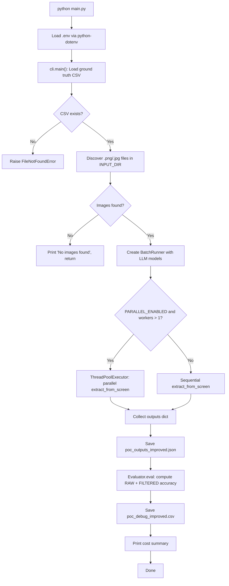
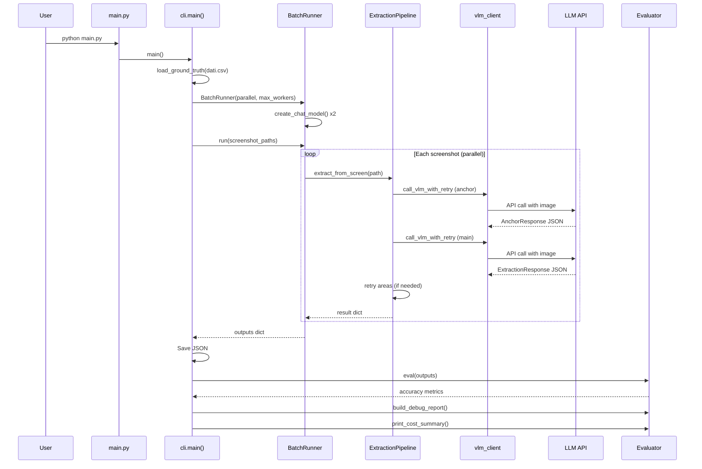
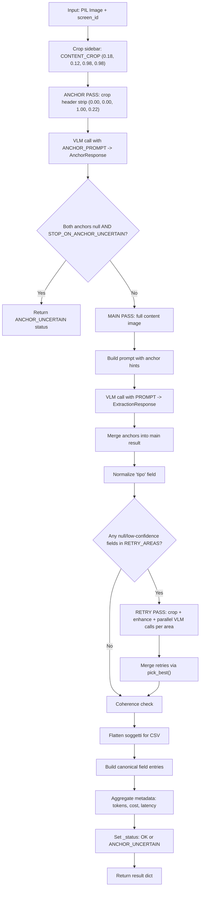
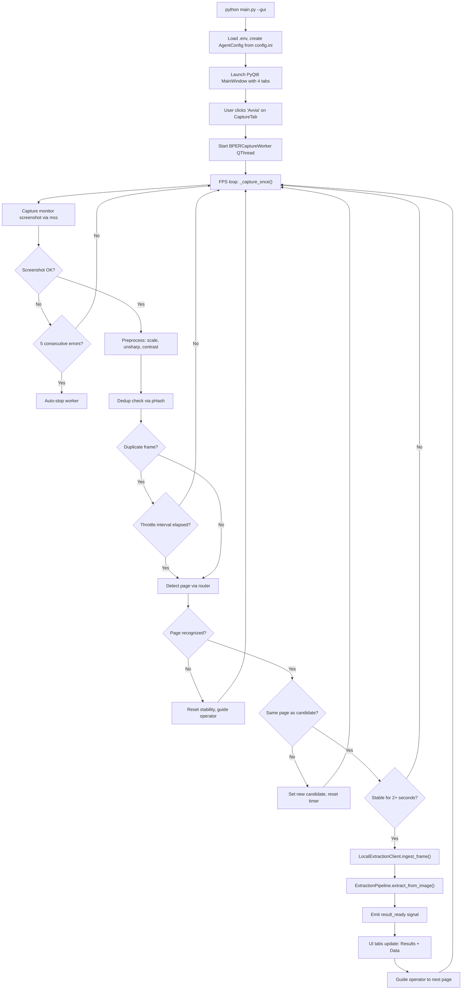
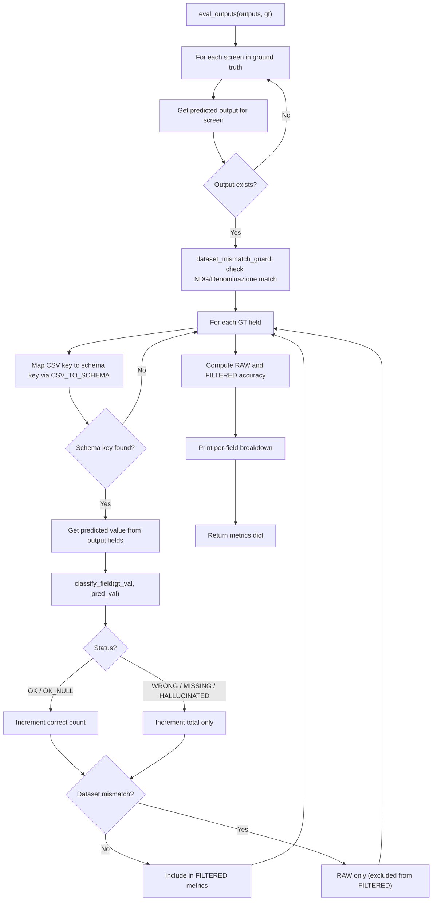

# Workflows

This project has three distinct user-facing workflows and one core system workflow that underpins all of them. The **CLI batch extraction** runs all screenshots through the multi-pass pipeline and evaluates accuracy against ground truth. The **edge-agent live capture** monitors a screen in real time, detects BPER banking pages, and extracts data as operators navigate. The **Tkinter desktop GUI** provides a graphical interface for ad-hoc extraction runs. At the heart of each sits the **multi-pass extraction pipeline**, the shared engine that turns a single screenshot into structured banking data.

## CLI Batch Extraction

The most common development workflow. An operator runs `python main.py` to process every screenshot in the input directory, evaluate accuracy against a ground truth CSV, and produce cost reports.

### Flowchart

### Walkthrough

1. **Entry point.** `main.py` loads environment variables via `python-dotenv`, then imports everything from the `extraction` package. When run without flags, it calls `main()` from `extraction/cli.py` (line 314).

2. **Ground truth loading.** `cli.main()` checks for `mnt/data/dati.csv` (the path is built from `INPUT_DIR` in `extraction/config.py`, line 9). The function `load_ground_truth()` in `extraction/evaluation.py` (line 33) reads the CSV with pandas, mapping each screen name to a dict of field-name/value pairs. It tolerates several column name variants for the screen, key, and value columns.

3. **Image discovery.** All `.png`, `.jpg`, and `.jpeg` files in `INPUT_DIR` are collected and sorted alphabetically (`extraction/cli.py`, lines 322-327).

4. **BatchRunner initialization.** `BatchRunner.__init__()` (`extraction/cli.py`, line 158) calls `create_chat_model()` from `extraction/llm_factory.py` twice -- once for the main extraction model, once for the anchor model. Both LangChain `ChatModel` instances are thread-safe and shared across all workers. They feed into a single `ExtractionPipeline` instance.

5. **Parallel or sequential execution.** `BatchRunner.run()` (line 207) checks `PARALLEL_ENABLED` and the worker count. If parallel, it uses `ThreadPoolExecutor` with up to `PARALLEL_WORKERS` threads (default 12 in code, `extraction/config.py` line 11). Each thread calls `ExtractionPipeline.extract_from_screen()` for one image. Callbacks `on_complete` and `on_error` fire on the calling thread.

6. **Output persistence.** Results are saved as JSON to `mnt/data/poc_outputs_improved.json` (`extraction/cli.py`, lines 337-340).

7. **Evaluation.** `Evaluator.eval()` delegates to `eval_outputs()` in `extraction/evaluation.py` (line 74), which compares each predicted field value against ground truth using `classify_field()` from `extraction/normalization.py` (line 113). Fields are classified as OK, WRONG, MISSING, HALLUCINATED, or OK_NULL. A `dataset_mismatch_guard()` check filters out screens where the NDG or Denominazione do not match (suggesting a wrong ground truth row).

8. **Reporting.** `build_debug_report()` writes a semicolon-delimited CSV with per-(screen, field) rows. `print_cost_summary()` outputs per-screen token counts and estimated USD costs.

### Sequence Diagram

### Error Handling

- **Missing CSV**: `FileNotFoundError` raised immediately at `extraction/cli.py` line 316.
- **Missing images**: A warning prints but execution continues with remaining files (line 218).
- **LLM API transient errors**: `call_vlm_with_retry()` in `extraction/vlm_client.py` (line 229) retries up to 3 times with exponential backoff (`min(8.0, 2^i * 0.8) + 0.05*i` seconds). `ValueError` from parsing failures is re-raised immediately -- no retry.
- **Individual screen failure**: In parallel mode, exceptions from one screen are caught and reported via `on_error` callback; other screens continue (line 246).

---

## Multi-Pass Extraction Pipeline

The core system workflow shared by every interface. Given a single screenshot, it produces structured data through three passes: anchor, main, and conditional retry.

### Flowchart

### Walkthrough

1. **Image normalization.** `extract_from_screen()` in `extraction/pipeline.py` (line 182) opens the image, converts to RGB, and calls `normalize_image()` from `extraction/imaging.py` (line 12). This resizes the long side to 1800px, applies slight contrast enhancement (1.05x), and runs an unsharp mask.

2. **Content crop.** The BPER sidebar is removed by cropping to `CONTENT_CROP = (0.18, 0.12, 0.98, 0.98)` via `crop_relative()` (`extraction/imaging.py`, line 22). All subsequent operations use this cropped image.

3. **Anchor pass (Pass 1).** `extract_anchors()` (line 70) crops the header strip at `HEADER_IN_CONTENT = (0.00, 0.00, 1.00, 0.22)` and sends it to the VLM with `ANCHOR_PROMPT` from `extraction/prompts.py` (line 25). The schema is `AnchorResponse`, which only has `ndg` and `denominazione` fields. Confidence below `ANCHOR_CONF_MIN` (default 0.95, `extraction/config.py` line 52) causes the value to be zeroed out while retaining the confidence score.

4. **Anchor gate.** If `STOP_ON_ANCHOR_UNCERTAIN` is enabled and both anchor values are null, the pipeline returns early with status `ANCHOR_UNCERTAIN` (line 112-124).

5. **Main pass (Pass 2).** `extract_from_image()` builds a prompt by appending anchor hints ("NDG atteso: ...", "Denominazione attesa: ...") to the base `PROMPT` (`extraction/prompts.py`, line 3). The full content image is sent with schema `ExtractionResponse`, which returns all 40+ fields plus soggetti, fidi, and garanzie lists.

6. **Merge and post-process.** High-confidence anchor values override the main pass values (line 212-216). The `tipo` field is normalized through `normalize_tipo()` in `extraction/normalization.py` (line 17), mapping common variants like "mutui spesa" to "BPI Mutui".

7. **Retry pass (Pass 3).** `_retry_areas()` (line 243) scans `AREA_TO_FIELDS` in `extraction/config.py` (line 65) to find fields that are null or below 0.60 confidence. For each affected area (HEADER, BODY, FOOTER), it crops the corresponding region from `RETRY_AREAS`, applies contrast/sharpness enhancement, and sends it with an area-specific prompt from `FIELD_RETRY_PROMPTS`. Retries run in parallel via `ThreadPoolExecutor`. Results merge through `pick_best()` (`extraction/normalization.py`, line 87), which chooses whichever value has higher confidence or is non-null. The total number of VLM calls per screen is capped at `MAX_CALLS_PER_SCREEN` (default 4, minus 2 for anchor and main).

8. **Coherence check.** `_coherence_check()` (line 312) applies tooltip-based corrections. If `tooltip_evidenze_b` has a value and the `evidenze` field looks numeric or null, it gets overridden to "B". Similarly, `tooltip_descrizione_bmb` can set `tipo` to "BMB".

9. **Output assembly.** Soggetti are flattened into numbered fields (`ndg_1`, `denominazione_1`, `ruolo_1`, etc.) for CSV compatibility (line 160-166). Canonical field entries are built via `build_canonical_field_entries()` in `extraction/canonical_mapping.py`. Metadata across all attempts is aggregated into `_meta_agg`.

### Sequence Diagram

### Error Handling

- **Retry area failure**: Caught per-area; a warning prints and the main-pass results are preserved (`extraction/pipeline.py`, lines 289-291).
- **Gemini free-form JSON**: For Gemini 2.0+ models, `_call_vlm_gemini_freeform()` in `extraction/vlm_client.py` (line 47) injects the JSON schema into the prompt and parses the response manually. If Pydantic validation fails, a `ValueError` is raised with the raw JSON snippet.
- **OpenAI structured output**: Uses LangChain's `.with_structured_output()` with `include_raw=True`. If `parsing_error` is present in the result, a `ValueError` is raised (line 199).

---

## Edge-Agent Live Capture

The real-time workflow for banking operators. A PyQt6 desktop application captures the operator's screen, detects which BPER page is displayed, waits for stability, then runs extraction automatically.

### Flowchart

### Walkthrough

1. **Launch.** `main.py --gui` (line 16) adds `edge-agent/` to `sys.path` and calls `edge_agent.main()`. This loads `.env`, creates an `AgentConfig` from `edge-agent/config.ini` (`edge-agent/config.py`, line 51), applies the qt-material theme, and opens `MainWindow` (`edge-agent/ui/main_window.py`).

2. **MainWindow setup.** The window creates a `LocalExtractionClient` (`edge-agent/local_extraction_client.py`, line 32) which initializes its own `ExtractionPipeline` with LLM models. It then creates four tabs: Cattura (capture), Risultati (results), Dati Estratti (data table), and optionally Debug LLM.

3. **Start capture.** The user clicks "Avvia" in `CaptureTab` (`edge-agent/ui/capture_tab.py`). This starts a `BPERCaptureWorker` as a `QThread`. The base class `BaseCaptureWorker` (`edge-agent/workers/capture/base_capture_worker.py`, line 39) runs a loop calling `_capture_once()` at the configured FPS (default 1).

4. **Screenshot capture.** `_capture_screenshot()` (`edge-agent/workers/capture/bper_capture_worker.py`, line 550) uses `mss` for fast cross-platform monitor capture. The monitor index comes from `config.ini`. The raw screenshot is preprocessed via `preprocess_for_ocr()` from `edge-agent/image_ops.py`.

5. **Frame deduplication.** `_is_duplicate_frame()` (line 601) computes a perceptual hash (pHash) via `imagehash.phash()` on a 256x256 resize. If the Hamming distance from the last frame is within `DEDUP_HASH_THRESHOLD` (default 3), the frame is considered a duplicate. Duplicate frames can still be routed, but only after a configurable throttle interval (`route_retry_seconds`, default 1.0s).

6. **Page detection.** `_detect_page()` (line 628) delegates to the configured `PageRouter`. Three strategies are available via `config.ini [agent] router`:
   - **ml**: `MLPageRouter` wraps `BPERPagePrototypeClassifier` (DINOv2 ViT-S/14 cosine similarity against prototype embeddings).
   - **llm**: `LLMPageRouter` sends the screenshot to OpenAI Vision with a system prompt listing the known BPER pages.
   - **hybrid**: Tries LLM first, falls back to ML if LLM returns no match.

7. **Stability check.** The same page type must be detected for `STABILITY_SECONDS` (2.0s, line 49) before extraction triggers. A new page resets the timer.

8. **Extraction.** `_upload_page()` (line 679) calls `LocalExtractionClient.ingest_frame()` which delegates to `ExtractionPipeline.extract_from_image()`. The result is stored in memory (thread-safe via `threading.Lock`) and emitted as a Qt signal `result_ready`.

9. **UI update.** The `result_ready` signal connects to `ExtractionResultsTab` (pages tree, fields table, raw JSON, CSV export) and `DataTableTab` (spreadsheet view with CSV/Excel export). The worker also emits guidance messages telling the operator which BPER page to open next.

### Sequence Diagram

### Error Handling

- **mss failure**: If the screenshot library cannot initialize, a `RuntimeError` is emitted and the worker stops (`bper_capture_worker.py`, line 563).
- **Consecutive capture errors**: After 5 failures in a row (`_MAX_CONSECUTIVE_CAPTURE_ERRORS`), the worker auto-stops (line 593).
- **torch unavailable**: `BPERPagePrototypeClassifier` import is wrapped in a try/except. If it fails, ML classification degrades to `DISABLED` mode and the worker continues without page detection (line 19-21).
- **LLM router failure**: `LLMPageRouter.route()` catches all exceptions with a 2-attempt backoff. On total failure, it returns `RouterResult(None, 0.0, {})` (line 246-258).
- **Extraction error**: `LocalExtractionClient.ingest_frame()` catches pipeline exceptions and returns a fallback result with `_status: "ERROR"` (line 87-93).

---

## Accuracy Evaluation

Runs after batch extraction in the CLI workflow. Compares extracted values against ground truth and reports per-field accuracy.

### Flowchart

### Walkthrough

1. **Field classification.** `classify_field()` in `extraction/normalization.py` (line 113) handles five cases: both null (`OK_NULL`), GT present but prediction null (`MISSING`), GT null but prediction present (`HALLUCINATED`), and both present (compared via `norm_text()` or `norm_number_str()` depending on the field type). For long text fields (>20 chars), a fuzzy match with `SequenceMatcher` at threshold 0.85 is used.

2. **Dataset mismatch guard.** `dataset_mismatch_guard()` (line 174) compares the NDG and Denominazione from ground truth against the predicted values. If they do not match, the entire screen is excluded from FILTERED metrics. This catches cases where the ground truth CSV row does not correspond to the actual screenshot.

3. **Debug CSV.** `build_debug_report()` (`extraction/evaluation.py`, line 125) writes a detailed per-(screen, GT-key) CSV with columns for ground truth value, predicted value, confidence, evidence text, status, reason, source attempt (which pipeline pass produced the value), and cost metadata.

4. **CSV-to-schema mapping.** The `CSV_TO_SCHEMA` dict in `extraction/fields.py` (line 56) maps Italian column headers from the ground truth CSV to internal schema keys. It handles variants like "Denom." and "DENOMINAZIONE" both mapping to "denominazione".

---

## Background Processes

This project has no persistent background processes, scheduled tasks, or message queues. All work is triggered by user action:

- **CLI**: Single-run batch process. Exits after printing results.
- **Edge-agent**: The `BPERCaptureWorker` QThread runs continuously while the user has capture active, but it is started and stopped explicitly by the operator. No work happens when capture is paused.
- **Tkinter GUI**: Extraction runs in a background `threading.Thread` but only when the user clicks "Avvia Estrazione". The thread terminates after processing completes.

The `_maybe_upload_dataset()` method on `BPERCaptureWorker` (`bper_capture_worker.py`, line 713) is a stub that returns immediately -- dataset upload to MinIO/S3 is disabled. The MinIO configuration in `config.ini` is present but unused in the current codebase.

## See Also

- [Architecture](04-architecture.md) -- the component diagram and layer description that underpin these flows
- [Data Model](06-data-model.md) -- the Pydantic schemas and result dicts that each pass produces and mutates
- [Features](02-features.md) -- the user-facing capabilities (multi-pass pipeline, multi-provider LLM, edge agent) that these workflows implement
- [Configuration Guide](10-configuration-guide.md) -- how to tune `PARALLEL_WORKERS`, `MAX_CALLS_PER_SCREEN`, and the edge-agent router from outside the code
