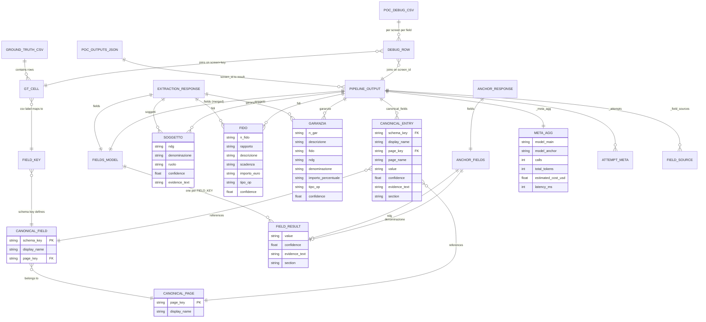

# Modello dei dati

Questo progetto non ha un database. Ogni dato risiede in uno di quattro posti: i modelli Pydantic che vincolano ciò che il VLM è autorizzato a restituire, i dizionari Python che trasportano il risultato di un'estrazione lungo la pipeline, un file CSV che contiene il ground truth per la valutazione dell'accuratezza e i file JSON su disco che persistono l'output dell'elaborazione a lotti (batch). Il dominio in sé è ristretto: una singola "pratica" di gestione del credito BPER composta da un'intestazione anagrafica, fino a quattro soggetti, un elenco di linee di credito, un elenco di garanzie e una lunga nota in testo libero. Tutto il resto sono metadati su come quel dato è stato ottenuto.

## Diagramma entità-relazione



Leggi questo diagramma come tre livelli. Il livello superiore (`GROUND_TRUTH_CSV`, `GT_CELL`, `FIELD_KEY`, `CANONICAL_FIELD`, `CANONICAL_PAGE`) è dato di riferimento statico, integrato nel codice e nel CSV. Il livello intermedio (`EXTRACTION_RESPONSE`, `ANCHOR_RESPONSE`, `FIELD_RESULT`, `SOGGETTO`, `FIDO`, `GARANZIA`) è il contratto Pydantic tra la pipeline e l'LLM. Il livello inferiore (`PIPELINE_OUTPUT`, `CANONICAL_ENTRY`, `META_AGG`, `POC_OUTPUTS_JSON`, `POC_DEBUG_CSV`) è la forma del risultato a runtime che viene persistita e valutata.

## FieldResult

L'unità atomica dell'estrazione. Ogni singolo valore restituito dal VLM è incapsulato in uno di questi. Contiene la stringa grezza letta dal modello più tre elementi di introspezione su cui si basano la logica di valutazione e di retry.

Definito in `extraction/schemas.py` righe 9-13:

- `value: Optional[str]` -- il testo estratto, oppure `None` quando il campo è assente sullo schermo
- `confidence: float` -- la confidenza autodichiarata dal modello, da 0.0 a 1.0
- `evidence_text: Optional[str]` -- una breve citazione dall'immagine usata per giustificare il valore (utile per le righe del CSV di debug)
- `section: Optional[str]` -- il nome della sezione UI in cui è stato trovato il valore (es. `soggetti_table`)

Il punteggio di confidenza guida due decisioni. Primo, `ExtractionPipeline.extract_anchors()` (`extraction/pipeline.py` righe 91-96) azzera gli anchor NDG e Denominazione se la loro confidenza è inferiore ad `ANCHOR_CONF_MIN` (default 0.95, `extraction/config.py` riga 52). Secondo, `ExtractionPipeline._retry_areas()` (`extraction/pipeline.py` righe 254-257) attiva un passaggio di retry per ogni campo con confidenza inferiore a 0.60.

## FieldsModel

Un singolo contenitore piatto che contiene un `Optional[FieldResult]` per ogni chiave dello schema. Non viene scritto a mano: è costruito dinamicamente al momento dell'import da `create_model()` di Pydantic, usando il contenuto di `FIELD_KEYS` come unica fonte di verità (`extraction/schemas.py` righe 46-49). Aggiungi una nuova voce a `FIELD_KEYS` in `extraction/fields.py` e il modello Pydantic acquisisce automaticamente quel campo.

`FIELD_KEYS` ha attualmente 45 voci (contale in `extraction/fields.py` righe 12-54) che coprono:

- **Campi di intestazione** della pagina Risultato Ricerca: `ndg`, `denominazione`, `tipo`, `stato`, `fase`, `creazione`, `evidenze`, `filiale_relazione`
- **Campi delle righe Fidi**: `n_fido`, `rapporto`, `descrizione`, `scadenza`, `importo_euro`, `tipo_op`
- **Testo libero**: `note_della_richiesta`
- **Campi tooltip** che esistono solo al passaggio del mouse: `tooltip_descrizione_bmb`, `tooltip_evidenze_b`, `tooltip_descrizione_m_consap`, `tooltip_descrizione_consap_dr_bis`, `tooltip_descrizione_ipoteca`
- **Soggetti appiattiti** per compatibilità con il CSV: `ndg_1..4`, `denominazione_1..4`, `ruolo_1..4`
- **Campi del cliente privato** dalle schermate 4 e 5: `dal`, `datore_di_lavoro_anagrafica`, `di_cui_percepiscono_reddito`, `importo_totale_annuo_nucleo`, `note_scheda_privati`, `nr_altri_componenti_nucleo`, `numero_mensilita`, `professione_principale`, `rating_ufficiale`, `retribuzione_annua_netta`, `score_cgs`, `tipo_contratto`, `ultima_validazione_scheda`

I Soggetti appiattiti sono un espediente. Il VLM restituisce i soggetti come lista strutturata (vedi `Soggetto` più sotto), ma il CSV di ground truth li ha come colonne separate. Dopo il passaggio principale, `ExtractionPipeline.extract_from_image()` copia i primi quattro soggetti in queste chiavi piatte (`extraction/pipeline.py` righe 160-166) così che il valutatore possa confrontarli colonna per colonna.

## Soggetto, Fido, Garanzia

Le tre entità tabellari rappresentate come classi Pydantic `BaseModel` in `extraction/schemas.py` righe 15-41. A differenza dei campi piatti visti sopra, queste vivono come `List[...]` ordinate dentro `ExtractionResponse` e possono crescere a lunghezza arbitraria.

**Soggetto** (righe 15-20) è una persona o un'entità giuridica legata alla pratica di credito. I campi di dominio sono `ndg`, `denominazione` e `ruolo`. I ruoli tipici sono "TITOLARE", "COOBBLIGATO", "GARANTE". Una schermata può elencare diversi soggetti in una tabella.

**Fido** (righe 22-30) è una linea di credito: `n_fido` (il numero della linea di credito), `rapporto` (il conto sottostante), `descrizione` (descrizione del prodotto leggibile), `scadenza` (data di scadenza), `importo_euro` (importo) e `tipo_op` (tipo di operazione, es. BMB). Tutti tipizzati come stringa perché il VLM restituisce testo OCR grezzo: la validazione numerica avviene più tardi in `classify_field()` tramite `norm_number_str()` (`extraction/normalization.py`).

**Garanzia** (righe 32-41) è un record di garanzia collaterale: `n_gar` (numero della garanzia), `descrizione`, `fido` (la linea di credito che garantisce), `ndg`/`denominazione` (il soggetto che la fornisce), `importo_percentuale` e `tipo_op`. Da notare che una Garanzia contiene il proprio `ndg` e `denominazione` -- sono join denormalizzati, non chiavi esterne, perché il VLM li estrae direttamente dalla tabella a schermo anziché cercarli.

Tutte e tre condividono i campi finali comuni `confidence: float` ed `evidence_text: Optional[str]`.

## ExtractionResponse e AnchorResponse

I modelli Pydantic di primo livello rispetto ai quali `.with_structured_output()` di LangChain valida. Ne esistono due perché la pipeline effettua due tipi diversi di chiamate VLM con due prompt diversi.

**`ExtractionResponse`** (`extraction/schemas.py` righe 54-58) è lo schema completo inviato nel passaggio principale e nei passaggi di retry. Contiene:

- `fields: FieldsModel` -- tutti i 45 campi scalari
- `soggetti: List[Soggetto]`
- `fidi: List[Fido]`
- `garanzie: List[Garanzia]`

**`AnchorResponse`** (`extraction/schemas.py` righe 60-65) è uno schema deliberatamente ristretto per il primo passaggio. Incapsula un modello `AnchorFields` che contiene solo `ndg` e `denominazione`, entrambi `Optional[FieldResult]`. Uno schema ristretto costringe il modello a concentrarsi solo sui due campi identificativi della striscia di intestazione, riduce il conteggio dei token e consente alla pipeline di applicare un'elevata soglia di confidenza prima che venga eseguito qualsiasi altro passaggio. Vedi la discussione sul passaggio anchor in [Workflow](05-workflows.md).

Entrambe le classi hanno gli alias retrocompatibili `RESPONSE_SCHEMA` e `ANCHOR_SCHEMA` in fondo al file (`extraction/schemas.py` righe 70-71).

## Metadati dei campi canonici

`CANONICAL_FIELD_DEFINITIONS` in `extraction/field_definitions.py` righe 5-186 è il ponte tra le chiavi compatte snake_case usate nel codice e le etichette comprensibili a cui tiene il cliente. Ogni voce in `FIELD_KEYS` dovrebbe avere una voce corrispondente qui; se ne manca una, il nome visualizzato ricade sulla chiave dello schema stessa (`extraction/fields.py` righe 118-121).

Ogni voce ha questa forma:

```python
"n_fido": {
    "display_name": "n° FIDO",
    "page_key": "gestione_fidi_e_garanzie",
},
```

Il `display_name` è l'esatta etichetta italiana che l'applicazione bancaria BPER mostra a schermo. La `page_key` è una chiave esterna verso la tabella delle pagine canoniche (vedi sezione successiva) e determina su quale dei quattro fogli finisce un campo quando l'edge-agent esporta in Excel tramite `DataTableTab`.

Accanto alle definizioni, lo stesso file porta `FIELD_LABEL_ALIASES` (righe 188-235), una ricerca inversa dalle etichette minuscole normalizzate alle chiavi dello schema. `normalize_field_label()` (righe 238-240) elimina spazi iniziali/finali, mette in minuscolo e comprime gli spazi così che una colonna CSV come `"n° FIDO"` si risolva in `"n_fido"` indipendentemente da spaziatura o maiuscole/minuscole. La usano due helper pubblici: `resolve_schema_key()` (righe 243-246) per passare dall'etichetta alla chiave, e `resolve_display_name()` / `resolve_field_page_key()` (righe 249-262) per la ricerca inversa.

## Pagine canoniche

Le quattro pagine del workflow di gestione del credito BPER da cui questo progetto estrae. Definite in `extraction/page_definitions.py` righe 5-10:

| page_key | display_name |
|----------|--------------|
| `risultato_ricerca` | Risultato ricerca |
| `elenco_soggetti` | Elenco Soggetti |
| `gestione_fidi_e_garanzie` | Gestione Fidi e Garanzie |
| `note_da_richiesta` | Note da Richiesta |

`PAGE_NAME_ALIASES` (righe 12-21) mappa le varianti comuni delle etichette di nuovo sulla chiave canonica, e `normalize_page_label()` (righe 31-33) esegue la stessa pulizia di maiuscole/minuscole e spaziatura della sua controparte a livello di campo. `PAGE_SHEET_ORDER` (righe 23-28) congela l'ordinamento usato quando `build_canonical_field_entries()` ordina il proprio output, ed è così che l'esportazione Excel mantiene i fogli in un ordine coerente.

Nota: sia il brief che il codice parlano di "nove" schermate BPER (le immagini prototipo in `edge-agent/assets/templates/bper/` e `mnt/data/screen 1-9.png`). Il modello delle pagine ha solo quattro pagine canoniche perché diverse schermate grezze mappano sulla stessa pagina canonica -- es. due schermate Fidi alimentano entrambe `gestione_fidi_e_garanzie`. L'edge-agent usa una definizione separata a 5 pagine in `edge-agent/assets/templates/bper/prompts.json` per il proprio router pagina, che non è collegata al modello delle pagine canoniche usato dalla pipeline di estrazione.

## CanonicalEntry e la lista canonical_fields

Dopo che la pipeline termina, `ExtractionPipeline.extract_from_image()` chiama `build_canonical_field_entries()` da `extraction/canonical_mapping.py` (righe 20-42). Questo percorre il dict `fields` estratto, cerca ogni chiave dello schema tramite `get_canonical_field_metadata()` (`extraction/fields.py` righe 128-138) e produce una lista piatta di voci:

```python
{
    "schema_key": "n_fido",
    "display_name": "n° FIDO",
    "page_key": "gestione_fidi_e_garanzie",
    "page_name": "Gestione Fidi e Garanzie",
    "value": "123456",
    "confidence": 0.95,
    "evidence_text": "n° FIDO 123456",
    "section": "fidi_table",
}
```

La lista è ordinata per una chiave composta `(page_index, display_name, schema_key)` da `_canonical_entry_sort_key()` (righe 8-18). Il risultato risiede sotto `output["canonical_fields"]` ed è ciò che l'interfaccia dell'edge-agent rende in `ExtractionResultsTab` ed esporta tramite `DataTableTab`.

## Dict di output della pipeline

Il dizionario a runtime che `ExtractionPipeline.extract_from_image()` (`extraction/pipeline.py` righe 104-180) restituisce. Nasce come `model_dump()` di un `ExtractionResponse` e viene decorato sul posto con i metadati della pipeline. Forma:

| Chiave | Tipo | Origine |
|-----|------|--------|
| `fields` | dict da schema_key a dict in forma FieldResult | dal passaggio principale, unito ai risultati anchor e di retry |
| `soggetti` | lista di dict in forma Soggetto | dal passaggio principale, eventualmente sovrascritta dal retry BODY |
| `fidi` | lista di dict in forma Fido | idem |
| `garanzie` | lista di dict in forma Garanzia | idem |
| `canonical_fields` | lista di dict CanonicalEntry | costruita dopo tutti i passaggi tramite `build_canonical_field_entries()` |
| `_attempts` | lista di dict `_meta` per ogni chiamata | aggiunta da ogni invocazione di `call_vlm_with_retry()` |
| `_meta_agg` | costo e latenza aggregati | costruito da `ExtractionPipeline._aggregate_meta()` righe 330-340 |
| `_field_sources` | dict da schema_key a nome del tentativo | traccia quale passaggio ha vinto per ciascun campo (CONTENT_MAIN, ANCHOR_HEADER, RETRY_HEADER, RETRY_BODY, RETRY_FOOTER) |
| `_status` | `"OK"` o `"ANCHOR_UNCERTAIN"` | impostato alla fine in base alla presenza di entrambi NDG e Denominazione |
| `screen_id` | string | il basename dello screenshot senza estensione |

Le chiavi con prefisso underscore sono una convenzione deliberata: sono metadati dell'estrazione, non dati estratti, e vengono filtrate via dall'esportazione Excel ma mantenute nell'output JSON per il debug.

Ogni voce `_attempts[i]` è un dict costruito da `call_vlm_with_retry()` in `extraction/vlm_client.py`. La sua forma (righe 107-116, 167-176 e 214-223 -- ci sono tre percorsi di codice per OpenAI structured, Gemini legacy e Gemini free-form):

```python
{
    "model": "gpt-4o",
    "screen_id": "screen 1",
    "attempt": "CONTENT_MAIN",
    "latency_ms": 2800,
    "prompt_tokens": 1234,
    "completion_tokens": 456,
    "total_tokens": 1690,
    "estimated_cost_usd": 0.0078,
}
```

`_meta_agg` somma poi `calls`, `prompt_tokens`, `completion_tokens`, `total_tokens`, `estimated_cost_usd` e `latency_ms` su tutti i tentativi, mantenendo `model_main` e `model_anchor` come stringhe piatte per il report dei costi (`extraction/evaluation.py` righe 244-258).

## CSV di ground truth

Il file di riferimento per la valutazione. Il percorso predefinito è `mnt/data/dati.csv`, risolto da `GROUND_TRUTH_CSV` in `extraction/config.py` riga 9. Il file è in gitignore e deve essere fornito manualmente al momento dell'esecuzione.

`load_ground_truth()` in `extraction/evaluation.py` righe 33-69 lo legge in un dict annidato con forma `{ screen_name: { csv_column_label: value, ... }, ... }`. Il loader è tollerante: cerca la colonna della schermata tra `["Screenshot", "Fotogramma", "Screen", "screen"]`, la colonna del valore tra `["Valore rilevato", "Valore rilevato ", "Valore", "Value"]` e la colonna della chiave tra `["Denominazione da attribuire", "Denominazione", "Campo", "Field"]` (righe 38-52). L'helper `_find_column()` (righe 26-31) solleva `ValueError` se nessuna corrisponde, elencando le colonne effettivamente trovate così da poter correggere il CSV.

Ogni riga del CSV diventa una `GT_CELL` -- una tripla di (screen_name, csv_column_label, value). Il loader salta le righe la cui chiave è vuota o pari alla stringa `"nan"`, e normalizza i valori mancanti alla stringa vuota. Schermate e chiavi sono mantenute così come sono (messe in minuscolo solo nel valutatore), quindi l'ordinamento e la gestione dei duplicati seguono i default di pandas.

Il ponte dalle colonne del CSV alle chiavi dello schema risiede in `CSV_TO_SCHEMA` in `extraction/fields.py` righe 56-100. È un semplice dict Python: le chiavi sono le etichette italiane delle colonne BPER (incluse le varianti con spazio di troppo come `"Evidenze "` e `"Valore rilevato "`), i valori sono chiavi dello schema. Quando `eval_outputs()` itera sul ground truth, considera solo le righe la cui chiave CSV è presente in questa mappatura (`extraction/evaluation.py` righe 87-90) -- le colonne non mappate vengono ignorate silenziosamente, il che consente di aggiungere colonne diagnostiche extra al CSV senza rompere la valutazione.

## File di output JSON

`mnt/data/poc_outputs_improved.json` è l'unico artefatto di persistenza di un'esecuzione batch da CLI. È scritto come un dict con chiave `screen_id`, dove ogni valore è un dict completo di output della pipeline:

```json
{
    "screen 1": {
        "fields": {
            "ndg": {"value": "12345678", "confidence": 0.98, "evidence_text": "...", "section": "header"},
            "denominazione": {"value": "ROSSI MARIO", "confidence": 0.97, ...},
            ...
        },
        "soggetti": [...],
        "fidi": [...],
        "garanzie": [...],
        "canonical_fields": [...],
        "_meta_agg": {...},
        "_attempts": [...],
        "_field_sources": {...},
        "_status": "OK"
    },
    "screen 2": {...}
}
```

La scrittura avviene in `cli.main()` (`extraction/cli.py` righe 337-340) usando `json.dump(..., ensure_ascii=False, indent=2)`. Il file sostituisce l'esecuzione precedente a ogni avvio -- non c'è cronologia delle esecuzioni né versionamento. Il CSV di debug che lo accompagna, `mnt/data/poc_debug_improved.csv`, è un file piatto delimitato da punto e virgola, una riga per ogni coppia (schermata, chiave GT), scritto da `build_debug_report()` in `extraction/evaluation.py` righe 125-177. Le sue colonne includono il valore predetto, il valore GT, lo stato di classificazione, l'origine del retry per quel campo e l'aggregato di costo per schermata.

## Pattern di flusso dei dati

### Create
I dati entrano nel sistema solo in due modi. Dal **CSV di ground truth**, caricato una volta all'inizio di un'esecuzione batch da `load_ground_truth()`. Da **oggetti PIL Image**, letti dal disco tramite `Image.open(path).convert("RGB")` in `ExtractionPipeline.extract_from_screen()` (`extraction/pipeline.py` righe 182-187) oppure ricevuti in memoria dal capture worker dell'edge-agent tramite `LocalExtractionClient.ingest_frame()`. Non esiste alcun input utente diretto nel modello dei dati stesso.

### Read
Il dict di ground truth è letto da `eval_outputs()`, `build_debug_report()` e dallo stampatore del riepilogo di accuratezza. Il file di output JSON è letto dalla GUI Tkinter e dall'interfaccia dell'edge-agent quando l'utente apre un'esecuzione precedente. La lista `canonical_fields` è letta dalle schede dell'interfaccia dell'edge-agent per popolare l'albero delle pagine, la tabella dei campi e la vista a foglio di calcolo.

### Update
L'unico dato mutabile è il dict di output della pipeline durante una singola estrazione. Cinque punti di mutazione, tutti in `extraction/pipeline.py`:

1. `_merge_anchors()` (righe 211-216) sovrascrive `fields["ndg"]` e `fields["denominazione"]` con il risultato del passaggio anchor quando l'anchor ha un valore non nullo.
2. `_postprocess_tipo()` (righe 219-223) riscrive `fields["tipo"]["value"]` tramite `normalize_tipo()` da `extraction/normalization.py`.
3. `_retry_areas()` (righe 243-309) itera sui campi poco confidenti e chiama `merge_field_sources()` da `extraction/normalization.py` riga 96 per inserire valori migliori. L'helper usa `pick_best()` per scegliere tra valore corrente e candidato in base a null-ità e confidenza, e aggiorna `field_sources` quando vince il candidato.
4. `_merge_tables()` (righe 225-241) sostituisce `soggetti`, `fidi` o `garanzie` per intero se il retry BODY restituisce più righe o una confidenza media più alta.
5. `_coherence_check()` (righe 311-328) reincrocia i campi tooltip nei loro campi target -- se `tooltip_evidenze_b` è popolato ma `evidenze` è nullo o un semplice numero, sovrascrive `evidenze` con `"B"`.

Una volta che `extract_from_image()` ritorna, il dict è di fatto congelato -- l'unica "mutazione" a valle è la copia piatta dei Soggetti effettuata dentro la stessa funzione alle righe 160-166.

### Delete
Nessuna. Non c'è alcuna cancellazione. La CLI sovrascrive `poc_outputs_improved.json` a ogni esecuzione, l'edge-agent mantiene i risultati in memoria finché l'utente non chiude la finestra, e il CSV di ground truth non viene mai toccato dal codice. La funzione commentata `_deduplicate_same_page_outputs()` in `extraction/cli.py` righe 92-152 potrebbe scartare dal batch gli output con pagina duplicata, ma è attualmente disabilitata tramite una chiamata commentata alle righe 268-274.

## Validazione

La validazione è a livelli e quasi interamente a runtime. Non ci sono migrazioni di schema, vincoli SQL o validatori di form.

**L'output strutturato Pydantic** è il primo e più rigoroso livello. Quando la pipeline chiama LangChain con `.with_structured_output(ExtractionResponse)`, la risposta dell'LLM deve deserializzarsi nell'intero albero Pydantic annidato, altrimenti viene sollevato un `ValidationError` dentro `call_vlm_with_retry()`. Per i modelli Gemini più recenti che rifiutano `response_schema` complessi, `_call_vlm_gemini_freeform()` in `extraction/vlm_client.py` righe 47-119 riprende il JSON in forma libera, rimuove i delimitatori Markdown tramite `_extract_json_str()` ed esegue manualmente `schema.model_validate_json()`. In ogni caso, ogni campo di ogni record restituito è un `FieldResult` tipizzato.

**Il gating sulla confidenza** è il secondo livello. Il passaggio anchor azzera NDG e Denominazione poco confidenti sotto `ANCHOR_CONF_MIN = 0.95` (`extraction/pipeline.py` righe 91-96). La logica di retry segnala qualsiasi campo sotto 0.60 per una seconda verifica (`extraction/pipeline.py` riga 255). Se `STOP_ON_ANCHOR_UNCERTAIN` è impostato ed entrambi gli anchor sono nulli, la pipeline va in corto circuito e restituisce `_status = "ANCHOR_UNCERTAIN"` senza eseguire il passaggio principale (`extraction/pipeline.py` righe 112-124).

**La validazione al momento del ground truth** avviene durante la valutazione. `classify_field()` in `extraction/normalization.py` righe 113-148 emette uno di cinque stati -- `OK`, `OK_NULL`, `MISSING`, `HALLUCINATED`, `WRONG` -- per ogni coppia (predetto, atteso). I campi numerici (`importo_euro`, `ndg`, `n_fido`) passano per `norm_number_str()` per un confronto tollerante al tipo. I campi di testo lungo (>20 caratteri) usano `difflib.SequenceMatcher` con una soglia di rapporto 0.85 per il fuzzy matching. `dataset_mismatch_guard()` righe 174-189 è un controllo di coerenza che segnala intere schermate in cui NDG o Denominazione differiscono pesantemente tra GT e predizione, suggerendo che l'operatore ha allineato il CSV allo screenshot sbagliato. Quelle schermate compaiono comunque nel numero di accuratezza RAW ma sono escluse dal numero FILTERED che viene stampato come metrica di punta.

**Dataset mismatch** è un sesto stato che usa solo `build_debug_report()` (`extraction/evaluation.py` riga 149). Riscrive lo stato per singola cella in `"DATASET_MISMATCH"` quando l'intera schermata fa scattare il guard, così che leggendo il CSV di debug si possa distinguere "questa riga era sbagliata" da "questa intera schermata stava confrontando con la riga GT sbagliata".

Sul lato edge-agent non c'è alcuna validazione oltre a quella imposta dalla pipeline stessa. `RouterResult` (`edge-agent/llm_router.py` righe 27-34) è una `dataclass`, non un modello Pydantic, e il suo `fields: Dict[str, Any]` viene passato senza tipizzazione.

## Riferimenti incrociati

- [Architettura](04-architecture.md) -- come il livello dati si colloca tra il client VLM e i livelli di valutazione/esportazione
- [Funzionalità](02-features.md) -- i comportamenti rivolti all'utente che consumano queste strutture
- [Workflow](05-workflows.md) -- il flusso end-to-end che crea e legge questi dati, incluse le mutazioni della pipeline multi-passaggio qui descritte
- [Per iniziare](07-getting-started.md) -- come fornire il CSV di ground truth e ispezionare l'output JSON
