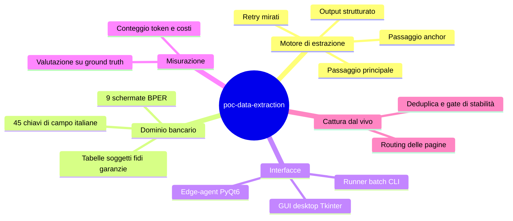

# poc-data-extraction

Questo progetto estrae campi strutturati dagli screenshot dell'applicativo di gestione del credito di BPER (pagine "BStore Pratiche" / PEF) usando i Vision Language Model, LLM capaci di interpretare le immagini, non solo il testo. Esiste per rispondere a una domanda misurabile per gli ingegneri di Tri-tech solutions: la lettura delle schermate basata su VLM può sostituire la ridigitazione manuale di queste schermate bancarie, con quale accuratezza per campo e a quale costo per schermata? Un unico motore senza UI (**`extraction/`**) fa la lettura; tre interfacce lo pilotano: un runner batch da CLI, una GUI desktop Tkinter e un edge-agent PyQt6 che cattura dal vivo il monitor dell'operatore.

La mindmap qui sotto abbozza a colpo d'occhio le cinque preoccupazioni del progetto:

## Cosa fa

Gli dai in pasto gli screenshot dei 9 tipi di schermata BPER conosciuti (`mnt/data/screen 1.png` … `screen 9.png`) e ti restituisce un record per schermata che copre le 45 chiavi di `FIELD_KEYS` (**`extraction/fields.py`**): identificatori del cliente (`ndg`, `denominazione`), metadati della pratica (`tipo`, `stato`, `fase`, `creazione`, `evidenze`), dati sulle linee di credito (`n_fido`, `importo_euro`, `scadenza`, …), cinque campi tooltip, le colonne appiattite dei cointestatari (`ndg_1..4` / `denominazione_1..4` / `ruolo_1..4`) e i 13 campi della "scheda privati" (`professione_principale`, `retribuzione_annua_netta`, `score_cgs`, …). Ogni campo porta con sé un valore, un punteggio di confidenza e un testo di evidenza.

La lettura è un algoritmo a tre passaggi in `ExtractionPipeline` (**`extraction/pipeline.py`**):

1. **Passaggio anchor**: legge l’intestazione sulla famiglia calibrata e l’immagine intera altrimenti. Estrae `ndg` + `denominazione` e annulla i valori sotto `ANCHOR_CONF_MIN` (default 0.95) prima del suggerimento al main e del merge (`extraction/pipeline.py`).
2. **Passaggio principale**: invia il ritaglio completo del contenuto con i suggerimenti degli anchor ("NDG atteso: …") ed estrae tutti i campi più le tabelle `soggetti` / `fidi` / `garanzie` in un'unica chiamata a output strutturato.
3. **Retry condizionale**: rilegge le aree HEADER / BODY / FOOTER che contengono campi nulli o sotto `RETRY_CONF_MIN` (default 0.60). `MAX_CALLS_PER_SCREEN` assegna al massimo `N - 2` passaggi di retry, nell’ordine delle aree; il default `2 + len(AREA_TO_FIELDS)` vale 5 ([ADR 0004](adr/0004-budget-retry-derivato-dalle-aree.md)). È un budget di passaggi logici, non un limite alle richieste di rete: ciascun passaggio può ritentare errori transitori. `pick_best()` in `extraction/normalization.py` sceglie il valore da conservare.

Dopo un'esecuzione batch, ogni campo estratto viene classificato rispetto a un CSV di ground truth come OK / WRONG / MISSING / HALLUCINATED / OK_NULL (**`extraction/evaluation.py`**), e i token e il costo stimato in USD di ogni chiamata VLM vengono aggregati per schermata (**`extraction/vlm_client.py`**, tabella prezzi in **`extraction/config.py`**). L'edge-agent aggiunge il percorso dal vivo: osserva un monitor, rileva quale pagina BPER è a schermo, aspetta che si stabilizzi ed esegue la stessa pipeline in locale (**`edge-agent/workers/capture/bper_capture_worker.py`**). Le tracce complete sono in [Workflow](05-workflows.md); il quadro dei componenti in [Architettura](04-architecture.md).

## A chi è rivolto

- **In primis: gli sviluppatori e ingegneri che mantengono ed estendono questa codebase** (Tri-tech solutions). Questi documenti sono calibrati per voi: la valutazione dell'accuratezza, il conteggio dei costi e i report di debug sono i veri deliverable del progetto, e la documentazione presume che leggerete il codice insieme ad essa.
- **In secondo luogo: gli operatori di banca**, che usano l'interfaccia in italiano dell'edge-agent (`edge-agent/ui/`) per catturare le schermate dal vivo con una guida pagina per pagina. I loro bisogni sono serviti dalla UI stessa e dai documenti divulgativi di questa cartella.

## Com'è costruito

Python 3.12/3.13 come target pratico: **`run_edge_agent.bat`** prova prima il 3.13, poi il 3.12 e infine `python` sul PATH. L’estrazione passa da LangChain: `create_chat_model()` in **`extraction/llm_factory.py`** è l'unica factory che restituisce un chat model OpenAI o Google Gemini in base a `LLM_PROVIDER`, e gli output vengono validati con schemi Pydantic (output strutturato LangChain o JSON con validazione manuale per le famiglie Gemini recenti) (**`extraction/schemas.py`**). Pillow gestisce ritagli e miglioramento delle immagini (**`extraction/imaging.py`**), pandas carica la ground truth e scrive i report (**`extraction/evaluation.py`**). Le interfacce usano Tkinter (libreria standard, `gui_app.py`) e PyQt6 + qt-material (`edge-agent/`); l'edge-agent aggiunge `mss` per la cattura dello schermo, `imagehash` per la deduplica dei frame e un classificatore di pagine opzionale DINOv2 ViT-S/14 su torch (**`edge-agent/page_classifier.py`**). Il dettaglio dipendenza per dipendenza è in [Tech Stack](03-tech-stack.md).

## Il progetto in sintesi

| Attributo | Valore |
|---|---|
| Linguaggio | Python 3.12/3.13 come target pratico |
| Framework LLM | LangChain (`langchain-openai`, `langchain-google-genai`) |
| Provider | OpenAI (default, `gpt-4o`) oppure Google Gemini via `LLM_PROVIDER` |
| Tipo di progetto | Proof of concept - CLI + due GUI desktop su un unico pacchetto libreria |
| Entry point | `main.py` (CLI; `--gui` → edge-agent), `gui_app.py` (Tkinter), `edge-agent/edge_agent.py` (PyQt6) |
| Motore core | Pacchetto `extraction/`, senza UI |
| Cattura dal vivo | `edge-agent/` - mss, pHash via imagehash, routing pagine DINOv2 o OpenAI Vision |
| Dominio | 9 varianti di schermata BPER, 45 chiavi di campo italiane, 5 pagine sorgenti e 4 gruppi di export |
| Persistenza | Dizionari in memoria; export JSON/CSV nel batch e Tkinter, Excel nell’edge-agent |
| Configurazione | Variabili d'ambiente per il motore (`extraction/config.py`); `edge-agent/config.ini` per l'agente |
| Test / packaging | Suite pytest in `tests/`; build portable `build_exe.bat` + `edge_agent.spec` |
| CI / Docker | Non configurati |

## Perché esiste / contesto

Ridigitare a mano i dati dall'applicativo di gestione del credito di BPER (intestazioni di pratica, cointestatari, linee di credito, garanzie, dati su lavoro e reddito) è lento e soggetto a errori. Questo POC legge quelle schermate con i vision LLM e, cosa cruciale, **si misura da solo**: accuratezza per campo rispetto a un CSV di ground truth e costo per chiamata rispetto a una tabella prezzi (`PRICING_PER_1M` in `extraction/config.py`). La proposta di valore è un unico motore condiviso esposto in tre modi, così le modifiche a modelli e prompt si possono confrontare con una baseline in batch, a mano o dal vivo.

La storia git racconta com'è arrivato fin qui:

- Nato come `main.py` monolitico, poi scomposto nel pacchetto `extraction/` (commit `ce87bd3`, `699a8db`).
- Il codice provider su misura è migrato all'astrazione ChatModel unificata di LangChain (`37560b9`); la configurazione è stata semplificata a quattro variabili d'ambiente unificate (`6ee9767`) con il caricamento di `.env` via python-dotenv (`368b7aa`).
- L'edge-agent era originariamente costruito su un backend remoto (client API, MinIO). I componenti remoti deprecati sono stati rimossi (`ea04ef7`) e il percorso BPER consolidato sull'estrazione solo locale tramite `LocalExtractionClient` (`e12af18`; percorso attuale in `edge-agent/local_extraction_client.py`). Resti di quell'era sopravvivono come sezioni `[api]` / `[minio]` inutilizzate in `edge-agent/config.ini`.
- Il lavoro recente ha aggiunto il layer di mappatura canonica campi/pagine per l'esportazione verso il cliente (`e9f22a1`, `5709f66`, `3521ba9`: vedi **`extraction/canonical_mapping.py`**), il tema qt-material (`6e3634b`), le guardie anti-allucinazione del router LLM (`c80f809`), il layer di documentazione e gli audit di CLAUDE.md (`397f17a`, `f5b5a85`) e l'irrobustimento del launcher Windows (`40725a3`, `f74c21e`).
- I nomi dei branch registrano le direzioni esplorate: `feature/ollama-version` (modelli locali), `feature/image-optimization`, `dev/optimization`, `bug-fix/improove_accuracy`.

Restano aperte due domande di contesto: chi sia il consumatore esterno del contratto "canonico" dei campi (`extraction/canonical_mapping.py` menziona "backend/UI/export integration" ma nessun client è nominato nel repo), e se il percorso di ingestione remota tornerà mai. Entrambe sono tracciate in [Domande Aperte](08-open-questions.md).

## Ambito e non-obiettivi

**In ambito:**

- Estrarre ~45 campi strutturati dai 9 tipi di schermata BPER noti tramite la pipeline VLM multi-pass (`extraction/pipeline.py`).
- Valutare rispetto a un CSV di ground truth e riportare l'accuratezza per campo nelle varianti RAW e FILTERED (`extraction/evaluation.py`).
- Tracciare token, latenza e USD stimati per chiamata e per schermata (`extraction/vlm_client.py`).
- Catturare le schermate BPER dal vivo, instradarle verso un tipo di pagina ed estrarre in locale (`edge-agent/`).

**Deliberatamente fuori ambito:**

- **Nessun backend remoto nel percorso BPER.** L’upload verso un backend di estrazione separato è stato rimosso; `LocalExtractionClient` è l'unico client usato dall'edge-agent. Il `DefaultCaptureWorker` della modalità generica invia ancora POST verso un'API `localhost:8081` che non esiste in questo repo: legacy, non ambito.
- **Nessun OCR classico.** Tutta la lettura è basata su VLM; non c'è alcun riconoscimento testo in stile Tesseract da nessuna parte.
- **Nessuna generalizzazione.** Le coordinate di ritaglio (`CONTENT_CROP`, `HEADER_IN_CONTENT` in `extraction/config.py`), i prompt e le chiavi di campo sono cablati sui layout delle schermate BPER. Non è uno strumento generico da-screenshot-a-dati.
- **Infrastruttura ancora da completare.** Esistono test automatici e build portable; mancano CI/CD, `pyproject.toml`, lockfile e containerizzazione. L’accuratezza con provider reali resta da confrontare con una baseline esterna.

Per trovare il modulo da cambiare, usa la [Mappa del codice](mappa-codice.md); per firme, risultati e segnali consulta il [Riferimento API Python](12-python-api.md).

## Dove andare adesso

Il resto di questa guida approfondisce questa panoramica. Parti da [Funzionalità](02-features.md) per ciò che il progetto fa davvero, poi [Architettura](04-architecture.md) per come si incastrano i pezzi. Se vuoi eseguirlo subito, salta a [Getting Started](07-getting-started.md). Per le strutture dati citate sopra (FieldResult, Soggetto, ExtractionResponse), vedi [Data Model](06-data-model.md). L'elenco onesto delle questioni ancora senza risposta vive in [Domande Aperte](08-open-questions.md).
