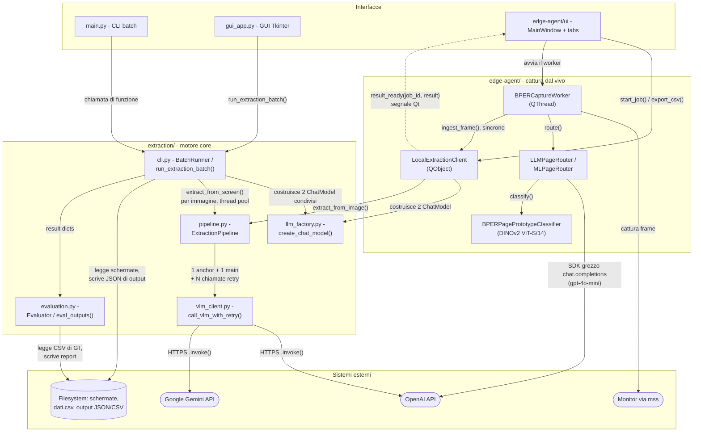

# Architettura

Un core di estrazione senza UI con tre interfacce intercambiabili. L'idea di fondo: **tutta l'intelligenza sugli screenshot bancari vive nel pacchetto `extraction/`, e nulla in quel pacchetto sa quale UI l'ha chiamato.** Il runner batch CLI, l'app desktop Tkinter e l'edge-agent PyQt6 raggiungono tutti la stessa `ExtractionPipeline`, che esegue una sequenza VLM fissa a tre passaggi (anchor → main → retry) e restituisce un unico result dict ben definito. Il provider LLM sta dietro una factory a funzione singola, quindi passare da OpenAI a Gemini è una variabile d'ambiente, non una modifica al codice.

## Diagramma dei componenti

Il diagramma qui sotto segue le due catene di chiamata autoritative registrate nel Call Graph della mappa delle interconnessioni (`.codebase-map/_internal/interconnect.md`): la catena batch `CLI/Tkinter → BatchRunner → ExtractionPipeline → call_vlm_with_retry → ChatModel → API del provider` e la catena dal vivo `BPERCaptureWorker → LocalExtractionClient.ingest_frame() → ExtractionPipeline → segnale result_ready → schede della UI`. Le frecce piene sono chiamate dirette; la freccia tratteggiata è il segnale Qt cross-thread.



Ogni arco qui sopra corrisponde a una riga del Call Graph della mappa delle interconnessioni: per esempio `ExtractionPipeline` è chiamata da `extraction/cli.py:192` e `edge-agent/local_extraction_client.py:49`; `create_chat_model` da `extraction/cli.py:182,187` e `edge-agent/local_extraction_client.py:47-48`; `ingest_frame` solo da `edge-agent/workers/capture/bper_capture_worker.py:696`. La modalità generica legacy (`DefaultCaptureWorker` che invia frame in POST a `http://localhost:8081`, un backend che non esiste in questo repo) è deliberatamente omessa dal diagramma; vedi [Layer](#layer-di-cattura-e-rilevamento-delledge-agent).

## Struttura delle directory

```
poc-data-extraction/
  main.py                       # Entry: caricamento .env + CLI batch; --gui smista all'edge-agent
  gui_app.py                    # Entry: GUI Tkinter standalone (niente load_dotenv - vedi Configurazione)
  run_edge_agent.bat            # Launcher Windows: bootstrap venv + avvio edge-agent
  prompt_store.py               # Loader del catalogo prompt (solo stdlib), condiviso da extraction/ ed edge-agent/
  prompts/                      # Catalogo prompt LLM: un file JSON per prompt, letto una volta all'avvio
  requirements.txt              # Unica lista piatta di dipendenze per tutto

  extraction/                   # ── Motore core (niente UI, niente Qt) ──
    __init__.py                 # Facciata dell'API pubblica (re-export __all__)
    config.py                   # Env var (lette all'import), coordinate di ritaglio, prezzi, mappe delle aree di retry
    fields.py                   # FIELD_KEYS (45 chiavi), mappatura CSV_TO_SCHEMA per la ground truth
    field_definitions.py        # display_name canonico + page_key per ogni chiave di schema
    page_definitions.py         # 4 chiavi di pagina canoniche, alias, PAGE_SHEET_ORDER
    canonical_mapping.py        # build_canonical_field_entries() - righe rivolte al cliente
    schemas.py                  # Pydantic: FieldResult, Soggetto, Fido, Garanzia, risposte
    prompts.py                  # Costanti dei prompt VLM, risolte dal catalogo prompts/ all'import
    normalization.py            # is_nullish, pick_best, classify_field, dataset_mismatch_guard
    imaging.py                  # normalize_image, crop_relative, codifica PNG, ritagli di debug
    vlm_client.py               # call_vlm / call_vlm_with_retry, stima dei costi per chiamata
    llm_factory.py              # create_chat_model() - l'unica factory dei provider LLM
    pipeline.py                 # ExtractionPipeline: orchestrazione anchor → main → retry
    evaluation.py               # Loader GT, eval_outputs, report di debug, riepilogo costi
    cli.py                      # BatchRunner, run_extraction_batch() (condiviso), main()

  edge-agent/                   # ── App PyQt6 di cattura dal vivo ──
    edge_agent.py               # Entry: .env, tema qt-material, AgentConfig, MainWindow
    config.py / config.ini      # AgentConfig: vista tipizzata sull'INI committato
    local_extraction_client.py  # Bridge QObject: ingest_frame() → ExtractionPipeline
    llm_router.py               # Base PageRouter; LLMPageRouter (SDK OpenAI grezzo); MLPageRouter
    page_classifier.py          # Matching su prototipi DINOv2 ViT-S/14 (degrada senza torch)
    image_ops.py                # preprocess_for_ocr (scala, unsharp, autocontrasto)
    ui/                         # MainWindow + schede: cattura, risultati, tabella dati, debug, overlay
    workers/capture/            # BaseCaptureWorker (loop QThread), worker BPER + Default
    assets/templates/bper/      # prompts.json (10 definizioni di pagina), cache prototipi DINOv2, campioni

  mnt/data/                     # screen 1..9.png (tracciati); dati.csv atteso qui ma assente
  docs/                   # Questa guida (layer di documentazione narrativa in italiano)
  .codebase-map/                # Mappa del codice generata (in inglese)
```

## Layer / moduli

### Layer delle interfacce

Tre UI, nessuna delle quali contiene logica di estrazione.

- **CLI**: **`main.py`** è uno shim sottile (`load_dotenv()`, poi `from extraction import *`; `main.py:7-8,23`) che esegue `extraction.cli.main()`: batch su `INPUT_DIR`, stampa dell'accuratezza RAW + FILTERED e del costo per schermata, scrittura di `poc_outputs_improved.json` + `poc_debug_improved.csv`. `python main.py --gui` invece inserisce `edge-agent/` in `sys.path` e lancia l'app Qt (`main.py:15-20`).
- **Tkinter** - **`gui_app.py`**: selettori di immagini/CSV, menu provider e modello alimentati da `PROVIDER_MODELS` (`extraction/config.py:22-33`), un thread in background che chiama `run_extraction_batch()` (`gui_app.py:238`), poi valutazione opzionale via `load_ground_truth` / `eval_outputs` / `build_debug_report`: il Call Graph della mappa delle interconnessioni elenca `gui_app.py` come chiamante diretto di ciascuna.
- **Edge-agent PyQt6**: l'unica interfaccia con un proprio sottosistema (cattura, routing, un client bridge locale); trattata [più sotto](#layer-di-cattura-e-rilevamento-delledge-agent).

CLI e Tkinter condividono per scelta un unico entry point batch: `run_extraction_batch()` in **`extraction/cli.py:282`** possiede il `ThreadPoolExecutor` e la costruzione dei modelli, e `CLAUDE.md` (Architectural Constraints #8) vieta di reimplementare quel threading altrove.

### Layer di configurazione

Trasforma variabili d'ambiente e un file INI in costanti importabili: dettagli in [Configurazione](#configurazione) più sotto. File chiave: **`extraction/config.py`** (env var, coordinate di ritaglio, tabella prezzi, mappe delle aree di retry) e **`edge-agent/config.py`** + **`edge-agent/config.ini`**. La proprietà critica: `extraction/config.py` esegue tutte le chiamate `os.getenv()` al momento dell'import del modulo (`config.py:8-56`), quindi la configurazione si congela nell'istante in cui `extraction` viene importato per la prima volta, ed è per questo che ogni entry point deve caricare `.env` *prima* di quell'import (contratto implicito della mappa delle interconnessioni: "env must be populated before `extraction.config` import").

### Layer del modello dati

L'unica fonte di verità su cosa sia un "campo".

- **File chiave:** **`extraction/fields.py`** (`FIELD_KEYS`, `CSV_TO_SCHEMA`), **`extraction/schemas.py`**, `extraction/field_definitions.py`, `extraction/page_definitions.py`, `extraction/canonical_mapping.py`.
- **Pattern: single source of truth tramite uno schema generato dinamicamente.** `FieldsModel` è costruito con `create_model()`: esattamente un `Optional[FieldResult]` per ogni chiave di `FIELD_KEYS` (`extraction/schemas.py:46-49`), quindi la sincronia schema/elenco campi vale *per costruzione* (un invariante della mappa delle interconnessioni). I contratti formali:
  - `FieldResult` = `{value: Optional[str], confidence: float, evidence_text, section}` (`schemas.py:9-13`): l'atomo di ogni campo estratto.
  - `ExtractionResponse` = `{fields: FieldsModel, soggetti, fidi, garanzie}` (`schemas.py:54-58`): la forma del passaggio principale e dei retry.
  - `AnchorResponse` = solo `fields.{ndg, denominazione}` (`schemas.py:60-65`): la forma del passaggio anchor.
- **Mappatura canonica.** Ogni chiave di schema è legata staticamente a un nome visualizzato e a una delle quattro chiavi di pagina canoniche (`risultato_ricerca`, `elenco_soggetti`, `gestione_fidi_e_garanzie`, `note_da_richiesta`, `extraction/page_definitions.py:5-28`) tramite `CANONICAL_FIELD_DEFINITIONS` (`extraction/field_definitions.py:5-186`). `build_canonical_field_entries()` produce le righe rivolte al cliente consumate dalla valutazione, da entrambe le GUI e dalla tabella dati dell'edge-agent. Dettaglio completo in [Data Model](06-data-model.md).

### Layer delle immagini

- **File chiave:** **`extraction/imaging.py`** per la pipeline; **`edge-agent/image_ops.py`** per la cattura.
- La divisione è intenzionale e spiega i due metodi di ingresso della pipeline. `extract_from_screen(path)` normalizza internamente via `normalize_image()` (`extraction/pipeline.py:182-196`); `extract_from_image(img, screen_id)` **no**, perché l'edge-agent ha già eseguito `preprocess_for_ocr()` a monte (`bper_capture_worker.py:576-583`). La mappa delle interconnessioni lo registra come precondizione di stato documentata ma non imposta (`edge-agent/local_extraction_client.py:84-85`): passa un'immagine grezza a `extract_from_image()` e la normalizzazione viene silenziosamente saltata.

### Layer LLM

La cucitura di astrazione dei provider.

- **File chiave:** **`extraction/llm_factory.py`** (`create_chat_model()`), **`extraction/vlm_client.py`** (`call_vlm`, `call_vlm_with_retry`, `estimate_cost_usd`).
- **Comunica con:** `BatchRunner.__init__` e `LocalExtractionClient.__init__` costruiscono ciascuno due modelli condivisi (main + anchor) attraverso la factory (chiamanti a `extraction/cli.py:182,187` e `edge-agent/local_extraction_client.py:47-48`). La pipeline è l'unico chiamante di `call_vlm_with_retry` (`extraction/pipeline.py:76,130,274`).
- **Contratto della factory:** `create_chat_model(provider_name, *, model, api_key=None) -> BaseChatModel` solleva `ValueError` per chiave mancante (`llm_factory.py:41-44`), per combinazione provider/modello incoerente (un modello `gemini*` sotto provider `openai` o `gpt-*` sotto `gemini`, `:49-53,59-63`) e per provider sconosciuto (`:77`). Le vecchie `OPENAI_API_KEY` / `GEMINI_API_KEY` funzionano ancora con un `DeprecationWarning` (`:10-13,30-40`).
- **La strategia di output strutturato** è la parte sottile, ed è per provider *e* per famiglia di modello (`extraction/vlm_client.py`): OpenAI usa `.with_structured_output(schema, include_raw=True)` (`:193`); Gemini 1.5 usa `method="json_mode"` con lo schema di risposta (`:147`); Gemini 2.0+/3.x riceve JSON in forma libera con lo schema iniettato nel prompt più validazione Pydantic manuale (`:47-119`), perché gli schemi di risposta complessi provocano `INVALID_ARGUMENT` sui Gemini più recenti. La diramazione è un gate su sottostringa: `_GEMINI_JSON_SCHEMA_MODELS = ("gemini-1.5",)` (`:18`).
- **Tassonomia degli errori** (contratto implicito, priorità di review nella mappa): `ValueError` significa "non ritentare". Tutti i fallimenti di parsing/validazione sono sollevati come `ValueError` (`vlm_client.py:39,44,95,153,200`); `call_vlm_with_retry()` li risolleva subito e ritenta tutto il resto con backoff esponenziale limitato, massimo 3 tentativi (`:252-258`). Qualsiasi nuovo tipo di eccezione introdotto in `call_vlm` diventa silenziosamente "transitorio, ritenta 3 volte".
- **Contratto dell'effetto collaterale sui costi:** ogni chiamata popola `_meta` con `model`, token, `latency_ms`, `estimated_cost_usd` (`vlm_client.py:107-116,167-176,214-223`); la pipeline aggrega in `_meta_agg`. Un'avvertenza: `estimate_cost_usd()` restituisce `0.0` per qualsiasi modello assente da `PRICING_PER_1M` (`vlm_client.py:23-26`, tabella a `extraction/config.py:36-49`), quindi i report di costo possono sottostimare senza alcun segnale.
- L'unica eccezione alla regola della factory unica: il `LLMPageRouter` dell'edge-agent usa l'SDK `openai` grezzo con chiave e modello propri da `config.ini` (`edge-agent/llm_router.py:200-209`), solo routing delle pagine, mai estrazione.

### Layer di orchestrazione

Dove vive la strategia multi-pass.

- **File chiave:** **`extraction/pipeline.py`** (`ExtractionPipeline`), **`extraction/cli.py`** (`BatchRunner`, `run_extraction_batch()`).
- **La sequenza dei passaggi è un contratto di ordinamento:** passaggio anchor → passaggio main → merge degli anchor → normalizzazione di `tipo` → retry condizionale → controllo di coerenza → appiattimento dei soggetti → costruzione canonica → stato (`extraction/pipeline.py:109-178`). I passi a valle presumono le mutazioni precedenti: la selezione dei retry legge i campi con gli anchor già fusi, e il controllo di coerenza gira dopo i retry così i tooltip riflettono il passaggio migliore. Il passaggio anchor applica il gate su `ANCHOR_CONF_MIN` (0.95) con uscita anticipata opzionale (`STOP_ON_ANCHOR_UNCERTAIN`); i retry scattano solo per i campi nulli o con confidenza `<0.60`, raggruppati per area di ritaglio (HEADER/BODY/FOOTER, `extraction/config.py:63-82`), con tetto a `MAX_CALLS_PER_SCREEN - 2` e vincitori per campo scelti da `pick_best()` (il non-nullo batte il nullo; a parità vince la confidenza, `extraction/normalization.py:87-96`). Vedi [Workflow](05-workflows.md) per la traccia passo passo.
- **Modello di threading:** `BatchRunner` costruisce una pipeline e due ChatModel una volta sola, poi li condivide sul `ThreadPoolExecutor` (`extraction/cli.py:159-163,181-192,233`); il passaggio di retry della pipeline usa un executor annidato (`pipeline.py:284`). La correttezza poggia sulla thread-safety dei ChatModel LangChain per `.invoke()` concorrente: documentata nei commenti, non verificata nel repo. Le callback batch `on_complete`/`on_error` girano sul thread *chiamante*, dentro il loop `as_completed` (`cli.py:235-266`); nota che la semantica degli errori differisce per modalità: in sequenziale risolleva, in parallelo si limita a stampare, quando non viene fornita una `on_error`.
- **Provenienza:** `_field_sources` registra quale passaggio ha vinto ogni campo (`ANCHOR_HEADER` / `CONTENT_MAIN` / `RETRY_{HEADER|BODY|FOOTER}`), esposto nel report di debug.
- **Divergenze note da tenere a mente** (tutte dalla mappa delle interconnessioni, verificate sul codice): il gate di confidenza degli anchor è attualmente *inefficace*: i dict `ndg`/`den` che alimentano il prompt dei suggerimenti, l'uscita anticipata e il merge sono copiati *prima* dell'esecuzione del gate, e `safe_set_field(..., None)` non può sovrascrivere un valore non nullo esistente (`pipeline.py:87-96` vs `normalization.py:78-79`), quindi gli anchor a bassa confidenza non vengono realmente filtrati a valle, nonostante quanto afferma `CLAUDE.md`. L'appiattimento dei soggetti gira dopo il merge dei retry e sovrascrive incondizionatamente `ndg_1..ruolo_4` senza aggiornare `_field_sources` (`pipeline.py:161-166`). E un retry fallito non è fatale ma il suo `_meta` non viene accodato, quindi `_meta_agg.calls` sottoconta (`pipeline.py:288-294`). Segnalato anche: 6 campi (`creazione` e i 5 `tooltip_*`) non appartengono ad alcuna area di retry e non possono mai essere ritentati (`config.py:69-82`), e le guardie `if/raise` all'avvio descritte in `CLAUDE.md` non esistono nel codice.

### Layer di valutazione

- **File chiave:** **`extraction/evaluation.py`** (`Evaluator`, `load_ground_truth`, `eval_outputs`, `build_debug_report`, `print_cost_summary`), con il supporto di **`extraction/normalization.py`**.
- Il caricamento della ground truth auto-rileva i nomi delle colonne e solleva `ValueError` quando nessun candidato combacia (contratto formale, `evaluation.py:26-31,38-52`). `classify_field()` etichetta ogni campo OK / WRONG / MISSING / HALLUCINATED / OK_NULL (`normalization.py:113-148`), con regole di confronto specifiche del dominio (normalizzazione numerica per le chiavi `importo_euro`/`ndg`/`n_fido`, fuzzy ratio ≥ 0.85 per il testo lungo). `dataset_mismatch_guard()` (`normalization.py:174-189`) marca intere schermate il cui NDG/DENOMINAZIONE non concorda con la ground truth, ed è per questo che l'accuratezza è riportata due volte: RAW e FILTERED.
- Una stranezza strutturale dalla mappa: esistono due funzioni chiamate `build_debug_report` con arità diverse: quella a livello di modulo `(outputs, gt, out_csv_path)` usata da `gui_app.py:274`, e `Evaluator.build_debug_report(outputs, out_csv_path)` usata da `extraction/cli.py:346`.

### Layer di cattura e rilevamento dell'edge-agent

Cattura dello schermo dal vivo, rilevamento delle pagine e un bridge che attraversa i thread fino al core.

- **File chiave:** **`edge-agent/workers/capture/bper_capture_worker.py`**, **`edge-agent/local_extraction_client.py`**, `edge-agent/llm_router.py`, `edge-agent/page_classifier.py`, `edge-agent/ui/`.
- **Due cuciture lo collegano al core:**
  1. **`ingest_frame()`**: un contratto di integrazione a duck-typing. `BPERCaptureWorker._upload_page()` richiede solo `hasattr(api_client, "ingest_frame")` (`bper_capture_worker.py:693`) e chiama `ingest_frame(job_id, img, page_no, page_type, confidence, fields_json)` con esattamente quelle keyword (`local_extraction_client.py:65-73`, chiamante a `bper_capture_worker.py:696-703`; `fields_json` è accettato ma inutilizzato). Il client esegue poi `ExtractionPipeline.extract_from_image()` in modo sincrono.
  2. **`result_ready(str, dict)`**: l'unico canale di ritorno verso la UI (`local_extraction_client.py:42`). L'estrazione gira dentro il `QThread` di cattura; il segnale trasporta una copia shallow del result dict attraverso il confine di thread verso tre schede collegate (`capture_tab.py:212`, `extraction_results_tab.py:65`, `data_table_tab.py:98`). Le mutazioni di `_results` sono protette dal lock; le letture restituiscono copie.
- **Pattern:** Strategy per il routing delle pagine: base `PageRouter` con `LLMPageRouter` (SDK OpenAI grezzo, definizioni di pagina da `assets/templates/bper/prompts.json`) e `MLPageRouter` (avvolge il classificatore a prototipi DINOv2); `hybrid` prova prima l'LLM, con fallback su ML. Observer via segnali Qt (`tick`, `error`, `llm_debug`, `result_ready`). Degradazione controllata: il classificatore si auto-disabilita a `(None, 0.0)` senza torch (`page_classifier.py:9-19`), e una guardia anti-allucinazione rifiuta i nomi di pagina del router non definiti in `prompts.json` (`llm_router.py:225-230`).
- **Spigoli registrati nella mappa:** `ingest_frame()` blocca il loop di cattura a FPS per l'intera estrazione multi-chiamata (`local_extraction_client.py:77-79`); `force_capture()` viene eseguito sul thread UI condividendo il contesto `mss` e lo stato non protetti del worker (`capture_tab.py:404`, `bper_capture_worker.py:739`); e ri-ingerire la stessa pagina accoda risultati duplicati: la deduplica lato batch esiste ma è disabilitata in attesa di validazione (`extraction/cli.py:268-273`). Il `DefaultCaptureWorker` legacy (modalità generica) invia ancora frame in POST a un backend `localhost:8081` inesistente ed è meglio trattarlo come codice morto.

## Flusso dei dati

La spina dorsale del sistema è il **result dict per schermata** costruito in `extract_from_image()` (`extraction/pipeline.py:104-180`): un contratto strutturale nella mappa delle interconnessioni. Trasporta: `screen_id`; `fields` (chiave di schema → dict a forma di FieldResult); le liste `soggetti` / `fidi` / `garanzie`; `canonical_fields` (righe ordinate rivolte al cliente); `_attempts` (un `_meta` per chiamata VLM); `_meta_agg` (chiamate, token, `estimated_cost_usd`, latenza); `_field_sources`; e `_status` ∈ {`OK`, `ANCHOR_UNCERTAIN`}. `LocalExtractionClient` aggiunge `_page_type` / `_page_no` / `_page_confidence`, e in caso di errore sostituisce un dict *ridotto* `{screen_id, fields:{}, _status:"ERROR", _error}` senza `_meta_agg` né `canonical_fields` (`local_extraction_client.py:89-98`), ed è per questo che ogni consumatore legge in modo difensivo con `or {}` e ripiega da `canonical_fields` a `fields`.

**Percorso batch (CLI / Tkinter):**
1. Input: i file di screenshot in `INPUT_DIR` più il CSV di ground truth (la CLI lo richiede obbligatoriamente; `extraction/cli.py:315-316`, e `dati.csv` è oggi assente dal repo, quindi un clone fresco si ferma qui).
2. `BatchRunner` costruisce una volta i due ChatModel condivisi, poi smista `extract_from_screen(path)` per immagine sul thread pool.
3. Dentro la pipeline: `normalize_image()` → ritaglio del contenuto → passaggio anchor (striscia di intestazione, NDG + DENOMINAZIONE) → passaggio main (ritaglio completo, suggerimenti anchor nel prompt) → retry condizionali per area → riparazioni di coerenza → appiattimento/canonicalizzazione.
4. Gli output finiscono su disco (`poc_outputs_improved.json`), poi `Evaluator` valuta rispetto alla ground truth (RAW + FILTERED) e scrive il CSV di debug e il riepilogo dei costi.

**Percorso dal vivo (edge-agent):**
1. Input: una cattura del monitor in tempo reale via `mss` agli FPS configurati.
2. `BPERCaptureWorker` pre-elabora (`preprocess_for_ocr`), deduplica con pHash, instrada il tipo di pagina (LLM/ML/hybrid) e richiede 2 secondi di rilevamento stabile prima di agire.
3. Su una pagina stabile e riconosciuta chiama `ingest_frame()`, che esegue `extract_from_image()` (normalizzazione intenzionalmente saltata) e produce lo stesso result dict.
4. `result_ready` porta il dict all'albero dei risultati, al foglio di calcolo della tabella dati e al contatore delle catture. Nota il rilievo della mappa: gli screen ID dell'edge-agent (`"{Friendly} - pag. {n}"`, `local_extraction_client.py:80-81`) non combaciano mai con le chiavi di ground truth (stem di file come `"screen 1"`), quindi il percorso di valutazione ha senso solo per gli output CLI/Tkinter.

Poiché così tanto pende da questa unica forma, la mappa delle interconnessioni enumera ogni consumatore che si rompe se cambia: `extraction/evaluation.py`, gli helper di valutazione di `extraction/cli.py`, `gui_app.py` e le tre schede dell'edge-agent. Lo stesso vale per `FIELD_KEYS`: aggiungere un campo si propaga sullo schema (automatico), sulla mappa delle aree di retry (manuale, altrimenti il campo non viene mai ritentato), su `CSV_TO_SCHEMA`, sulle definizioni canoniche e sui prompt in italiano.

## Configurazione

La configurazione è divisa per sottosistema, senza alcun file di configurazione condiviso.

- **Core di estrazione: variabili d'ambiente, lette una volta all'import** (`extraction/config.py:8-56`). Provider e credenziali: `LLM_PROVIDER` (`openai` di default / `gemini`), `LLM_API_KEY` (obbligatoria: la factory solleva `ValueError` senza), `LLM_MODEL` (`gpt-4o`), `LLM_MODEL_ANCHOR`, `LLM_THINKING_LEVEL` (applicata solo ai modelli con "thinking" nel nome). Comportamento: `INPUT_DIR` (`mnt/data`), `PARALLEL_WORKERS` (default 4), `PARALLEL_ENABLED`, `MAX_CALLS_PER_SCREEN` (4), `ANCHOR_CONF_MIN` (0.95), `STOP_ON_ANCHOR_UNCERTAIN`, `DEBUG_MODE`, `DEBUG_SAVE_CROPS`. `.env` viene caricato automaticamente in `main.py:7`, `edge-agent/edge_agent.py:9-13` e `edge-agent/local_extraction_client.py:22-25`; ma **non** in `gui_app.py`, che importa `extraction` presumendo l'ambiente già impostato (lo snapshot all'import rende l'ordine di caricamento portante). La tabella completa delle variabili vive nella [Guida alla configurazione](10-configuration-guide.md).
- **Edge-agent: un file INI**, **`edge-agent/config.ini`**, parsato nella `AgentConfig` tipizzata (`edge-agent/config.py:8,134`). `[agent]` imposta fps=10, `router=llm`, `monitor_index=1`, l'overlay del bordo di cattura e `route_retry_seconds`; `[llm]` imposta provider/modello del router (`gpt-4o-mini`) e il timeout; `[debug] show_llm_tab` abilita il segnale `llm_debug` (la scheda Debug richiede in aggiunta il flag CLI `--debug`, `edge_agent.py:51`). Le sezioni `[api]`, `[minio]` e `[dataset]` sono residui del backend remoto rimosso e non sono consumate da alcun codice attivo del percorso BPER. Precedenza della chiave del router: `config.ini [llm] api_key` → `OPENAI_API_KEY` → `LLM_API_KEY` (`bper_capture_worker.py:122`). **Nota di sicurezza:** una chiave API OpenAI era stata committata a `config.ini:23`; il 2026-07-21 è stata rimossa dall'intera cronologia git (`git filter-repo` + force-push) e il valore ora recita `REDACTED_OPENAI_API_KEY`. La rotazione della chiave originale è ancora da confermare: trattala come compromessa; chi ha clonato prima del 2026-07-21 deve riclonare. Attenzione inoltre che `AgentConfig.save()` ri-persisterebbe su disco qualsiasi chiave configurata, se mai venisse chiamato (`edge-agent/config.py:326-332`, attualmente mai invocato).
- **Configurazione negli asset committati:** `edge-agent/assets/templates/bper/prompts.json` definisce le 10 pagine riconoscibili (nomi, suggerimenti, campi) ed è letto in modo indipendente da tre consumatori: il router LLM, il worker di cattura e il combo di cattura forzata (la mappa delle interconnessioni segnala la triplice lettura come rischio di deriva). `bper_page_prototypes.json` mette in cache gli embedding dei prototipi DINOv2.
- **Costanti cablate che si comportano da configurazione:** i rettangoli di ritaglio `CONTENT_CROP` / `HEADER_IN_CONTENT` / `RETRY_AREAS` e la mappa campo-area (`extraction/config.py:59-82`), la soglia di confidenza dei retry 0.60 (`extraction/pipeline.py:255`) e la tabella prezzi `PRICING_PER_1M` (`extraction/config.py:36-49`).

Non ci sono feature flag in senso formale né profili dev/staging/prod; il comportamento varia solo tramite env var, `config.ini`, input delle GUI e il flag `--debug`.

---

Vedi anche: [Tech Stack](03-tech-stack.md) per le dipendenze dietro ogni layer, [Funzionalità](02-features.md) per ciò che il sistema fornisce, [Workflow](05-workflows.md) per le tracce end-to-end di entrambi i percorsi dati e [Data Model](06-data-model.md) per lo schema dei campi e il dettaglio del result dict.
