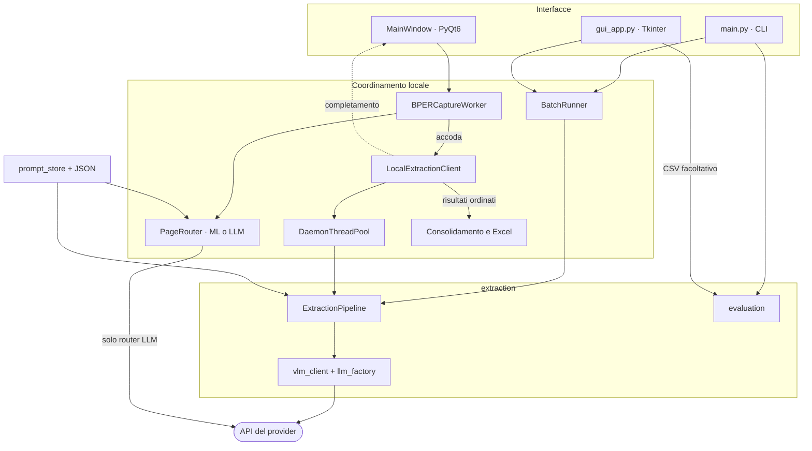

# Architettura

CLI, GUI Tkinter e edge-agent PyQt6 condividono un motore di estrazione senza dipendenze dalla UI. `ExtractionPipeline` legge gli identificativi, esegue la lettura principale e rilegge le aree deboli, poi restituisce campi e metadati. L'edge-agent aggiunge cattura, riconoscimento della pagina e consolidamento: i frame di una stessa pratica confluiscono in una riga consultabile ed esportabile.
<!-- Source: extraction/pipeline.py:55; extraction/cli.py:157; gui_app.py:238; edge-agent/local_extraction_client.py:90; edge-agent/practice_consolidation.py:87 -->

## Diagramma dei componenti

Il coordinamento risiede nel processo locale; la lettura delle immagini usa API di modelli esterni. Il router LLM ha un proprio percorso di rete, separato dalle chiamate del motore. Le frecce tratteggiate indicano notifiche Qt; il dettaglio temporale è nei [workflow](05-workflows.md).
<!-- Source: extraction/vlm_client.py:22; edge-agent/llm_router.py:172; edge-agent/local_extraction_client.py:87 -->



<!-- Source: extraction/cli.py:184; extraction/cli.py:230; edge-agent/workers/capture/bper_capture_worker.py:687; edge-agent/local_extraction_client.py:145; edge-agent/local_extraction_client.py:170; edge-agent/excel_export.py:217; extraction/prompts.py:1; edge-agent/llm_router.py:111 -->

## Struttura delle directory

```text
poc-data-extraction/
  main.py                       # CLI; --gui inoltra all'edge-agent
  gui_app.py                    # Tkinter: file, valutazione facoltativa, export
  run_edge_agent.bat            # Launcher Windows
  prompt_store.py               # Catalogo prompt condiviso, solo stdlib
  prompts/                      # Testi LLM in JSON
  requirements.txt              # Dipendenze runtime e build
  requirements-dev.txt          # Dipendenze di sviluppo
  extraction/                   # Motore, schema, immagini, valutazione, batch
  edge-agent/
    edge_agent.py               # Avvio Qt, preflight, import della UI
    app_paths.py / bootstrap.py # Percorsi source/bundle e preparazione avvio
    config.py / config.ini      # Configurazione della cattura e del router
    local_extraction_client.py  # Accodamento e pubblicazione ordinata
    extraction_pool.py          # Thread daemon per l'estrazione
    llm_router.py               # Interfaccia PageRouter, strategie LLM e ML
    page_classifier.py          # DINOv2 e cache dei prototipi
    page_registry.py            # Nomi, ordine, template e risoluzione pagine
    stability.py               # Conferme e permanenza della pagina candidata
    frame_normalize.py          # Dal monitor alla finestra applicativa
    image_ops.py                # Preparazione dell'immagine per la lettura
    practice_consolidation.py   # Una pratica per NDG normalizzato
    excel_export.py             # Workbook con 45 colonne canoniche
    ui/                         # Cattura, Dati Estratti, Debug LLM opzionale
    workers/capture/            # Loop QThread, worker BPER e generico
    assets/templates/bper/      # Catalogo pagine, immagini e cache prototipi
  tests/                        # Test di comportamento
  mnt/data/                     # Screenshot; dati.csv da procurare separatamente
  docs/                         # Guida ufficiale e ADR
```

Per orientarsi dentro `extraction/`, usare la tabella seguente; per le firme dei punti di ingresso, il [riferimento API Python](12-python-api.md).

## Layer / moduli

### Layer delle interfacce

- **CLI:** `main.py` carica `.env`, importa `extraction` e avvia il batch. `--gui` inoltra all'edge-agent dopo quell'import: non ha lo stesso ordine di inizializzazione dell'avvio diretto Qt.
- **Tkinter:** `gui_app.py` seleziona file, provider e modello, poi chiama `run_extraction_batch()` da un thread di background. La valutazione richiede un CSV facoltativo. Non carica `.env`: l'ambiente deve essere già disponibile.
- **PyQt6:** `MainWindow` condivide un `LocalExtractionClient` fra Cattura e Dati Estratti. La scheda Debug LLM richiede `--debug`; il flusso di diagnostica del router richiede anche `show_llm_tab` nell'INI. La tabella ordinaria contiene dati di pratica, mentre costo, confidenza e provenienza sono registrati dal client su stdout, reindirizzato a `edge-agent.log` nel bundle senza console.

<!-- Source: main.py:4; gui_app.py:24; gui_app.py:225; gui_app.py:238; edge-agent/ui/main_window.py:31; edge-agent/ui/main_window.py:43; edge-agent/edge_agent.py:15; edge-agent/edge_agent.py:87; edge-agent/workers/capture/bper_capture_worker.py:636; edge-agent/local_extraction_client.py:41 -->

CLI e Tkinter riusano `BatchRunner`: la creazione dei modelli, l'esecuzione parallela e le callback hanno un solo proprietario. `on_complete` e `on_error` vengono chiamate dal thread che esegue il batch, non dai suoi worker.
<!-- Source: extraction/cli.py:157; extraction/cli.py:210; extraction/cli.py:285 -->

### Layer di configurazione

`extraction/config.py` legge l'ambiente all'importazione. Nell'avvio diretto Qt, `bootstrap.run_preflight()` prepara i file, carica o crea l'ambiente e precede l'import di `ui.main_window`, che raggiunge indirettamente `extraction`. Spostare quell'import sopra il preflight congela le impostazioni troppo presto. `app_paths.py` centralizza i percorsi differenti fra sorgente e bundle.
<!-- Source: extraction/config.py:7; edge-agent/edge_agent.py:63; edge-agent/edge_agent.py:74; edge-agent/bootstrap.py:489; edge-agent/app_paths.py:9 -->

`AgentConfig` legge invece l'INI della cattura. `resolve_llm_settings()` risolve credenziale, endpoint e modello del router separatamente dal motore. La [guida alla configurazione](10-configuration-guide.md) raccoglie parametri e precedenze; modificare una variabile dopo l'import non ricarica le costanti del motore.
<!-- Source: edge-agent/config.py:123; edge-agent/config.py:292; extraction/config.py:7 -->

### Layer del modello dati

| File | Responsabilità |
|---|---|
| [fields.py](../extraction/fields.py) | `FIELD_KEYS` e corrispondenza delle etichette CSV con le chiavi italiane. |
| [schemas.py](../extraction/schemas.py) | `FieldResult`, risposte anchor/main e righe soggetti, fidi, garanzie. |
| [field_definitions.py](../extraction/field_definitions.py) | Nome visualizzato e pagina canonica di ogni campo. |
| [page_definitions.py](../extraction/page_definitions.py) | Quattro pagine canoniche e ordine di presentazione. |
| [canonical_mapping.py](../extraction/canonical_mapping.py) | Trasformazione dei campi in voci rivolte al cliente. |

<!-- Source: extraction/fields.py:12; extraction/schemas.py:31; extraction/schemas.py:73; extraction/field_definitions.py:1; extraction/page_definitions.py:5; extraction/canonical_mapping.py:20 -->

`FieldsModel` è generato da `FIELD_KEYS`: lo schema segue automaticamente le 45 chiavi. Le altre corrispondenze restano esplicite: un nuovo campo richiede di aggiornare mapping CSV, area di retry o esclusione deliberata in `UNRETRIED_FIELDS`, definizione canonica e prompt. `FieldResult` contiene valore facoltativo, confidenza ricondotta a 0–1, testo di evidenza e sezione. `ExtractionResponse` aggiunge le liste tabellari; `AnchorResponse` contiene soltanto NDG e denominazione. I dettagli sono nel [modello dei dati](06-data-model.md).
<!-- Source: extraction/schemas.py:11; extraction/schemas.py:31; extraction/schemas.py:73; extraction/schemas.py:76; extraction/schemas.py:82; extraction/config.py:105 -->

### Layer delle immagini

L'inquadratura precede qualsiasi consumatore del frame dal vivo: `_grab_raw()` usa `normalize_frame()` per riportare il monitor sulla finestra, poi il worker calcola identità e pHash e applica `preprocess_for_ocr()`. La ROI del classificatore e le bande di retry assumono quella inquadratura; applicare la normalizzazione soltanto a uno dei consumatori rende incoerenti gli altri. La motivazione è nell'[ADR 0001](adr/0001-normalizzazione-inquadratura-frame.md).
<!-- Source: edge-agent/workers/capture/bper_capture_worker.py:444; edge-agent/workers/capture/bper_capture_worker.py:536; edge-agent/frame_normalize.py:209 -->

Il motore distingue due ingressi. `extract_from_screen()` apre il file, esegue `normalize_image()` e autorizza il controllo del ritaglio calibrato. `extract_from_image()` salta quel preprocessing e, per default, conserva l'immagine intera; impone comunque il limite dimensionale `MAX_IMAGE_LONG_SIDE`. Il ritaglio di contenuto è ammesso solo quando rapporto d'aspetto e lato lungo corrispondono alla famiglia di riferimento 848×679: tolleranza d'aspetto 5%, lato lungo 800–900 pixel. Fuori calibrazione anche l'anchor legge l'immagine intera e il retry BODY può riempire una tabella vuota, ma non sostituirne una esistente. Vedi [ADR 0010](adr/0010-ritaglio-autorizzato-dal-percorso-e-dalla-famiglia.md).
<!-- Source: extraction/imaging.py:19; extraction/imaging.py:52; extraction/config.py:78; extraction/pipeline.py:92; extraction/pipeline.py:138; extraction/pipeline.py:231; extraction/pipeline.py:266 -->

### Layer LLM e prompt

`llm_factory.create_chat_model()` è la factory del motore. Rifiuta chiavi mancanti, provider sconosciuti, nomi che non appartengono a nessuna famiglia e combinazioni provider/modello incoerenti; accetta ancora variabili di credenziale precedenti con avviso di deprecazione. Tutto ciò che cambia per famiglia sta in `extraction/model_adapters.py`, un adapter per famiglia scelto da `adapter_for()` ([ADR 0016](adr/0016-adapter-per-famiglia-di-modelli.md)): OpenAI usa output strutturato; `gemini-1.5*` usa `json_mode`; le altre famiglie Gemini percorrono JSON libero con validazione Pydantic manuale, e la famiglia Gemini 3 riceve `LLM_THINKING_LEVEL`. `vlm_client.call_vlm()` delega all'adapter e calcola `_meta` e costo. Queste sono diramazioni dell'implementazione, non una garanzia sulla compatibilità futura dei provider.
<!-- Source: extraction/llm_factory.py:21; extraction/model_adapters.py:207; extraction/model_adapters.py:218; extraction/vlm_client.py:22 -->

Il wrapper ritenta fino a tre volte le eccezioni diverse da `ValueError`, `KeyError` e `IndexError`, che propagano immediatamente. Ogni chiamata conclusa produce `_meta`; la pipeline aggrega token, costo e latenza. Un modello assente da `PRICING_PER_1M` vale zero nella stima, non è necessariamente gratuito. Le chiamate del router LLM usano direttamente l'SDK OpenAI compatibile e non rientrano nella contabilità di `vlm_client`.
<!-- Source: extraction/vlm_client.py:14; extraction/vlm_client.py:63; extraction/pipeline.py:396; edge-agent/llm_router.py:224 -->

I testi LLM sono dati in `prompts/*.json`, caricati e validati una volta da `prompt_store.py`, modulo solo stdlib condiviso anche dal router. Parti e placeholder devono corrispondere a `CATALOG`. Il primo catalogo caricabile vince; nel bundle la copia interna può sostituire una copia esterna danneggiata, mentre `PROMPTS_DIR` esplicito non ammette fallback. Non esiste reload parziale. Il catalogo delle pagine in `assets/templates/bper/prompts.json` è distinto: il suo errore degrada il riconoscimento; un catalogo di testi inutilizzabile solleva un errore. Il router importa lo store pigramente affinché il proprio errore resti gestibile nell'inizializzazione del router.
<!-- Source: prompt_store.py:62; prompt_store.py:139; prompt_store.py:220; prompt_store.py:262; prompt_store.py:284; edge-agent/llm_router.py:102; edge-agent/llm_router.py:111; edge-agent/workers/capture/bper_capture_worker.py:204 -->

### Layer di orchestrazione

`ExtractionPipeline` conserva l'ordine anchor → main → merge → normalizzazione `tipo` → retry → coerenza → metadati → appiattimento soggetti → campi canonici → stato. Il gate anchor annulla realmente i valori sotto `ANCHOR_CONF_MIN` prima di hint e merge. I retry selezionano le aree deboli nell'ordine HEADER, BODY, FOOTER e le eseguono in parallelo entro il budget disponibile. Vedi il [flusso multi-pass](05-workflows.md#pipeline-di-estrazione-multi-pass).
<!-- Source: extraction/pipeline.py:110; extraction/pipeline.py:122; extraction/pipeline.py:295 -->

`BatchRunner` e `LocalExtractionClient` costruiscono ciascuno una pipeline con due ChatModel condivisi fra i propri worker. I retry aggiungono un executor temporaneo per immagine. Il codice assume l'uso concorrente dei modelli; il numero di richieste simultanee può quindi superare il numero di immagini elaborate contemporaneamente.
<!-- Source: extraction/cli.py:184; extraction/cli.py:237; edge-agent/local_extraction_client.py:100; edge-agent/local_extraction_client.py:114; extraction/pipeline.py:349 -->

L'appiattimento dei primi quattro soggetti usa lo stesso `pick_best()` dei retry per le dodici chiavi numerate e aggiorna `_field_sources` solo quando vince il candidato tabellare, con la sorgente della tabella accettata ([ADR 0018](adr/0018-appiattimento-soggetti-con-merge-e-provenienza.md)). Restano limiti del risultato: i campi prodotti dal flatten non aggiungono `evidence_text`, il main assegna una sorgente anche ai campi assenti, le correzioni di coerenza non registrano la trasformazione e i retry falliti non aggiungono metadati. `creazione` appartiene a HEADER; solo i cinque tooltip sono esclusi esplicitamente dai retry in `UNRETRIED_FIELDS`, perché la loro posizione transitoria non autorizza un ritaglio fisso. La suite verifica che ogni campo abbia esattamente una politica di retry e che mapping CSV e definizioni canoniche coprano `FIELD_KEYS`; non sono guardie di avvio.
<!-- Source: extraction/pipeline.py:180; extraction/pipeline.py:203; extraction/pipeline.py:353; extraction/pipeline.py:378; extraction/config.py:105; extraction/config.py:122; tests/test_domain_vocabulary.py:11; tests/test_pipeline_postprocessing.py:187 -->

### Layer di valutazione

`evaluation.py` carica la ground truth, calcola accuratezza RAW/FILTERED ed esporta report. `normalization.py` contiene confronti, normalizzazioni, `pick_best()` e `dataset_mismatch_guard()`. La funzione di modulo `build_debug_report(outputs, gt, path)` riceve la ground truth; il metodo `Evaluator.build_debug_report(outputs, path)` usa quella già conservata nell'istanza. Vedi [valutazione dell'accuratezza](05-workflows.md#valutazione-dellaccuratezza).
<!-- Source: extraction/evaluation.py:47; extraction/evaluation.py:88; extraction/evaluation.py:139; extraction/evaluation.py:269; extraction/normalization.py:120; extraction/normalization.py:218 -->

### Layer di cattura e rilevamento dell'edge-agent

Il worker BPER possiede camera e stato delle visite. Una visita identifica un'immagine normalizzata invariata tramite dimensioni, modalità colore e digest dei pixel; il pHash serve a limitare lavoro di routing, senza decidere se una pratica è nuova. `PageRegistry` risolve nomi del router e template, `StabilityTracker` richiede conferme e permanenza. Il set dei nomi già elaborati guida l'operatore: non impedisce di acquisire ancora la stessa pagina in una visita diversa.
<!-- Source: edge-agent/workers/capture/bper_capture_worker.py:55; edge-agent/workers/capture/bper_capture_worker.py:267; edge-agent/workers/capture/bper_capture_worker.py:329; edge-agent/page_registry.py:69; edge-agent/stability.py:10 -->

`ingest_frame()` restituisce subito la sequenza accettata per il job. `DaemonThreadPool` esegue l'estrazione in background, mentre la cattura continua. Il client conserva sotto lock i completamenti fuori ordine e pubblica soltanto il prefisso contiguo in ordine di cattura. `result_ready` segnala ogni completamento e non costituisce una lista ordinata: la tabella rilegge `get_results()`. Il dettaglio e l'esempio 0–2–1 sono nel [contratto di pubblicazione](05-workflows.md#pubblicazione-ordinata-e-consolidamento).
<!-- Source: edge-agent/local_extraction_client.py:127; edge-agent/local_extraction_client.py:194; edge-agent/local_extraction_client.py:222; edge-agent/ui/data_table_tab.py:128 -->

Le conferme sono associate a `(job_id, sequenza)` e quindi a visita e pagina. Solo la conferma corrente può completare o liberare la cattura pendente. `force_capture()` inserisce un comando; il loop lo esegue nel thread che usa e chiude mss. Una chiamata router in corso può ritardare il comando. Vedi [ADR 0013](adr/0013-risultati-nell-ordine-di-acquisizione.md), [0014](adr/0014-acquisizione-per-visita-con-esito.md), [0015](adr/0015-scatto-manuale-nel-thread-di-cattura.md).
<!-- Source: edge-agent/workers/capture/bper_capture_worker.py:216; edge-agent/workers/capture/bper_capture_worker.py:278; edge-agent/workers/capture/bper_capture_worker.py:299; edge-agent/workers/capture/bper_capture_worker.py:722 -->

Le strategie ML, LLM, hybrid e il comportamento effettivo di local-first sono descritti nel [routing di pagina](05-workflows.md#routing-di-pagina-edge-agent). `DefaultCaptureWorker` è un percorso generico separato: invia frame a un endpoint configurato, ma il repository non implementa quel backend. Il percorso BPER usa soltanto il client locale; questo non rende offline le chiamate ai modelli.
<!-- Source: edge-agent/workers/capture/bper_capture_worker.py:123; edge-agent/workers/capture/bper_capture_worker.py:622; edge-agent/workers/capture/default_capture_worker.py:34; edge-agent/ui/main_window.py:36 -->

## Flusso dei dati

Il contratto centrale è un risultato per immagine: campi, liste tabellari, `canonical_fields`, `_attempts`, `_meta_agg`, `_field_sources`, `_content_crop` e `_status`. L'uscita anticipata senza anchor omette `canonical_fields`. Il client aggiunge pagina, numero, confidenza del routing e `_capture_sequence`; un'eccezione del motore diventa un risultato ridotto `ERROR` con campi vuoti. Un errore diagnostico aggiunge `_diagnostic_error` conservando il risultato.
<!-- Source: extraction/pipeline.py:151; extraction/pipeline.py:196; edge-agent/local_extraction_client.py:170; edge-agent/local_extraction_client.py:182 -->

Nel batch gli output sono indicizzati dallo stem del file e salvati prima della valutazione. Dal vivo restano in memoria sotto il job: `consolidate()` li raggruppa per NDG normalizzato, applica `pick_best()` e produce `PracticeRecord`. La tabella e l'export Excel riusano questa fusione. Excel contiene 45 colonne, NDG e denominazione all'inizio, due righe di intestazione e una riga per pratica; i valori sono testo anche quando iniziano con `=` o hanno segno negativo.
<!-- Source: extraction/imaging.py:29; extraction/cli.py:344; extraction/normalization.py:40; edge-agent/practice_consolidation.py:67; edge-agent/practice_consolidation.py:87; edge-agent/ui/data_table_tab.py:194; edge-agent/excel_export.py:92; edge-agent/excel_export.py:124; edge-agent/excel_export.py:177 -->

## Configurazione

Le impostazioni del motore vengono dall'ambiente; quelle della cattura e del router da `AgentConfig`. Le geometrie delle immagini e la mappa delle aree sono costanti del motore, mentre `RETRY_CONF_MIN`, `MAX_IMAGE_LONG_SIDE` e i limiti di parallelismo possono essere configurati via ambiente. I prompt hanno un catalogo dedicato e le pagine un catalogo distinto. Non è presente un sistema separato di feature flag o profili dev/staging/prod: i punti di variazione sono ambiente, INI, parametri Python e scelte della UI.
<!-- Source: extraction/config.py:7; extraction/config.py:59; extraction/config.py:65; extraction/config.py:105; edge-agent/config.py:123; prompt_store.py:220; edge-agent/page_registry.py:40 -->

Le credenziali del router seguono la precedenza INI non vuoto, poi variabili del provider, poi `LLM_API_KEY`; lasciare vuota la voce INI permette di usare l'ambiente. `AgentConfig.save()` può ripersistire la credenziale configurata. Per configurazione operativa e gestione delle chiavi usare la [guida dedicata](10-configuration-guide.md); per avvio e comandi, [Per iniziare](07-getting-started.md).
<!-- Source: edge-agent/config.py:292; edge-agent/config.py:339 -->

Vedi anche: [Tech Stack](03-tech-stack.md), [Workflow](05-workflows.md), [Modello dei dati](06-data-model.md), [API Python](12-python-api.md), [ADR](adr/README.md).
