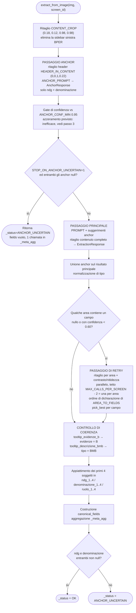
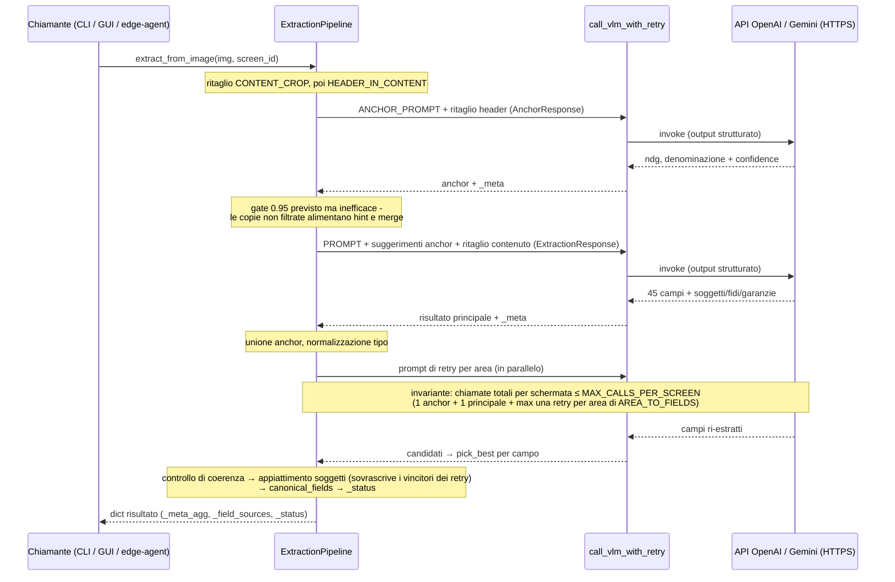
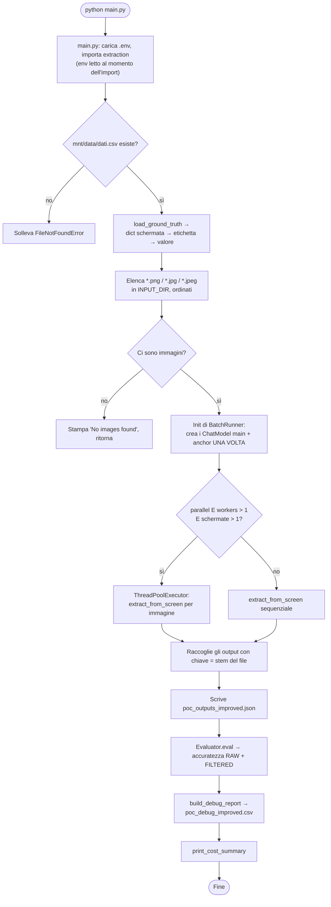
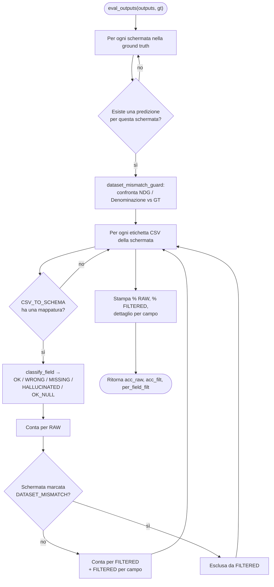
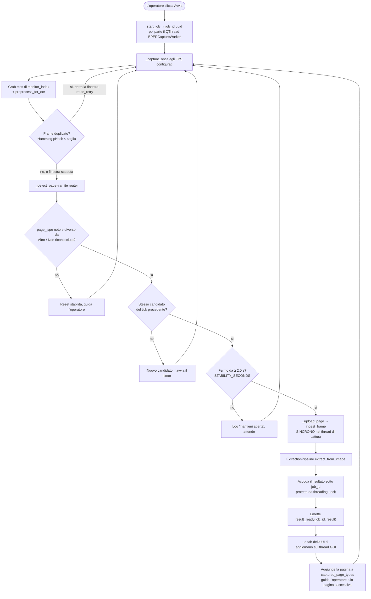
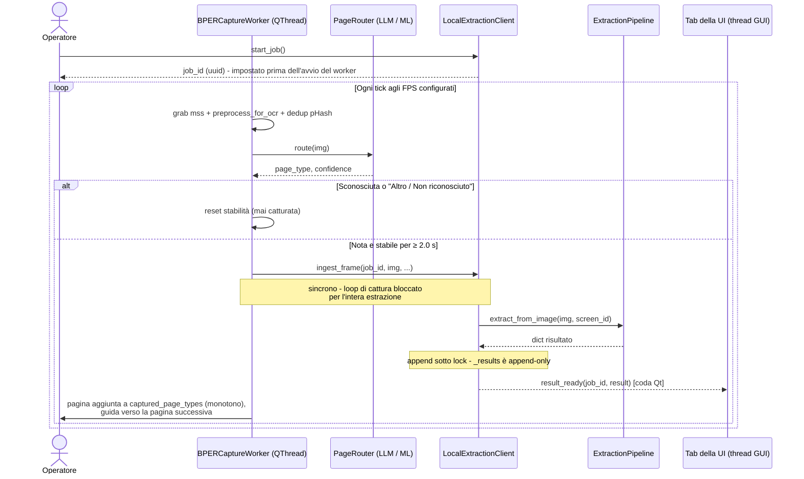
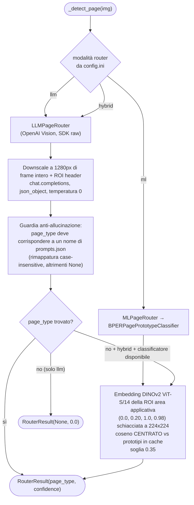

# Workflow

Tutto ciò che questo progetto fa passa per un unico motore: la pipeline di estrazione multi-pass in `extraction/pipeline.py`. Tre front-end la avvolgono. La CLI (`main.py`) elabora in batch una cartella di screenshot e valuta i risultati rispetto a un CSV di ground truth. La GUI Tkinter (`gui_app.py`) fa lo stesso su richiesta, per file scelti dall'utente. L'edge-agent PyQt6 (`edge-agent/edge_agent.py`) osserva un monitor dal vivo, riconosce quale pagina BPER è a schermo ed esegue l'estrazione frame per frame mentre l'operatore naviga nell'applicazione.

I workflow qui sotto sono ordinati dal motore verso l'esterno: la pipeline stessa, l'esecuzione batch da CLI che la esercita, la valutazione di accuratezza che la misura, il loop di cattura dal vivo dell'edge-agent e la decisione di routing di pagina che filtra ogni frame catturato. Per come i pezzi si incastrano strutturalmente, vedi [Architettura](04-architecture.md); per le capacità rivolte all'utente, vedi [Funzionalità](02-features.md).

## Pipeline di estrazione multi-pass

Ogni screenshot (che arrivi dalla CLI, dalla GUI Tkinter o dall'edge-agent) viene elaborato da `ExtractionPipeline.extract_from_image()` in **`extraction/pipeline.py`**. La pipeline effettua fino a `MAX_CALLS_PER_SCREEN` chiamate Vision-LLM per schermata (default `2 + len(AREA_TO_FIELDS)` = 5, derivato in `extraction/config.py` subito dopo `AREA_TO_FIELDS`) in tre stadi (anchor, principale, retry condizionale) e ne fonde gli output in un unico dict risultato. Il disegno esiste perché un singolo passaggio LLM su una schermata bancaria densa manca o legge male dei campi; il passaggio anchor punta prima ai due campi identitari, e il passaggio di retry ritenta soltanto le aree tornate deboli.

**Trigger:** `extract_from_screen(path)` (`extraction/pipeline.py:182-187`, usato da CLI e GUI Tkinter; apre il file, esegue `normalize_image()`, ricava `screen_id` dallo stem del file) oppure `extract_from_image(img, screen_id)` (`extraction/pipeline.py:104`, usato dall'edge-agent; il frame è già preprocessato a monte, quindi `normalize_image()` viene deliberatamente bypassata, `edge-agent/local_extraction_client.py:84-86`).

**Esito:** un dict risultato con i valori per campo, le tabelle `soggetti`/`fidi`/`garanzie`, `canonical_fields` (le voci rivolte al cliente), i metadati di costo/token in `_meta_agg`, la provenienza per campo in `_field_sources` e uno `_status` pari a `OK` o `ANCHOR_UNCERTAIN`. La forma completa del dict è documentata in [Modello dei dati](06-data-model.md#il-dict-risultato).

### Spiegazione passo per passo

**1. Ritaglio del contenuto.** `extract_from_image` ritaglia l'immagine a `CONTENT_CROP = (0.18, 0.12, 0.98, 0.98)` (`extraction/config.py:59`), rimuovendo la barra di navigazione sinistra di BPER così che il modello veda solo la regione dei dati (`extraction/pipeline.py:106`).

**2. Passaggio anchor.** `extract_anchors()` ritaglia la striscia header `HEADER_IN_CONTENT = (0.00, 0.00, 1.00, 0.22)` (`extraction/config.py:60`) e la invia con `ANCHOR_PROMPT` per estrarre solo `ndg` e `denominazione` (`extraction/pipeline.py:70-102`). Il prompt codifica due regole di dominio: NDG e Denominazione stanno al centro visivo dell'intestazione della pratica, e il nome dell'operatore in alto a destra va ignorato (`prompts/extraction_anchor.json`). Il prompt istruisce inoltre il modello a restituire `null` quando è incerto e a impostare `confidence >= 0.95` solo quando il valore è chiaramente leggibile (`prompts/extraction_anchor.json`).

**3. Il gate di confidenza degli anchor: intento vs comportamento reale.** Il codice *intende* azzerare gli anchor sotto `ANCHOR_CONF_MIN` (0.95, `extraction/config.py:56`), e CLAUDE.md lo documenta così. In pratica il gate è un no-op. I dict `ndg`/`den` restituiti sono copie fresche prodotte da `safe_field()` *prima* che il gate venga eseguito (`extraction/pipeline.py:87-88` vs `:91-96`), e in ogni caso la chiamata `safe_set_field(..., value=None)` del gate non può annullare un valore non nullo esistente, per via della guardia `if value is not None or f.get("value") is None` (`extraction/normalization.py:78-79`). Sono le copie pre-gate ad alimentare tutto ciò che viene dopo: l'uscita anticipata `STOP_ON_ANCHOR_UNCERTAIN` (`extraction/pipeline.py:112-113`), il prompt con i suggerimenti (`:205-208`) e `_merge_anchors` (`:212-216`). Effetto netto: **un anchor a bassa confidenza fluisce comunque a valle a piena forza**; l'unico comportamento "null se incerto" realmente in vigore è l'istruzione contenuta nel prompt. L'uscita anticipata scatta quindi solo quando è il modello stesso ad aver restituito valori null. Con `STOP_ON_ANCHOR_UNCERTAIN=1` ed entrambi gli anchor null, la pipeline ritorna `_status="ANCHOR_UNCERTAIN"` con `fields` vuoto, una sola voce in `_attempts` e nessuna chiave `canonical_fields` (`extraction/pipeline.py:112-124`).

**4. Passaggio principale.** `_build_anchor_hint_prompt()` accoda i valori anchor al `PROMPT` di base come suggerimenti (`"NDG atteso: {value}"`, `"Denominazione attesa: {value}"`), così la chiamata principale parte già innescata con gli identificativi (`extraction/pipeline.py:127`, `:202-209`). Il ritaglio completo del contenuto viene inviato e parsato in una `ExtractionResponse`: tutti i 45 campi scalari più le liste `soggetti`, `fidi` e `garanzie` in un'unica chiamata (`extraction/pipeline.py:130-138`). L'ordine qui è portante: il passaggio anchor deve completarsi prima che venga costruito il prompt principale, perché il prompt ne incorpora l'output. L'intera sequenza per schermata (anchor → principale → merge → normalizzazione tipo → retry → coerenza → appiattimento → canonico → status) è garantita soltanto dall'ordine sequenziale del codice (`extraction/pipeline.py:109-178`).

**5. Merge e normalizzazione di tipo.** `_merge_anchors()` sovrascrive `ndg`/`denominazione` del passaggio principale con qualsiasi valore anchor non nullo e registra la sorgente come `ANCHOR_HEADER` (`extraction/pipeline.py:211-216`). `_postprocess_tipo()` canonicalizza poi `tipo`: i sinonimi `mutui spesa`, `mutuo spesa` e `bpi mutui` (case-insensitive) mappano tutti su `BPI Mutui` (`extraction/normalization.py:10-23`, applicato in `extraction/pipeline.py:146` e di nuovo per ogni candidato di retry in `:298-299`).

**6. Retry condizionale.** `_retry_areas()` scansiona le tre aree funzionali (`HEADER`, `BODY`, `FOOTER`, `extraction/config.py:63-82`) e marca ogni area contenente un campo nullo o con confidenza sotto 0.60 (`extraction/pipeline.py:251-257`; lo 0.60 è hardcoded). Ogni area marcata riceve un ritaglio dedicato (con potenziamento extra di contrasto/nitidezza per `HEADER` e `BODY`, `:267-272`) e un prompt italiano specifico per area (`FIELD_RETRY_PROMPTS`, `extraction/prompts.py:23-27`, testi in `prompts/extraction_retry_*.json`), eseguito in un `ThreadPoolExecutor` annidato (`:284`). Il tetto è `max(0, MAX_CALLS_PER_SCREEN - 2)` retry: una chiamata ciascuna riservata ad anchor e principale. Il tetto viene applicato alla lista delle aree nell'**ordine di dichiarazione** di `AREA_TO_FIELDS` (`[a for a in AREA_TO_FIELDS if a in areas_to_retry][:allowed_retries]`), non alfabetico: `HEADER` possiede i campi identitari che pilotano `_status` e la guardia sul disallineamento del dataset, quindi deve essere ritentata prima che il budget finisca. Con il default derivato (`2 + len(AREA_TO_FIELDS)` = 5) il tetto vale 3 e copre tutte le aree, quindi nessuna viene scartata. Abbassare `MAX_CALLS_PER_SCREEN` ripristina lo scarto silenzioso, e a perderci sono le aree in coda alla lista: fu così che `FOOTER`, che possiede `note_della_richiesta`, non veniva mai riletta sulla pagina Note da Richiesta ([ADR 0004](adr/0004-budget-retry-derivato-dalle-aree.md)). Per ogni campo, `merge_field_sources()`/`pick_best()` scelgono il vincitore: non-nullo batte nullo; a parità di confidenza vince il valore corrente (`extraction/normalization.py:87-108`); `_field_sources` passa a `RETRY_{AREA}` solo quando vince il candidato del retry. Le tabelle vengono unite solo dal retry `BODY`, preferendo più righe e, a pari lunghezza, la confidenza media più alta (`extraction/pipeline.py:225-241`, una regola di dominio: una tabella soggetti/fidi/garanzie più lunga si presume più completa).

**7. Controllo di coerenza.** Due regole di dominio riparano i campi a partire dai loro tooltip, dopo i retry così che i tooltip riflettano il passaggio migliore (`extraction/pipeline.py:311-328`):
- Se `tooltip_evidenze_b` ha un valore ed `evidenze` è nullo o puramente numerico, `evidenze` viene forzato a `"B"` (`:317-322`).
- Se `tooltip_descrizione_bmb` ha un valore e `tipo` è null, `tipo` viene impostato a `"BMB"` (`:324-328`).

**8. Appiattimento dei soggetti.** Le prime quattro righe di `soggetti` vengono appiattite in `ndg_1..4` / `denominazione_1..4` / `ruolo_1..4` per la valutazione in stile CSV (`extraction/pipeline.py:160-166`): il dominio limita i cointestatari a 4 slot piatti. Questo passo gira *dopo* il passaggio di retry e sovrascrive incondizionatamente: quelle dodici chiavi sono campi `BODY` ritentabili (`extraction/config.py:73-76`), quindi un vincitore di retry `BODY` per `ndg_2` viene rimpiazzato in silenzio da qualunque cosa contenga `soggetti[1].ndg` (persino `None`) e `_field_sources` non viene aggiornato per loro.

**9. Campi canonici e status.** `build_canonical_field_entries()` converte ogni campo in una voce rivolta al cliente con nome visualizzato, chiave di pagina e nome di pagina (`extraction/canonical_mapping.py:20-42`). `_status` è `OK` se e solo se sia `ndg` sia `denominazione` contengono valori non nulli alla fine (`extraction/pipeline.py:172-178`).

La stessa pipeline come sequenza di chiamate, con l'indicazione di dove avviene ogni chiamata VLM:

### Gestione degli errori e casi limite

- **Fallimenti transitori vs permanenti.** `call_vlm_with_retry()` riprova fino a 3 volte con backoff limitato (`min(8.0, 2**i * 0.8) + 0.05*i` secondi) per qualsiasi eccezione *tranne* `ValueError`, che viene risollevata immediatamente (`extraction/vlm_client.py:229-258`). Tutti i fallimenti di parsing/validazione vengono deliberatamente sollevati come `ValueError` (`extraction/vlm_client.py:39,44,95,153,200`), quindi la tassonomia è: `ValueError` = permanente, tutto il resto = transitorio. Qualunque nuovo tipo di eccezione introdotto in `call_vlm` diventa silenziosamente "riprova 3 volte".
- **Un retry fallito non è fatale.** La pipeline stampa `Warning: retry {area} for {screen} failed (keeping main-pass results)` e mantiene i valori del passaggio principale (`extraction/pipeline.py:288-292`). Il `_meta` della chiamata fallita non viene mai accodato (la riga `:294` è raggiunta solo in caso di successo), quindi `_meta_agg.calls` sottoconta i tentativi falliti anche se i tentativi precedenti del wrapper di retry potrebbero essere già stati fatturati.
- **Sei campi non vengono mai ritentati.** `creazione` e i cinque campi `tooltip_*` non appartengono a nessuna area di retry (`extraction/config.py:69-82` vs `extraction/fields.py:12-54`): un buco nel passaggio principale per loro è definitivo, salvo dove il controllo di coerenza riempie `evidenze`/`tipo` come effetto collaterale. Nessuna guardia di avvio verifica questa copertura.
- **L'output strutturato varia per provider.** OpenAI usa `.with_structured_output(schema, include_raw=True)`; `gemini-1.5*` usa json_mode con lo schema; Gemini 2.0+/3.x ricevono lo schema JSON iniettato nel prompt e vengono validati manualmente con Pydantic, perché payload `response_schema` complessi provocano `INVALID_ARGUMENT` (`extraction/vlm_client.py:15-18`, `:47-119`, `:134-183`).

## Estrazione batch da CLI

L'esecuzione end-to-end canonica: elaborare ogni screenshot in una directory, persistere il JSON e stampare accuratezza e costi. La GUI Tkinter riusa lo stesso macchinario: entrambe chiamano `run_extraction_batch()` / `BatchRunner` in **`extraction/cli.py`** (vincolo di CLAUDE.md: non duplicare mai questa logica di threading).

**Trigger:** `python main.py`. `main.py:7-8` carica `.env` *prima* di `from extraction import *`: quest'ordine conta, perché `extraction/config.py:8-56` legge tutte le variabili d'ambiente al momento dell'import. Poi gira `extraction.cli.main()` (`extraction/cli.py:314`).

**Esito:** `mnt/data/poc_outputs_improved.json` (i dict risultato completi), `mnt/data/poc_debug_improved.csv` (righe di audit per coppia (schermata, campo), separatore `;`, `utf-8-sig`), accuratezza RAW + FILTERED su console e un riepilogo dei costi per schermata.

### Spiegazione passo per passo

**1. La ground truth è obbligatoria.** `main()` solleva `FileNotFoundError` se `GROUND_TRUTH_CSV` (`INPUT_DIR/dati.csv`) manca (`extraction/cli.py:315-316`). Il repo traccia i nove screenshot ma non `dati.csv` (`/mnt` è in gitignore), quindi un clone fresco si ferma qui finché il CSV non viene fornito, vedi [Domande aperte](08-open-questions.md).

**2. Caricamento della ground truth.** `load_ground_truth()` costruisce un dict `{screen_id: {csv_label: value}}`, auto-rilevando le colonne schermata/chiave/valore tra diverse grafie accettate (`extraction/evaluation.py:33-69`).

**3. Enumerazione degli screenshot.** Ogni `.png`/`.jpg`/`.jpeg` in `INPUT_DIR`, in ordine lessicale (`extraction/cli.py:322-327`), non limitato alle schermate nominate nel CSV. `screen_id` è lo stem del file (`:225`), quindi `a.png` e `a.jpg` colliderebbero in silenzio nel dict degli output.

**4. Modelli costruiti una sola volta.** `BatchRunner.__init__` crea esattamente due ChatModel LangChain via `create_chat_model()` (principale e anchor) e una `ExtractionPipeline` condivisa (`extraction/cli.py:181-197`). I ChatModel LangChain si assumono thread-safe e vengono condivisi tra tutti i worker (commento a `:181`; docstring in `extraction/pipeline.py:50-51`); questo è documentato, non verificato nel repo.

**5. Estrazione, in parallelo quando conviene.** Il `ThreadPoolExecutor` viene usato solo quando `parallel` è attivo, `max_workers > 1` e c'è più di un'immagine esistente; altrimenti il loop è seriale (`extraction/cli.py:229-266`). La CLI passa `PARALLEL_ENABLED` / `PARALLEL_WORKERS` (default `1` / `4`, `extraction/config.py:11-12`). I file mancanti vengono segnalati con un warning e saltati (`:214-217`).

**6. Persistenza e valutazione.** Gli output vanno in `poc_outputs_improved.json` (`extraction/cli.py:337-340`), poi girano `Evaluator.eval()`, `Evaluator.build_debug_report()` e `print_cost_summary()` (`:343-347`).

Il percorso Tkinter differisce solo ai bordi: `gui_app.py:225-226` avvia un thread worker che chiama `run_extraction_batch()` con la chiave API inserita nella GUI, il provider e il modello principale (`gui_app.py:238-247`, `max_workers=min(len(images), 12)`), scrive `poc_outputs_gui.json` / `poc_results_gui.csv` nella directory corrente e (se è stato selezionato un CSV di GT) esegue `eval_outputs()` e `build_debug_report()` (`gui_app.py:250-275`). Due avvertenze: la GUI non passa mai `model_anchor`, quindi il modello anchor ricade sul `LLM_MODEL_ANCHOR` derivato dall'ambiente (un mismatch di provider solleva un'eccezione in `extraction/llm_factory.py:59-63` quando dal menu a tendina si sceglie Gemini), e `gui_app.py` non esegue alcun `load_dotenv`: assume che le variabili d'ambiente siano già esportate. Vedi [Per iniziare](07-getting-started.md) per l'avvio di ciascuna interfaccia.

### Gestione degli errori e casi limite

- **La semantica degli errori cambia per modalità.** In modalità parallela un'eccezione di un worker senza callback `on_error` stampa `ERROR extracting {screen}` e il batch prosegue (`extraction/cli.py:246-251`). In modalità seriale senza callback l'eccezione viene risollevata e il batch si interrompe (`:261-266`).
- **Le callback girano sul thread chiamante.** `on_complete`/`on_error` scattano dentro il loop `as_completed` sul thread che ha chiamato `BatchRunner.run()`, non sui worker (`extraction/cli.py:235-266`).
- **La deduplica per pagina è implementata ma disabilitata.** `_deduplicate_same_page_outputs()` (`extraction/cli.py:92-152`) terrebbe un solo risultato per pagina canonica, ma il punto di chiamata è commentato: `# TEMP TEST: keep all outputs until page_key mapping is validated` (`:268-273`). Il suo controllo di confidenza (`_is_confident_output`, `:77-89`) è, per inciso, l'unico codice che applica davvero `ANCHOR_CONF_MIN` sui valori finali.

## Valutazione dell'accuratezza

Dopo un'esecuzione batch, il valutatore classifica ogni campo estratto rispetto alla ground truth e riporta due numeri di accuratezza più una traccia di audit per coppia (schermata, campo). I numeri sono due per separare i veri errori di estrazione dalle schermate abbinate alla riga di ground truth sbagliata.

**Trigger:** `Evaluator.eval()` / `Evaluator.build_debug_report()` dalla CLI (`extraction/cli.py:343-346`); `eval_outputs()` / la `build_debug_report()` a livello di modulo dalla GUI (`gui_app.py:266-274`, nota che le due callable `build_debug_report` hanno arità diverse: la funzione di modulo prende `(outputs, gt, path)`, il metodo `(outputs, path)`, `extraction/evaluation.py:125-129` vs `:275-277`).

**Esito:** accuratezza complessiva RAW e FILTERED su console, un dettaglio FILTERED per campo e il CSV di debug.

### Spiegazione passo per passo

**1. Guardia di mismatch per schermata.** `dataset_mismatch_guard()` confronta `ndg`/`denominazione` predetti con la riga di GT: l'NDG normalizzato numericamente, la Denominazione normalizzata come testo (`extraction/normalization.py:174-189`). Codifica la regola di dominio centrale: **NDG + DENOMINAZIONE sono gli anchor identitari di una pratica; se uno dei due non concorda con la ground truth, l'intera schermata viene marcata `DATASET_MISMATCH` ed esclusa dalle metriche FILTERED.** Il valore anchor può anche essere soddisfatto dalla tabella `soggetti` quando il campo di intestazione è nullo (`_resolve_anchor_value`, `:162-172`).

**2. Classificazione dei campi.** `classify_field()` restituisce uno di cinque stati (`extraction/normalization.py:113-148`): `OK_NULL` (entrambi vuoti), `MISSING` (GT ha un valore, predizione nulla), `HALLUCINATED` (GT nulla, predizione con un valore), e `OK`/`WRONG` per il caso in cui entrambi sono presenti. Le regole di confronto sono specifiche di dominio: qualsiasi campo la cui chiave *contiene* `importo_euro`, `ndg` o `n_fido` viene confrontato dopo la normalizzazione valuta/migliaia (`,`→`.`, rimozione di `€` e spazi, `:127-133`, `norm_number_str` a `:40-55`; la semantica per sottostringa estende la regola a `ndg_1..4`); il testo più lungo di 20 caratteri passa con un rapporto `SequenceMatcher` ≥ 0.85 (`:141-146`). Il vocabolario dei valori nulli è `""`, `"n/d"`, `"nd"`, `"---"`, `"null"`, `"none"`, `"nan"` (`:28-32`).

**3. Accuratezza a due varianti.** Ogni campo classificato conta per RAW; solo i campi su schermate non in mismatch contano per FILTERED e per il dettaglio per campo (`extraction/evaluation.py:96-104`).

**4. Report di debug.** Una riga per coppia (schermata, etichetta GT) con valore predetto, confidenza, testo di evidenza, stato, il passaggio produttore da `_field_sources` (colonna `source_attempt`) e i metadati di costo per schermata; su una schermata marcata ogni stato viene sovrascritto con `DATASET_MISMATCH` (`extraction/evaluation.py:141-170`). Scritto con `sep=";"` e `utf-8-sig` (`:172-177`).

### Gestione degli errori e casi limite

- **Colonne CSV non riconoscibili falliscono rumorosamente**: `_find_column()` solleva `ValueError` (`extraction/evaluation.py:26-31`).
- **Le etichette GT non mappate vengono saltate in silenzio** durante la valutazione (`extraction/evaluation.py:88-90`); `CSV_TO_SCHEMA` porta persino chiavi con varianti di spaziatura come `"Evidenze "` per assorbire intestazioni sporche (`extraction/fields.py:65`).
- **I risultati dell'edge-agent non sono valutabili in questo modo.** `ingest_frame` costruisce screen ID come `"{Friendly} - pag. {n}"` (`edge-agent/local_extraction_client.py:80-81`) mentre le chiavi della GT sono stem di file come `"screen 1"`: il join non corrisponde mai, quindi la valutazione ha senso solo per gli output CLI/Tkinter.

## Cattura dal vivo dell'edge-agent (modalità BPER)

L'edge-agent osserva un monitor dal vivo ed estrae mentre l'operatore naviga in BPER. È il workflow più ricco di stato: cattura a FPS fissi, salta i duplicati, aspetta che lo schermo stia fermo, riconosce la pagina, poi esegue l'intera pipeline, in modo sincrono, sul thread di cattura. Non esiste alcun backend remoto: `LocalExtractionClient` è l'unico client del percorso BPER (la logica di upload remoto è stata rimossa deliberatamente, commento a `edge-agent/workers/capture/bper_capture_worker.py:710`).

**Trigger:** `python edge-agent/edge_agent.py` (oppure `python main.py --gui`, oppure `run_edge_agent.bat`), poi l'operatore clicca Avvia nella tab Cattura.

**Esito:** un dict risultato per pagina catturata, memorizzato sotto il job in `LocalExtractionClient` e spinto verso le tab della UI tramite il segnale Qt `result_ready`; l'operatore viene guidato verso la prossima pagina da aprire.

### Spiegazione passo per passo

**1. Un client condiviso, un job.** `MainWindow` costruisce un solo `LocalExtractionClient`, che al volo costruisce entrambi i ChatModel e la `ExtractionPipeline` dalla config derivata dall'ambiente: l'app fallisce subito al boot senza chiave API (`edge-agent/local_extraction_client.py:44-57`; `edge-agent/ui/main_window.py:37`). Il click su Avvia chiama `start_job()` per un nuovo UUID e avvia un QThread `BPERCaptureWorker` agli FPS configurati (`edge-agent/ui/capture_tab.py:177-232`, `:272`). Contratto di ordinamento: **il job ID viene impostato prima che il worker parta**; `_capture_once()` non fa nulla finché `job_id_getter()` restituisce un valore falsy (`edge-agent/workers/capture/bper_capture_worker.py:466-469`).

**2. Cattura e preprocessing.** A ogni tick (loop `BaseCaptureWorker.run()`, `edge-agent/workers/capture/base_capture_worker.py:39-61`), `_capture_screenshot()` cattura il monitor configurato tramite un contesto `mss` creato pigramente ed esegue `preprocess_for_ocr()` (scala adattiva, unsharp mask, autocontrasto) da `edge-agent/image_ops.py` (`bper_capture_worker.py:550-587`). `monitor_index` viene limitato con fallback al monitor 1 (`:569-571`).

**3. Deduplica tramite pHash.** `_is_duplicate_frame()` confronta un pHash su 256×256 con il frame precedente; una distanza di Hamming ≤ `dedup_threshold` (config, default 3) significa duplicato (`bper_capture_worker.py:601-624`). Dettaglio temporale: **l'hash memorizzato viene aggiornato solo quando la distanza supera la soglia** (`:617-623`), quindi una deriva lenta continua a confrontare con l'ultimo frame "nuovo". Un duplicato non viene scartato subito: il routing viene ritentato una volta ogni `route_retry_seconds`, così una schermata statica che il router non ha riconosciuto ha un'altra occasione (`:476-489`).

**4. Riconoscimento della pagina.** `_detect_page()` esegue il router configurato (vedi il workflow successivo). Un page type `None` o il catch-all resetta la stabilità e salta il frame; **"Altro / Non riconosciuto" non viene mai catturato** (`bper_capture_worker.py:31-32`, `:491-494`, lo stesso controllo su frozenset è duplicato in `edge-agent/ui/capture_tab.py:34`).

**5. Il gate di stabilità: un invariante temporale.** Una pagina riconosciuta viene caricata solo dopo che lo *stesso* candidato è stato rilevato continuativamente per ≥ `STABILITY_SECONDS` (2.0 s, `bper_capture_worker.py:49`, `:496-521`). Un candidato diverso riavvia il timer. Questo evita di catturare frame a metà transizione. Il gate viene bypassato da `force_capture()` (passo 8).

**6. Estrazione sincrona.** `_upload_page()` riconosce il client locale per duck typing (`hasattr(api_client, "ingest_frame")`) e chiama `ingest_frame(job_id, img, page_no, page_type, confidence, fields_json)` (`bper_capture_worker.py:693-703`; il kwarg `fields_json` viene accettato ma non usato dal chiamato, `edge-agent/local_extraction_client.py:65-73`). **La chiamata gira in modo sincrono nel QThread di cattura** (`local_extraction_client.py:77-79`), quindi le molteplici chiamate HTTPS bloccanti della pipeline fermano il loop FPS finché l'estrazione non è completa.

**7. Memorizza ed emette.** `ingest_frame()` esegue `extract_from_image()`, allega `_page_type`/`_page_no`/`_page_confidence`, accoda a `_results[job_id]` sotto un `threading.Lock` ed emette `result_ready(job_id, result)` con un dict copiato in modo shallow (`local_extraction_client.py:86-106`). Invarianti: **le mutazioni di `_results` sono sempre protette dal lock e la lista è append-only**: ri-rilevare una pagina dopo un cambio di hash accoda un'altra riga invece di sostituirne una (`:100-103`). Il segnale Qt è l'unico canale cross-thread; sono connesse tre tab (`edge-agent/ui/capture_tab.py:212`, `edge-agent/ui/extraction_results_tab.py:65`, `edge-agent/ui/data_table_tab.py:98`), e il codice UI legge soltanto tramite gli accessor con lock `get_results()`/`get_all_job_ids()` (`local_extraction_client.py:147-153`). Le copie sono shallow, quindi i dict annidati restano condivisi con la UI.

**8. Guida e cattura forzata.** Dopo la cattura, la pagina entra in `captured_page_types`: un set che **cresce monotonicamente entro un job** e guida soltanto l'operatore; nulla lo consulta prima di ricaricare una pagina già catturata, e lo "stop automatico quando tutte le pagine previste sono acquisite" della docstring (`bper_capture_worker.py:45`) non ha codice che lo implementi (`:532-546`). Il pulsante "Acquisisci ora" chiama `force_capture(page_name)` per una pagina selezionata manualmente, saltando sia il match del router sia il gate di stabilità (`:725-764`).

Lo stesso loop come sequenza di chiamate, con i confini tra thread:

### Gestione degli errori e casi limite

- **Un fallimento di estrazione diventa un risultato `ERROR`, non un crash.** In caso di eccezione, `ingest_frame()` sostituisce `{screen_id, fields: {}, _status: "ERROR", _error}`: un dict ridotto senza `_meta_agg`, `canonical_fields`, `_field_sources` né le liste tabellari (`edge-agent/local_extraction_client.py:87-94`). I consumatori leggono quelle chiavi in modo difensivo.
- **La cattura si auto-arresta dopo fallimenti ripetuti.** Cinque errori di screenshot consecutivi sollevano `RuntimeError("Cattura fallita N volte consecutive...")` e fermano il worker (`bper_capture_worker.py:97-98`, `:588-598`); un `mss` mancante solleva `"mss non disponibile"` e ferma subito (`:557-564`). Le altre eccezioni per-tick non sono fatali: il loop di run le cattura e le emette (`base_capture_worker.py:53-56`).
- **Rischi cross-thread (non verificati).** `force_capture()` viene eseguito sul thread della UI (`capture_tab.py:404` invoca lo slot direttamente sull'oggetto QThread) e condivide `_mss_ctx`, `_last_frame_hash` e `captured_page_types` con il loop di cattura senza lock (`bper_capture_worker.py:739`, `:557-574`). `stop()` chiude `_mss_ctx` dal thread chiamante mentre il loop può essere a metà di `_capture_once()`; `CaptureTab` chiama `stop()` e poi `wait(5000)` (`bper_capture_worker.py:214-222`; `capture_tab.py:307-308`).
- **Crescita illimitata.** `_results` accumula una voce per frame catturato per job e non viene mai svuotato (`local_extraction_client.py:56`, `:100-103`).

## Routing di pagina (edge-agent)

La decisione per-frame dentro il passo 4 della cattura dal vivo: *quale pagina BPER è questa, e l'estrazione va eseguita?* Tre strategie intercambiabili, selezionate da `router=` in `edge-agent/config.ini` (valore committato: `llm`).

**Trigger:** `BPERCaptureWorker._detect_page()` (`edge-agent/workers/capture/bper_capture_worker.py:628-675`).

**Esito:** un `RouterResult(page_type, confidence, fields, reason, expected)` (`edge-agent/llm_router.py:27-34`): il contratto che ogni implementazione di `PageRouter.route()` deve onorare (`:37-39`).

### Spiegazione passo per passo

**1. Modalità LLM (il piano di ripiego, non il default).** `LLMPageRouter.route()` riduce il frame intero e una ROI di header (la banda di altezza 12%-30%) a 1280 px, invia entrambi alle chat completions con `response_format={"type": "json_object"}` a temperatura 0 e il timeout di config, e parsa `page_type`/`confidence`/`reason` (`edge-agent/llm_router.py:144-245`). L'elenco delle pagine e i suggerimenti per pagina vengono da `edge-agent/assets/templates/bper/prompts.json` (10 definizioni, catch-all incluso). Questo è l'unico percorso LLM che bypassa `create_chat_model()`; usa l'SDK `openai` raw contro l'endpoint del provider configurato, con la propria risoluzione di chiave, endpoint e modello via `AgentConfig.resolve_llm_settings()`: i valori espliciti in `config.ini [llm]` sono autorevoli, i default del provider riempiono solo le voci vuote, e per `gemini` la chiave si cerca in `GEMINI_API_KEY` → `GOOGLE_API_KEY` → `LLM_API_KEY` (per `openai`: `OPENAI_API_KEY` → `LLM_API_KEY`). Nota che il valore `[llm] api_key` nel `config.ini` committato è stato ripulito e sostituito da un placeholder dopo una fuga di chiave; tratta quel file come potenziale portatore di segreti.

**2. Guardia anti-allucinazione.** Un `page_type` restituito viene validato contro i nomi di `prompts.json`; un quasi-match viene rimappato in modo case-insensitive, tutto il resto viene annullato (`edge-agent/llm_router.py:225-230`). Invariante: **un page type non nullo del router è sempre un vero nome di pagina di `prompts.json`.**

**3. Modalità ML** (quella in vigore). `MLPageRouter` incapsula `BPERPagePrototypeClassifier` (ROI `DEFAULT_CROP_ROI = (0.0, 0.20, 1.0, 0.98)` sull'area applicativa, soglia 0.35 sul punteggio centrato, CPU, `edge-agent/llm_router.py:42-58`), che fa l'embedding del ritaglio con DINOv2 ViT-S/14 (384 dimensioni, caricato via `torch.hub`), lo schiaccia a 224x224 senza `CenterCrop` e confronta con i prototipi in cache in `edge-agent/assets/templates/bper/bper_page_prototypes.json` per **coseno centrato**: il centroide dei prototipi viene sottratto a entrambi i lati del confronto. Serve perché pagine diverse dello stesso applicativo condividono quasi tutti i pixel: sul coseno grezzo stavano tutte fra 0.91 e 1.00 con margini di 0.003 fra la prima e la seconda, e nessuna soglia poteva separarle. Togliendo la componente comune il margine medio sale a 0.11. La cache dei prototipi è indicizzata anche su `embedding_geometry()`, così un cambio di ROI, resize, modello o regola di punteggio la invalida invece di servire vettori incoerenti ([ADR 0002](adr/0002-riconoscimento-pagina-roi-e-coseno-centrato.md), [ADR 0003](adr/0003-chiave-cache-prototipi-con-geometria.md)). (La docstring del worker a `bper_capture_worker.py:42` dice ancora "MobileNetV3"; il codice in `edge-agent/page_classifier.py` è quello autorevole.) Se l'import di torch fallisce, il classificatore si auto-disabilita e `classify()` restituisce `(None, 0.0)` (`page_classifier.py:9-19`).

**4. Fallback hybrid.** Prima LLM; se non restituisce alcuna pagina ed esiste un classificatore ML, si ricade su ML (`bper_capture_worker.py:663-668`).

### Gestione degli errori e casi limite

- **Il router non lancia mai eccezioni nel loop.** Un client assente (chiave mancante, import fallito) produce un `RouterResult` nullo con un messaggio d'errore solo di debug (`llm_router.py:146-150`); i fallimenti API vengono ritentati due volte con backoff di `0.5*(n+1)` s e poi restituiscono anch'essi null (`:191`, `:246-258`). Un router silenziosamente morto appare quindi come "nessuna pagina riconosciuta": visibile solo nella tab Debug LLM (`config.ini [debug] show_llm_tab` più il flag CLI `--debug`).
- **I page type del router non raggiungono mai la tassonomia canonica.** I nomi rilevati (es. `"Risultato ricerca - Colonne estese"`) vengono memorizzati grezzi in `_page_type` e non passano mai per `resolve_page_key()`, che conosce solo le quattro chiavi canoniche: due sistemi di naming disgiunti senza alcun ponte (`edge-agent/local_extraction_client.py:96`; `extraction/page_definitions.py:12-39`). Vedi [Modello dei dati](06-data-model.md#pagina-canonica).
- **I pesi DINOv2 vengono scaricati al primo uso ML** via `torch.hub`, senza fallback offline.

## Processi in background

Non esistono server, scheduler, cron job o worker di coda. L'unica attività a lunga esecuzione è il loop di cattura dell'edge-agent, che è una funzionalità rivolta all'operatore più che un task autonomo:

- **`BPERCaptureWorker` (QThread).** Il loop di cattura descritto sopra gira agli FPS configurati finché l'operatore non lo ferma o non scatta l'auto-arresto dopo cinque fallimenti consecutivi (`edge-agent/workers/capture/bper_capture_worker.py`).
- **Executor di retry per schermata.** Il passaggio di retry della pipeline avvia un `ThreadPoolExecutor` annidato di breve vita per schermata, condividendo gli stessi ChatModel del pool batch esterno (`extraction/pipeline.py:284-309`).
- **`DefaultCaptureWorker` (modalità "Generico").** Un percorso legacy che cattura frame a schermo intero via `pyscreenshot` e li POSTa a `{api.base_url}/jobs/{job_id}/frames` (`edge-agent/workers/capture/default_capture_worker.py:62-66`; `config.ini` punta a `http://localhost:8081`). Nessun backend del genere esiste in questo repo. L'endpoint è morto. Non fa riconoscimento pagina né estrazione locale.
- **Upload del dataset a stub.** `_maybe_upload_dataset()` è un no-op (`bper_capture_worker.py:713-715`); le sezioni `[minio]` e `[dataset]` in `config.ini` sono residui dell'era remota rimossa.

## Vedi anche

- [Architettura](04-architecture.md): il diagramma dei componenti e i livelli che sostengono questi flussi
- [Modello dei dati](06-data-model.md): gli schemi Pydantic e il dict risultato che ogni passaggio produce e modifica
- [Funzionalità](02-features.md): le capacità rivolte all'utente che questi workflow implementano
- [Guida alla configurazione](10-configuration-guide.md): come regolare `PARALLEL_WORKERS`, `MAX_CALLS_PER_SCREEN` e il router di pagina dell'edge-agent dall'esterno del codice
