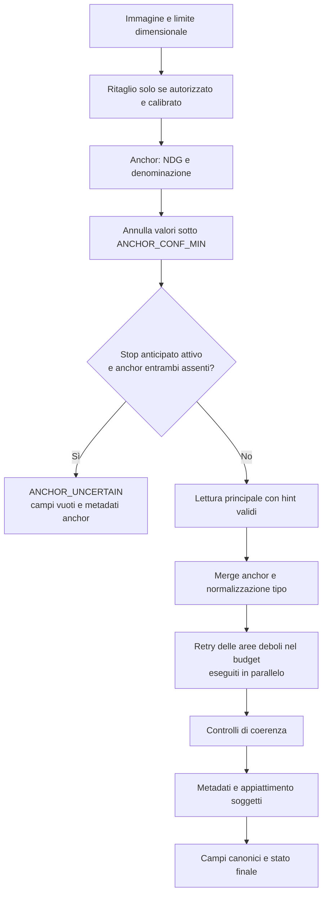
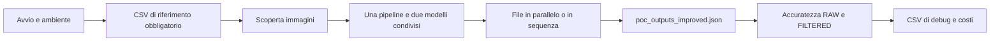
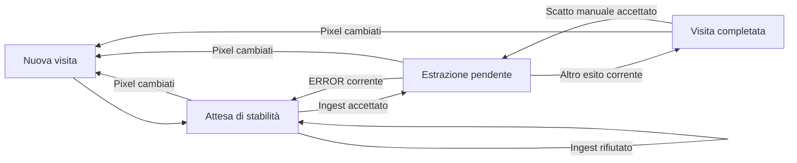
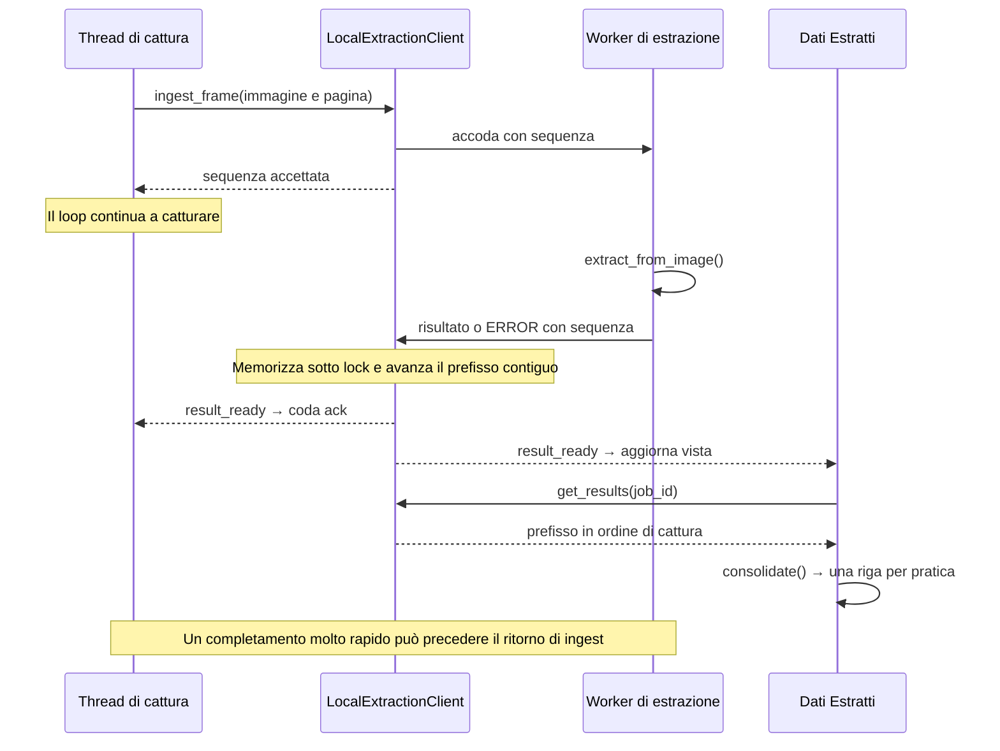

# Workflow

Il motore estrae campi da una singola immagine. CLI e Tkinter lo applicano a file scelti; l'edge-agent lo alimenta con frame acquisiti durante la navigazione e riunisce i risultati per pratica. Questo capitolo segue i dati dalla lettura dell'immagine fino alla valutazione o all'Excel, indicando anche dove errori e attese cambiano il flusso.
<!-- Source: src/extraction/pipeline.py:122; src/extraction/cli.py::BatchRunner.run; gui_app.py:238; src/edge-agent/local_extraction_client.py:127; src/edge-agent/excel_export.py:217 -->

Per le responsabilità dei componenti vedere [Architettura](04-architecture.md); per firme, parametri e ritorni, [API Python](12-python-api.md).

## Pipeline di estrazione multi-pass

L'anchor è la prima lettura di NDG e denominazione. Una volta filtrati per confidenza, questi identificativi possono guidare il passaggio principale. I retry successivi rileggono ritagli contenenti campi nulli o poco affidabili. L'ordine dei passaggi è rilevante: i retry vedono gli anchor già fusi e il controllo di coerenza legge il risultato dei retry.
<!-- Source: src/extraction/pipeline.py:78; src/extraction/pipeline.py:180; src/extraction/pipeline.py:243; src/extraction/pipeline.py:295 -->

**Trigger:** `extract_from_screen(path)` per i file; `extract_from_image(img, screen_id)` per i frame già preparati. Il primo apre il file in RGB, normalizza l'immagine e autorizza il controllo della famiglia calibrata; il secondo lascia quel ritaglio disabilitato per default. Entrambi passano dal limite dimensionale `MAX_IMAGE_LONG_SIDE`, default 2000 pixel.
<!-- Source: src/extraction/pipeline.py:122; src/extraction/pipeline.py:138; src/extraction/pipeline.py:231; src/extraction/config.py:65 -->

<!-- Source: src/extraction/pipeline.py:110; src/extraction/pipeline.py:138; src/extraction/pipeline.py:151; src/extraction/pipeline.py:180; src/extraction/pipeline.py:196; src/extraction/pipeline.py:203; src/extraction/pipeline.py:224 -->

### Spiegazione passo per passo

1. **Inquadratura e ritaglio.** Sul file, `normalize_image()` limita il lato lungo a 1800 senza ingrandire e applica contrasto e nitidezza. Il ritaglio `CONTENT_CROP=(0.18, 0.12, 0.98, 0.98)` si applica soltanto se autorizzato e compatibile con la famiglia 848×679: rapporto entro il 5% e lato lungo 800–900 pixel. Dal vivo il worker ha già normalizzato l'inquadratura e preparato il frame. Vedi [ADR 0010](adr/0010-ritaglio-autorizzato-dal-percorso-e-dalla-famiglia.md).
2. **Anchor.** Su immagine calibrata legge la fascia superiore `HEADER_IN_CONTENT=(0, 0, 1, 0.22)` del contenuto; fuori calibrazione legge l'immagine intera. Il prompt italiano distingue gli identificativi della pratica dal nome dell'operatore.
3. **Gate di confidenza.** I valori anchor con confidenza sotto `ANCHOR_CONF_MIN`, default 0.95, vengono annullati sulle copie restituite. Non entrano quindi negli hint né nel merge. Con `STOP_ON_ANCHOR_UNCERTAIN=1`, se entrambi sono nulli, la pipeline termina con campi e tabelle vuoti, un solo tentativo e senza `canonical_fields`.
4. **Lettura principale.** Il prompt incorpora solo gli anchor non nulli. La risposta contiene i 45 campi e le liste soggetti, fidi e garanzie. Gli anchor validi sovrascrivono poi gli omologhi del main e ricevono provenienza `ANCHOR_HEADER`.
5. **Normalizzazione di tipo.** `normalize_tipo()` riconduce i sinonimi di mutuo previsti dal codice a `BPI Mutui`; la stessa regola si applica ai candidati del retry per `tipo`.
6. **Retry condizionale.** Un campo nullo o sotto `RETRY_CONF_MIN`, default 0.60, rende candidata la propria area. HEADER, BODY e FOOTER vengono selezionate nell'ordine dichiarato in `AREA_TO_FIELDS`, fino a `max(0, MAX_CALLS_PER_SCREEN-2)`, poi eseguite in parallelo. HEADER e BODY ricevono anche un incremento di contrasto e nitidezza. Il default del budget è `2 + len(AREA_TO_FIELDS)`, oggi 5: ridurlo può escludere le aree in coda, come spiegato nell'[ADR 0004](adr/0004-budget-retry-derivato-dalle-aree.md).
7. **Fusione.** `pick_best()` preferisce il valore non nullo e poi la confidenza maggiore; a parità conserva il corrente. `_field_sources` cambia se vince il candidato. Solo BODY può proporre tabelle: su immagini calibrate prevalgono più righe, poi la confidenza media; fuori calibrazione può solo riempire una tabella vuota. Quando `soggetti` è vuoto, in entrambi i casi vengono prima scartate le righe sotto `RETRY_CONF_MIN` o senza NDG e denominazione leggibili. Il filtro opera per riga; le regole delle tabelle già popolate e di `fidi`/`garanzie` restano invariate ([ADR 0019](adr/0019-filtro-soggetti-da-retry-su-tabella-vuota.md)).
8. **Coerenza.** Un tooltip delle evidenze B può correggere `evidenze` nullo o numerico in `B`; un tooltip BMB può riempire `tipo` nullo con `BMB`.
9. **Risultato finale.** La pipeline aggrega metadati e confronta i primi quattro soggetti con i dodici campi numerati tramite `pick_best()`: il non nullo prevale, poi conta la confidenza; a parità resta lo scalare corrente. Se vince il candidato tabellare, `_field_sources` registra il passaggio che ha prodotto la tabella accettata (`CONTENT_MAIN` o `RETRY_BODY`). Infine costruisce `canonical_fields` e assegna `OK` solo se NDG e denominazione sono entrambi presenti; altrimenti assegna `ANCHOR_UNCERTAIN`. Vedi [ADR 0018](adr/0018-appiattimento-soggetti-con-merge-e-provenienza.md).

<!-- Source: src/extraction/imaging.py:19; src/extraction/imaging.py:52; src/extraction/config.py:78; src/extraction/pipeline.py:78; src/extraction/pipeline.py:110; src/extraction/pipeline.py:151; src/extraction/pipeline.py:243; src/extraction/pipeline.py:252; src/extraction/normalization.py:16; src/extraction/normalization.py:120; src/extraction/pipeline.py:266; src/extraction/pipeline.py:295; src/extraction/pipeline.py:378; src/extraction/pipeline.py:196; prompts/extraction_anchor.json:1 -->

### Gestione degli errori e casi limite

`MAX_CALLS_PER_SCREEN` regola i **passaggi logici**, non un tetto alle richieste HTTP. Anchor e main restano due letture anche se il valore configurato è inferiore a due, salvo uscita anticipata; ogni invocazione può essere ritentata dal wrapper di trasporto. Le aree vengono selezionate in ordine di priorità, ma completano in qualunque ordine.
<!-- Source: src/extraction/pipeline.py:151; src/extraction/pipeline.py:168; src/extraction/pipeline.py:317; src/extraction/pipeline.py:349; src/extraction/vlm_client.py:230 -->

- **Errori delle prime letture:** propagano al chiamante. `ValueError`, `KeyError` e `IndexError` non vengono ritentati dal wrapper; le altre eccezioni possono produrre fino a tre tentativi, con pausa `min(8.0, 2**i * 0.8) + 0.05*i` secondi.
- **Errore di un retry di area:** produce un avviso e conserva i valori precedenti. Non aggiunge `_meta`, quindi i tentativi falliti possono essere assenti dal conto di chiamate e costi.
- **Copertura dei retry:** `creazione` appartiene a HEADER. I cinque `tooltip_*` sono dichiarati in `UNRETRIED_FIELDS` e letti solo dal main: sono sovrapposizioni transitorie senza un ritaglio fisso affidabile. `test_domain_vocabulary.py` verifica che ogni campo appartenga a una sola area o all'esclusione esplicita; non esistono guardie di avvio equivalenti.
- **Appiattimento soggetti:** conserva gli scalari migliori e registra la sorgente dei candidati tabellari vincenti; questi candidati non aggiungono `evidence_text`. `_field_sources` resta parziale per i campi assenti inizializzati dal main e per le correzioni di coerenza.
- **Stime:** un modello non presente in `PRICING_PER_1M` costa zero nel report; la latenza aggregata somma le chiamate e non misura il tempo totale percepito quando i retry sono paralleli.

<!-- Source: src/extraction/vlm_client.py:230; src/extraction/pipeline.py:353; src/extraction/config.py:105; src/extraction/config.py:122; tests/test_domain_vocabulary.py:19; src/extraction/pipeline.py:203; src/extraction/vlm_client.py:26; src/extraction/pipeline.py:396 -->

La forma di output del modello dipende dal provider: OpenAI usa output strutturato, `gemini-1.5*` usa `json_mode`, le altre famiglie Gemini percorrono JSON libero e validazione Pydantic. Il [layer LLM](04-architecture.md#layer-llm-e-prompt) descrive anche il catalogo prompt.
<!-- Source: src/extraction/vlm_client.py:21; src/extraction/vlm_client.py:52; src/extraction/vlm_client.py:123 -->

## Estrazione batch da CLI

**Trigger:** `python main.py`, eseguito dalla radice del repository. Carica `.env` prima dell'import del motore, poi `main()` richiede `INPUT_DIR/dati.csv`, carica la ground truth e cerca tutte le immagini PNG/JPG/JPEG direttamente in `INPUT_DIR`, ordinate per nome. Il CSV non è distribuito con il repository; l'avvio CLI si ferma con `FileNotFoundError` se manca.
<!-- Source: main.py:4; src/extraction/cli.py::main; src/extraction/config.py:10; .gitignore:1 -->

<!-- Source: src/extraction/cli.py::BatchRunner.__init__; src/extraction/cli.py::BatchRunner.run; src/extraction/cli.py::main; src/extraction/cli.py::main -->

`BatchRunner` usa il pool solo quando il parallelismo è attivo, ci sono più worker e più immagini esistenti. I percorsi mancanti sono segnalati e saltati; una cartella senza immagini fa terminare la CLI dopo un messaggio. Ogni risultato è indicizzato dallo stem del file: `a.png` e `a.jpg` hanno la stessa chiave e possono sovrascriversi. Il batch conserva gli output delle schermate senza deduplicarli per pagina canonica.
<!-- Source: src/extraction/cli.py::BatchRunner.run; src/extraction/cli.py::BatchRunner.run; src/extraction/cli.py::BatchRunner.run; src/extraction/cli.py::main; src/extraction/imaging.py:29 -->

Il JSON completo viene scritto in `INPUT_DIR/poc_outputs_improved.json`. Il valutatore stampa accuratezza e riepilogo dei costi e scrive `INPUT_DIR/poc_debug_improved.csv` con separatore `;` e codifica `utf-8-sig`. Se manca `on_error`, il batch parallelo stampa l'errore e continua, mentre quello sequenziale rilancia l'eccezione. Le callback girano sempre nel thread che chiama il batch.
<!-- Source: src/extraction/cli.py::BatchRunner.run; src/extraction/cli.py::BatchRunner.run; src/extraction/cli.py::main; src/extraction/evaluation.py:15 -->

### Variante Tkinter

`gui_app.py` carica `.env` prima di importare `extraction`; provider e modello iniziali seguono la configurazione effettiva e il menu conserva anche un modello personalizzato. Avvia il batch da un thread di background con chiave, provider e modello selezionati, passando fino a `min(numero immagini, 12)` worker. Quando `model_main` è esplicito e `model_anchor` è omesso, il runner usa il modello scelto per entrambi ([ADR 0021](adr/0021-dotenv-prima-del-motore-nella-gui-tkinter.md)).
<!-- Source: gui_app.py:24; gui_app.py:225; gui_app.py:238; src/extraction/cli.py::BatchRunner.__init__ -->

La GUI scrive `poc_outputs_gui.json` e `poc_results_gui.csv` nella directory corrente; se è stato scelto il CSV di riferimento esegue anche valutazione e report di debug. Per comandi e prerequisiti vedere [Per iniziare](07-getting-started.md).
<!-- Source: gui_app.py:250; gui_app.py:265 -->

## Valutazione dell'accuratezza

Il confronto avviene per chiave di schermata e campo: non ricostruisce le pratiche del percorso live. La CLI usa `Evaluator`, che conserva la ground truth, mentre Tkinter chiama le funzioni equivalenti di modulo.
<!-- Source: src/extraction/evaluation.py:88; src/extraction/evaluation.py:269; gui_app.py:265 -->

1. **Caricamento CSV.** Il loader rileva il separatore e prova `utf-8-sig`, `cp1252`, `latin-1`; normalizza gli spazi delle intestazioni e riconosce varianti per schermata, nome campo e valore. Una colonna indispensabile non riconosciuta solleva `ValueError`.
2. **Allineamento della schermata.** Per ogni schermata GT viene cercato l'output con la stessa chiave. Una predizione assente viene saltata, non contata automaticamente come estrazione mancante. Anche etichette senza mapping in `CSV_TO_SCHEMA` vengono saltate.
3. **Guardia di mismatch.** Quando gli identificativi sono disponibili da entrambi i lati, `dataset_mismatch_guard()` confronta NDG e denominazione; può ricavare il valore predetto anche dai soggetti quando manca nell'intestazione. Una differenza marca la schermata come `DATASET_MISMATCH`.
4. **Classificazione.** Ogni valore diventa `OK`, `WRONG`, `MISSING`, `HALLUCINATED` o `OK_NULL`. `ndg` e `ndg_1..4` usano `normalize_ndg()` e richiedono identità dopo la normalizzazione; le chiavi contenenti `importo_euro` o `n_fido` mantengono il confronto numerico. Il testo GT normalizzato oltre 20 caratteri può passare con similarità `SequenceMatcher` almeno 0.85. Sono nulli anche stringhe vuote, `n/d`, `nd`, `---`, `null`, `none`, `nan`.
5. **Metriche.** RAW include i campi valutati; FILTERED esclude quelli delle schermate in mismatch. Il dettaglio per campo è FILTERED. Correttezza significa `OK` o `OK_NULL`.
6. **Report.** Una riga per coppia schermata/campo GT registra valore, confidenza, evidenza, stato, provenienza e metadati. Su una schermata in mismatch lo stato del report diventa `DATASET_MISMATCH`. I CSV neutralizzano le stringhe interpretabili come formule prima della scrittura.

<!-- Source: src/extraction/evaluation.py:25; src/extraction/evaluation.py:32; src/extraction/evaluation.py:47; src/extraction/evaluation.py:88; src/extraction/normalization.py:206; src/extraction/normalization.py:218; src/extraction/normalization.py:150; src/extraction/normalization.py:28; src/extraction/evaluation.py:139; src/extraction/evaluation.py:15 -->

Valutazione, guardia di mismatch e consolidamento importano la stessa `normalize_ndg()` da `src/extraction/normalization.py`: elimina i separatori, uniforma le lettere e toglie gli zeri iniziali solo agli identificatori interamente numerici. `12345/A` resta distinto da `12345/B` e da `12345` ([ADR 0017](adr/0017-identita-ndg-condivisa-tra-valutazione-e-consolidamento.md)). I risultati live usano `screen_id` pari al nome pagina o `pagina N`; non sono automaticamente allineati a chiavi GT come `screen 1`. Serve un mapping esplicito per confrontarli con quel dataset.
<!-- Source: src/extraction/normalization.py:40; src/edge-agent/practice_consolidation.py:22; src/edge-agent/local_extraction_client.py:168 -->

## Cattura dal vivo dell'edge-agent (modalità BPER)

**Trigger:** avvio diretto dell'edge-agent e pulsante Avvia nella scheda Cattura. Il preflight precede l'import di `MainWindow`, quindi la prima configurazione dell'ambiente arriva prima dello snapshot del motore. `python main.py --gui` inoltra alla stessa UI ma ha già importato `extraction`; il launcher Windows avvia invece direttamente l'edge-agent.
<!-- Source: src/edge-agent/edge_agent.py:63; src/edge-agent/edge_agent.py:74; main.py:4; run_edge_agent.bat:22; src/edge-agent/ui/capture_tab.py:192 -->

`MainWindow` crea un client condiviso e l'avvio della cattura assegna un UUID al job prima di far partire il worker. L'estrazione viene accodata su thread separati; il riconoscimento pagina resta nel loop di cattura e le sue chiamate di rete possono allungare un tick oltre l'intervallo FPS.
<!-- Source: src/edge-agent/ui/main_window.py:36; src/edge-agent/ui/capture_tab.py:192; src/edge-agent/workers/capture/base_capture_worker.py:43; src/edge-agent/local_extraction_client.py:114 -->

### Dalla schermata a una visita

`_grab_raw()` crea mss nel thread di cattura, legge il monitor configurato e applica `normalize_frame()` prima di deduplica, routing o estrazione. Se l'indice monitor non è valido usa il primo monitor. La normalizzazione prova a identificare la finestra; se resta il monitor intero, il worker emette un avviso perché le geometrie dei consumatori possono non corrispondere. Il preprocessing successivo è best effort: un suo errore conserva l'immagine precedente.
<!-- Source: src/edge-agent/workers/capture/bper_capture_worker.py:444; src/edge-agent/workers/capture/bper_capture_worker.py:497; src/edge-agent/workers/capture/bper_capture_worker.py:536; src/edge-agent/frame_normalize.py:209 -->

Una *visita* è un'immagine normalizzata invariata: dimensioni, modalità colore e digest BLAKE2b dei pixel. Qualsiasi cambiamento rilevato apre una nuova visita e riavvia la stabilità, anche quando cambia soltanto una cifra dell'NDG. Il pHash misura invece la somiglianza visiva: riduce lavoro di routing, ma non impedisce una nuova pratica sulla stessa pagina.
<!-- Source: src/edge-agent/workers/capture/bper_capture_worker.py:329; src/edge-agent/workers/capture/bper_capture_worker.py:549; tests/test_bper_capture_lifecycle.py:141 -->

Il registro risolve l'etichetta in una pagina; sul catalogo valido il catch-all e i nomi sconosciuti non sono acquisibili. `StabilityTracker` richiede almeno due osservazioni concordi e due secondi di permanenza e tollera un'osservazione discordante. Nel worker, un cambiamento dei pixel resetta comunque il tracker. Un duplicato può confermare il candidato già riconosciuto senza pagare un'altra chiamata router, purché l'ultima pagina riconosciuta coincida col candidato. Se non c'è un candidato confermabile, `route_retry_seconds` limita i nuovi tentativi sul frame simile.
<!-- Source: src/edge-agent/page_registry.py:69; src/edge-agent/stability.py:10; src/edge-agent/stability.py:47; src/edge-agent/stability.py:75; src/edge-agent/workers/capture/bper_capture_worker.py:329; src/edge-agent/workers/capture/bper_capture_worker.py:368 -->

<!-- Source: src/edge-agent/workers/capture/bper_capture_worker.py:299; src/edge-agent/workers/capture/bper_capture_worker.py:329; src/edge-agent/workers/capture/bper_capture_worker.py:422; src/edge-agent/workers/capture/bper_capture_worker.py:727 -->

### Accodamento, esito e nuovo tentativo

`ingest_frame()` accetta il lavoro e restituisce la sequenza del frame da zero per job. Solo i lavori accettati consumano una sequenza; un pool chiuso solleva `RuntimeError` senza emettere `frame_queued`. `fields_json` è mantenuto nell'interfaccia, ma non guida la pipeline. Il worker marca la visita come pendente, senza dichiararla già acquisita.
<!-- Source: src/edge-agent/local_extraction_client.py:127; src/edge-agent/local_extraction_client.py:145; src/edge-agent/local_extraction_client.py:157; src/edge-agent/workers/capture/bper_capture_worker.py:422 -->

La conferma dell'esito, o *ack*, entra in una coda di comandi con `(job_id, sequenza, stato)`. La coppia job/sequenza identifica visita e pagina originarie. Solo l'ack della cattura corrente può completare o liberare quella visita; una risposta vecchia non modifica il pendente di una visita nuova. La [guida di navigazione](navigazione-edge.md) aggiorna la copertura per NDG nell’ordine delle catture. Una pagina può essere visitata e acquisita più volte.
<!-- Source: src/edge-agent/workers/capture/bper_capture_worker.py:278; src/edge-agent/workers/capture/bper_capture_worker.py:299; src/edge-agent/workers/capture/bper_capture_worker.py:267 -->

Dopo `ERROR` o rifiuto di ingest serve un nuovo intervallo stabile prima del retry automatico. `ANCHOR_UNCERTAIN` completa la visita: una pagina senza NDG può comunque avere campi utili e non va ripetuta indefinitamente solo per lo stato. La pagina corrente, mentre è pendente o completata, non viene instradata e accodata a ogni tick; un cambiamento di pixel riabilita la cattura.
<!-- Source: src/edge-agent/workers/capture/bper_capture_worker.py:299; src/edge-agent/workers/capture/bper_capture_worker.py:323; src/edge-agent/workers/capture/bper_capture_worker.py:362 -->

### Pubblicazione ordinata e consolidamento

Le estrazioni possono finire fuori ordine. `get_results()` espone soltanto il **prefisso completato senza buchi**: se sono pronti 0 e 2, espone 0; quando termina 1, espone 0, 1 e 2. Un risultato `ERROR` occupa il suo posto, mentre un errore nella scrittura diagnostica aggiunge `_diagnostic_error` senza perdere il risultato o bloccare il prefisso.
<!-- Source: src/edge-agent/local_extraction_client.py:170; src/edge-agent/local_extraction_client.py:188; src/edge-agent/local_extraction_client.py:194; src/edge-agent/local_extraction_client.py:222 -->

`result_ready` notifica invece ciascun completamento appena disponibile: può arrivare prima del ritorno di `ingest_frame()` e prima di `frame_queued`. La UI non deve costruire una seconda lista dall'ordine dei segnali. Dati Estratti rilegge il client e consolida il prefisso pubblicato. Il segnale immediato permette intanto al worker di confermare l'esito senza attendere i frame precedenti.
<!-- Source: src/edge-agent/local_extraction_client.py:154; src/edge-agent/local_extraction_client.py:204; src/edge-agent/ui/data_table_tab.py:128; src/edge-agent/ui/data_table_tab.py:194; src/edge-agent/workers/capture/bper_capture_worker.py:278 -->

<!-- Source: src/edge-agent/local_extraction_client.py:145; src/edge-agent/local_extraction_client.py:194; src/edge-agent/local_extraction_client.py:204; src/edge-agent/ui/data_table_tab.py:194 -->

`consolidate()` usa `normalize_ndg()` come chiave: elimina separatori, uniforma le lettere e rimuove gli zeri iniziali soltanto se restano cifre. Un frame senza NDG si associa alla pratica precedente in ordine di cattura; quelli iniziali attendono la prima identificata. Se nessun frame ha NDG, nasce un solo record anonimo. La fusione dei campi passa da `pick_best()`, condiviso con la pipeline.
<!-- Source: src/extraction/normalization.py:40; src/edge-agent/practice_consolidation.py:67; src/edge-agent/practice_consolidation.py:87 -->

Entrambi i pulsanti Excel usano `export_results()`: consolidamento, 45 colonne canoniche, NDG e denominazione all'inizio, intestazione su due righe, una riga per pratica. I valori vengono scritti come testo tramite il tipo della cella: le stringhe che iniziano con `=` non diventano formule e i valori negativi conservano il segno. Le rinomine delle colonne in Dati Estratti modificano le etichette, non le chiavi del motore.
<!-- Source: src/edge-agent/ui/capture_tab.py:332; src/edge-agent/ui/data_table_tab.py:255; src/edge-agent/excel_export.py:92; src/edge-agent/excel_export.py:124; src/edge-agent/excel_export.py:177; src/edge-agent/excel_export.py:217 -->

### Scatto manuale e arresto

`force_capture(page_name)` inserisce soltanto un comando nella coda. Il loop di cattura lo consuma, fotografa ciò che è visibile **al momento dell'esecuzione** e salta routing e attesa di stabilità. Se una chiamata router è già in corso, il comando aspetta che termini. Una richiesta per la stessa pagina già pendente non aggiunge un doppione; dopo un completamento è possibile riacquisire manualmente. Il retry dopo errore conserva la pagina selezionata e i suoi metadati, anche quando differiscono dalla precedente risposta del router.
<!-- Source: src/edge-agent/workers/capture/bper_capture_worker.py:284; src/edge-agent/workers/capture/bper_capture_worker.py:422; src/edge-agent/workers/capture/bper_capture_worker.py:722; src/edge-agent/workers/capture/bper_capture_worker.py:727 -->

Il worker usa un loop proprio, senza event loop Qt: uno slot Qt accodato da solo non basta a eseguire la cattura nel suo thread. Per questo lo slot cross-thread scrive soltanto nella coda e il loop applica i comandi. mss viene creato, usato e chiuso nel thread di cattura. Lo stop impedisce nuove acquisizioni ai punti di controllo e scarta i comandi non ancora eseguiti, ma non interrompe una chiamata di rete già in corso.
<!-- Source: src/edge-agent/workers/capture/base_capture_worker.py:43; src/edge-agent/workers/capture/base_capture_worker.py:74; src/edge-agent/workers/capture/bper_capture_worker.py:65; src/edge-agent/workers/capture/bper_capture_worker.py:216; src/edge-agent/workers/capture/bper_capture_worker.py:284; src/edge-agent/workers/capture/bper_capture_worker.py:350 -->

I compromessi sono espliciti negli [ADR 0013](adr/0013-risultati-nell-ordine-di-acquisizione.md), [0014](adr/0014-acquisizione-per-visita-con-esito.md) e [0015](adr/0015-scatto-manuale-nel-thread-di-cattura.md):

- un frame lento ritarda la visualizzazione dei successivi già pronti;
- animazioni o aggiornamenti continui dei pixel riavviano la stabilità e possono aumentare routing e attesa; lo scatto manuale resta disponibile;
- il client salva le catture prima di confermarle e ricostruisce i risultati in ordine alla riapertura. Le copie di `get_results()` proteggono la lista, mentre i dizionari annidati restano condivisi. [Guida al recupero](recupero-sessioni.md)
- `shutdown()` ferma l’elaborazione. Alla riapertura della GUI i fotogrammi salvati e ancora pendenti tornano in coda e sbloccano i risultati successivi;
- cinque errori consecutivi di screenshot fermano la cattura; l'assenza di mss la ferma subito. Le altre eccezioni per tick vengono segnalate dal loop.

<!-- Source: src/edge-agent/local_extraction_client.py:116; src/edge-agent/local_extraction_client.py:194; src/edge-agent/local_extraction_client.py:214; src/edge-agent/local_extraction_client.py:222; src/edge-agent/extraction_pool.py:45; src/edge-agent/workers/capture/bper_capture_worker.py:329; src/edge-agent/workers/capture/bper_capture_worker.py:444; src/edge-agent/workers/capture/base_capture_worker.py:53 -->

## Routing di pagina (edge-agent)

Il routing assegna una pagina alla schermata prima dell'estrazione. `RouterResult` trasporta `page_type`, `confidence`, `fields`, `reason` ed `expected`; `PageRegistry` collega nomi visualizzati e stem dei template. Questi nomi distinguono varianti della schermata. Le cinque pagine di origine dei campi sono assegnate da `field_definitions.py`, non dal nome ritornato dal router; i quattro gruppi di export sono definiti separatamente ([ADR 0020](adr/0020-pagina-sorgente-separata-dal-gruppo-export.md)). Il mapping non riduce il numero di retry delle aree deboli.
<!-- Source: src/edge-agent/llm_router.py:29; src/edge-agent/page_registry.py:69; src/extraction/field_definitions.py:1; src/extraction/page_definitions.py:5 -->

| Modalità | Percorso effettivo |
|---|---|
| `ml` | `MLPageRouter` possiede un classificatore DINOv2 locale e restituisce la classificazione. |
| `llm` | `LLMPageRouter` invia frame e fascia header all'endpoint configurato. |
| `hybrid` | Prima LLM; se non trova una pagina e il classificatore è disponibile, ripiega su ML. |
| `local-first` | Esegue prima il controllo locale su margine e classe di scarto. Se l’evidenza locale è incerta, consulta il router LLM configurato. |

<!-- Source: src/edge-agent/workers/capture/bper_capture_worker.py:123; src/edge-agent/workers/capture/bper_capture_worker.py:571; src/edge-agent/workers/capture/bper_capture_worker.py:622; src/edge-agent/llm_router.py:43 -->

### Router LLM

Il router riduce il lato lungo del frame a un massimo di 1280 pixel e aggiunge una fascia header dal 12% al 30% dell'altezza. Usa l'SDK OpenAI compatibile con endpoint e modello risolti da `AgentConfig`, temperatura zero e `response_format=json_object`. Prova due volte il blocco di chiamata/parsing, con pausa `0.5*(tentativo+1)` secondi in caso di errore; dopo il fallimento restituisce una pagina nulla con `reason`.
<!-- Source: src/edge-agent/llm_router.py:172; src/edge-agent/llm_router.py:218; src/edge-agent/config.py:292 -->

Con catalogo pagine valido e non vuoto, il nome prodotto deve appartenere al catalogo: il router corregge differenze di maiuscole/minuscole e annulla gli altri nomi. Se manca il client, restituisce un risultato nullo e registra la motivazione nel debug. Gli errori forniti in `reason` vengono mostrati nel feed del worker senza ripeterli a ogni frame. Il dettaglio completo di prompt e risposta richiede entrambi `--debug` e l'impostazione INI della diagnostica LLM.
<!-- Source: src/edge-agent/llm_router.py:172; src/edge-agent/llm_router.py:251; src/edge-agent/workers/capture/bper_capture_worker.py:636; src/edge-agent/workers/capture/bper_capture_worker.py:653; src/edge-agent/edge_agent.py:87 -->

Il catalogo dei testi e quello delle pagine hanno politiche diverse: un testo LLM illeggibile deve produrre un errore gestibile, mentre un catalogo pagine mancante o danneggiato degrada la specifica e il registro. In fallback permissivo `PageRegistry.empty()` può risolvere etichette non vuote senza una sequenza predefinita; non vale quindi in quella modalità l'invariante del catalogo completo.
<!-- Source: src/edge-agent/llm_router.py:102; src/edge-agent/llm_router.py:111; src/edge-agent/page_registry.py:63; src/edge-agent/page_registry.py:69; src/edge-agent/workers/capture/bper_capture_worker.py:239 -->

### Classificatore ML e cache

DINOv2 ViT-S/14 produce un vettore di 384 dimensioni dalla ROI dell'area applicativa, ridimensionata interamente a 224×224 senza ritaglio centrale. Il confronto usa coseno centrato: sottrae la componente comune dei prototipi per distinguere schermate con gran parte della grafica identica. La soglia del punteggio è 0.35; `classify_detailed()` espone anche il margine rispetto al secondo candidato e l'eventuale prototipo di scarto.
<!-- Source: src/edge-agent/page_classifier.py:37; src/edge-agent/page_classifier.py:350; src/edge-agent/page_classifier.py:660 -->

La cache include la geometria dell'embedding: ROI, resize, modello e regola di punteggio. Un cambiamento di geometria invalida i prototipi, come descritto negli [ADR 0002](adr/0002-riconoscimento-pagina-roi-e-coseno-centrato.md) e [0003](adr/0003-chiave-cache-prototipi-con-geometria.md). Se torch/torchvision non sono importabili, il classificatore si disabilita. Il caricamento usa Torch Hub; il preflight prepara pesi e cache per `ml` e `hybrid`, ma non include `local-first` in quel controllo.
<!-- Source: src/edge-agent/page_classifier.py:140; src/edge-agent/page_classifier.py:166; src/edge-agent/page_classifier.py:313; src/edge-agent/page_classifier.py:350; src/edge-agent/bootstrap.py:510 -->

In `local-first`, un prototipo di scarto termina la decisione senza rete; una pagina con margine almeno `local_margin_min`, default 0.10, viene accettata localmente. Se il margine è basso si consulta il router LLM. Un’astensione o l’indisponibilità del provider lasciano la vista da identificare.
<!-- Source: src/edge-agent/workers/capture/bper_capture_worker.py:103; src/edge-agent/workers/capture/bper_capture_worker.py:190; src/edge-agent/workers/capture/bper_capture_worker.py:571; src/edge-agent/workers/capture/bper_capture_worker.py:622 -->

## Processi in background

| Unità | Compito e durata |
|---|---|
| `BPERCaptureWorker` | Loop QThread di camera, routing, stabilità e comandi fino allo stop. |
| `DaemonThreadPool` | Coda di estrazione live con almeno un worker, normalmente `PARALLEL_WORKERS`; `pending()` conta approssimativamente i lavori non ancora iniziati. |
| Pool batch | Executor temporaneo per i file, condividendo una pipeline e due modelli. |
| Executor dei retry | Pool temporaneo per le aree deboli di ogni immagine, annidato al livello batch o live. |
| Preflight Qt | Preparazione di pesi e classificatore prima della UI principale, con worker dedicato al download. |

<!-- Source: src/edge-agent/workers/capture/base_capture_worker.py:43; src/edge-agent/extraction_pool.py:14; src/edge-agent/extraction_pool.py:41; src/edge-agent/local_extraction_client.py:114; src/extraction/cli.py::BatchRunner.run; src/extraction/pipeline.py:349; src/edge-agent/bootstrap.py:284; src/edge-agent/bootstrap.py:489 -->

Il worker generico resta un percorso separato: cattura e invia frame a `{api.base_url}/jobs/{job_id}/frames`. Il repository non implementa il server destinatario e quel percorso non esegue l'estrazione locale BPER. La presenza di quell'upload non descrive un'API HTTP disponibile in questo progetto.
<!-- Source: src/edge-agent/workers/capture/default_capture_worker.py:34; src/edge-agent/ui/main_window.py:36; src/edge-agent/workers/capture/bper_capture_worker.py:687 -->

Vedi anche: [Architettura](04-architecture.md), [Modello dei dati](06-data-model.md), [Funzionalità](02-features.md), [Guida alla configurazione](10-configuration-guide.md), [API Python](12-python-api.md).
