# Modello dei dati

Questo progetto non ha un database. Il suo paesaggio dati è fatto di dict Python in memoria, modelli Pydantic che definiscono la forma dell'output dell'LLM e file piatti su disco: un CSV di ground truth rispetto a cui l'estrazione viene valutata e i report JSON/CSV scritti dopo un'esecuzione. Il centro del modello è il **dict risultato**: l'unica struttura che esce dalla pipeline ed entra in ogni consumatore a valle (valutazione, export CSV, la vista risultati Tkinter e le tre tab dell'edge-agent).

Tre concetti ancorano tutto. **`FIELD_KEYS`** (`extraction/fields.py:12-54`) è l'elenco canonico di esattamente 45 campi scalari e l'unica fonte di verità: il modello Pydantic dei campi viene generato da esso, e la mappatura CSV, le definizioni canoniche e le aree di retry devono restargli allineate. Gli **schemi Pydantic** (`extraction/schemas.py`) definiscono che aspetto ha una risposta LLM valida. Le **definizioni canoniche di campo/pagina** (`extraction/field_definitions.py`, `extraction/page_definitions.py`) mappano ogni campo su un nome visualizzato italiano e su una delle quattro pagine BPER, ed è così che i valori vengono raggruppati per export e visualizzazione. Le chiavi dei campi sono termini italiani del dominio bancario (`professione_principale`, `filiale_relazione`, ...) e sono portanti: devono corrispondere alle etichette della ground truth tramite `CSV_TO_SCHEMA` e non vanno mai tradotte. Le definizioni in linguaggio semplice dei termini di dominio sono nel [Glossario](11-glossary.md).

Il diagramma seguente mappa come queste strutture si relazionano:

```mermaid
erDiagram
    RESULT-DICT ||--|| FIELDS-MODEL : "contiene (fields)"
    RESULT-DICT ||--o{ SOGGETTO : "contiene (soggetti)"
    RESULT-DICT ||--o{ FIDO : "contiene (fidi)"
    RESULT-DICT ||--o{ GARANZIA : "contiene (garanzie)"
    RESULT-DICT ||--o{ CANONICAL-FIELD-ENTRY : "contiene (canonical_fields)"
    RESULT-DICT ||--|| META-AGG : "aggrega (_meta_agg)"
    RESULT-DICT ||--o{ FIELD-SOURCE : "registra (_field_sources)"

    FIELDS-MODEL ||--|{ FIELD-RESULT : "uno per voce di FIELD_KEYS (45)"
    CANONICAL-FIELD-ENTRY }o--|| FIELD-RESULT : "derivata da"
    CANONICAL-FIELD-ENTRY }o--|| CANONICAL-PAGE : "legata a (page_key)"

    GROUND-TRUTH-ROW }o--|| FIELD-RESULT : "valutata contro (CSV_TO_SCHEMA)"

    FIELD-RESULT {
        string value "testo estratto, nullable"
        float confidence "fornita dal modello, default 0.0"
        string evidence_text "nullable"
        string section "nullable"
    }
    SOGGETTO {
        string ndg "identificativo del cointestatario"
        string denominazione "nome del cointestatario"
        string ruolo "ruolo"
        float confidence
    }
    FIDO {
        string n_fido "numero della linea di credito"
        string rapporto
        string scadenza "scadenza"
        string importo_euro "importo EUR"
        string tipo_op "tipo operazione"
        float confidence
    }
    GARANZIA {
        string n_gar "numero garanzia"
        string fido FK "linea di credito collegata"
        string ndg
        string importo_percentuale "importo o percentuale"
        float confidence
    }
    CANONICAL-FIELD-ENTRY {
        string schema_key PK "membro di FIELD_KEYS"
        string display_name "etichetta italiana per il cliente"
        string page_key FK "una delle 4 pagine canoniche"
        string value
        float confidence
    }
    CANONICAL-PAGE {
        string page_key PK "risultato_ricerca ecc"
        string display_name
    }
    GROUND-TRUTH-ROW {
        string screen_id PK "screen 1..9"
        string csv_label PK "etichetta GT italiana"
        string value "valore atteso"
    }
    META-AGG {
        string model_main
        string model_anchor
        int calls "solo chiamate riuscite"
        int total_tokens
        float estimated_cost_usd "arrotondato a 6 decimali"
        int latency_ms
    }
```



## Il dict risultato

La struttura centrale del progetto: ciò che `ExtractionPipeline.extract_from_image()` restituisce per una schermata. Ogni lettore a valle dipende dalla sua disposizione, che è una convenzione strutturale, non uno schema applicato da qualche validatore.

**Significato di dominio:** tutto ciò che il sistema sa di un singolo screenshot bancario, i campi scalari estratti, le tabelle a lunghezza variabile di cointestatari/linee di credito/garanzie, una vista appiattita rivolta al cliente e i metadati necessari a valutare e costare l'estrazione.

**Voci chiave** (assemblate in **`extraction/pipeline.py:104-180`**):

| Chiave | Tipo | Scopo |
|---|---|---|
| `screen_id` | str | Stem del file (`screen 1`) o `"{Friendly} - pag. N"` nell'edge-agent |
| `fields` | dict di dict in forma FieldResult | Una voce per membro di `FIELD_KEYS` |
| `soggetti` / `fidi` / `garanzie` | liste | Righe tabellari a lunghezza variabile |
| `canonical_fields` | lista | Voci rivolte al cliente con nome visualizzato e binding di pagina |
| `_attempts` | lista di dict `_meta` | Una per chiamata VLM *riuscita* |
| `_meta_agg` | dict | Chiamate/token/costo/latenza aggregati (`extraction/pipeline.py:330-340`) |
| `_field_sources` | dict | `{key: ANCHOR_HEADER \| CONTENT_MAIN \| RETRY_{HEADER\|BODY\|FOOTER}}` |
| `_status` | str | `OK`, `ANCHOR_UNCERTAIN` oppure (percorso d'errore dell'edge-agent) `ERROR` |
| `_meta`, `attempt` | dict, str | Residui dell'ultima chiamata VLM principale - mai rimossi (`extraction/vlm_client.py:214-225`) |

L'edge-agent allega tre chiavi in più: `_page_type`, `_page_no`, `_page_confidence` (`edge-agent/local_extraction_client.py:96-98`).

**Persistenza:** in memoria durante un'esecuzione; serializzato letteralmente (inclusi `_meta` e `_attempts`) in `mnt/data/poc_outputs_improved.json` dalla CLI (`extraction/cli.py:337-340`) e in `poc_outputs_gui.json` dalla GUI (`gui_app.py:253-254`). L'edge-agent tiene i risultati in `LocalExtractionClient._results`, un dict `{job_id: [result, ...]}` protetto da lock, append-only e mai svuotato (`edge-agent/local_extraction_client.py:56`, `:100-103`).

**Invarianti da conoscere:**

- `_status == "OK"` se e solo se sia `fields["ndg"].value` sia `fields["denominazione"].value` sono non nulli alla fine (`extraction/pipeline.py:172-178`). La confidenza non gioca alcun ruolo in questo controllo: vedi Validazione più sotto.
- I totali di `_meta_agg` sono le somme su `_attempts`, con il costo arrotondato a 6 decimali (`extraction/pipeline.py:330-340`). Poiché il `_meta` di un retry fallito non viene mai accodato (`extraction/pipeline.py:288-294`), `calls` conta solo le chiamate riuscite: i tentativi già fatturati del wrapper di retry sono invisibili.
- I valori di `_field_sources` provengono per costruzione da un insieme chiuso (`extraction/pipeline.py:141`, `:216`, `:301-307`), ma il passo di appiattimento dei soggetti sovrascrive `ndg_1..4`/`denominazione_1..4`/`ruolo_1..4` senza aggiornarne la sorgente (`extraction/pipeline.py:160-166`), quindi la provenienza di quelle dodici chiavi può essere stantia.
- Il risultato del percorso `ERROR` dell'edge-agent è un dict ridotto: solo `screen_id`, `fields: {}`, `_status`, `_error`; niente `_meta_agg`, `canonical_fields`, `_field_sources` né liste tabellari (`edge-agent/local_extraction_client.py:87-94`). Ogni consumatore legge quelle chiavi in modo difensivo con `.get(..., {})` o con un fallback `canonical_fields`→`fields` (`extraction/evaluation.py:186-217`, `gui_app.py:333-368`, `edge-agent/ui/data_table_tab.py:161-208`).

## FieldResult e FieldsModel

**Significato di dominio:** un singolo scalare estratto (ad esempio il numero NDG o lo `stato` della pratica) con la confidenza del modello e l'evidenza a schermo che ha citato.

**Definizione** (`extraction/schemas.py:9-13`):

```python
class FieldResult(BaseModel):
    value: Optional[str] = None
    confidence: float = 0.0
    evidence_text: Optional[str] = None
    section: Optional[str] = None
```

Ogni valore è una stringa o null indipendentemente da ciò che rappresenta: il confronto numerico avviene più tardi, in valutazione, tramite `norm_number_str()`. L'accessor `safe_field()` coerce la `confidence` a float anche quando il modello restituisce null (`extraction/normalization.py:60-69`).

**`FieldsModel`** non è scritto a mano: è generato con `create_model()`, un `Optional[FieldResult]` per ogni voce di `FIELD_KEYS` (`extraction/schemas.py:46-49`). La sincronia schema/elenco-campi è garantita per costruzione: l'insieme delle chiavi valide *è* `FIELD_KEYS`. Aggiungere una chiave rigenera il modello automaticamente, ma la chiave va aggiunta anche a mano a `CSV_TO_SCHEMA` (o non viene mai valutata), ad `AREA_TO_FIELDS` (o non viene mai ritentata), a `CANONICAL_FIELD_DEFINITIONS` (o ricade su una visualizzazione con la chiave grezza e `page_key=None`) e ai prompt italiani. Niente di tutto ciò è verificato da guardie: vedi Validazione.

**I 45 campi** si raggruppano così (`extraction/fields.py:12-54`):

| Gruppo | Campi |
|---|---|
| Identificativi di intestazione | `ndg`, `denominazione` |
| Metadati della pratica | `tipo`, `stato`, `fase`, `creazione`, `evidenze`, `filiale_relazione` |
| Dati del credito | `n_fido`, `rapporto`, `descrizione`, `scadenza`, `importo_euro`, `tipo_op` |
| Note e tooltip | `note_della_richiesta` + 5 campi `tooltip_*` |
| Soggetti appiattiti | `ndg_1..4`, `denominazione_1..4`, `ruolo_1..4` |
| Scheda Privati | `dal`, `datore_di_lavoro_anagrafica`, `di_cui_percepiscono_reddito`, `importo_totale_annuo_nucleo`, `note_scheda_privati`, `nr_altri_componenti_nucleo`, `numero_mensilita`, `professione_principale`, `rating_ufficiale`, `retribuzione_annua_netta`, `score_cgs`, `tipo_contratto`, `ultima_validazione_scheda` |

La famiglia `ndg_1..4` è una proiezione piatta delle prime quattro righe `Soggetto`, scritta per compatibilità CSV con la ground truth della schermata 2 (`extraction/pipeline.py:160-166`; il dominio limita i cointestatari a 4 slot piatti).

## Soggetto, Fido, Garanzia

Le tabelle a lunghezza variabile che l'LLM restituisce come array JSON nel passaggio principale (e facoltativamente nel retry `BODY`).

- **Soggetto**: una riga di cointestatario da Elenco Soggetti (`extraction/schemas.py:15-20`): `ndg`, `denominazione`, `ruolo`, più `confidence`/`evidence_text`; tutto opzionale.
- **Fido**: una riga di linea di credito da Gestione Fidi e Garanzie (`extraction/schemas.py:22-30`): `n_fido`, `rapporto`, `descrizione`, `scadenza`, `importo_euro`, `tipo_op`, più confidenza/evidenza.
- **Garanzia**: una riga di garanzia (`extraction/schemas.py:32-41`): `n_gar`, `descrizione`, `fido` (la linea di credito collegata), `ndg`, `denominazione`, `importo_percentuale`, `tipo_op`, più confidenza/evidenza.

**Persistenza:** liste nel dict risultato; esportate come righe `category` del tipo `soggetti[0].ndg` (`extraction/evaluation.py:219-232`). Durante il retry, una tabella viene sostituita solo dall'area `BODY` e solo quando la nuova tabella ha più righe oppure, a pari lunghezza, una confidenza media più alta (`extraction/pipeline.py:225-241`).

## ExtractionResponse e AnchorResponse

I due schemi di primo livello consegnati a LangChain perché l'LLM restituisca JSON parseabile e validato.

- **`ExtractionResponse`** (passaggio principale e retry, `extraction/schemas.py:54-58`): `fields: FieldsModel` più le tre liste tabellari, l'intera struttura in un'unica chiamata.
- **`AnchorResponse`** (passaggio anchor, `extraction/schemas.py:60-65`): un ristretto `AnchorFields` con soli `ndg` e `denominazione`. La restrizione è voluta: costringe il modello a concentrarsi sui due campi identitari da cui dipende tutto il resto.

Esistono gli alias retrocompatibili `RESPONSE_SCHEMA` / `ANCHOR_SCHEMA` (`extraction/schemas.py:70-71`).

**L'applicazione varia per provider** (`extraction/vlm_client.py`): OpenAI usa `.with_structured_output(schema, include_raw=True)` (`:193`); `gemini-1.5*` usa json_mode con lo schema (`:138-147`); Gemini 2.0+/3.x ricevono lo schema JSON iniettato nel prompt e vengono validati manualmente con `schema.model_validate_json()` (`:47-119`), perché un `response_schema` complesso provoca `INVALID_ARGUMENT` su quei modelli (`:15-18`).

## Voce di campo canonica

**Significato di dominio:** la vista rivolta al cliente di un campo estratto. Dove `FieldResult` è l'estrazione grezza, una voce canonica abbina il valore alla sua etichetta italiana leggibile e alla pagina BPER a cui appartiene, così i risultati possono essere raggruppati per pagina negli export e nella tab Dati Estratti. La docstring del modulo ne dichiara lo scopo: "backend/UI/export integration" (`extraction/canonical_mapping.py:1`); il consumatore esterno di questo contratto non è identificato nel repo (vedi [Domande aperte](08-open-questions.md)).

**Forma**: costruita da `build_canonical_field_entries()` (`extraction/canonical_mapping.py:20-42`): `schema_key`, `display_name`, `page_key`, `page_name`, `value`, `confidence`, `evidence_text`, `section`. Le voci sono ordinate per posizione in `PAGE_SHEET_ORDER`, poi per nome visualizzato, poi per chiave di schema (`:8-18`); una `page_key` sconosciuta si ordina in coda invece di sollevare un'eccezione (`:12-14`). Nome visualizzato e binding di pagina si risolvono tramite `get_canonical_field_metadata()` (`extraction/fields.py:128-138`) contro `CANONICAL_FIELD_DEFINITIONS` (`extraction/field_definitions.py:5-186`).

**Consumatori:** `export_to_csv()` (`extraction/evaluation.py:186-200`), la deduplica batch attualmente disabilitata (`extraction/cli.py:45-74`), l'albero dei risultati Tkinter (`gui_app.py:333-354`) e la tabella dati dell'edge-agent (`edge-agent/ui/data_table_tab.py:161-208`). Tutti ricadono sui `fields` grezzi quando `canonical_fields` manca.

## Pagina canonica

**Significato di dominio:** le quattro pagine logiche della UI di gestione del credito BPER che organizzano i 45 campi per export e visualizzazione, un ordinamento a fogli fisso, non una proprietà scoperta a runtime.

**Definizione** (`extraction/page_definitions.py:5-28`):

| `page_key` | Nome visualizzato | Contiene |
|---|---|---|
| `risultato_ricerca` | Risultato ricerca | Identificativi di intestazione, metadati della pratica |
| `elenco_soggetti` | Elenco Soggetti | I 12 campi soggetti appiattiti |
| `gestione_fidi_e_garanzie` | Gestione Fidi e Garanzie | I campi delle linee di credito |
| `note_da_richiesta` | Note da Richiesta | `note_della_richiesta` e i campi Scheda Privati |

Ogni campo è legato staticamente a esattamente una pagina in `CANONICAL_FIELD_DEFINITIONS`. Il binding è metadato, non provenienza: i campi Scheda Privati come `professione_principale` sono legati a `note_da_richiesta` anche se hanno origine su una schermata BPER diversa.

**Un divario di naming da conoscere:** il router dell'edge-agent emette page type presi da `edge-agent/assets/templates/bper/prompts.json` (es. `"Risultato ricerca - Colonne estese"`, 10 definizioni catch-all compreso), memorizzati grezzi in `_page_type`. Non vengono mai risolti tramite `resolve_page_key()` (`extraction/page_definitions.py:36-39`), i cui alias coprono solo i quattro nomi canonici: la tassonomia delle pagine rilevate e quella delle pagine canoniche sono disgiunte, senza alcun ponte (`edge-agent/local_extraction_client.py:96`). La `page_key` di un campo viene sempre dal suo binding statico, mai dalla pagina su cui il frame è stato effettivamente catturato.

## Ground truth (CSV)

**Significato di dominio:** i valori attesi verificati da un umano per ogni schermata, il foglio delle risposte.

**Struttura:** formato long con tre colonne logiche (schermata, etichetta di campo, valore atteso) caricato in `{screen_id: {csv_label: value}}` da `load_ground_truth()` (`extraction/evaluation.py:33-69`). Il loader tollera varianti di intestazione: la schermata può essere `Screenshot`/`Fotogramma`/`Screen`/`screen`; il valore `Valore rilevato` (inclusa una variante con spazio finale)/`Valore`/`Value`; la chiave `Denominazione da attribuire`/`Denominazione`/`Campo`/`Field` (`:38-52`). Colonne non abbinabili sollevano `ValueError` (`:26-31`).

**Join con il modello dei campi:** le etichette GT mappano sulle chiavi di schema tramite `CSV_TO_SCHEMA` (`extraction/fields.py:56-100`, che porta anche etichette con varianti di spaziatura come `"Evidenze "`). Un'etichetta senza mappatura viene saltata in silenzio durante la valutazione (`extraction/evaluation.py:88-90`); nulla verifica che i valori di `CSV_TO_SCHEMA` siano ⊆ `FIELD_KEYS`.

**Persistenza:** letto da `INPUT_DIR/dati.csv` (`extraction/config.py:8-9`). La CLI lo richiede tassativamente (`extraction/cli.py:315-316`), ma il file è assente sia dal working tree sia dalla storia git: vedi [Domande aperte](08-open-questions.md).

## Strutture dati dell'edge-agent

Tre strutture più piccole sostengono la cattura dal vivo (vedi [Architettura](04-architecture.md)):

- **`RouterResult`** (`edge-agent/llm_router.py:27-34`): `page_type: Optional[str]`, `confidence: float`, `fields: dict`, `reason`, `expected`. Ogni `PageRouter.route()` ne restituisce uno. Invariante: un `page_type` non nullo è sempre un vero nome di pagina di `prompts.json`: i valori allucinati vengono rimappati in modo case-insensitive o annullati (`edge-agent/llm_router.py:225-230`).
- **`AgentConfig`** (`edge-agent/config.py:8`): una vista tipizzata su `edge-agent/config.ini` (fps, modalità router, indice monitor, preprocessing, credenziali `[llm]`). Nota che `AgentConfig.save()`, se mai venisse chiamato, ri-persisterebbe `[llm] api_key` su disco (`edge-agent/config.py:326-332`, attualmente non chiamato); il file committato in passato ha fatto trapelare una chiave reale, poi ripulita e sostituita con un placeholder.
- **Prototipi DINOv2** (`edge-agent/page_classifier.py`): embedding a 384 dimensioni L2-normalizzati per pagina, in cache in `edge-agent/assets/templates/bper/bper_page_prototypes.json`, confrontati per similarità coseno con soglia 0.70.

## Pattern di flusso dei dati

**Create.** Tutti i dati hanno origine in una chiamata Vision-LLM. `call_vlm()` invoca il modello con un'immagine e uno schema Pydantic e restituisce `parsed.model_dump()` più un blocco `_meta`: `{model, screen_id, attempt, latency_ms, prompt_tokens, completion_tokens, total_tokens, estimated_cost_usd}` (`extraction/vlm_client.py:107-116`, `:167-176`, `:214-223`). Popolare `_meta` a ogni chiamata è un contratto a effetto collaterale portante (vincolo n. 2 di CLAUDE.md); tutti e tre i percorsi produttori lo rispettano. Non esiste inserimento dati da parte dell'utente: ogni valore è prodotto dal modello, poi eventualmente sovrascritto dalle regole di post-elaborazione.

**Read.** I consumatori leggono il dict risultato per chiave documentata. La valutazione legge `fields[key].value` (`extraction/evaluation.py:92`); il report dei costi legge `_meta_agg` (`:249-257`); le GUI leggono `fields`, `canonical_fields`, le tabelle e `_meta_agg` (`gui_app.py:308-396`; `edge-agent/ui/extraction_results_tab.py:159-211`; `edge-agent/ui/data_table_tab.py:161-305`). Nessuno schema vincola il dict, quindi ogni lettore usa accessi difensivi con `.get()`.

**Update.** All'interno di una schermata, i valori dei campi vengono rivisti in un ordine temporale fisso che `_field_sources` registra (vedi [Workflow](05-workflows.md#pipeline-di-estrazione-multi-pass)):

1. Il passaggio principale inizializza la sorgente di ogni campo a `CONTENT_MAIN` (`extraction/pipeline.py:141`).
2. `_merge_anchors()` sovrascrive `ndg`/`denominazione` con qualsiasi valore anchor non nullo → `ANCHOR_HEADER` (`:211-216`). Il previsto filtro di confidenza 0.95 su questo passo è inefficace (vedi Validazione).
3. Il passaggio di retry sostituisce un campo solo quando `pick_best()` favorisce il candidato → `RETRY_{AREA}` (`extraction/normalization.py:87-108`).
4. Le regole di coerenza possono forzare `evidenze="B"` o `tipo="BMB"` a partire dall'evidenza dei tooltip (`extraction/pipeline.py:311-328`).
5. L'appiattimento dei soggetti scrive `ndg_1..4`/`denominazione_1..4`/`ruolo_1..4` per ultimo e incondizionatamente, vincendo su qualsiasi retry `BODY` per quelle chiavi e lasciando `_field_sources` intatto (`:160-166`).

L'ordinamento è portante: i retry assumono che gli anchor siano già stati uniti, il controllo di coerenza assume che i retry siano finiti, e `canonical_fields` viene costruito solo dopo l'appiattimento così da riflettere i valori finali (`extraction/pipeline.py:109-170`).

**Delete.** Non esiste alcun percorso di cancellazione. La CLI scarta i risultati all'uscita del processo; il `_results` dell'edge-agent cresce per job finché l'app non si chiude (`edge-agent/local_extraction_client.py:56`). La deduplica batch per pagina è implementata ma disabilitata (`extraction/cli.py:268-273`), e ri-ingerire una pagina nell'edge-agent accoda una nuova riga invece di sostituirne una.

**Le forme di export divergono.** Gli stessi dati escono dal sistema in tre dialetti CSV: separatore `;` e `utf-8-sig` per i CSV di valutazione/debug/report (`extraction/evaluation.py:172-177`, `:234-239`) e per l'export della tabella dati (`edge-agent/ui/data_table_tab.py:340-341`); `,` semplice per il formato piatto una-riga-per-schermata di `LocalExtractionClient.export_csv()` (`edge-agent/local_extraction_client.py:112-143`, che restituisce `None` quando un job non ha risultati).

## Validazione

La validazione avviene su tre livelli; nessuno è un vincolo di database, e diverse guardie previste sono più deboli di quanto documentato.

**Validazione dello schema (il confine con l'LLM).** Ogni risposta VLM deve essere JSON valido conforme al suo schema Pydantic. `call_vlm()` solleva `ValueError` per un oggetto JSON mancante, un errore di decodifica, un fallimento Pydantic o un errore di parsing dell'output strutturato (`extraction/vlm_client.py:39`, `:44`, `:95`, `:153`, `:200`). Per convenzione questi sono permanenti: `call_vlm_with_retry()` risolleva `ValueError` immediatamente e riprova solo le eccezioni non-`ValueError` (`:252-258`).

**Il gating sulla confidenza - per lo più consultivo.** La `confidence` fornita dal modello è fidata ovunque; nulla impone l'intervallo [0, 1] al di là di un'istruzione nel prompt (`prompts/extraction_anchor.json`). Il trigger di retry (`< 0.60`, `extraction/pipeline.py:255`) e gli spareggi di `pick_best()` la usano così com'è. Il gate degli anchor a `extraction/pipeline.py:91-96` *intende* annullare gli anchor sotto `ANCHOR_CONF_MIN` (0.95), ma i dict restituiti sono copie pre-gate (`:87-88`) e `safe_set_field(..., value=None)` non può sovrascrivere un valore non nullo (`extraction/normalization.py:78-79`), quindi gli anchor a bassa confidenza fluiscono a valle senza filtro. L'unico codice che verifica davvero `ANCHOR_CONF_MIN` sui valori finali è `_is_confident_output()` dentro l'helper di deduplica disabilitato (`extraction/cli.py:77-89`). Lo "zeroes out low-confidence anchors" di CLAUDE.md descrive l'intento, non il comportamento.

**Coerenza tra strutture - per costruzione dove c'è, assente dove non c'è.** La sincronia `FieldsModel` ⟷ `FIELD_KEYS` è garantita da `create_model()` (`extraction/schemas.py:46-49`), e `FIELD_RETRY_MAP` è derivata meccanicamente da `AREA_TO_FIELDS` (`extraction/config.py:85-88`). Ma nessuna guardia `if/raise` di avvio valida le chiavi di `AREA_TO_FIELDS` contro `FIELD_KEYS`, i valori di `CSV_TO_SCHEMA` o la copertura di `CANONICAL_FIELD_DEFINITIONS`: le guardie descritte da CLAUDE.md (e un dict `_FIELD_COMPARATORS`) non esistono nel codice attuale. Le conseguenze osservabili: sei campi (`creazione` e i cinque `tooltip_*`) non appartengono a nessuna area di retry e non possono mai essere ritentati; una nuova chiave di campo senza definizione canonica ricade in silenzio su una visualizzazione con la chiave grezza e `page_key=None` e si ordina nel bucket catch-all dell'export (`extraction/fields.py:118-138`, `extraction/canonical_mapping.py:12-14`). Questi fallback silenziosi sono la principale modalità di fallimento quando si estende l'insieme dei campi.

**Normalizzazione dei valori (in valutazione).** Prima del confronto: `norm_number_str()` rimuove `€`/spazi e normalizza i separatori per i campi numerici: qualsiasi chiave contenente `importo_euro`, `ndg` o `n_fido` (`extraction/normalization.py:40-55`, `:127-133`); `norm_text()` mette in minuscolo e comprime gli spazi (`:34-38`); il testo oltre i 20 caratteri passa in modalità fuzzy con un rapporto `SequenceMatcher` ≥ 0.85 (`:141-146`); il vocabolario dei valori nulli è `""`, `"n/d"`, `"nd"`, `"---"`, `"null"`, `"none"`, `"nan"` (`:28-32`). `tipo` viene normalizzato prima, nella pipeline, collassando `mutui spesa`/`mutuo spesa`/`bpi mutui` in `BPI Mutui` (`:10-23`).

**Avvertenza sulla contabilità dei costi.** `estimate_cost_usd()` restituisce `0.0` per qualsiasi modello assente da `PRICING_PER_1M` (`extraction/vlm_client.py:21-26`; tabella in `extraction/config.py:36-49`), quindi le esecuzioni con nomi di modello non elencati sotto-riportano il costo senza alcun avviso.

Per come queste strutture vengono prodotte e consumate end-to-end, vedi [Workflow](05-workflows.md); per la disposizione dei componenti, vedi [Architettura](04-architecture.md).
