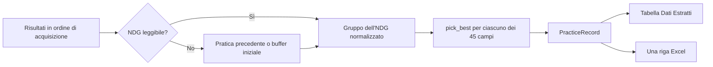

# Modello dei dati

Questo progetto non ha un database. Il suo paesaggio dati è fatto di dict Python in memoria, modelli Pydantic che definiscono la forma dell'output dell'LLM e file piatti su disco: un CSV di ground truth rispetto a cui l'estrazione viene valutata e i report JSON/CSV scritti dopo un'esecuzione. Il centro del modello è il **dict risultato**: l'unica struttura che esce dalla pipeline ed entra in ogni consumatore a valle (valutazione, export CSV, la vista risultati Tkinter e il consolidamento delle pratiche nell'edge-agent).

Tre concetti ancorano tutto. **`FIELD_KEYS`** è l'elenco canonico di esattamente 45 campi scalari e l'unica fonte di verità: il modello Pydantic dei campi viene generato da esso, e la mappatura CSV, le definizioni canoniche e le aree di retry devono restargli allineate. Gli **schemi Pydantic** (`extraction/schemas.py`) definiscono che aspetto ha una risposta LLM valida. Le **definizioni canoniche di campo/pagina** (`extraction/field_definitions.py`, `extraction/page_definitions.py`) mappano ogni campo su un nome visualizzato italiano e una delle cinque pagine di origine; il gruppo di export è una proprietà distinta e conserva quattro bande di colonne. Le chiavi dei campi sono termini italiani del dominio bancario (`professione_principale`, `filiale_relazione`, ...) e sono portanti: devono corrispondere alle etichette della ground truth tramite `CSV_TO_SCHEMA` e non vanno mai tradotte. Le definizioni in linguaggio semplice dei termini di dominio sono nel [Glossario](11-glossary.md).
<!-- Source: extraction/fields.py:12-54 -->

Il diagramma seguente mappa come queste strutture si relazionano:

```mermaid
erDiagram
    RESULT-DICT ||--|| FIELDS-MODEL : "contiene (fields)"
    RESULT-DICT ||--o{ SOGGETTO : "contiene (soggetti)"
    RESULT-DICT ||--o{ FIDO : "contiene (fidi)"
    RESULT-DICT ||--o{ GARANZIA : "contiene (garanzie)"
    RESULT-DICT ||--o{ CANONICAL-FIELD-ENTRY : "contiene (canonical_fields)"
    RESULT-DICT ||--|| META-AGG : "aggrega (_meta_agg)"
    RESULT-DICT ||--o{ FIELD-SOURCE : "registra (_field_sources)"

    FIELDS-MODEL ||--|{ FIELD-RESULT : "uno per voce di FIELD_KEYS (45)"
    CANONICAL-FIELD-ENTRY }o--|| FIELD-RESULT : "derivata da"
    CANONICAL-FIELD-ENTRY }o--|| CANONICAL-PAGE : "legata a (page_key)"

    GROUND-TRUTH-ROW }o--|| FIELD-RESULT : "valutata contro (CSV_TO_SCHEMA)"

    FIELD-RESULT {
        string value "testo estratto, nullable"
        float confidence "limitata a 0–1, default 0.0"
        string evidence_text "nullable"
        string section "nullable"
    }
    SOGGETTO {
        string ndg "identificativo del cointestatario"
        string denominazione "nome del cointestatario"
        string ruolo "ruolo"
        float confidence
    }
    FIDO {
        string n_fido "numero della linea di credito"
        string rapporto
        string scadenza "scadenza"
        string importo_euro "importo EUR"
        string tipo_op "tipo operazione"
        float confidence
    }
    GARANZIA {
        string n_gar "numero garanzia"
        string fido FK "linea di credito collegata"
        string ndg
        string importo_percentuale "importo o percentuale"
        float confidence
    }
    CANONICAL-FIELD-ENTRY {
        string schema_key PK "membro di FIELD_KEYS"
        string display_name "etichetta italiana per il cliente"
        string page_key FK "una delle 5 pagine di origine"
        string value
        float confidence
    }
    CANONICAL-PAGE {
        string page_key PK "risultato_ricerca ecc"
        string display_name
    }
    GROUND-TRUTH-ROW {
        string screen_id PK "nome file senza estensione"
        string csv_label PK "etichetta GT italiana"
        string value "valore atteso"
    }
    META-AGG {
        string model_main
        string model_anchor
        int calls "solo chiamate riuscite"
        int total_tokens
        float estimated_cost_usd "arrotondato a 6 decimali"
        int latency_ms
    }
```



## Il dict risultato

La struttura centrale del progetto: ciò che `ExtractionPipeline.extract_from_image()` restituisce per una schermata. Ogni lettore a valle dipende dalla sua disposizione, che è una convenzione strutturale, non uno schema applicato da qualche validatore.

**Significato di dominio:** tutto ciò che il sistema sa di un singolo screenshot bancario, i campi scalari estratti, le tabelle a lunghezza variabile di cointestatari/linee di credito/garanzie, una vista appiattita rivolta al cliente e i metadati necessari a valutare e costare l'estrazione.

Il risultato ordinario contiene le seguenti voci. Le firme dei metodi sono nel
[riferimento delle API Python](12-python-api.md).

| Chiave | Tipo | Scopo |
|---|---|---|
| `screen_id` | stringa | Nome del file senza estensione; nel client live è `page_type`, oppure `pagina N` se manca. |
| `fields` | dizionario | Chiavi di `FIELD_KEYS`; ogni payload può essere un `FieldResult` serializzato o `None`. |
| `soggetti`, `fidi`, `garanzie` | liste | Righe tabellari a lunghezza variabile. |
| `canonical_fields` | lista | Valori con etichetta italiana e pagina canonica. |
| `_attempts` | lista di dizionari | Metadati delle chiamate VLM riuscite. |
| `_meta_agg` | dizionario | Modelli, chiamate, token, costo stimato e latenza aggregati. |
| `_field_sources` | dizionario | Passaggio che ha fornito ciascun campo: `ANCHOR_HEADER`, `CONTENT_MAIN` o `RETRY_{AREA}`. |
| `_content_crop` | stringa | `calibrated` oppure `full-frame`. |
| `_status` | stringa | `OK` oppure `ANCHOR_UNCERTAIN`; il client aggiunge anche il percorso `ERROR`. |
| `_meta`, `attempt` | dizionario, stringa | Metadati rimasti dalla chiamata principale. |

<!-- Source: extraction/pipeline.py:151; extraction/pipeline.py:180; extraction/pipeline.py:196; extraction/imaging.py:29; extraction/vlm_client.py:223; edge-agent/local_extraction_client.py:168 -->

Il client live aggiunge `_page_type`, `_page_no`, `_page_confidence` e
`_capture_sequence`: quest'ultima è una sequenza intera da zero per job, assegnata
soltanto ai frame accettati. Se la pipeline solleva un'eccezione, restituisce un
risultato ridotto con `screen_id`, `fields: {}`, `_status: "ERROR"` e `_error`,
comunque corredato dei metadati di cattura. Un errore di scrittura diagnostica
aggiunge `_diagnostic_error` senza perdere il risultato.
<!-- Source: edge-agent/local_extraction_client.py:127; edge-agent/local_extraction_client.py:170; edge-agent/local_extraction_client.py:188 -->

Anche l'uscita anticipata è ridotta: con `STOP_ON_ANCHOR_UNCERTAIN` attivo e i due
anchor nulli, `fields` e le tre tabelle sono vuoti, i metadati contano soltanto
l'anchor e `canonical_fields` non viene costruito. Nel percorso completo, lo stato
finale è `OK` quando NDG e denominazione non sono nulli dopo tutti i passaggi; non
è una certificazione di accuratezza o una soglia sulla loro confidenza finale.
<!-- Source: extraction/pipeline.py:151; extraction/pipeline.py:224 -->

**Persistenza.** La CLI scrive i risultati completi in
`INPUT_DIR/poc_outputs_improved.json`; Tkinter scrive `poc_outputs_gui.json` nella
directory corrente. Il client live conserva risultati e completamenti in memoria,
protetti da lock, fino alla chiusura del processo; l'export Excel è esplicito.
<!-- Source: extraction/cli.py::main; gui_app.py:250; edge-agent/local_extraction_client.py:114; edge-agent/ui/data_table_tab.py:255 -->

### Ordine di acquisizione e disponibilità dei risultati

`get_results(job_id)` espone solo il prefisso contiguo completato nell'ordine di
acquisizione: se sono pronti 0 e 2, restituisce solo 0; quando termina 1, rende
visibili 0, 1 e 2. Un errore occupa il proprio posto e consente ai successivi di
avanzare. Il segnale `result_ready` annuncia invece ogni completamento appena
pronto, anche fuori ordine e prima del ritorno di `ingest_frame()` o del segnale
`frame_queued`. La tabella rilegge quindi `get_results()` a ogni notifica.
<!-- Source: edge-agent/local_extraction_client.py:145; edge-agent/local_extraction_client.py:194; edge-agent/local_extraction_client.py:222; edge-agent/ui/data_table_tab.py:128; tests/test_local_extraction_client.py:117; tests/test_local_extraction_client.py:183; tests/test_local_extraction_client.py:220 -->

Questo ordinamento conserva il legame fra una schermata senza NDG e la pratica
che la precede. Può ritardare la visualizzazione di risultati già pronti; lo
shutdown scarta i lavori ancora in coda e può lasciare incompleto il prefisso.
La lista restituita è una copia superficiale: i consumatori non devono modificare
i dizionari annidati. La motivazione è nell'[ADR 0013](adr/0013-risultati-nell-ordine-di-acquisizione.md).
<!-- Source: edge-agent/local_extraction_client.py:214; edge-agent/local_extraction_client.py:222; edge-agent/practice_consolidation.py:87 -->

## FieldResult e FieldsModel

**Significato di dominio:** un singolo scalare estratto (ad esempio il numero NDG o lo `stato` della pratica) con la confidenza del modello e l'evidenza a schermo che ha citato.

**Definizione:**
<!-- Source: extraction/schemas.py:31 -->

```python
class FieldResult(_ConfidenceModel):
    value: Optional[str] = None
    confidence: float = 0.0
    evidence_text: Optional[str] = None
    section: Optional[str] = None
```

La classe base limita `confidence` a 0–1, riconducendo a zero valori non numerici o non finiti. Ogni valore è una stringa o null indipendentemente da ciò che rappresenta: il confronto numerico avviene più tardi, in valutazione, tramite `norm_number_str()`. L'accessor `safe_field()` converte la `confidence` a float anche quando il modello restituisce null.

**`FieldsModel`** non è scritto a mano: è generato con `create_model()`, un `Optional[FieldResult]` per ogni voce di `FIELD_KEYS`. La sincronia schema/elenco-campi è garantita per costruzione: l'insieme delle chiavi valide *è* `FIELD_KEYS`. Aggiungere una chiave rigenera il modello automaticamente, ma la chiave va aggiunta anche a mano a `CSV_TO_SCHEMA` (o non viene mai valutata), a un'area di `AREA_TO_FIELDS` oppure a un'esclusione deliberata in `UNRETRIED_FIELDS`, a `CANONICAL_FIELD_DEFINITIONS` (o ricade su una visualizzazione con la chiave grezza e `page_key=None`) e ai prompt italiani. La suite verifica la coerenza delle definizioni; non sono guardie di avvio: vedi Validazione.

**I 45 campi** si raggruppano così:
<!-- Source: extraction/fields.py:12-54 -->

| Gruppo | Campi |
|---|---|
| Identificativi di intestazione | `ndg`, `denominazione` |
| Metadati della pratica | `tipo`, `stato`, `fase`, `creazione`, `evidenze`, `filiale_relazione` |
| Dati del credito | `n_fido`, `rapporto`, `descrizione`, `scadenza`, `importo_euro`, `tipo_op` |
| Note e tooltip | `note_della_richiesta` + 5 campi `tooltip_*` |
| Soggetti appiattiti | `ndg_1..4`, `denominazione_1..4`, `ruolo_1..4` |
| Scheda Privati | `dal`, `datore_di_lavoro_anagrafica`, `di_cui_percepiscono_reddito`, `importo_totale_annuo_nucleo`, `note_scheda_privati`, `nr_altri_componenti_nucleo`, `numero_mensilita`, `professione_principale`, `rating_ufficiale`, `retribuzione_annua_netta`, `score_cgs`, `tipo_contratto`, `ultima_validazione_scheda` |

La famiglia `ndg_1..4` è una proiezione piatta delle prime quattro righe `Soggetto`, scritta per compatibilità CSV con la ground truth della schermata 2. Il formato piatto dispone di quattro slot, mentre la lista originale può contenere altre righe.

<!-- Source: extraction/schemas.py:11; extraction/schemas.py:31; extraction/schemas.py:68; extraction/normalization.py:93; extraction/pipeline.py:203 -->

## Soggetto, Fido, Garanzia

Le tabelle a lunghezza variabile che l'LLM restituisce come array JSON nel passaggio principale (e facoltativamente nel retry `BODY`).

- **Soggetto**: una riga di cointestatario da Elenco Soggetti: `ndg`, `denominazione`, `ruolo`, più `confidence`/`evidence_text`; tutto opzionale.
- **Fido**: una riga di linea di credito da Gestione Fidi e Garanzie: `n_fido`, `rapporto`, `descrizione`, `scadenza`, `importo_euro`, `tipo_op`, più confidenza/evidenza.
- **Garanzia**: una riga di garanzia: `n_gar`, `descrizione`, `fido` (la linea di credito collegata), `ndg`, `denominazione`, `importo_percentuale`, `tipo_op`, più confidenza/evidenza.

**Persistenza:** liste nel dict risultato; esportate nel CSV con una categoria per tabella e un campo del tipo `soggetti[0].ndg`. Durante il retry, solo l’area `BODY` può aggiornare una tabella. Sulle immagini calibrate vince una tabella con più righe o, a pari lunghezza, confidenza media maggiore. Fuori calibrazione il retry può soltanto riempire una tabella vuota, mai sostituirne una già letta.
<!-- Source: extraction/schemas.py:37; extraction/schemas.py:44; extraction/schemas.py:54; extraction/evaluation.py:228; extraction/pipeline.py:266; tests/test_content_crop.py:172 -->

## ExtractionResponse e AnchorResponse

I due schemi di primo livello consegnati a LangChain perché l'LLM restituisca JSON parseabile e validato.

- **`ExtractionResponse`** (passaggio principale e retry): `fields: FieldsModel` più le tre liste tabellari, l'intera struttura in un'unica chiamata.
- **`AnchorResponse`** (passaggio anchor): un ristretto `AnchorFields` con soli `ndg` e `denominazione`. La restrizione è voluta: costringe il modello a concentrarsi sui due campi identitari da cui dipende tutto il resto.

Esistono gli alias retrocompatibili `RESPONSE_SCHEMA` / `ANCHOR_SCHEMA`.

**Applicazione per provider.** Il codice usa output strutturato LangChain con
`include_raw=True` per OpenAI, `json_mode` con schema per i nomi `gemini-1.5*`,
e JSON libero seguito da validazione Pydantic manuale per gli altri nomi Gemini.
Questa è la scelta implementata dall'adattatore, non una verifica aggiornata
delle capacità o disponibilità dei modelli esterni.
<!-- Source: extraction/schemas.py:76; extraction/schemas.py:82; extraction/schemas.py:92; extraction/vlm_client.py:123 -->

## Voce di campo canonica

Una voce canonica abbina il valore estratto alla sua etichetta italiana e alla
pagina BPER di appartenenza. `build_canonical_field_entries()` produce
`schema_key`, `display_name`, `page_key`, `page_name`, `value`, `confidence`,
`evidence_text` e `section`. Ordina per il gruppo risolto da
`resolve_field_export_group_key()` nell'ordine `PAGE_SHEET_ORDER`, poi per etichetta
e chiave; un gruppo sconosciuto va in coda. `page_key` e `page_name` conservano la
pagina di origine. Il binding viene dalle definizioni
canoniche dei campi, non dalla pagina riconosciuta sul frame.
<!-- Source: extraction/canonical_mapping.py:8; extraction/canonical_mapping.py:20; extraction/fields.py:112 -->

`export_to_csv()` e l'albero Tkinter usano queste voci, con fallback su `fields`.
Il batch non deduplica gli output per pagina. La tabella live e il suo Excel
usano invece direttamente `fields` tramite `consolidate()`.
<!-- Source: extraction/evaluation.py:191; gui_app.py:333; edge-agent/ui/data_table_tab.py:194 -->

## Pagina canonica

**Significato di dominio:** le cinque pagine logiche di origine dei campi BPER. Il gruppo di presentazione nell'Excel è distinto dalla pagina di origine e conserva il layout a quattro bande.

**Definizione**:
<!-- Source: extraction/page_definitions.py:5-28 -->

| `page_key` | Nome visualizzato | Contiene |
|---|---|---|
| `risultato_ricerca` | Risultato ricerca | Identificativi di intestazione, metadati della pratica |
| `elenco_soggetti` | Elenco Soggetti | I 12 campi soggetti appiattiti |
| `gestione_fidi_e_garanzie` | Gestione Fidi e Garanzie | I campi delle linee di credito |
| `note_da_richiesta` | Note da Richiesta | `note_della_richiesta` |
| `scheda_privati` | Scheda Privati | I tredici campi della scheda privati |

Ogni campo è legato staticamente a una pagina in `CANONICAL_FIELD_DEFINITIONS`. I tredici campi Scheda Privati hanno `page_key=scheda_privati` ed `export_group_key=note_da_richiesta`. Per gli altri campi `resolve_field_export_group_key()` usa `page_key` come gruppo predefinito. Lo stesso resolver serve all'ordinamento canonico e alle colonne Excel: restano quattro gruppi in `PAGE_SHEET_ORDER` e 45 colonne, mentre il risultato canonico riporta la pagina corretta ([ADR 0020](adr/0020-pagina-sorgente-separata-dal-gruppo-export.md)). `export_group_key` è metadato della definizione, non una nuova chiave delle voci restituite da `build_canonical_field_entries()`.

Il catalogo di riconoscimento contiene le varianti delle schermate; `_page_type`
conserva il nome riconosciuto, che può essere più specifico della pagina canonica.
Il client non lo converte con `resolve_page_key()`. I campi restano raggruppati
secondo il loro binding statico: `page_key` descrive l'origine del campo e
`_page_type` quale variante è stata acquisita; il gruppo di export decide la banda
di colonne. Questi metadati non selezionano i retry per pagina.
<!-- Source: edge-agent/local_extraction_client.py:183; extraction/page_definitions.py:35; extraction/field_definitions.py:1 -->

## Ground truth (CSV)

**Significato di dominio:** i valori attesi verificati da un umano per ogni schermata, il foglio delle risposte.

**Struttura.** Il formato long ha una riga per coppia schermata/campo ed è caricato
in `{screen_id: {csv_label: value}}`. Il loader rileva il separatore, prova
`utf-8-sig`, `cp1252` e `latin-1`, elimina gli spazi esterni dalle intestazioni e
accetta le varianti seguenti:

| Colonna logica | Intestazioni accettate |
|---|---|
| Schermata | `Screenshot`, `Fotogramma`, `Screen`, `screen` |
| Campo | `Denominazione da attribuire`, `Denominazione`, `Campo`, `Field` |
| Valore | `Valore rilevato`, `Valore`, `Value` |

<!-- Source: extraction/evaluation.py:26; extraction/evaluation.py:34; extraction/evaluation.py:49 -->

L'identificativo deve coincidere con il nome del file senza estensione, per
esempio `screen 1` per `screen 1.png`: il loader rimuove gli spazi esterni, ma non
converte `1` o `screen 1.png` in `screen 1`. In valutazione le schermate senza
risultato corrispondente vengono saltate. Le etichette dei campi passano per
`CSV_TO_SCHEMA`; quelle sconosciute vengono saltate a loro volta. Una coppia
schermata/campo ripetuta nel CSV conserva l'ultima riga letta.
<!-- Source: extraction/imaging.py:29; extraction/evaluation.py:70; extraction/evaluation.py:85; extraction/evaluation.py:97 -->

**Persistenza.** La CLI richiede `INPUT_DIR/dati.csv`; il dataset di riferimento non
è distribuito con il repository. Tkinter può ricevere un CSV facoltativo, mentre
l'edge-agent non ne ha bisogno. Il formato completo dei risultati e le funzioni
di accesso sono nel [riferimento API](12-python-api.md).
<!-- Source: extraction/config.py:8; extraction/cli.py::main; gui_app.py:263; edge-agent/local_extraction_client.py:90 -->

## Una riga per pratica: PracticeRecord

Il risultato di un frame conserva ciò che il modello ha letto da un'immagine.
`PracticeRecord` riunisce invece le informazioni di una pratica attraverso più
frame: NDG normalizzato, denominazione scelta, `fields`, `source_pages` (tupla dei
nomi pagina) e `frame_count`. La dataclass è dichiarata `frozen`, ma il dizionario
annidato dei campi resta mutabile.
<!-- Source: edge-agent/practice_consolidation.py:30 -->



<!-- Source: edge-agent/practice_consolidation.py:67; edge-agent/practice_consolidation.py:87; edge-agent/ui/data_table_tab.py:194; edge-agent/excel_export.py:217 -->

`normalize_ndg()` tratta l'NDG come identificatore: elimina i caratteri non
alfanumerici, uniforma le lettere in maiuscolo e toglie gli zeri iniziali solo se
rimangono cifre. Non usa `norm_number_str()`, che normalizza quantità e può
corrompere identificativi con punti o suffissi. I gruppi sono presentati
nell'ordine della prima apparizione.
La funzione vive in `extraction/normalization.py` ed è condivisa con il confronto
dei campi `ndg`/`ndg_1..4` e con la guardia di mismatch della valutazione
([ADR 0017](adr/0017-identita-ndg-condivisa-tra-valutazione-e-consolidamento.md)).
<!-- Source: extraction/normalization.py:40; edge-agent/practice_consolidation.py:22; tests/test_normalization.py:22; tests/test_practice_consolidation.py:23 -->

Un frame senza NDG si unisce alla pratica precedente. Quelli iniziali attendono
la prima pratica identificata; se nessun frame ha un NDG leggibile, nasce un solo
record anonimo. È un'associazione basata sull'ordine, che non ricostruisce la
pratica dal contenuto delle note. `pick_best()` preferisce un valore non nullo,
poi la confidenza maggiore; in caso di parità conserva il valore precedente.
Gli stessi criteri sono usati nel motore: tabella ed export non introducono una
seconda fusione. Ogni campo canonico è presente nel record anche quando mai letto.
<!-- Source: edge-agent/practice_consolidation.py:60; edge-agent/practice_consolidation.py:87; extraction/normalization.py:120; tests/test_practice_consolidation.py:61; tests/test_practice_consolidation.py:81; tests/test_practice_consolidation.py:122 -->

### Excel: colonne e valori

`export_results()` è condiviso dai pulsanti di Cattura e Dati Estratti. Consolida
la sequenza ricevuta, scrive il workbook e restituisce il numero di pratiche.
L'Excel contiene 45 colonne canoniche: NDG e denominazione per primi, poi i campi
raggruppati per pagina. La prima riga contiene le bande pagina, la seconda le
etichette; i dati iniziano dalla terza. Le intestazioni rinominate dall'operatore
possono sostituire le etichette predefinite. Filtro automatico e blocco riquadri
`C3` mantengono consultabili intestazioni e identificativi.
<!-- Source: edge-agent/excel_export.py:92; edge-agent/excel_export.py:177; edge-agent/excel_export.py:217; tests/test_excel_export.py:22; tests/test_excel_export.py:68; tests/test_excel_export.py:130 -->

I valori delle celle sono testo (`cell.data_type = "s"`): una stringa che inizia
con `=` resta inerte e un importo negativo conserva il segno. Non si applica
l'apostrofo di `escape_csv_formula()` al workbook, perché lì resterebbe visibile.
Il CSV di report usa invece tale protezione, con separatore `;` e `utf-8-sig`.
I metadati diagnostici (confidenza, token, costi e provenienza) restano nel
risultato e nella diagnostica del client, non nelle 45 colonne business.
<!-- Source: edge-agent/excel_export.py:124; extraction/evaluation.py:15; extraction/normalization.py:78; edge-agent/local_extraction_client.py:41; tests/test_excel_export.py:92; tests/test_excel_export.py:104 -->

## Strutture dati dell'edge-agent

Tre strutture più piccole sostengono la cattura dal vivo (vedi [Architettura](04-architecture.md)):

- **`RouterResult`** contiene `page_type`, `confidence`, `fields`, `reason` ed
  `expected`. Il router LLM valida i nomi contro il catalogo, normalizzando il caso
  o annullando i valori sconosciuti; il percorso ML restituisce la classe del
  classificatore. Sono metadati di routing, distinti dai campi dell'estrazione.
- **`AgentConfig`** rappresenta la configurazione INI di cattura e router. Il
  resolver considera vuoti i valori `REDACTED*` e cerca le credenziali nell'ambiente
  se l'INI è vuoto. `save()` può persistere la credenziale nell'INI: non va usato
  per salvare una chiave reale in un file distribuito.
- **Prototipi DINOv2**: embedding a 384 dimensioni normalizzati, conservati nella
  cache `bper_page_prototypes.json`. Il router ML usa coseno centrato e soglia 0.35.
  La chiave di cache combina hash del dataset e `embedding_geometry()` (modello,
  ROI, resize, regola di punteggio e classi di scarto); se cambia, i prototipi si
  ricostruiscono. Vedi [ADR 0002](adr/0002-riconoscimento-pagina-roi-e-coseno-centrato.md)
  e [ADR 0003](adr/0003-chiave-cache-prototipi-con-geometria.md).

<!-- Source: edge-agent/llm_router.py:28; edge-agent/llm_router.py:43; edge-agent/llm_router.py:250; edge-agent/config.py:239; edge-agent/config.py:292; edge-agent/config.py:339; edge-agent/page_classifier.py:51; edge-agent/page_classifier.py:140; edge-agent/page_classifier.py:415; edge-agent/page_classifier.py:629 -->

## Pattern di flusso dei dati

**Creazione.** `call_vlm()` restituisce la risposta Pydantic serializzata e un
blocco `_meta` con modello, identificativo schermata, passaggio, latenza, token
in ingresso/uscita e costo stimato. I valori letti sono poi rivisti dalle regole
della pipeline; la tabella live non permette di modificare le celle business.
<!-- Source: extraction/vlm_client.py:123; extraction/pipeline.py:180; edge-agent/ui/data_table_tab.py:114 -->

**Lettura.** La valutazione usa `fields`, i report di costo `_meta_agg`, Tkinter
anche `canonical_fields` e le liste tabellari. La tabella live rilegge il prefisso
ordinato dal client e costruisce i record consolidati. L'assenza di alcune chiavi
nei percorsi ridotti richiede accessi difensivi.
<!-- Source: extraction/evaluation.py:106; extraction/evaluation.py:248; gui_app.py:333; edge-agent/ui/data_table_tab.py:194 -->

**Aggiornamento.** Nel singolo frame, il risultato principale assegna la sorgente
`CONTENT_MAIN`; gli anchor ammessi dal gate sovrascrivono i due identificativi.
Seguono normalizzazione di `tipo`, retry con `pick_best()`, controllo di coerenza,
metadati, appiattimento dei primi quattro soggetti e costruzione dei campi canonici.
Le regole di coerenza possono ricavare `evidenze="B"` o `tipo="BMB"` dai tooltip.
Il flatten confronta ciascun valore dei soggetti con lo scalare numerato già
presente mediante `pick_best()`: il non nullo prevale sul nullo, poi conta la
confidenza; a parità resta il corrente. Se vince la tabella, `_field_sources`
riporta `CONTENT_MAIN` o `RETRY_BODY` secondo l'origine della tabella accettata.
Un retry rifiutato non cambia tale origine. Il candidato tabellare conserva la
sezione `soggetti_table` e non aggiunge `evidence_text`
([ADR 0018](adr/0018-appiattimento-soggetti-con-merge-e-provenienza.md)). Restano
limiti di provenienza: il main assegna `CONTENT_MAIN` anche ai campi assenti e
il controllo di coerenza non registra le proprie correzioni.
<!-- Source: extraction/pipeline.py:180; extraction/pipeline.py:203; extraction/pipeline.py:378 -->

Se un retry BODY propone righe per una tabella `soggetti` ancora vuota, ogni riga
deve avere confidenza almeno `RETRY_CONF_MIN` e NDG o denominazione non nulli.
La selezione precede il merge e il flatten, sia in calibrazione sia fuori.
Le tabelle già popolate e `fidi`/`garanzie` conservano i criteri precedenti
([ADR 0019](adr/0019-filtro-soggetti-da-retry-su-tabella-vuota.md)).

**Durata dei dati.** Il client non espone un'operazione di cancellazione dei risultati.
Una nuova acquisizione aggiunge un risultato di frame; la tabella ed Excel lo
fondono nella pratica corrispondente. Il batch conserva gli output delle schermate
senza deduplicarli per pagina canonica.
<!-- Source: edge-agent/local_extraction_client.py:114; edge-agent/local_extraction_client.py:194; edge-agent/practice_consolidation.py:87; extraction/cli.py::_debug_log -->

## Validazione

I modelli Pydantic validano la risposta LLM, mentre il dizionario arricchito della
pipeline segue un contratto fra consumatori. Non esistono vincoli di database.

**Confine LLM.** JSON mancante, parsing non valido o validazione Pydantic fallita
producono `ValueError`. `call_vlm_with_retry()` rilancia subito `ValueError`,
`KeyError` e `IndexError`; le altre eccezioni entrano nel backoff fino a tre
tentativi per passaggio. Il budget dei passaggi non è un tetto alle richieste di rete.
<!-- Source: extraction/vlm_client.py:34; extraction/vlm_client.py:230 -->

**Confidenza.** `_ConfidenceModel` limita a 0–1 la confidenza delle risposte Pydantic;
valori non numerici o non finiti diventano zero. Il gate anchor è efficace:
`extract_anchors()` annulla direttamente i valori delle copie restituite sotto
`ANCHOR_CONF_MIN` (default 0.95), escludendoli sia dal suggerimento principale sia
dal merge. La lettura principale e i retry possono comunque fornire gli
identificativi finali. Il retry viene selezionato sui campi nulli o sotto
`RETRY_CONF_MIN` (default 0.60).
<!-- Source: extraction/schemas.py:11; extraction/pipeline.py:105; extraction/pipeline.py:243; extraction/pipeline.py:295; extraction/config.py:57 -->

**Coerenza delle definizioni.** `FieldsModel` deriva da `FIELD_KEYS`; la suite
verifica la copertura di `CSV_TO_SCHEMA` e delle definizioni canoniche, e che
ogni campo appartenga esattamente a un'area di retry o a `UNRETRIED_FIELDS`.
`creazione` appartiene a HEADER; `UNRETRIED_FIELDS` contiene solo i cinque
`tooltip_*`, letti dal main perché privi di un ritaglio fisso affidabile. Questi
controlli sono test, non guardie di avvio. Se manca una definizione canonica, il mapping usa la chiave
grezza e `page_key=None`; le colonne Excel sono invece costruite dalle definizioni
canoniche, quindi estendere solo `FIELD_KEYS` non basta a ottenere una colonna.
<!-- Source: extraction/schemas.py:68; extraction/config.py:105; extraction/config.py:122; tests/test_domain_vocabulary.py:11; extraction/fields.py:118; edge-agent/excel_export.py:92 -->

**Normalizzazione in valutazione.** `normalize_ndg()` confronta `ndg` e
`ndg_1..4` con la stessa identità usata dal consolidamento e dalla guardia di
mismatch: `12.345` equivale a `12345`, mentre i suffissi alfanumerici restano
significativi. Il confronto degli NDG non passa dal fuzzy matching.
`norm_number_str()` gestisce euro, spazi e separatori per le chiavi contenenti
`importo_euro` o `n_fido`. `norm_text()` uniforma maiuscole e spazi; oltre 20 caratteri il
confronto del testo atteso può accettare una somiglianza `SequenceMatcher` ≥ 0.85.
Sono nulli anche `""`, `n/d`, `nd`, `---`, `null`, `none` e `nan`. La pipeline
normalizza già `mutui spesa`, `mutuo spesa` e `bpi mutui` in `BPI Mutui`.
<!-- Source: extraction/normalization.py:10; extraction/normalization.py:28; extraction/normalization.py:40; extraction/normalization.py:56; extraction/normalization.py:150; extraction/normalization.py:218 -->

**Contabilità dei costi.** `_meta_agg` somma i metadati in `_attempts` e arrotonda
il costo a sei decimali. Conta le chiamate riuscite registrate dalla pipeline,
non tutti i tentativi di trasporto potenzialmente fatturati. La latenza è una
somma: con retry paralleli non rappresenta il tempo totale percepito.
`estimate_cost_usd()` restituisce zero per un modello assente da `PRICING_PER_1M`;
un report a zero non significa che il servizio sia gratuito.
<!-- Source: extraction/pipeline.py:351; extraction/pipeline.py:396; extraction/vlm_client.py:26; extraction/vlm_client.py:230 -->

Per come queste strutture vengono prodotte e consumate end-to-end, vedi [Workflow](05-workflows.md); per la disposizione dei componenti, vedi [Architettura](04-architecture.md).
