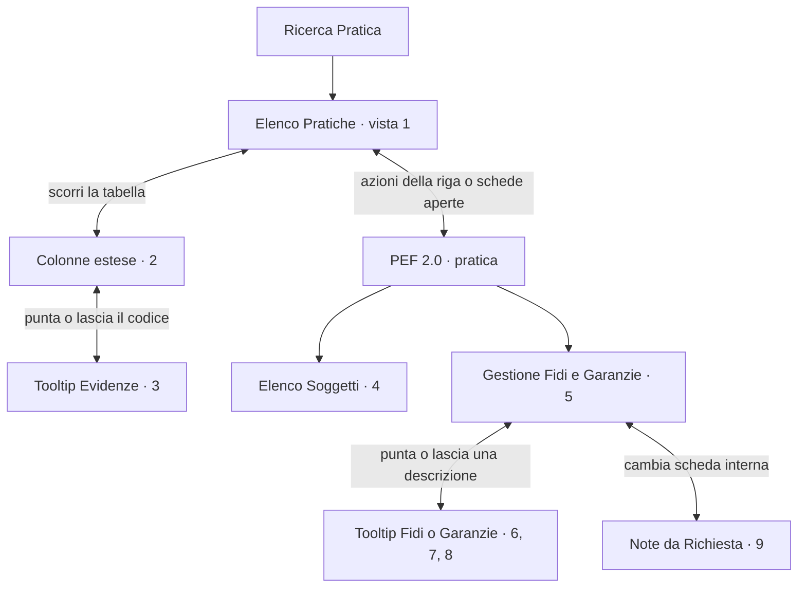

# Leggere una pratica BPER con l’edge-agent

Si parte dalla riga della pratica in **Elenco Pratiche** e si termina confrontando i valori in **Dati estratti** con quelli a video. I numeri da 1 a 9 identificano le viste della pratica PEF di riferimento. Puoi entrare a metà percorso, tornare su una riga, saltare un tooltip assente e riprendere da un’altra scheda.

## Dove ti trovi

Le **schede in alto** cambiano fra ricerca, elenco e pratiche aperte. Nel **Navigatore** della pratica trovi *Verifica Preliminare → Elenco Soggetti* nel riferimento e *Istruttoria → Gestione Fidi e Garanzie* per la parte finanziaria. Anche Istruttoria può offrire Elenco Soggetti. Guarda la voce selezionata e il titolo dell’area di lavoro. Le spunte, il pallino e le matite del Navigatore indicano l’avanzamento della lavorazione bancaria. Le **schede sopra le tabelle** cambiano il contenuto dentro il passo. Lo scorrimento e il puntatore cambiano infine ciò che è leggibile nella stessa pagina.

### Albero della pratica

Nel dettaglio PEF, il menu orizzontale mostra **Cruscotto Pratiche**, **Dettaglio Pratica**, **Politiche Creditizie** e **Altre Funzionalità**. Per le viste 4–9 rimani in **Dettaglio Pratica**. La tabella riporta i rami ricostruiti nel [Navigatore del simulatore](../bper-emulator/site/detail.js). Le voci disponibili dipendono dalla fase raggiunta e dalla modalità di consultazione.

| Ramo del Navigatore | Voci che puoi incontrare | Quando serve al data entry |
|---|---|---|
| **Verifica Preliminare** | Elenco Soggetti, Recupero Segnalazioni | Apri **Elenco Soggetti** per la vista 4. |
| **Richiesta**, dove presente | Elenco Soggetti, Richiesta Cliente, Elenco Documenti, Stampe, Controlli di Fine Fase | Per leggere i soggetti verifica la testata e la presenza della tabella con NDG, denominazione e ruolo. |
| **Istruttoria** | Note alla Restituzione nelle pratiche restituite, Elenco Soggetti, Note Delibere Precedenti, Gestione Fidi e Garanzie, Analisi Soggetti, Situazione Banche, Controlli di Fine Fase, Iter e Chiusura | In **Gestione Fidi e Garanzie**, la scheda interna omonima dà accesso alle viste 5–8. La scheda interna **Note da Richiesta** apre la vista 9. Nella stessa barra puoi vedere **Note a Istruttoria** e **Dettaglio BPI**. |
| **Proposta**, **Parere**, **Delibera** | In Proposta compaiono Dati Riepilogo, Controlli di Fine Fase e Iter e Proposta. In Delibera compaiono Controlli di Fine Fase e Delibera Pratica. Per Parere manca un sottoalbero documentato. | La fase aiuta a orientarsi quando riapri una pratica avanzata. Per recuperare i campi torna al passo che contiene la rispettiva tabella. |
| **Funzioni** e **Collegamenti Rapidi** | Gestione Documentale, Stampe, eventuale Modulistica e collegamenti ad altre applicazioni | Se compare la checklist di Gestione Documentale, riapri **Istruttoria → Gestione Fidi e Garanzie → Note da Richiesta** per leggere la nota della vista 9. |

**Scheda Privati** si consulta in un applicativo separato. Le cinque immagini di una seconda pratica documentano la scheda già aperta. Il comando reale che la apre dalla PEF resta da verificare con l'operatore. Il pulsante **Apri Scheda Privati** è nella console del simulatore.

## Dalla ricerca alle note

Nell’edge-agent seleziona **Cattura → Modalità BPER → Avvia**. Nel gestionale entra in **Ricerca Pratica**, inserisci l’NDG richiedente o il numero pratica e scegli **Ricerca**. Nell’elenco verifica numero pratica, NDG e denominazione sulla *stessa riga*. Il numero pratica e l’NDG identificano rispettivamente il fascicolo e il cliente. Mantieni stabile ogni vista finché il testo è leggibile e la cattura viene accodata. Poi puoi cambiare pagina mentre l’estrazione prosegue.

| Vista | Cosa fare nel gestionale | Cosa leggere e come proseguire |
|---|---|---|
| **1 · Risultato ricerca** | Porta in vista le colonne identificative della riga. | NDG, denominazione, codice Tipo, Stato e Fase, se visibili. Se **Tipo** mostra **BMB**, soffermati sul codice per la descrizione estesa. È un gesto aggiuntivo in elenco, senza un numero di vista dedicato. Sposta il puntatore e scorri la tabella. |
| **2 · Colonne estese** | Scorri a destra con la barra **della tabella dei risultati in alto**. La coda BStore sottostante ha una barra propria. ABI, NDG e denominazione possono restare fissi mentre appaiono colonne come **Data Ass./Del.** e **Assegnata**. | Leggi Creazione e i codici Evidenze visibili sulla stessa riga. La data di assegnazione ha un altro significato. Puoi riportare la barra a sinistra in qualunque momento. |
| **3 · Tooltip Evidenze** | Se compare **B** in Evidenze, tieni il puntatore sul codice finché vedi il testo del popup. | Mantieni distinti il codice della cella e la sua spiegazione. Esci dalla cella per richiudere. In assenza del codice o del popup, prosegui al dettaglio. |
| **4 · Elenco Soggetti** | Dal menu **⋮** della riga apri **Visualizza Pratica** per la consultazione, quando disponibile. Nel dettaglio individua **Elenco Soggetti**. | Controlla NDG e denominazione **di testata**, Tipo Pratica per esteso e Filiale relazione. Leggi NDG, denominazione e ruolo di ciascuna delle prime quattro righe, nell’ordine a video. Poi apri **Istruttoria → Gestione Fidi e Garanzie**. |
| **5 · Gestione Fidi e Garanzie** | Apri la scheda interna omonima e sposta il puntatore fuori dalle descrizioni. Inquadra intestazioni e prima riga del riquadro **Fidi**. | Leggi dalla **stessa riga** n° Fido, Rapporto, Descrizione, Scadenza, Importo in euro e Tipo Op. Se la tabella è scorsa, riporta in alto la prima riga del fido da rilevare. Individua le righe del riquadro **Garanzie** sottostante. |
| **6 · Tooltip Fidi** | Sosta sulla Descrizione del primo fido. Nel riferimento è **M. CONSAP ≥ 80%**. | Leggi il testo esteso e verifica a quale descrizione appartiene. Esci dalla cella per ritrovare la vista 5. |
| **7 · Tooltip Garanzie, CONSAP** | Punta **CONSAP DR BIS** nella tabella **Garanzie**. È la prima riga nel riferimento. | Il popup contiene **DR SOSTEGNI BIS**. Identifica la garanzia da questo testo anche se occupa un’altra riga. Sposta il puntatore fuori dalla cella per richiudere. |
| **8 · Tooltip Garanzie, ipoteca** | Punta **IPOTECA I GR.** nella tabella **Garanzie**. È la seconda riga nel riferimento. | Il popup mostra **IPOTECA DI PRIMO GRADO**. Segui la descrizione anche quando cambia la posizione. Prosegui con le note se la garanzia o il tooltip manca. |
| **9 · Note da Richiesta** | Nel medesimo passo seleziona **Note da Richiesta** e cerca il riquadro **Nota della richiesta**. Se è chiuso, espandilo per leggere il testo. | Scorri se la nota continua oltre il bordo. La sola linguetta inattiva compare anche sulle viste Fidi. **Note a Istruttoria** e la checklist documentale sono altre destinazioni. Per tornare al fido seleziona la scheda interna **Gestione Fidi e Garanzie**. |

Nella vista 4 del riferimento le tre righe portano i ruoli *Richiedente*, *Nuovo Garante/nuovo Datore Di Pegno* e *Cointestazione*. Altre pratiche possono presentare un solo soggetto, un garante istituzionale o una quarta riga. Mantieni per ogni riga i suoi tre valori e il ruolo come appare. L’NDG del Fondo di garanzia appartiene alla sua riga. L’identità da controllare prima di cambiare pratica resta quella della testata.

Prima di lasciare l'elenco, se hai aperto il tooltip **BMB**, verifica che la sua descrizione estesa sia arrivata nella riga della pratica. Quel tooltip e i campi della Scheda Privati richiedono un controllo esplicito anche quando la guida indica che tutte le nove viste PEF disponibili sono state acquisite.

In lavorazione il pulsante **Avvia Step Succ.** può portare da Soggetti a Fidi passando per **Note Delibere Precedenti**. In visualizzazione il simulatore mostra il pulsante disabilitato. Per la consultazione scegli nel Navigatore il passo disponibile. Per tornare a Soggetti riapri la voce omonima. Per tornare alla lista scegli la scheda **Elenco Pratiche** in alto.

## Scheda Privati e verifica dei 45 campi

Con la Scheda Privati aperta, confronta l’NDG della sua testata con il soggetto a cui appartiene. In una cointestazione può essere l’NDG del singolo titolare. Leggi prima la parte alta, poi scorri la **pagina** fino a Situazione familiare e alle Note conclusive. Se le note continuano, scorri anche **dentro il riquadro Note**. Verifica il testo completo nella riga finale. Le catture di parti successive di una nota possono produrre valori parziali.

| Sorgente del catalogo | Campi da controllare nell’output |
|---|---|
| **Risultato ricerca · 9** | NDG, denominazione, Tipo, Stato, Fase, Creazione, Evidenze, tooltip Evidenze B e Filiale relazione. La filiale di relazione si legge anche nella **testata del dettaglio**. |
| **Elenco Soggetti · 12** | Per ciascuna delle righe 1, 2, 3 e 4, **NDG, denominazione e ruolo**. Lascia vuote le terne per le righe assenti. |
| **Gestione Fidi e Garanzie · 10** | I sei campi del primo fido e i quattro tooltip di descrizione **BMB**, **M. CONSAP**, **CONSAP DR BIS**, **IPOTECA**. Il catalogo assegna BMB a questo gruppo, benché il testo si legga puntando il **Tipo nell’elenco**. Le colonne della tabella Garanzie servono a identificare la voce corretta. |
| **Note da Richiesta · 1** | Note della richiesta, dal riquadro omonimo della PEF. |
| **Scheda Privati · 13** | **Testata** — ultima validazione scheda. **Redditi da lavoro/pensione** — professione principale, Dal della professione, numero mensilità, retribuzione annua netta, tipo contratto. **Datore di lavoro** — anagrafica, rating ufficiale, Score CGS (CRIBIS Class). **Situazione familiare** — numero altri componenti del nucleo, di cui percepiscono reddito, importo totale annuo degli altri componenti. **Note conclusive** — Note Scheda Privati. |

Le nove viste PEF del riconoscitore coprono quattro pagine sorgenti. Scheda Privati è la quinta sorgente dei campi e rimane fuori da queste nove viste. I suoi 13 campi sono presenti sotto **Note da Richiesta** nei quattro gruppi di colonne di **Dati estratti** ed Excel. Se occorre completarli, controlla il titolare e riporta i valori leggibili nella riga corretta. I campi opzionali possono rimanere vuoti.

## Quale pagina aprire adesso

In **Cattura → Guida alla pratica** controlla l’NDG, il nome della vista e il suo stato. **Prossima vista** suggerisce un gesto a partire dalla posizione riconosciuta. Apri l’elenco delle viste per vedere insieme quelle **Da acquisire**, quelle da mostrare **Se presente**, quelle dichiarate **Non applicabile** e quelle già **Acquisite**. Controlla il numero pratica della testata prima di indicare che un tooltip manca.

| Situazione | Azione successiva |
|---|---|
| Sei entrato direttamente in **Note da Richiesta**. | Raccogli il testo già visibile. Se mancano i dati finanziari, apri la scheda interna Fidi. Se manca Creazione, torna alla scheda in alto **Elenco Pratiche** e scorri la stessa riga. |
| L’agent ha segnato **Note** come acquisita mentre leggevi **Fidi**. | Nella guida seleziona **Acquisita · Note da Richiesta** e premi **Da riacquisire**. Note torna fra le pagine mancanti di quell’NDG. Apri la vera scheda Note per acquisirla. Controlla in **Dati estratti** le celle già compilate e correggi quelle errate. |
| Fidi risulta acquisita, ma manca il testo dell’ipoteca. | Torna a **Istruttoria → Gestione Fidi e Garanzie**. Cerca la descrizione IPOTECA nella tabella Garanzie e apri il suo tooltip. Chiudilo per una nuova lettura della tabella di base. |
| La pratica ha una sola garanzia. | Verifica quale descrizione è presente. Con la sola ipoteca apri il suo popup anche se è **in prima riga**. Con la cattura attiva e l’NDG identificato, seleziona il tooltip CONSAP sotto **Se presente**, scegli **Non applicabile** e prosegui. **Ripristina** lo rimette tra le viste da valutare per quella pratica. |
| La schermata è in caricamento, appartiene a un altro applicativo oppure è stata identificata male. | Seleziona il nome corretto in **Cattura** e usa **Acquisisci ora**. Se l’agent è sul monitor da acquisire, si riduce a icona. Hai tre secondi per mostrare la pagina PEF o aprire il tooltip. Lasciala visibile durante lo scatto. Se usi un secondo monitor per l’agent, lo scatto viene richiesto subito. |
| Torni alla ricerca e selezioni un altro risultato. | Scorri l’elenco, scegli la riga e apri il dettaglio PEF. Mostra la testata con il numero pratica. La guida avvia la checklist del fascicolo aperto. Se le Note sono già in coda e la testata è illeggibile, rendila nuovamente visibile prima di aprire un terzo risultato. Per verificare due righe con lo stesso NDG, porta il puntatore sulla rispettiva cella NDG. |

Prima di **Esporta Excel**, verifica che le elaborazioni attese siano terminate. Una vista elaborata indica che l’edge-agent ha ricevuto un esito per quella lettura. Per stabilire che i valori sono corretti, confrontali con le celle, le righe e i tooltip del gestionale. In **Dati estratti** puoi correggere le celle di una pratica con NDG identificato e usare **Ripristina originale** dal menu della cella. L’NDG è protetto dalle modifiche. Le correzioni confermate si recuperano anche dopo la chiusura e confluiscono nell’Excel. Il testo di una cella ancora in modifica riappare come bozza. [Ripresa dopo un arresto](recupero-sessioni.md)

## Riscontri e limiti del percorso

Le corrispondenze fra viste e file e i valori leggibili sono verificabili nella [mappa dei nove fotogrammi](../tools/reference/fotogrammi.json), nel [repertorio delle schermate](../data/dataset/schermate.csv) e nelle [trascrizioni per campo](../data/dataset/valori.csv). Per la Scheda Privati sono disponibili le cinque viste `scheda-privati-01…05` della pratica 52062600. I conteggi per sorgente e i gruppi di esportazione derivano dalle [definizioni dei campi](../src/extraction/field_definitions.py).

Le immagini reali attestano il contenuto delle viste. I gesti di ricerca, il menu di riga, gli scorrimenti, i ritorni e i cambi di scheda descritti qui sono quelli riprodotti dal [simulatore](../bper-emulator/site/app.js). La sua console permette anche di saltare direttamente a una vista. Le immagini di passaggio verso Scheda Immobile, Gestione GEP o FICS documentano altro lavoro dell’operatore e restano fuori dai nove stati PEF. Per la distinzione fra pagina corrente, suggerimento, esito della lettura e pagine mancanti, consulta la [guida tecnica alla navigazione dell’edge-agent](navigazione-edge.md).
